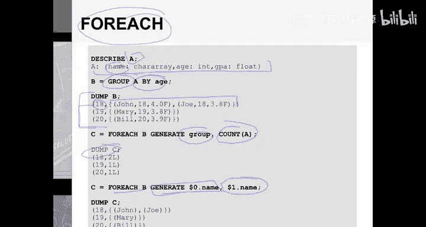
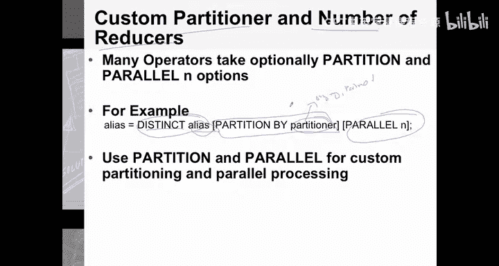

# 课程名称：Hadoop大数据处理 | Big Data Processing Using Hadoop - P80：核心关系运算符 🧮


在本节课中，我们将要学习Pig Latin中的核心关系运算符。这些运算符是处理和提取数据的基础工具，能够帮助你从大数据集中筛选、组织和生成所需的结果。


---

## Distinct（去重） 🔄

上一节我们介绍了Pig Latin的基本概念，本节中我们来看看`DISTINCT`运算符。`DISTINCT`用于从关系中移除重复的元组。

其语法非常简单：`DISTINCT` 后跟一个关系名或别名。执行结果是获得原始记录集合中的唯一记录集，并赋值给一个新的关系名。

结果**不保留**原始内容的顺序，因为它可能经过MapReduce层处理，顺序可能发生变化。`DISTINCT`不能用于字段子集，必须作用于整个记录，即基于整个记录进行去重。

以下是`DISTINCT`的一个示例：

```pig
A = LOAD 'data' AS (a1:int, a2:int, a3:int);
DUMP A;
-- 输出: (1,2,3), (4,3,3), (1,2,3), (7,2,5), (8,4,3)

X = DISTINCT A;
DUMP X;
-- 输出: (1,2,3), (4,3,3), (7,2,5), (8,4,3)
```

原始数据中`(1,2,3)`和`(4,3,3)`各出现两次，`DISTINCT`操作后，我们得到了4条唯一的记录。

---

## Filter（过滤） 🎯

`FILTER`运算符允许你根据某些条件从关系中选择元组。

其语法为：`FILTER alias BY expression`。这意味着你将筛选出真正关心的记录。

它通常用于选择你想要的数据。以下是`FILTER`的一个示例：

```pig
A = LOAD 'data' AS (a1:int, a2:int, a3:int);
DUMP A;
-- 输出: (1,2,3), (4,3,3), (1,2,3), (7,2,5), (8,4,3)

X = FILTER A BY a3 == 3;
DUMP X;
-- 输出: (1,2,3), (4,3,3), (1,2,3), (8,4,3)
```

此操作筛选出`a3`字段等于3的所有记录。

你还可以使用更复杂的表达式进行过滤：

```pig
X = FILTER A BY (a1 == 8) OR (NOT (a2 + a3 > a1));
```

这个表达式会筛选出`a1`等于8，或者`a2`与`a3`之和不大于`a1`的记录。

---

## Split（拆分） ✂️

`SPLIT`是另一个核心关系运算符，它将一个关系分割成两个或更多个关系。

其语法允许你根据多个表达式将数据分配到不同的关系中。需要注意的是，根据条件，一个元组可能被分配到多个关系中。

以下是`SPLIT`的一个示例：

```pig
A = LOAD 'data' AS (f1:int, f2:int, f3:int);
DUMP A;
-- 输出: (1,2,3), (4,5,6), (7,8,9)

SPLIT A INTO X IF f1 < 7, Y IF f2 == 5, Z IF (f3 < 6) OR (f3 > 6);
DUMP X; -- 输出: (1,2,3), (4,5,6)
DUMP Y; -- 输出: (4,5,6)
DUMP Z; -- 输出: (1,2,3), (7,8,9)
```

记录`(4,5,6)`同时满足了进入`X`和`Y`关系的条件。

---

## Order By（排序） 📊

`ORDER BY`运算符基于一个或多个字段对关系进行排序。

其语法为：`ORDER alias BY field [ASC|DESC]`。如果多个记录具有相同的排序键，返回的记录顺序是未定义的，并且不能保证在不同运行中保持一致，因为底层使用了MapReduce。

以下是`ORDER BY`的一个示例：

```pig
A = LOAD 'data' AS (a1:int, a2:int, a3:int);
DUMP A;
-- 输出: (1,2,3), (4,3,3), (7,2,5), (8,4,3)

X = ORDER A BY a3 DESC;
DUMP X;
-- 输出: (7,2,5), (1,2,3), (4,3,3), (8,4,3) -- 按a3降序排列
```

---

## Limit（限制） ⛔

`LIMIT`运算符限制输出元组的数量。

其语法为：`LIMIT alias n`。它不保证返回哪`n`个元组，并且返回的元组在不同运行间可能变化。如果`n`大于或等于关系中的元组数，则返回所有元组。`LIMIT`在开发和调试Pig脚本时非常高效，应尽可能使用。

以下是`LIMIT`的一个示例：

```pig
A = LOAD 'data' AS (a1:int, a2:int, a3:int);
X = LIMIT A 3;
DUMP X;
-- 可能输出前3条记录，例如: (1,2,3), (4,3,3), (1,2,3)
```

---

## Group（分组） 👥

`GROUP`运算符将一个或多个关系中的数据分组。

其语法为：`GROUP alias BY expression`。`GROUP`操作将具有相同组键的元组集合在一起。每次`GROUP`操作的结果为每个元组生成两个字段：第一个字段名为`group`，第二个字段采用原始关系的名称，类型为`bag`（包）。

以下是`GROUP`的一个示例：

```pig
A = LOAD 'student_data' AS (name:chararray, age:int, gpa:float);
DUMP A;
-- 输出: (John, 18, 4.0), (Joe, 18, 3.8), (Jane, 19, 3.9), (Bill, 20, 3.7)

X = GROUP A BY age;
DUMP X;
-- 输出:
-- (18, {(John,18,4.0), (Joe,18,3.8)})
-- (19, {(Jane,19,3.9)})
-- (20, {(Bill,20,3.7)})
```

所有年龄为18的学生被分组在一起。

---

## For Each（遍历） 🔁

`FOREACH`运算符基于数据列生成数据转换。

其语法为：`FOREACH alias GENERATE expression`。它通常用于处理`GROUP`操作后产生的包（bag），遍历其中的每个元素。

以下是结合`GROUP`和`FOREACH`的示例：

```pig
A = LOAD 'student_data' AS (name:chararray, age:int, gpa:float);
B = GROUP A BY age;

-- 计算每个年龄组的学生数量
C = FOREACH B GENERATE group, COUNT(A);
DUMP C;
-- 输出: (18,2), (19,1), (20,1)

-- 从包中提取特定字段
D = FOREACH B GENERATE group, A.name;
DUMP D;
-- 输出: (18, {John, Joe}), (19, {Jane}), (20, {Bill})
```

---

## 并行与分区 ⚙️

许多运算符支持自定义分区器和设置Reducer数量，以实现并行处理和分区。



例如，你可以在`DISTINCT`操作中指定分区方式：

```pig
X = DISTINCT A
    PARTITION BY org.my.partitioner
    PARALLEL 10;
```

这允许你使用自定义的分区类（如`org.my.partitioner`）并设置并行度为10，从而在Pig作业中获得更好的分区和并行处理能力。

---



本节课中我们一起学习了Pig Latin的核心关系运算符，包括`DISTINCT`、`FILTER`、`SPLIT`、`ORDER BY`、`LIMIT`、`GROUP`和`FOREACH`。这些运算符是构建复杂数据处理流水线的基础，使你能够在大数据环境中高效地操作和转换数据。