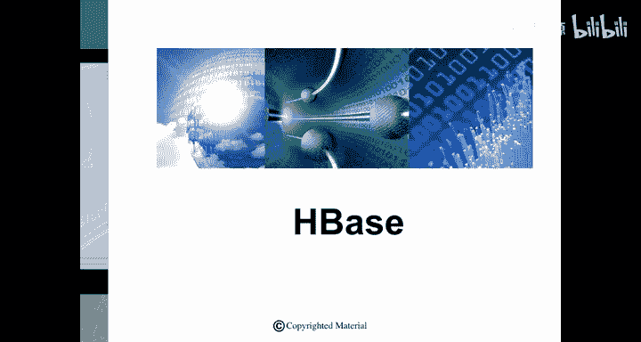
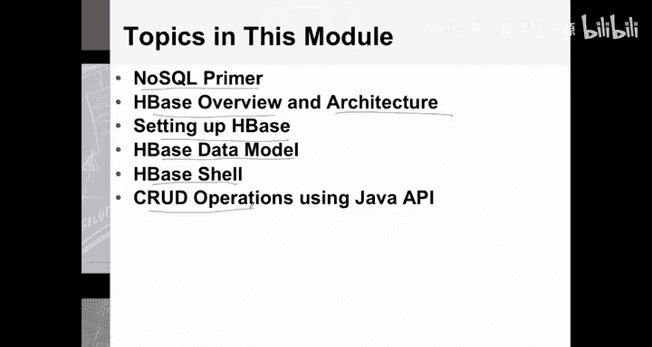
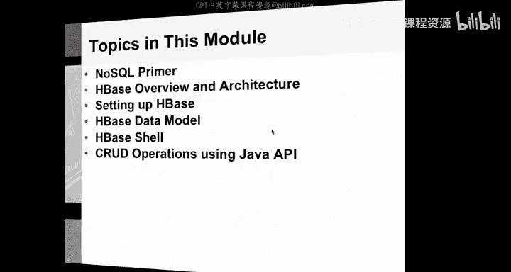
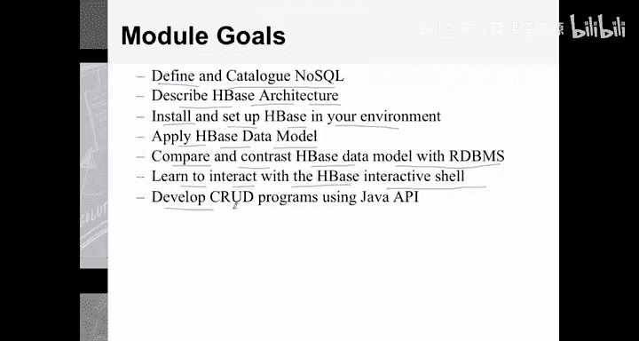

# 课程18：HBase导论 🗄️

在本节课中，我们将学习Hadoop生态系统中的另一个重要子项目——HBase。HBase是一个NoSQL数据库，也被称为Hadoop数据库。它是一个构建在Hadoop之上的分布式、版本化、开源数据库，能够为你的大数据提供实时的读写访问能力。

## 模块概览 📋

上一节我们介绍了本课程的主题。本节中，我们来看看本模块将涵盖的具体内容。

以下是本模块将要探讨的主题列表：
*   首先，我们将概览NoSQL数据库的版图，你可以将其视为NoSQL入门或鸟瞰图。
*   由于这是一门关于使用Hadoop处理大数据的课程，我们将重点学习Hadoop的NoSQL数据库，即HBase，并概述其架构。
*   接着，我们将在开发环境中学习如何设置HBase。
*   然后，我们将研究HBase的数据模型，它与标准的关系型数据模型有所不同。
*   之后，我们将学习HBase Shell，这是一个交互式命令行工具，允许你执行CRUD操作。
*   最后，我们将了解用于对HBase数据库表执行CRUD操作的Java API。

## 学习目标 🎯

在了解了课程内容后，本节我们明确一下本模块的学习目标。完成本模块后，你应该能够：

以下是需要达成的具体目标列表：
*   定义NoSQL并对其进行分类。
*   描述HBase的架构及其与Hadoop的关系。
*   在开发环境中安装和设置HBase。
*   为应用程序应用HBase数据模型。
*   对比HBase数据模型与RDBMS系统的异同。
*   学习与HBase交互式Shell进行交互，以便直接在Shell中执行CRUD操作，这类似于MySQL或Oracle的命令行工具。
*   最终，能够使用Java API开发CRUD程序。

---

本节课中，我们一起学习了HBase的基本概念、课程内容大纲以及明确的学习目标。我们了解到HBase是Hadoop生态中用于实时访问大数据的NoSQL数据库。在接下来的章节中，我们将逐步深入这些主题，从NoSQL概览开始，逐步掌握HBase的核心知识。