# 课程19：NoSQL基础理论 🗄️

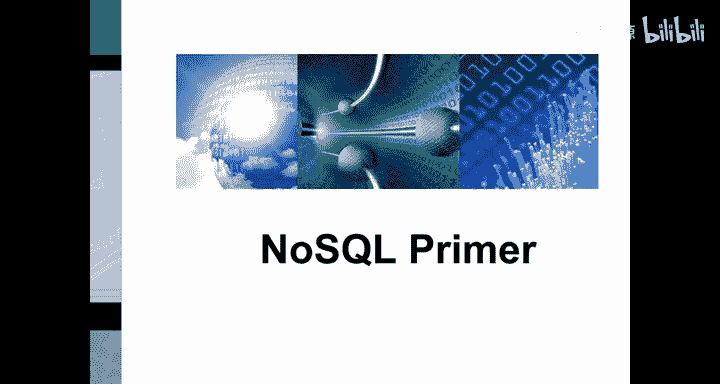

在本节课中，我们将要学习NoSQL数据库的基础理论。我们将了解NoSQL数据库兴起的背景，对比三种流行的NoSQL数据库，并理解其核心概念与适用场景。

## 概述：从关系型数据库到NoSQL

为了更好地理解NoSQL数据库的出现，了解1975年至今交互式应用程序的变化至关重要。这些变化主要体现在用户、应用程序和基础设施三个方面。

在1975年，应用程序通常为大约2000名用户构建。例如，AT&T的订单系统。而今天，互联网应用程序的用户起点可能就是2000人，并可能迅速增长到数百万甚至数亿，例如Facebook。

在应用程序方面，过去我们进行业务流程自动化，数据以高度结构化的格式存储在RDBMS中。如今，我们需要处理结构化、半结构化和非结构化数据，因此需要不同的机制来存储、处理和实时检索数据。

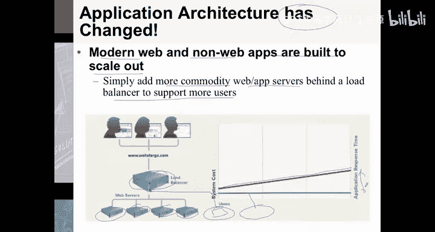

在基础设施方面，1970年代数据网络处于起步阶段，而今天我们看到遍布全球的高速数据网络。计算方面，过去是集中式计算，而今天分布式计算成为主流，我们将成百上千台计算机连接起来以解决复杂问题。

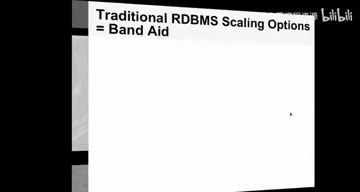

为了支持自1975年以来交互式应用程序的变化，应用程序架构已经跟上步伐。现代Web和非Web应用程序被设计为可水平扩展。你只需要在负载均衡器后面添加更多商用服务器即可。系统成本和响应时间呈线性增长。

## 数据库架构的滞后 😡

与应用程序架构的全面变革形成对比的是，关系型数据库系统在过去40多年里并未发生根本性改变。我们仍然在处理单一、庞大的RDBMS服务器。扩展关系型数据库系统的方式是购买更大的服务器，这导致系统成本急剧增加，并且由于单台服务器的能力有限，应用程序响应时间也会增加。

## 关系型数据库的扩展方案

人们采取了不同的方案来扩展关系型数据库系统，但这些方案都像是临时补救措施。

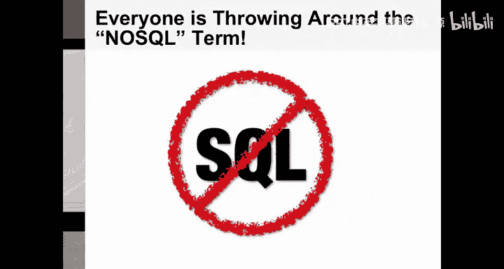

以下是几种常见的解决方案：

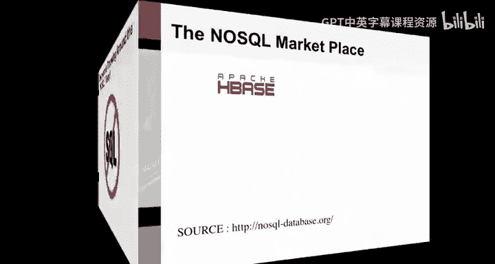

*   **分片**：其思想是分割数据，使其分布在多个服务器上。但现实是，当一个分片填满时，重新分片的过程极具破坏性。分片还会失去关系模型的一些优势，并且需要在多台服务器上维护模式，任何模式变更都需要在所有服务器上更新。
*   **反规范化**：其思想是放宽对严格范式（如第一、第二、第三范式）的要求。但反规范化可能导致数据在数据库中被重复存储，从而失去关系数据模型的一些重要优势。
*   **分布式缓存**：在数据库前部署分布式缓存技术（如Memcached），以减少对数据库的直接冲击。这种方法加速了数据读取，但对于写入操作，仍然存在“冷缓存”问题，即数据必须先到数据库，再加载到缓存，然后才能返回给客户端。此外，实现分布式缓存可能会增加一个层级，使架构变得更复杂。

仔细审视，许多RDBMS扩展方案都像是临时补救措施。我们真正需要的是一个可水平扩展的解决方案，一个可水平扩展的数据库。就像我们扩展Web服务器和应用服务器一样，我们应该能够通过添加更多商用服务器来扩展数据库服务器。NoSQL数据库正是填补了这一空白。关键在于，扩展数据库应该像添加另一台应用服务器一样简单。

## 什么是NoSQL？

现在，每个人都在谈论“NoSQL”这个术语。

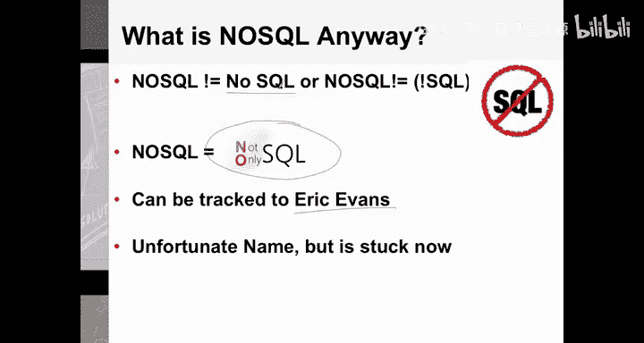

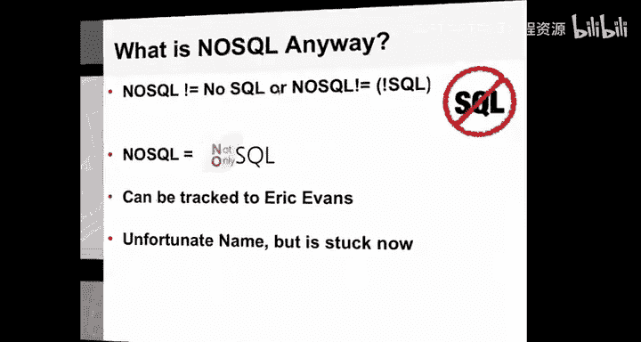

如果你查看NoSQL市场，除了我们将在本模块讨论的Apache HBase，还有一大批其他NoSQL数据库。访问 `nosqldatabase.org` 网站，你可以看到完整的NoSQL数据库列表，这个列表可能随时在变化。该网站列出了150多个NoSQL数据库，并对它们进行了简要描述。我强烈建议你有机会时浏览这些不同的NoSQL数据库及其所属类别。

“NoSQL”这个术语看起来像是通过“否定定义法”来定义的，即我们说它不是SQL，或者类似的意思，仿佛它是超越SQL或不同于SQL的东西。那么，NoSQL这个术语到底是什么意思？我想在这里给你一个更清晰的NoSQL数据库图景。

那么，NoSQL到底是什么？NoSQL可以意味着“没有SQL”，也可以意味着“不仅仅是SQL”。我更喜欢使用“不仅仅是SQL”这个说法。NoSQL这个术语实际上可以追溯到Rackspace的一次会议演讲。虽然许多人将NoSQL称为“没有SQL”，但如果你看看像Cassandra这样的NoSQL数据库，它们有一种查询语言叫CQL（Cassandra查询语言）。再看看MongoDB，它们有一种查询语言叫UnQL（非结构化查询语言）。所以，它们似乎都有某种SQL，只是不是我们所说的标准SQL。无论如何，它们都希望内置某种查询语言。因此，称其为“NoSQL”听起来有点奇怪。事实上，我更愿意称之为“无关系”。如果你看看大多数NoSQL数据库，我觉得它们有一个共同点：没有关系，没有连接，可能就是一个大表或一个大的数据模型。所以我觉得“无关系”会是一个更好的术语。

无论如何，我想将NoSQL数据库分为四大类：

以下是NoSQL数据库的四种主要类型：

*   **键值对数据库**：例如Voldemort、Redis、Amazon Dynamo。当你插入记录时，有一个键和一个值。只要键和值可以被序列化为字节，你可以在其中放入任何内容。
*   **列式数据库**：例如Apache HBase和Cassandra。它们被称为列式数据库是因为有“列族”的概念。每个列族实际上被放置在文件系统中一个独立的物理文件里，因此修改一个列族不会影响其他列族，这对性能非常有利。Apache HBase和Cassandra都源自Google Bigtable和Amazon SimpleDB。
*   **文档型数据库**：数据以文档形式存储，如今最常见的文档类型是JSON文档。MongoDB是文档型数据库的典型例子。
*   **图数据库**：以图的形式存储数据，你可以通过遍历图来获取实体间的各种关系和关联数据。Neo4j是一个非常流行的图数据库。

在这张幻灯片中，我列出了市场上流行的几种关键NoSQL数据库，并将它们分为四大类。如果你访问 `nosqldatabase.org`，你会看到这些数据库被归入更多不同的类别，但我认为这四类是最重要的。

## 理解Brewer的CAP定理

从分布式NoSQL数据库的角度理解这一点非常重要。分布式数据库有三个特征：

*   **一致性**：所有客户端对数据有一致的视图。
*   **可用性**：所有使用系统的客户端总是能在一定的最大延迟（即一定时间内）内进行读写操作，不能永远等待。
*   **分区容错性**：允许系统部分故障，除非发生整个网络故障，否则系统不应响应错误。即除非整个数据中心完全宕机，否则系统仍应工作。

这被称为Brewer的CAP定理，其中C代表一致性，A代表可用性，P代表分区容错性。根据Eric Brewer博士的理论，一个分布式系统，特别是分布式数据库，最多只能满足这三个属性中的两个。

如果你看传统数据库，如Oracle、MySQL和SQL Server，它们满足一致性和可用性，但这只发生在单台机器上。你无法将系统拆分到多台机器上，因为你只选择了C和A作为特性。

如果你看一些其他NoSQL数据库，如HBase和Cassandra，它们提供一致性和分区容错性。一致性意味着你读写的是相同的数据，不会出现脏读。分区容错性意味着数据可以分布在多台机器上。但你没有得到完全的可用性。

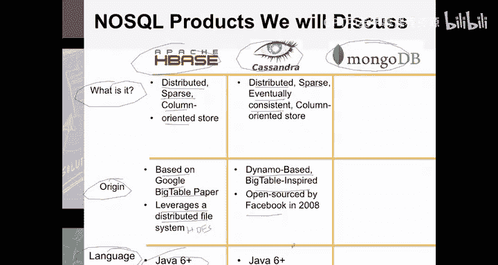

如果你看另一些NoSQL数据库，如MongoDB和Cassandra，它们声称提供可用性和分区容错性，但无法保证强一致性。

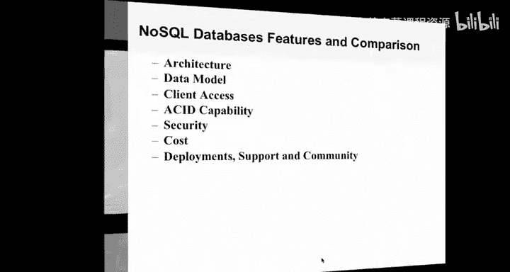

可以看到，有三个区域可能被满足：你可以得到一致性和可用性，或者可用性和分区容错性，或者分区容错性和一致性，但你永远无法同时拥有三者。这就是Eric Brewer博士在其CAP定理中阐述的，后来被一些学生作为研究项目并给出了证明。

还需要注意，Cassandra同时出现在CP和AP区域。这是因为Cassandra具有“可调一致性”，如果你想要可用性和分区容错性，你可以以牺牲一些一致性为代价获得；或者你可以以牺牲可用性为代价获得一致性和分区容错性。

Brewer的CAP定理的关键点是，对于任何共享数据系统，你最多只能拥有这三个属性中的两个。

## 对比三种流行的NoSQL数据库

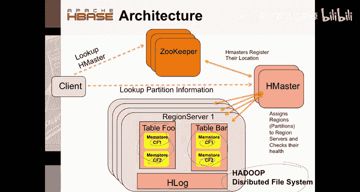

让我们具体看看三种NoSQL产品：Apache HBase、Cassandra和MongoDB。我们从它们是什么、起源和编写语言的角度来看。

以下是三种流行NoSQL数据库的基本信息：

*   **Apache HBase**：它是一个分布式（多机）、稀疏的数据库，类似于键值系统。它也是一个列式数据库，因为有列族的概念，每个列族存储在单独的文件中，因此可以独立扩展列族。HBase基于Google Bigtable论文，并利用分布式文件系统HDFS作为底层存储。它使用Java编写。
*   **Cassandra**：它也是一个分布式、稀疏的数据库。它遵循最终一致性或可调一致性的概念。你可以选择获得一致性和分区容错性，或者分区容错性和可用性，并且可以按需调整。Cassandra是Amazon Dynamo项目和Google Bigtable项目的结合体。它最初由Facebook为其收件箱概念创建，后来开源。它完全用Java编写。
*   **MongoDB**：它是一个分布式、可扩展的数据库，自认为是高性能数据库。最重要的是，它是一个文档存储数据库，以文档格式（具体是JSON格式）存储数据。它由DoubleClick（一个非常流行的广告点击平台，后来被Google收购）的创始人创建。这些创始人在将公司卖给Google并在Google工作一段时间后，决定创办自己的公司10gen并推出MongoDB。MongoDB也是开源数据库，使用C++编写。

## 深入比较：架构、数据模型与特性

现在，让我们从架构、数据模型、客户端访问、ACID能力、安全性、成本、部署、支持和社区等角度来比较这些数据库。

### 架构对比

上一节我们介绍了三种数据库的基本信息，本节我们来看看它们的架构设计有何不同。

*   **Apache HBase架构**：HBase构建在Hadoop分布式文件系统之上。有一个称为HMaster的组件，负责将区域（分区）分配给Region Server，并检查这些Region Server的健康状况。所有分区逻辑都由HMaster完成，它是HBase系统的大脑，与各个Region Server通信。这些Region Server分布在多台机器上，维护表的部分数据。例如，Region Server 1可能维护表Foo的一部分和表Bar的一部分，并将这些表中的列族数据保存在内存存储中，最终写入HDFS中的各个文件。还有ZooKeeper的概念，因为HMaster是大脑，如果它宕机，整个系统就宕机了。为了实现高可用性，可以启动多个HMaster实例，它们向ZooKeeper（一个协调系统）注册自己。客户端想要插入记录时，首先与ZooKeeper通信，找出HMaster在哪里，然后询问HMaster应该与哪个Region Server通信以进行CRUD操作，最后与该Region Server通信。
*   **Cassandra架构**：Cassandra具有基于环的架构，Cassandra守护进程在多台机器上启动并形成一个环。当客户端想要插入记录时，它连接到其中一个Cassandra守护进程，Cassandra守护进程知道该记录应该插入到哪里，它会与适当的Cassandra守护进程通信并插入记录，然后该记录会在环架构中复制到下一台机器，再下一台机器，从而实现数据的三副本复制。这就是Cassandra获得可用性和分区容错性的方式。在HBase中，你不需要担心三副本复制，因为当数据存储在HDFS中时，它已经作为HDFS复制的一部分被复制了三份。此外，在Cassandra中，你可以拥有多数据中心解决方案。当你在Cassandra中插入一条记录时，它不仅可以插入一个数据中心，还可以传播到第二个数据中心，从而实现跨多个数据中心的读写，这是Cassandra的最大优势之一。而HBase是构建在Hadoop之上的分布式数据库解决方案，但不是多数据中心解决方案。
*   **MongoDB架构**：在MongoDB架构中，有分片，每个分片称为一个副本集。每个副本集有一个主服务器（存放主副本）和至少两个从服务器（实现三副本复制）。你可以根据需要拥有任意多个这样的分片。MongoDB中有MongoDB配置服务器，它与副本集的主服务器通信以确定所有不同分片的位置。当客户端想要进行CRUD操作时，它查询MongoDB配置服务器以确定记录的位置，然后直接与相应副本集的主服务器通信以读写记录。实际上，一旦确定需要与哪个分片或副本集通信，它就与主服务器进行创建、更新和删除操作，但也可以与从服务器进行读取操作。

### 数据模型对比

了解了架构之后，我们来看看它们是如何组织和存储数据的，即数据模型。

*   **HBase和Cassandra的数据模型**：称为列族数据模型。对于每个表，通常有一个主键（行键），然后有称为列族的东西。你可以拥有任意多的列族，但通常在1到10或15个之间。列族的妙处在于，每个列族可以拥有任意数量的列，事实上你可以有数千、数万甚至数百万列，因此列族内的列是一个非常动态的概念。每个列族为了扩展目的存储在一个单独的文件中。这不是关系数据模型，而是一种列族或列式数据模型。
*   **MongoDB的数据模型**：基于JSON。你只需创建JSON对象并将其插入MongoDB数据库。无论是列族数据模型还是JSON数据模型，都能够动态添加列，因此具有灵活的模式，在NoSQL数据库中更容易演进。

### 客户端访问、查询与索引

不同的数据模型决定了不同的访问和查询方式。以下是它们在客户端访问方面的特点：

*   **Apache HBase**：可以使用Java API进行CRUD操作，也可以使用Thrift RPC API。还有Hadoop集成，可以在Apache HBase上使用MapReduce。查询记录都是基于API的，因此客户端需要做很多工作来从数据库查询记录。索引仅针对主键。
*   **Cassandra**：支持多种API，如Ruby、Perl、Python、Scala等。支持Hadoop集成。可以基于索引查询，因为有主索引和二级索引的概念。还有CQL（Cassandra查询语言）。支持主索引、二级索引和复合键。
*   **MongoDB**：有原生JavaScript API。也有多种语言的二进制驱动程序（如C++、Python）。对于Java，它提供了一个REST接口（实际上，如今REST在所有三种数据库中都有提供，但可能比原生API慢一些）。还有一种特殊的查询语言，称为UnQL（非结构化查询语言）。支持主键、二级键索引和复合键。

### ACID与BASE模型

理解NoSQL数据库时，ACID和BASE的概念很重要。ACID代表原子性、一致性、隔离性、持久性。BASE代表基本可用、软状态、最终一致性。在ACID模型中，你获得完全ACID系统，保证一致性、原子性、隔离性和持久性。而在BASE模型中，你会获得一致性，但它是最终一致性。

像Oracle和MySQL这样的关系型数据库系统是完全ACID兼容的。而像Cassandra这样的系统支持BASE模型，即基本可用、软状态、最终一致性。换句话说，记录最终会一致，但暂时可能有一些延迟，因为它们必须基于时间戳维护一切，它们并不真正更新记录，更新操作实际上是一次插入，它们必须合并和整合这些记录。我想说明的是，Cassandra支持可调一致性模型，可以提供一致性和分区容错性，而HBase支持一致性和分区容错性模型。Cassandra实际上也可以做到AP（可用性和分区容错性）。所有这些特性都是可调的。MongoDB也支持AP模型，提供可用性和分区容错性，实际上它提供的是最终一致性。关键在于，NoSQL数据库实际上放弃了ACID概念，转向了称为BASE的最终一致性，这是由于Eric Brewer博士的CAP定理。

### 其他考量因素

最后，我们还需要从安全性、成本、部署和支持等实际角度进行考量。

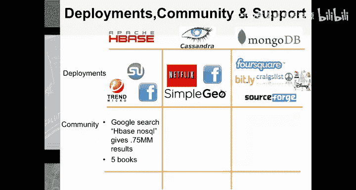

*   **安全性**：几乎所有NoSQL数据库的安全性都相对较弱。我们知道关系型数据库在数据控制语言方面做得很好，可以控制对数据的访问。这是NoSQL数据库的一个弱点。
*   **成本**：NoSQL数据库运行在廉价的商用硬件上，因此从前期投资来看，不像传统数据库那样需要从中型数据库开始，然后随着增长购买越来越大的、更昂贵的服务器。在NoSQL数据库中，扩展只是动态添加这些商用服务器。软件方面，几乎所有NoSQL数据库都是开源项目，几乎没有成本。
*   **部署、社区与支持**：
    *   **Apache HBase**：部署在Trend Micro、Facebook和StumbleUpon等公司。社区方面，谷歌搜索“HBase NoSQL”约有75万条结果，有大约5本相关书籍。支持方面，可以从Cloudera、Hortonworks或MapR获得HBase的支持许可。
    *   **Cassandra**：部署在Netflix、Facebook和Simple Geo等公司。谷歌搜索“Cassandra NoSQL”约有310万条结果，有2本相关书籍。支持可以从DataStax获得。
    *   **MongoDB**：部署在Foursquare、Bitly、Craigslist、SourceForge、Disney等公司。谷歌搜索“MongoDB NoSQL database”约有230万条结果，有14本相关书籍。支持可以从10gen获得。

## 总结

本节课中，我们一起学习了NoSQL数据库的基础理论。我们了解了NoSQL兴起的背景，对比了关系型数据库与NoSQL在扩展性上的差异。我们深入探讨了Brewer的CAP定理，理解了分布式系统在一致性、可用性和分区容错性之间的权衡。最后，我们详细比较了三种流行的NoSQL数据库——Apache HBase、Cassandra和MongoDB——在架构、数据模型、访问方式、一致性模型以及生态系统等方面的特点。希望通过本课，你能对NoSQL数据库有一个清晰的概览，并能在实际工作中根据需求选择合适的数据库解决方案。在本课程中，由于主题是“使用Hadoop进行大数据处理”，我们将重点学习Apache HBase这一NoSQL数据库。