# 课程21：HBase环境部署 🛠️


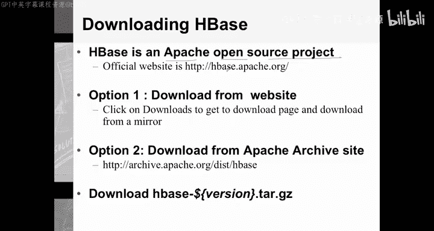

在本节课中，我们将学习如何在开发环境中下载、安装、配置并运行HBase。

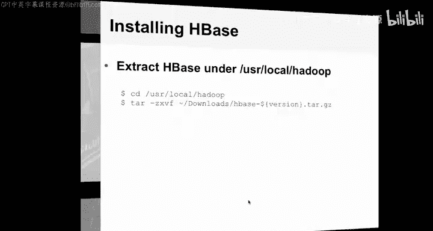

## 概述

HBase是一个运行在Hadoop HDFS之上的分布式、可扩展的NoSQL数据库。为了进行开发和测试，我们将在“伪分布式”模式下安装和配置HBase。这种模式模拟了完全分布式环境，但所有守护进程都运行在同一台主机上，非常适合学习和原型设计。

## 下载HBase

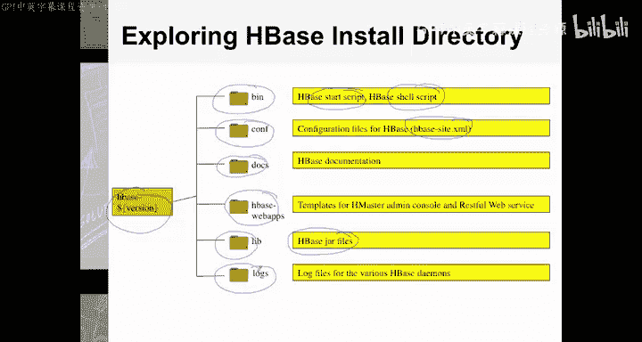

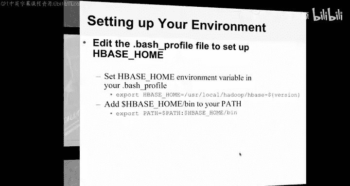

HBase是Apache的开源项目，其官方网站是 `hbase.apache.org`。

以下是下载HBase的两种方法：

**方法一：通过官方网站下载**
1.  访问 `hbase.apache.org`。
2.  点击“Downloads”链接，页面会跳转到一个镜像下载页面。
3.  在镜像页面下载最新版本的HBase。

**方法二：通过Apache存档站点下载**
1.  访问 `archive.apache.org/dist/hbase`。
2.  页面会列出所有HBase发行版，选择最新的版本进行下载。

HBase的发行版文件命名格式为：`hbase-版本号-bin.tar.gz`。

## 安装HBase

安装HBase非常简单，只需解压下载的压缩包即可。

1.  进入Hadoop的安装目录（例如 `/usr/local/hadoop`）。
2.  使用以下命令解压HBase压缩包：
    ```bash
    tar -zxvf /path/to/downloaded/hbase-*.tar.gz
    ```
    这将在当前目录下创建一个名为 `hbase-版本号` 的文件夹。

现在HBase已安装完成。让我们探索一下HBase的安装目录，了解各个文件夹的作用。

*   **`bin` 目录**：存放HBase的启动脚本。其中包含 `start-hbase.sh` 脚本和用于启动HBase交互式Shell的脚本。
*   **`conf` 目录**：存放HBase的配置文件。其中最重要的文件是 `hbase-site.xml`，它包含了连接Hadoop HDFS所需的信息，我们需要修改此文件以使HBase连接到Hadoop。
*   **`docs` 目录**：存放HBase的文档。
*   **`hbase-webapps` 目录**：存放HMaster管理控制台和RESTful Web服务的模板。通常我们不需要过多关注此目录。
*   **`lib` 目录**：存放HBase的JAR文件。如果你要编写HBase客户端程序以执行数据操作，需要包含这些JAR文件。
*   **`logs` 目录**：存放所有HBase守护进程的日志文件。

## 配置环境变量

安装好HBase后，我们需要设置环境变量，以便系统能够找到HBase的命令。

编辑 `~/.bash_profile` 文件（或相应的shell配置文件），添加以下两行：

1.  设置 `HBASE_HOME` 环境变量，指向HBase的安装路径：
    ```bash
    export HBASE_HOME=/usr/local/hadoop/hbase-版本号
    ```
2.  将HBase的 `bin` 目录添加到 `PATH` 环境变量中，这样我们就可以直接执行启动、停止命令以及启动HBase Shell：
    ```bash
    export PATH=$PATH:$HBASE_HOME/bin
    ```
    保存文件后，执行 `source ~/.bash_profile` 使配置生效。

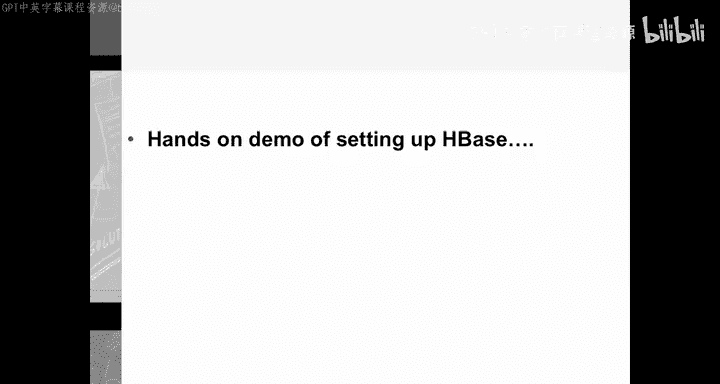

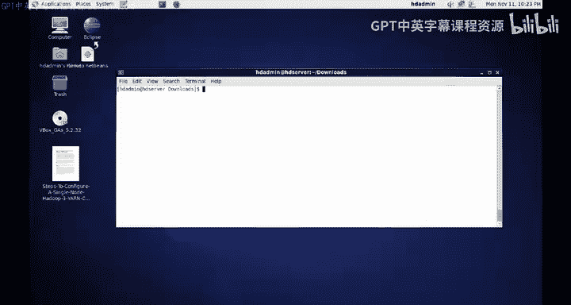

## 配置HBase连接HDFS

由于我们要在伪分布式模式下运行HBase，需要确保HDFS正在运行。你可以通过浏览器访问NameNode控制台（默认端口9870）或执行 `hadoop fs -ls /` 命令来验证HDFS是否可用。

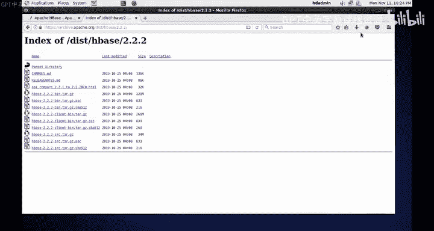

HBase可以在三种模式下运行：

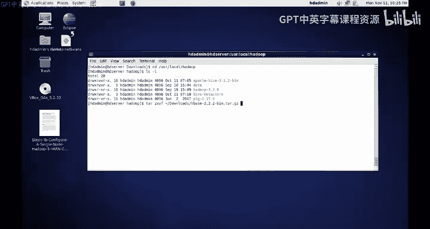

1.  **本地/独立模式**：开箱即用的模式，不使用HDFS，所有守护进程（HMaster、RegionServer、ZooKeeper）都在同一个JVM中运行。仅用于快速测试，不推荐使用。
2.  **伪分布式模式**：开发模式，需要HDFS。它模拟了完全分布式环境，但所有守护进程运行在同一台主机上。这是学习、测试和调试应用程序的理想模式，也是本教程将使用的模式。
3.  **完全分布式模式**：生产模式，HBase守护进程分布在多台机器上运行。

为了让HBase在伪分布式模式下与Hadoop HDFS通信，我们需要修改 `$HBASE_HOME/conf/hbase-site.xml` 配置文件。

在该文件中，我们需要设置以下三个关键属性：

1.  **`hbase.rootdir`**：指定HDFS的位置以及HBase存储其元数据和数据的目录。
    ```xml
    <property>
      <name>hbase.rootdir</name>
      <value>hdfs://localhost:9000/hbase</value>
    </property>
    ```
2.  **`hbase.cluster.distributed`**：设置为 `true`，以启用伪分布式模式，让各个守护进程独立运行。
    ```xml
    <property>
      <name>hbase.cluster.distributed</name>
      <value>true</value>
    </property>
    ```
3.  **`hbase.unsafe.stream.capability.enforce`**：对于较新版本的Hadoop（支持擦除编码），需要将此属性设置为 `false`，因为HBase的预写日志（WAL）目前不完全兼容此特性。
    ```xml
    <property>
      <name>hbase.unsafe.stream.capability.enforce</name>
      <value>false</value>
    </property>
    ```

## 启动与验证HBase


配置完成后，就可以启动HBase了。由于我们已经将HBase的 `bin` 目录加入了PATH，可以直接执行启动命令：
```bash
start-hbase.sh
```
此命令会依次启动ZooKeeper、HMaster和RegionServer守护进程。

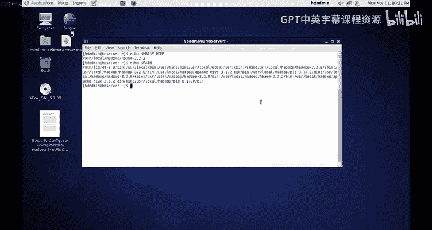

可以通过以下几种方式验证HBase是否成功运行：

1.  **使用HBase Shell**：执行 `hbase shell` 命令进入交互式Shell，然后输入 `list` 命令。如果返回表列表（初始为空），则说明HBase运行正常且客户端可以连接。
    ```bash
    hbase shell
    list
    ```
2.  **检查HDFS目录**：执行 `hadoop fs -ls /hbase` 命令。如果HBase运行成功，会在HDFS的 `/hbase` 目录下创建一系列用于存储内部信息、数据和元数据的目录。
3.  **访问Web管理控制台**：
    *   **HMaster控制台**：默认运行在 `http://localhost:16010`。在此可以查看HMaster状态和已连接的RegionServer列表。
    *   **RegionServer控制台**：每个RegionServer默认运行在 `http://localhost:16030`。可以从HMaster控制台点击链接直接访问。

## 停止HBase

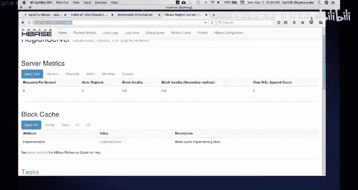

停止HBase非常简单，只需执行：
```bash
stop-hbase.sh
```
此命令会按顺序停止RegionServer、HMaster和ZooKeeper守护进程。

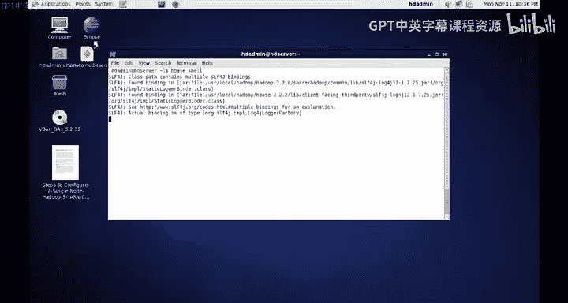

## 总结


本节课中，我们一起学习了如何在开发环境中部署HBase。我们完成了从官网下载HBase发行版、解压安装、配置环境变量、修改核心配置文件 `hbase-site.xml` 以连接HDFS，并在伪分布式模式下成功启动和验证了HBase服务。我们还了解了HBase的三种运行模式及其适用场景，并掌握了通过Shell和Web控制台验证服务状态的方法。现在，你的HBase开发环境已经准备就绪，可以开始进行数据操作了。