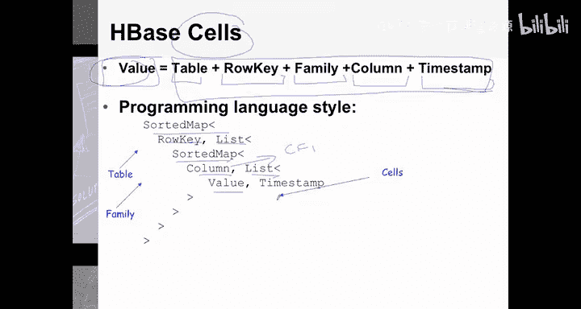
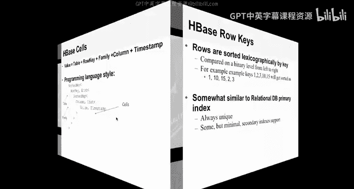
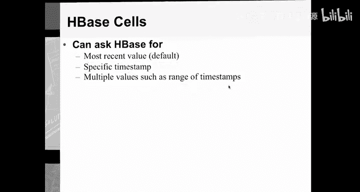

# 课程22：HBase数据模型解析 🗂️

在本节课中，我们将学习HBase的数据模型。这是一种灵活的、面向列的、基于键值对和列族的数据模型，与我们熟悉的传统关系型数据库模型有所不同。

## 概述

HBase数据模型的核心在于其独特的组织方式。数据存储在表中，这一点与关系数据库类似，但其底层存储依赖于HDFS，并且数据以列族的形式进行组织，支持动态列和版本控制。

## HBase数据模型详解

上一节我们介绍了HBase的概览，本节中我们来看看其数据模型的具体构成。

### 表与行

在HBase数据模型中，数据存储在表中，这与关系数据库非常相似。但底层数据实际上存储在HDFS中。表由行组成，每行通过一个唯一的键来引用。这个键是一个字节数组，这意味着任何可序列化为字节的数据类型（如字符串、长整型或自定义类型）都可以作为键。

### 列与列族

行由列组成，但这里的列被分组到所谓的“列族”中。在一个行内，可以有多个列族，每个列族下又包含多个列。因此，一个数据单元（称为“单元格”）实际上是行、列族和列这三者的组合，值就存储在这个单元格中。

以下是关于列族的关键点：
*   **列族是静态的**：在创建表时预定义，之后可以修改但相对固定。
*   **列是动态的**：列名可以在程序运行时动态创建和添加。
*   **存储方式**：每个列族及其下的所有列和值，都存储在一个单独的HDFS文件中（即HFile）。因此，一个包含三个列族的表，在HDFS中会对应三个文件。
*   **数量限制**：列族的数量通常较少（个位数到十位数），而一个列族内可以拥有数百万个列。

列族名称必须由可打印字符组成。你可以将列族名视为单元格的一个“标签”。

### 单元格与版本控制

行实际上由单元格组成。单元格通过 `列族:列名` 的组合来定位。

HBase单元格是带版本控制的。默认情况下，每个单元格会保留三个版本的值（包括当前值）。这为数据检索增加了时间维度。你可以根据时间戳来获取特定版本的值，或获取某个时间范围内的值。

时间戳可以由区域服务器隐式分配，也可以由客户端在插入数据时显式提供。读取数据时，默认返回最新值，但也可以请求获取旧版本。保留的版本数量可以在列族定义时进行配置。

综上所述，一个HBase单元格的值由以下元素唯一确定：
`值 = f(表名, 行键, 列族名, 列名, 时间戳)`

本质上，一个HBase表是一个排序的映射（Sorted Map）：
*   键是行键。
*   值又是一个映射，其键是带有列族标签的列，值则是带时间戳版本的值列表。

### 行键排序

当向HBase表插入记录时，所有行会按照行键进行字典序排序（在字节级别从左到右比较）。例如，行键 `1`, `2`, `3`, `10`, `15` 会排序为 `1`, `10`, `15`, `2`, `3`。这类似于关系数据库中基于主键的聚簇索引。

## 综合示例

为了将上述概念串联起来，请看以下示例表，它包含两行（row1, row2）、两个列族（name, address）以及多个时间戳版本：

| 行键 | 时间戳 | 列族:列名 | 值 |
| :--- | :--- | :--- | :--- |
| row1 | T5 | name:firstname | Bob |
| row1 | T5 | name:lastname | Smith |
| row1 | T8 | address:number | 10 |
| row1 | T8 | address:street | First St |
| row1 | T10 | address:street | Second St |
| row1 | T15 | address:street | Last St |
| row2 | T10 | name:firstname | Alice |

*   当请求 `row1` 的所有内容时，HBase默认返回每个单元格的最新值：
    *   `name:firstname` = Bob
    *   `name:lastname` = Smith
    *   `address:number` = 10
    *   `address:street` = Last St
*   对于 `address:street`，系统保留了T8、T10、T15三个时间戳的版本（假设版本数设置为3）。如果后续在T31更新为 `Eight St`，那么最旧的T8版本将被删除。
*   你可以请求特定时间戳的值，或某个时间范围内的所有值。

## 总结

本节课中我们一起学习了HBase的数据模型。我们看到HBase将数据存储在HDFS中，其表包含列族，每个列族存储在独立的HDFS文件里。列族可以包含列，列可以动态添加。列族是静态定义的，而列名可以动态创建。此外，HBase基于时间戳存储值，默认保留三个版本（包括当前值）。我们可以在创建表时配置版本数量，也可以根据时间戳或时间戳范围来查询特定版本的数据。简单地请求一个单元格的值，将返回最新的版本。