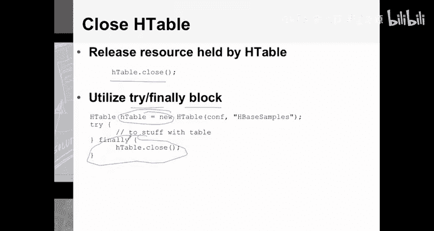
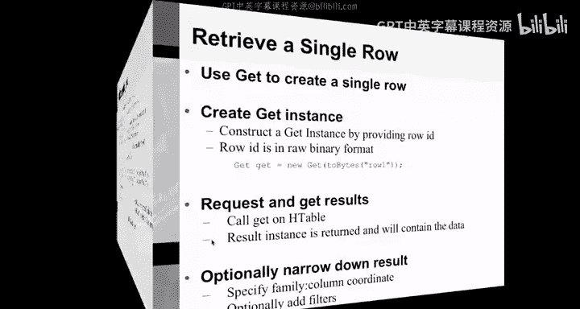
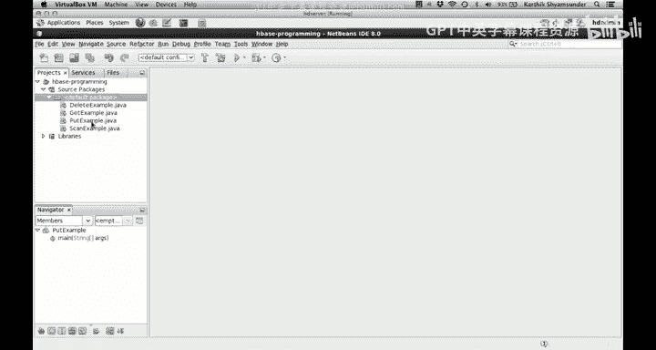
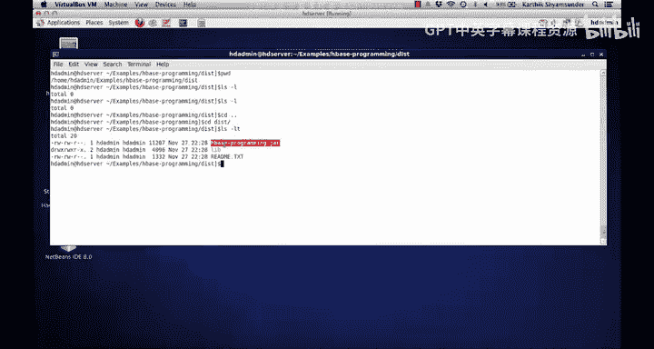
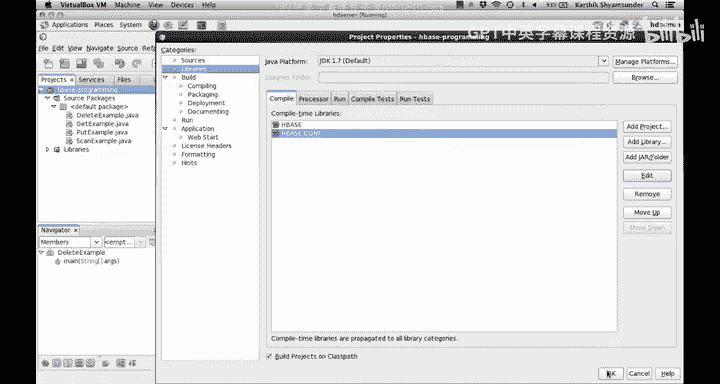
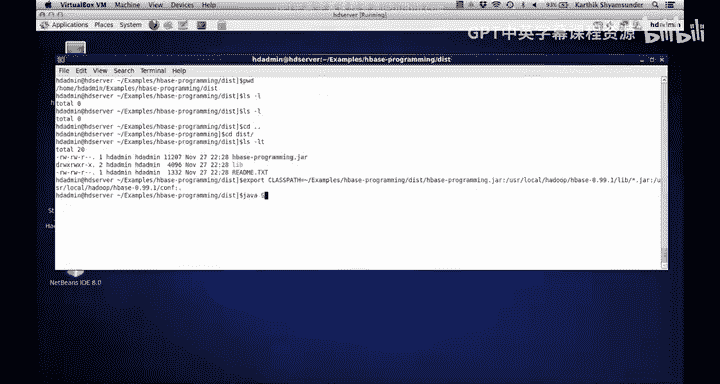

# 课程24：使用Java API实现HBase增删改查 📚


在本节课中，我们将学习如何使用HBase的Java原生API来操作和查询HBase表。HBase本身是用Java编写的，因此它提供了功能强大的Java原生API，支持以编程方式对基于行的表进行数据操作。我们将重点介绍如何执行增删改查（CRUD）操作以及扫描操作。

## 概述

HBase的Java原生API是访问HBase表中记录的最快方式。通过它，我们可以执行所有在HBase Shell中能完成的操作，包括数据定义（DDL）和数据操作（DML）。本节我们将专注于使用Java API进行DML操作。

## 客户端API使用步骤

以下是使用HBase Java客户端API的一般步骤：

1.  创建HBase配置对象。
2.  构建HTable对象，它代表要操作的HBase表。
3.  执行操作，如扫描（Scan）、插入（Put）、获取（Get）和删除（Delete）。
4.  操作完成后，关闭HTable实例以释放资源。

接下来，我们将详细探讨这些步骤中的关键概念和操作。

## 1. 创建HBase配置对象 🛠️

在使用CRUD API之前，首先需要创建一个HBase配置对象。该对象代表了HBase客户端代码的配置。

**代码示例：创建配置对象**
```java
import org.apache.hadoop.hbase.HBaseConfiguration;
import org.apache.hadoop.conf.Configuration;

Configuration config = HBaseConfiguration.create();
```

`HBaseConfiguration.create()` 方法会从类路径中的 `hbase-default.xml` 文件加载配置。因此，你需要确保将HBase的JAR文件（位于 `$HBASE_HOME/lib` 目录下）以及包含 `hbase-site.xml` 的配置目录（`$HBASE_HOME/conf`）添加到程序的类路径中。

## 2. 构建HTable对象 📊

HTable对象是客户端与单个HBase表交互的接口。所有对HBase表的操作都需通过此对象进行。

**代码示例：构建HTable对象**
```java
import org.apache.hadoop.hbase.client.HTable;

HTable table = new HTable(config, "your_table_name");
```

创建HTable实例是一个开销较大的操作，因为它需要扫描元数据表并与HMaster通信。建议每个线程创建一个HTable实例并尽可能重用。HTable不是线程安全的，每个线程应持有自己的HTable对象实例。



## 3. 执行数据操作 🔄

上一节我们介绍了如何建立与HBase表的连接，本节中我们来看看如何使用Java API进行核心的数据操作。



### 插入（Put）操作

Put操作用于向表中插入或更新单行数据。操作以行为单位，具有原子性。

**代码示例：插入数据**
```java
import org.apache.hadoop.hbase.client.Put;
import static org.apache.hadoop.hbase.util.Bytes.toBytes;

Put put = new Put(toBytes("row_key_1"));
put.add(toBytes("column_family"), toBytes("column_name"), toBytes("value"));
table.put(put);
```

以下是插入操作的关键点：
*   **行键（Row Key）**：构造Put对象时必须指定行键，且所有键值都需要转换为字节数组。
*   **字节转换**：HBase内部以字节形式存储所有数据。可以使用 `org.apache.hadoop.hbase.util.Bytes` 工具类的 `toBytes()` 方法进行转换。
*   **添加列**：通过 `put.add()` 方法指定列族、列限定符和值。
*   **提交操作**：最后通过 `table.put(put)` 将数据写入表。

### 获取（Get）操作

Get操作用于从表中检索单行数据。你可以指定条件来缩小返回结果的范围。

**代码示例：获取数据**
```java
import org.apache.hadoop.hbase.client.Get;
import org.apache.hadoop.hbase.client.Result;

Get get = new Get(toBytes("row_key_1"));
// 可选：缩小查询范围
get.addFamily(toBytes("column_family"));
get.addColumn(toBytes("column_family"), toBytes("column_name"));

Result result = table.get(get);
// 处理结果
byte[] value = result.getValue(toBytes("column_family"), toBytes("column_name"));
System.out.println(Bytes.toString(value));
```

以下是获取数据时可以使用的筛选条件：
*   **按列族筛选**：`get.addFamily()`
*   **按列筛选**：`get.addColumn()`
*   **按时间范围筛选**：`get.setTimeRange()`
*   **按版本数筛选**：`get.setMaxVersions()`

`Result` 对象包含了查询返回的数据，可以通过 `getValue()` 等方法提取具体内容。

### 扫描（Scan）操作

Scan操作用于遍历整个表或表的一部分。

**代码示例：扫描表**
```java
import org.apache.hadoop.hbase.client.Scan;
import org.apache.hadoop.hbase.client.ResultScanner;

Scan scan = new Scan();
ResultScanner scanner = table.getScanner(scan);
for (Result result : scanner) {
    // 处理每一行结果
    // 例如调用之前定义的 printResult 方法
}
scanner.close();
```

### 删除（Delete）操作

Delete操作用于删除表中的行或特定单元格。删除也是以行为单位进行的。


**代码示例：删除数据**
```java
import org.apache.hadoop.hbase.client.Delete;



// 删除整行
Delete delete = new Delete(toBytes("row_key_1"));
table.delete(delete);

// 删除特定列
Delete specificDelete = new Delete(toBytes("row_key_2"));
specificDelete.deleteColumn(toBytes("column_family"), toBytes("column_name"));
table.delete(specificDelete);
```

以下是删除操作的方法：
*   `deleteColumn()`：删除指定列的最新版本。
*   `deleteColumns()`：删除指定列的所有版本。

## 4. 资源清理 🧹

所有操作执行完毕后，必须关闭HTable对象以释放网络连接和缓冲区等资源。建议使用 `try-finally` 块或Java 7的 `try-with-resources` 语句来确保资源被正确关闭。



**代码示例：使用try-with-resources**
```java
try (HTable table = new HTable(config, "table_name")) {
    // 执行各种CRUD操作
    Put put = new Put(...);
    table.put(put);
    // ...
} // 自动关闭table
```

## 项目配置与运行 🚀

为了成功编译和运行HBase Java程序，需要进行正确的项目配置。



以下是配置项目类路径的关键步骤：
1.  **添加HBase库**：将 `$HBASE_HOME/lib` 目录下的所有JAR文件添加到项目的构建路径中。
2.  **添加配置目录**：将 `$HBASE_HOME/conf` 目录（包含 `hbase-site.xml`）也添加到类路径中，以便客户端能定位到HBase集群。
3.  **注意依赖**：HBase的JAR通常已包含必要的Hadoop依赖，因此通常无需单独添加Hadoop库。

在集成开发环境（IDE）中配置好库后，即可编译项目生成JAR文件。在命令行中运行时，需要设置包含所有必要JAR和配置目录的 `CLASSPATH` 环境变量。



## 总结

在本节课中，我们一起学习了如何使用HBase的Java CRUD API来操作HBase表。我们掌握了四个核心操作对象的使用方法：使用 **Put** 对象插入或更新记录，使用 **Get** 对象检索记录，使用 **Delete** 对象删除记录，以及使用 **Scan** 对象遍历表。所有操作都通过 **HTable** 对象执行，该对象由HBase配置对象和表名构造。最后，我们强调了显式关闭HTable对象以释放资源的重要性，并了解了正确配置项目类路径的必要步骤。通过掌握这些知识，你已经能够使用Java程序高效地与HBase进行交互了。