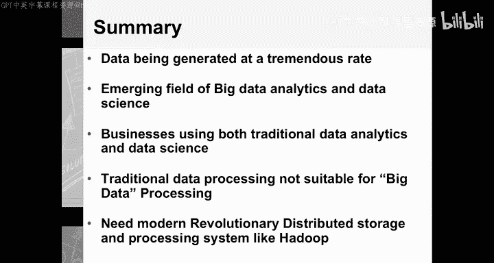

# 课程名称：Hadoop大数据处理｜Big Data Processing Using Hadoop - P8：大数据革命总结 🚀

在本节课中，我们将回顾大数据革命背后的趋势与核心概念，并对整个模块的内容进行总结。

上一节我们探讨了大数据处理的技术需求，本节中我们来看看本模块的要点总结。

## 大数据革命概述 📈

我们审视了信息技术市场中近期大数据革命背后的趋势与概念。

我们从宏观视角俯瞰了大数据领域。

## 核心要点总结

以下是本模块学习的关键内容总结：

*   数据正以惊人的速度生成，这即是其被称为“大数据”的原因。
*   大数据分析与数据科学是一个新兴领域。
*   企业正在同时运用传统数据分析与新兴数据科学来改善业务并发现新机遇。
*   传统数据处理技术表现良好，但并不真正适用于大数据处理。
*   我们真正需要的是像 **Hadoop** 这样的现代化、革命性的分布式存储与处理系统。

## 后续展望 🔮

而这正是我们将在下一个模块中详细讨论的内容。

本节课中我们一起学习了大数据革命的驱动因素、核心概念以及传统技术的局限性，并引出了解决这些挑战的关键技术——Hadoop分布式系统。