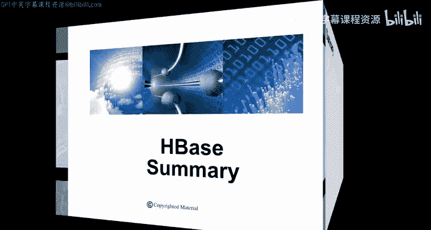
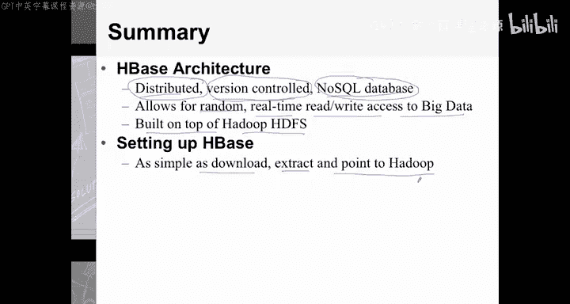

# 课程25：HBase模块总结 📚

在本节课中，我们将对HBase模块的核心内容进行总结。我们将回顾HBase的架构、数据模型以及操作方式，帮助你巩固对HBase的理解。

---

## HBase架构总结 🏗️

上一节我们介绍了HBase的基本操作，本节中我们来看看HBase的整体架构特点。

HBase是一个**分布式**、**版本控制**的**NoSQL**数据库。
*   **分布式**：多台机器可以协同工作，形成一个统一的分布式数据库。
*   **版本控制**：可以存储同一个值的多个版本。
*   **NoSQL数据库**：它不是关系型数据库。

HBase允许对大数据进行**随机、实时的读写访问**。这在普通的HDFS中难以实现，尽管HBase实际上是构建在Hadoop HDFS文件系统之上的。

以下是HBase的简要设置步骤：
1.  下载HBase的`.tar.gz`文件。
2.  解压文件。
3.  在`hbase-site.xml`配置文件中，将其指向Hadoop的HDFS NameNode。

---

## HBase数据模型总结 📊

了解了架构之后，我们来看看HBase独特的数据模型。

HBase的数据模型包含**列族**和**列**的概念，这与关系型数据库中固定的列不同。
*   在一个列族内，可以有许多列，这带来了**灵活性**，它是一种灵活的模式。
*   在列中，你可以存储任何想要的值。

因此，其内部数据结构可以表示为：
**行键(Row ID) + 列族(Column Family) + 列(Column) + 时间戳(Timestamp) = 值(Value)**
这就是HBase内部数据模型的存储方式。

---

## HBase操作方式总结 🛠️

最后，我们来总结操作HBase的两种主要方式。

HBase提供了一个交互式Shell，你可以使用以下命令：
*   **DDL语句**：创建表。
*   **DML语句**：使用`put`和`delete`进行记录的插入（更新）和删除操作。
*   **查询语句**：使用`get`和`scan`从表中检索记录。

此外，我们还学习了Java Client API，它允许我们通过编程方式操作HBase：
*   使用`put`方法向表中插入或更新记录。
*   使用`get`方法从表中检索记录。
*   使用`delete`方法删除表中的条目。

---

## 总结 ✨

本节课中我们一起学习了HBase的核心内容。我们回顾了HBase作为分布式、版本控制的NoSQL数据库的架构特点，探讨了其基于列族和列的灵活数据模型，并总结了通过交互式Shell和Java API进行数据操作的方法。希望本模块能帮助你建立起对HBase的基本认识。