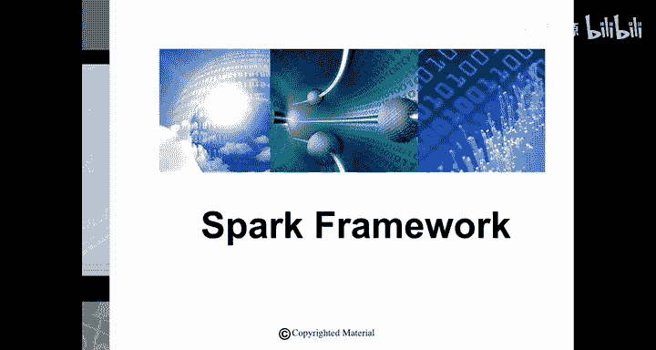
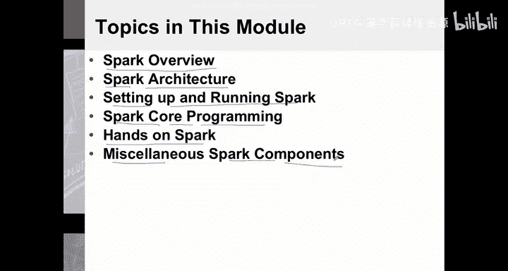
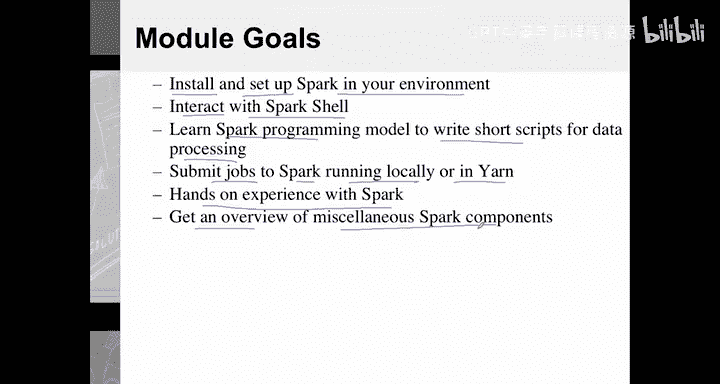

# 课程名称：Spark框架导论 🚀

在本节课中，我们将学习Spark框架的基本概念、架构、安装方法以及编程模型。通过本课程，您将能够理解Spark如何工作，它与Hadoop平台的关系，并掌握编写和运行Spark应用程序的基本技能。

---



## Spark概述 🔍

上一节我们介绍了本课程的整体结构，本节中我们来看看Spark的起源、优势、特性以及它与MapReduce的区别。

Spark起源于加州大学伯克利分校的AMPLab实验室，旨在解决MapReduce在处理迭代算法和交互式数据挖掘任务时的性能瓶颈。Spark的主要优势在于其内存计算能力，这显著提高了数据处理速度。

以下是Spark的核心特性：

*   **速度**：Spark通过内存计算和优化的执行引擎，比Hadoop MapReduce快上百倍。
*   **易用性**：Spark提供了丰富的API（支持Java、Scala、Python和R），并包含用于SQL查询、流处理、机器学习和图计算的集成库。
*   **通用性**：Spark提供了一个统一的栈，可以处理批处理、交互式查询、实时流处理、机器学习和图计算等多种任务。
*   **运行模式多样**：Spark可以运行在本地模式、Apache Mesos、Hadoop YARN上，也可以独立运行。

Spark与MapReduce的主要区别在于数据处理模型。MapReduce将中间结果写入磁盘，而Spark尽可能将数据保留在内存中，从而减少了磁盘I/O开销。其核心数据抽象是**弹性分布式数据集（RDD）**。

---

## Spark架构 🏗️

了解了Spark的基本概念后，本节我们来探讨Spark的架构及其多种运行方式。

Spark架构的核心是驱动程序（Driver Program）和集群管理器（Cluster Manager）。驱动程序包含应用程序的main函数并定义了RDD及其上的操作。集群管理器负责在集群中分配资源。

Spark支持多种运行模式，以适应不同的环境和需求：

*   **本地模式**：在单个机器上运行，用于开发和测试。
*   **独立模式**：使用Spark自带的简单集群管理器。
*   **Apache Mesos**：运行在通用的集群管理平台Mesos之上。
*   **Hadoop YARN**：运行在Hadoop的资源调度框架YARN之上，这是与Hadoop平台集成的主要方式。

本课程将主要关注Spark在Hadoop平台上的集成方式。

---

## 安装与运行Spark ⚙️

上一节我们介绍了Spark的架构，本节中我们将实际操作，学习如何安装和设置Spark，使其能够在Hadoop平台上运行。

安装Spark的步骤如下：

1.  **下载Spark**：从Apache Spark官网下载预编译版本。
2.  **解压文件**：将下载的压缩包解压到指定目录。
3.  **配置环境变量**：设置`SPARK_HOME`环境变量，并将`$SPARK_HOME/bin`添加到`PATH`中。
4.  **配置Hadoop集成**：为了在YARN上运行，需要确保`HADOOP_CONF_DIR`或`YARN_CONF_DIR`环境变量指向Hadoop的配置文件目录。

完成安装后，可以通过运行 `spark-shell` 命令来启动交互式Shell，验证安装是否成功。

---

## Spark编程模型 💻

在成功安装Spark之后，本节我们来学习如何编写Spark应用程序。您将了解RDD操作、Spark Shell的使用以及如何提交作业。

编写Spark应用程序通常涉及以下步骤：

1.  **创建SparkContext**：这是与Spark集群连接的主要入口点。
    ```scala
    val conf = new SparkConf().setAppName("MyApp")
    val sc = new SparkContext(conf)
    ```
2.  **创建RDD**：可以从外部数据集（如HDFS文件）或驱动程序中的集合创建RDD。
    ```scala
    val data = sc.textFile("hdfs://...")
    ```
3.  **对RDD进行转换和行动操作**：转换操作（如`map`, `filter`）生成新的RDD，行动操作（如`count`, `collect`）触发计算并返回结果。
4.  **使用Spark Shell**：这是一个交互式环境，非常适合快速原型设计和数据探索。
5.  **提交应用程序**：使用 `spark-submit` 脚本将打包好的应用程序提交到集群运行。
    ```bash
    spark-submit --class MyApp --master yarn myapp.jar
    ```

鉴于您已经具备MapReduce、Hive和Pig的编程经验，理解Spark API应该不难。本课程将主要概述API，您可以查阅官方文档来编写具体的应用程序。

---

## Spark实践操作 🛠️

理论结合实践，本节我们将实际与Spark系统交互，演示如何编写和运行一个简单的Spark数据处理脚本。

我们将通过一个例子，使用Spark Shell来统计一个文本文件中各单词出现的频率。这个过程将让您亲身体验RDD的创建、转换和行动操作。

---

## Spark其他组件 📦

Spark不仅仅是一个核心计算引擎。在学习了核心编程之后，本节我们将简要介绍构建在Spark核心之上的其他重要组件，这些组件扩展了Spark的功能。

Spark生态系统包含多个高级组件，为特定领域的计算任务提供了便利的API：



*   **Spark SQL**：用于处理结构化数据的模块，支持使用SQL或DataFrame API进行查询。
*   **Spark Streaming**：用于处理实时流数据的组件。
*   **MLlib**：一个可扩展的机器学习库。
*   **GraphX**：用于图计算和并行图处理的API。

这些组件与Hadoop生态系统中的其他工具（如Hive、Storm、Mahout）存在竞争和互补关系。了解它们有助于您在未来的数据科学工作中选择合适的技术。

---

## 总结 📝

本节课中，我们一起学习了Spark框架。我们从Spark的概述和优势开始，了解了其内存计算的特性以及与MapReduce的区别。接着，我们探讨了Spark的架构和多种运行模式，特别是与Hadoop YARN的集成。我们逐步讲解了Spark的安装、配置过程，并介绍了基于RDD的编程模型，包括如何使用Spark Shell和提交作业。通过实践环节，我们巩固了对核心概念的理解。最后，我们概览了Spark SQL、Streaming、MLlib和GraphX等扩展组件，认识到Spark是一个统一、通用的大数据处理平台。



通过本课程的学习，您应该能够在自己的环境中安装和设置Spark，使用Spark Shell进行交互式数据分析，编写基本的数据处理脚本，并向本地或YARN集群提交Spark作业，从而获得宝贵的Spark实战经验。