# 课程 27：Spark核心概述 🚀

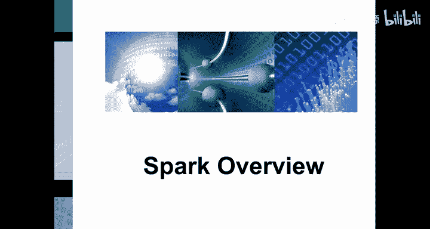

在本节课中，我们将学习Apache Spark是什么，了解其诞生的背景和原因，并对比Spark与Hadoop生态系统。我们还将探讨Spark的关键特性、运行方式、相关研究论文、发行版本以及丰富的社区资源。

---

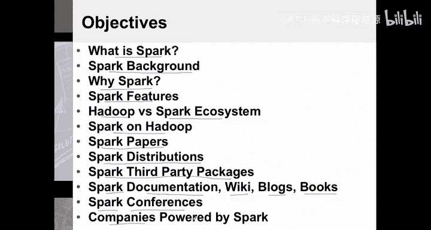

## Spark是什么？🤔

Apache Spark是一个开源的集群计算平台。这意味着它拥有自己的调度守护进程，包括一个主节点和多个工作节点，可以在多台机器上启动不同的进程和任务。从这个角度看，它类似于Hadoop的YARN。

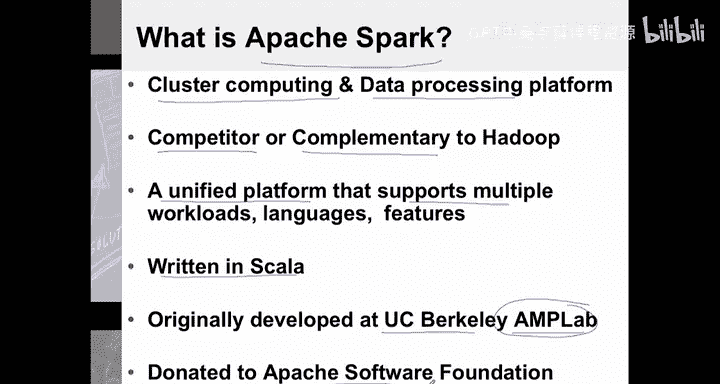

Spark也是一个数据处理平台，拥有自己的核心引擎——Spark引擎。这使得它成为Hadoop MapReduce引擎的一个竞争者。同时，Spark也可以与Hadoop生态系统互补，运行在Hadoop之上，利用HDFS和YARN。

Spark是一个统一平台，支持多种工作负载。与Hadoop核心项目主要专注于批处理不同，Spark将流处理、机器学习、SQL查询等功能都集成在一个项目中。

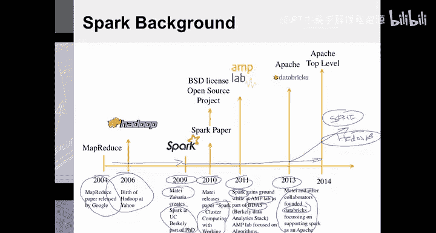

Spark项目本身使用Scala语言编写，运行在Java虚拟机之上。它最初由加州大学伯克利分校的AMPLab实验室开发，并于2010年捐赠给Apache软件基金会。

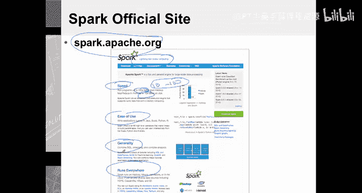

---

## Spark的背景 📜

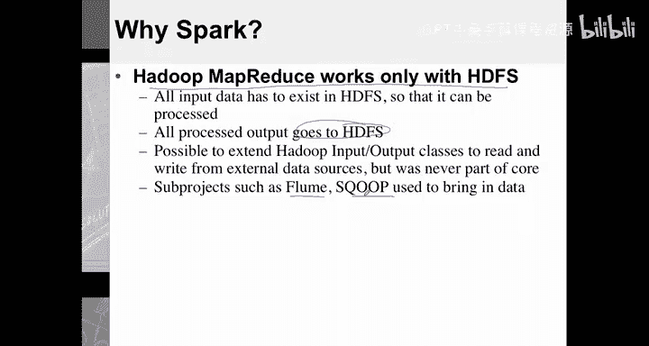

回顾Hadoop的起源，2004年Google发布的MapReduce论文启发了Yahoo在2006年启动Hadoop项目。大约在2009年，Matei Zaharia在加州大学伯克利分校攻读博士期间创建了Spark。

2010年，Matei Zaharia发表了题为《Spark: Cluster Computing with Working Sets》的论文，这使Spark开始受到关注并逐渐流行起来。2011年，伯克利AMPLab启动了名为BDAS（伯克利数据分析栈）的项目，其中就包含了Spark。

2013年，Matei Zaharia和其他Spark项目的贡献者共同创立了Databricks公司。至此，Spark生态系统正式形成，与Hadoop生态系统既存在竞争，又相互补充。

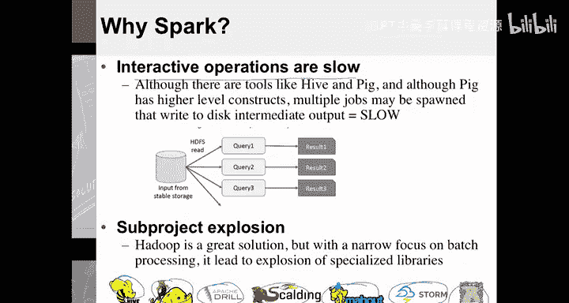

Spark的官方网站是 spark.apache.org。官网宣称它是一个“闪电般快速”的集群计算平台，比Hadoop MapReduce快10到100倍。

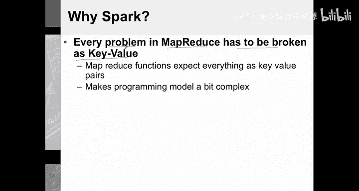

---

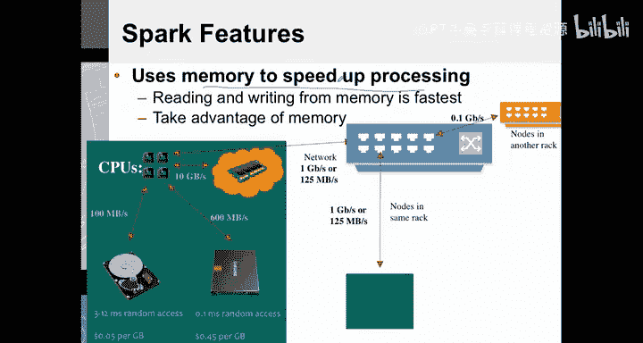

## 为什么需要Spark？⚡

上一节我们介绍了Spark的背景，本节我们来看看Spark旨在解决Hadoop MapReduce的哪些痛点。

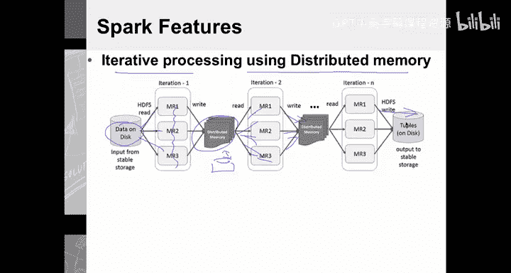

**Hadoop MapReduce的局限性：**

1.  **依赖HDFS**：MapReduce处理数据时，必须先将数据复制到HDFS中，处理结果也写回HDFS。虽然可以通过其他项目（如Flume、Sqoop）将外部数据导入HDFS，但这增加了复杂性。
2.  **迭代处理慢**：MapReduce的每个步骤都需要将中间结果写入磁盘。对于需要多次迭代的算法（如机器学习），反复的磁盘I/O会严重影响性能。
3.  **交互操作慢**：虽然可以通过Hive或Pig进行交互式查询，但每个查询都可能触发一个或多个MapReduce作业，仍然受限于磁盘读写速度。
4.  **子项目爆炸**：Hadoop生态系统由众多独立的子项目（如Hive、Pig、Mahout、Storm）组成，需要分别安装和集成，增加了部署和维护的复杂度。
5.  **编程模型局限**：MapReduce要求所有问题都抽象为键值对（key-value pair）的处理，编程模型不够直观和灵活。

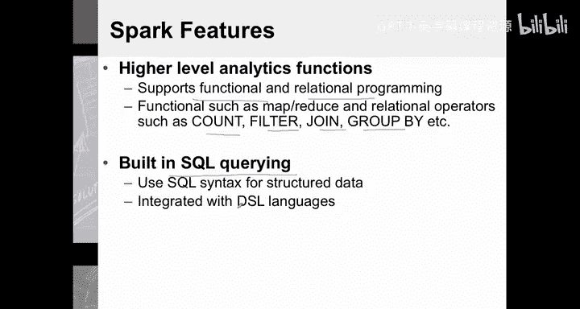

Spark正是为了克服MapReduce的上述局限性而设计的。

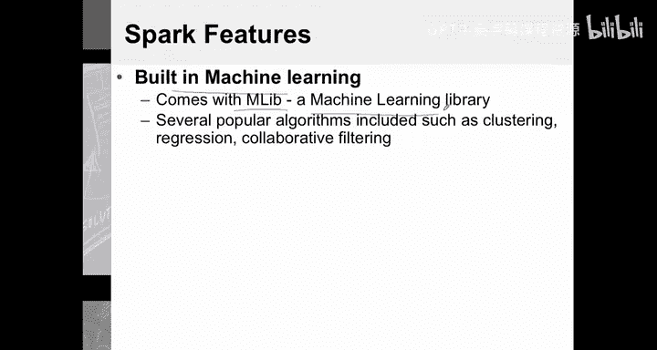

---

## Spark的核心特性 ✨

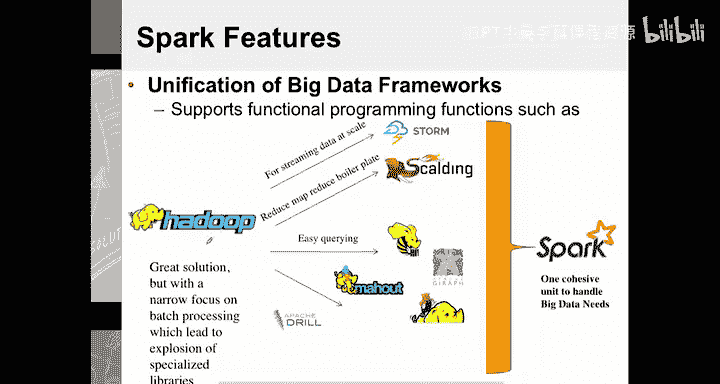

了解了Spark要解决的问题后，我们来看看Spark提供了哪些关键特性来应对这些挑战。

**以下是Spark的核心特性：**

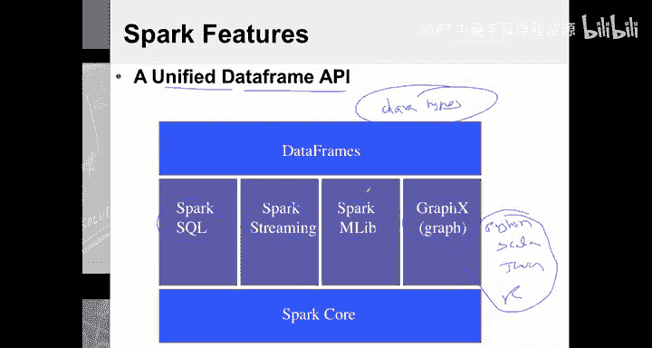

1.  **利用内存加速处理**：数据读取和写入的速度，内存（约10 GB/s）远快于SSD（约600 MB/s）和机械硬盘（约100 MB/s）。Spark通过其核心数据结构——**弹性分布式数据集（RDD）**，尽可能将数据保留在内存中进行计算，仅在内存不足时才溢出到本地磁盘，从而极大提升了处理速度。
2.  **支持迭代处理**：Spark可以在内存中保存中间计算结果，供下一次迭代直接使用，避免了反复的磁盘I/O，特别适合机器学习等需要多次迭代的算法。
3.  **支持交互式处理**：由于数据主要驻留在内存中，Spark能够提供真正快速的交互式查询体验，用户可以通过Spark Shell与数据进行实时交互。
4.  **丰富的操作符**：除了Map和Reduce，Spark还支持`count`、`filter`、`join`、`groupBy`等多种关系型操作符，以及通过**Spark SQL**提供的SQL查询接口。
5.  **多语言统一API**：Spark提供了Scala、Java、Python和R语言的统一API，允许用户使用自己熟悉的语言进行开发。
6.  **实时流处理**：通过**Spark Streaming**模块，Spark可以处理实时流入的数据流。
7.  **内置机器学习库**：**MLlib**是Spark内置的机器学习库，提供了常见的机器学习算法。
8.  **图处理**：**GraphX**模块提供了图处理API，支持像PageRank、三角形计数等图算法。
9.  **集群管理器**：Spark自带集群管理器（Standalone模式），可以管理由主节点和工作节点组成的集群。它也支持运行在Apache Mesos或Hadoop YARN之上。
10. **统一的大数据框架**：Spark将批处理、交互查询、流处理、机器学习和图计算整合在一个统一的平台中，简化了技术栈。
11. **统一数据帧API**：在Spark 2.0中引入了**DataFrame API**（在RDD之上构建），它不仅知道数据内容，还知道数据的类型（Schema），为不同语言提供了统一且更高效的数据操作接口。

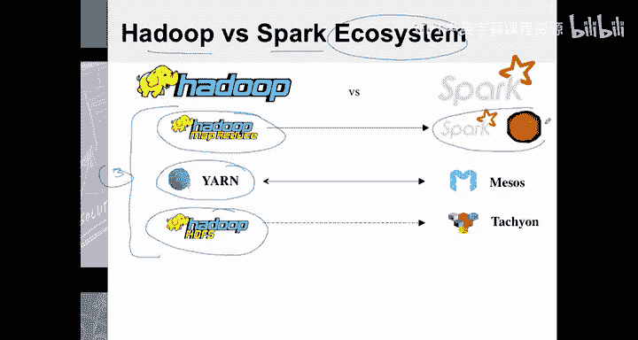

---

## Hadoop vs. Spark 生态系统对比 🔄

我们已经分别了解了Hadoop和Spark的特性，现在我们来系统地对比一下两者的生态系统。


**Hadoop生态系统核心包括：**
*   **HDFS**：分布式文件系统。
*   **YARN**：集群资源管理和作业调度框架。
*   **MapReduce**：数据处理引擎。
*   **其他子项目**：如Hive（SQL）、Pig（脚本）、Mahout（机器学习）、Storm（流处理）等，这些是独立于核心Hadoop的项目，需要额外集成。

**Spark生态系统核心包括：**
*   **Spark Core**：包含RDD和核心API。
*   **内置模块**：**Spark SQL**、**Spark Streaming**、**MLlib**、**GraphX**。这些功能都集成在Spark项目内，下载Spark即包含所有模块。
*   **可集成的外部项目**：如集群管理器Apache Mesos、分布式文件系统Tachyon等。
*   **多语言支持**：Scala、Java、Python、R。

**关键区别：** Hadoop的核心三组件与高级功能（如SQL、机器学习）是分离的不同项目；而Spark将高级功能作为统一项目内的内置模块。Spark既可以独立运行，也可以完美地运行在现有的Hadoop集群之上，使用HDFS存储和YARN进行资源调度。

---

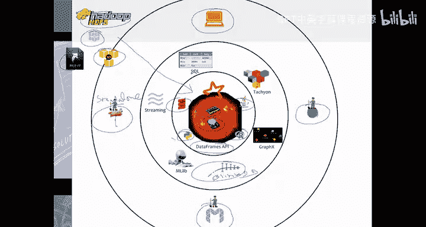

## Spark 运行架构全景图 🗺️

为了更直观地理解Spark如何融入大数据技术栈，我们来看一下Spark从数据源到处理引擎的完整运行架构。

下图展示了Spark生态系统的大致全景：

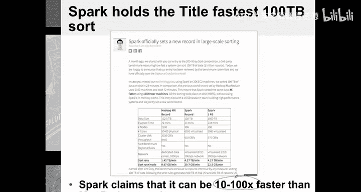

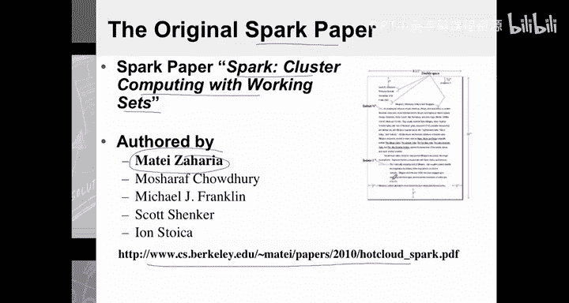

```
[数据源]
    |
    |--- 分布式文件系统 (HDFS, Tachyon, S3...)
    |
    |--- 分布式数据库 (MongoDB, Cassandra, HBase...)
    |
    |--- 流数据源 (Kafka, Flume...)
    |
    v
[Spark Core (运行在集群管理器上)]
    |
    |--- 集群管理器：Standalone模式 / Apache Mesos / Hadoop YARN
    |
    v
[Spark 处理模块]
    |
    |--- Spark SQL        (交互查询)
    |
    |--- Spark Streaming  (流处理)
    |
    |--- MLlib            (机器学习)
    |
    |--- GraphX           (图计算)
    |
    v
[多语言API]
    |
    |--- Scala / Python / Java / R
    |
    v
[应用程序]
```

**架构要点：**
*   **数据源多样性**：Spark可以从HDFS、本地文件系统、Amazon S3、以及各种NoSQL和关系型数据库中读取数据，处理后再写回这些系统。
*   **集群管理器灵活性**：Spark可以运行在自带的Standalone集群模式上，也可以运行在更通用的集群管理器如Apache Mesos或Hadoop YARN上。
*   **处理引擎统一性**：所有高级处理模块（SQL、Streaming等）都构建在Spark Core之上，共享RDD和内存计算的优势。
*   **开发接口友好**：为不同开发者提供了Scala、Python、Java、R等多种编程语言接口。

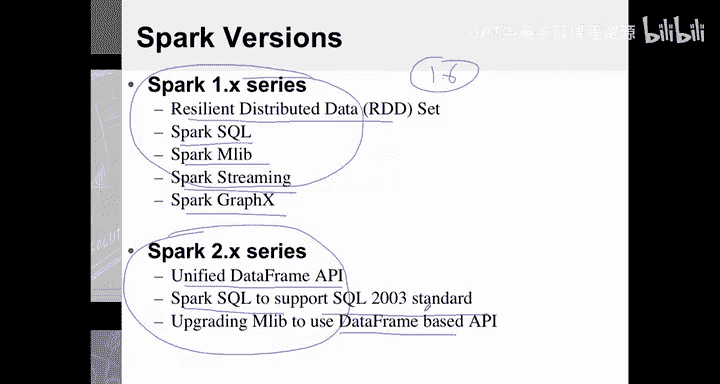

---

## Spark 发行版、社区与资源 📚

了解了Spark的技术架构后，我们来看看在实际应用中如何获取、使用Spark以及从哪里获得支持。

**以下是Spark相关的发行版与资源：**

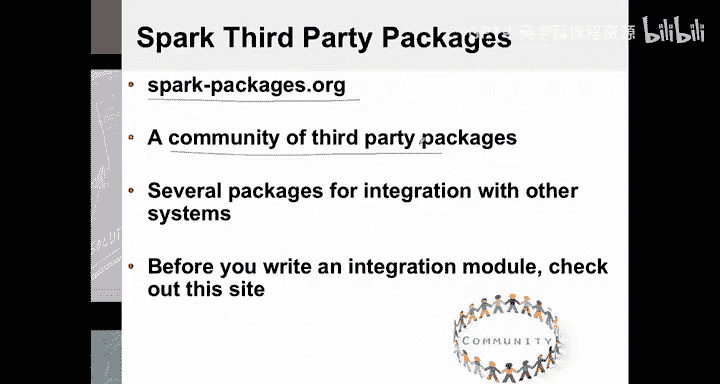

1.  **主要发行版**：
    *   **Databricks**：由Spark创始人创建的公司，提供商业支持和托管平台。
    *   **Cloudera CDH**、**Hortonworks HDP**、**MapR**：主流Hadoop发行商都将Spark集成在其平台中。
    *   **Amazon EMR**：AWS的云服务，提供Spark作为处理选项。
    *   其他如IBM、Oracle等公司也提供集成了Spark的解决方案。

2.  **Spark版本**：
    *   **Spark 1.x**：稳定版本，核心是RDD API。本课程使用此版本。
    *   **Spark 2.x**：新版本，核心是统一DataFrame/Dataset API，性能更优，并增强了对SQL标准的支持。

3.  **社区与第三方包**：
    *   **spark-packages.org**：社区维护的第三方库仓库，包含各种数据源连接器、算法库等。
    *   **官方文档**：访问 spark.apache.org/docs 获取API文档，可根据编程语言（Scala/Python/Java/R）筛选示例。
    *   **Wiki与邮件列表**：官方Wiki和用户邮件列表是解决问题的重要渠道。
    *   **Stack Overflow**：使用 `[apache-spark]` 标签可以找到大量问答。

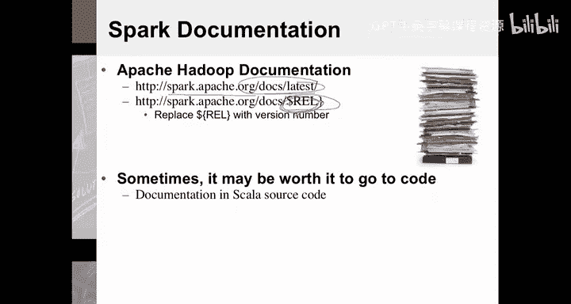

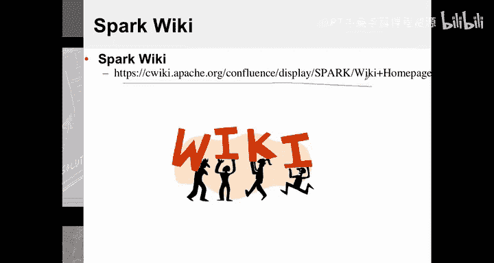

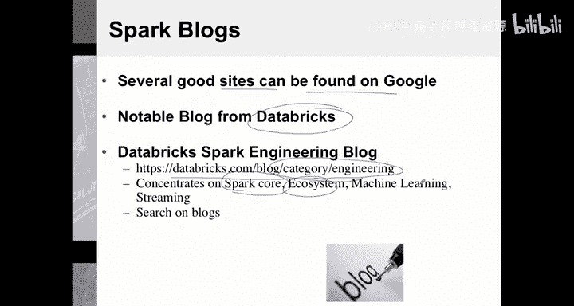

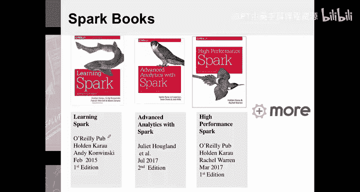

4.  **学习资源**：
    *   **书籍**：目前多数书籍基于Spark 1.x（如《Learning Spark》）。Spark 2.x的书籍正在陆续出版。
    *   **博客**：Databricks公司博客是获取深度技术文章的好地方。
    *   **会议**：**Spark Summit** 是主要的Spark技术会议，每年在旧金山、纽约和欧洲举行。
    *   **认证**：Databricks、Cloudera、IBM等公司提供Spark开发者认证。

5.  **应用案例**：许多知名公司都在使用Spark，如Amazon、eBay、阿里巴巴、腾讯等，用于处理大规模数据分析和机器学习任务。


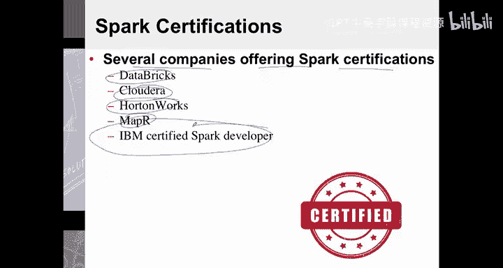

---

## 总结 🎯

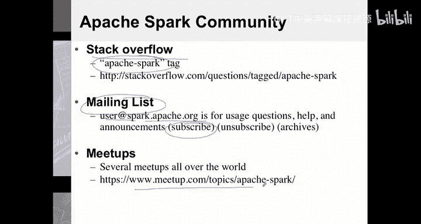

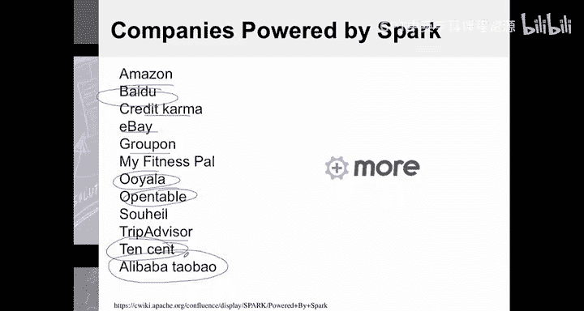

本节课中，我们一起学习了Apache Spark的核心概念。

我们了解到Spark是一个快速的、统一的集群计算和数据处理平台，它通过**内存计算**和**弹性分布式数据集（RDD）** 解决了Hadoop MapReduce在迭代处理和交互查询上的性能瓶颈。Spark集成了SQL查询、流处理、机器学习和图计算等多种功能，并提供了多语言API。

Spark既可以独立运行，也可以与现有的Hadoop生态系统（HDFS, YARN）无缝集成。它拥有活跃的社区、丰富的第三方库以及由多家厂商提供的商业发行版和支持。

总而言之，Spark以其速度、易用性和统一的栈，成为了现代大数据处理中一个极其重要的工具。