# 课程28：Spark架构解析 🚀

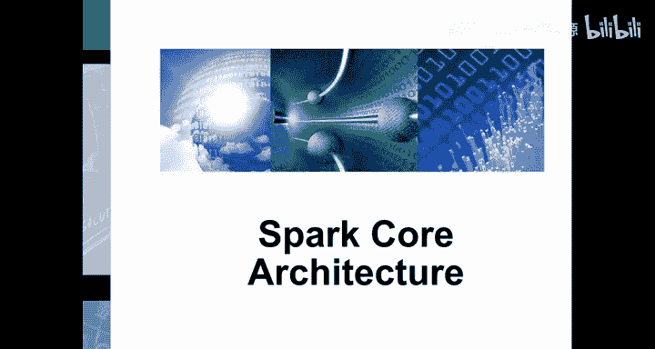

在本节课中，我们将学习Spark的核心架构组件、应用运行模式、主节点模式以及其处理模型。我们将深入理解RDD、驱动程序、执行器等核心概念，并了解Spark如何以不同模式运行。

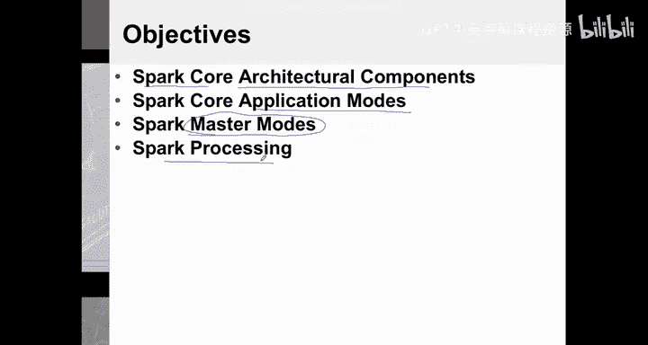

---

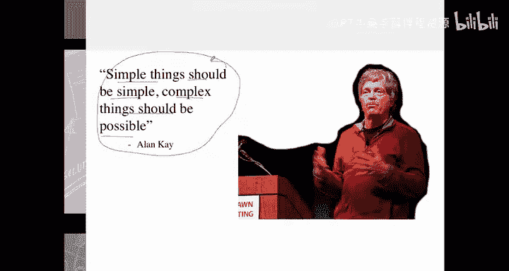

## Spark核心架构组件

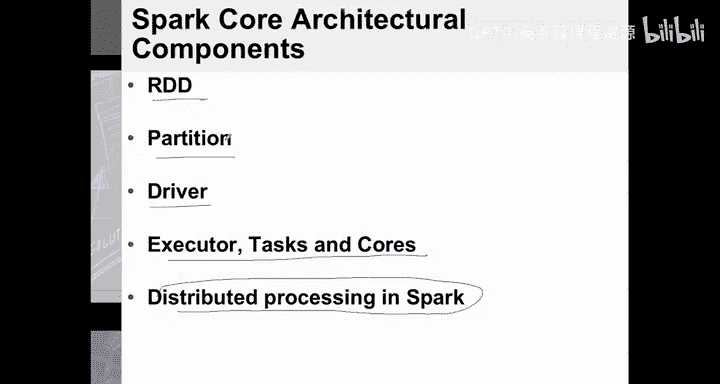

上一节我们介绍了Spark的概述，本节中我们来看看构成Spark核心架构的具体组件。

Spark的核心架构组件包括：**RDD**、**分区**、**驱动程序**、**执行器**、**任务**和**核心**。这些组件共同协作，实现了Spark的分布式数据处理能力。

### RDD：弹性分布式数据集

RDD是Spark最基本的数据抽象，代表一个**不可变、可分区、可并行计算**的元素集合。其核心思想源于2010年Matei Zaharia等人的论文《Spark: Cluster Computing with Working Sets》。

*   **弹性**：如果持有某个分区的机器崩溃，Spark可以从数据源重建该分区。
*   **分布式**：数据被分割并分布在集群的多个节点上。
*   **数据集**：可以是任何类型的数据集合。

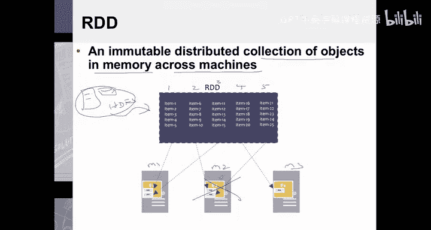

**公式/代码描述**：`RDD[T]` 表示一个类型为 `T` 的RDD。

### 分区

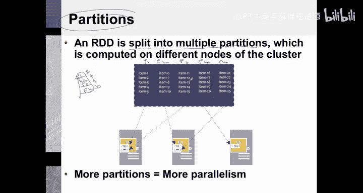

RDD被分割成多个**分区**，每个分区是数据集的一个子集。分区是Spark中并行处理的基本单位。

*   从HDFS加载数据时，每个HDFS块通常成为一个RDD分区。
*   分区数量决定了并行度。分区越多，并行处理能力越强，因为每个分区由一个单独的任务处理。

### 驱动程序

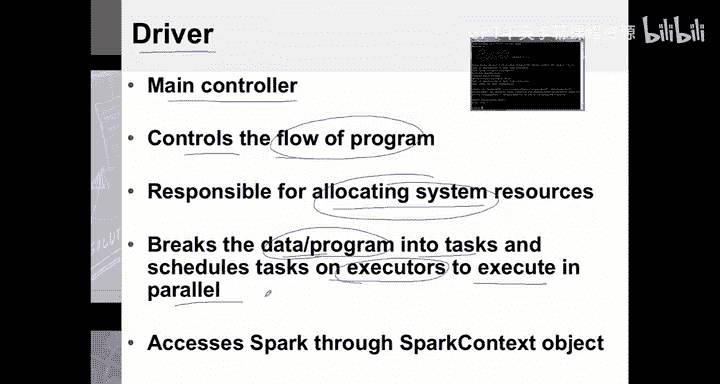

驱动程序是Spark应用的**主控程序**。它负责执行用户编写的`main`函数，并创建SparkContext对象。

驱动程序的主要职责包括：
*   与集群管理器通信，申请执行任务所需的资源。
*   将用户程序分解为多个任务。
*   将任务调度到各个执行器上运行。

**代码描述**：驱动程序是包含 `main` 方法并创建 `SparkContext` 的进程。

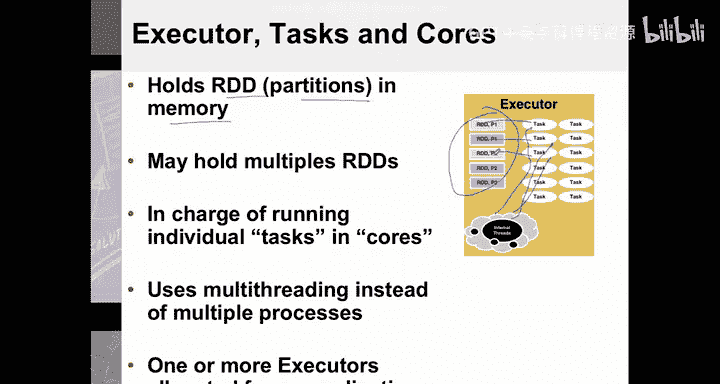

### 执行器与任务

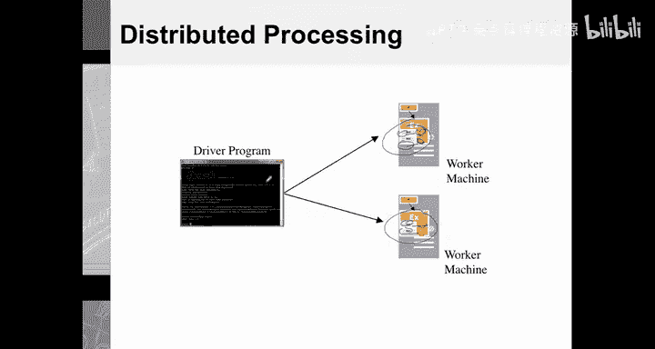

执行器是运行在集群工作节点上的**工作进程**。每个应用都有自己的一组执行器。

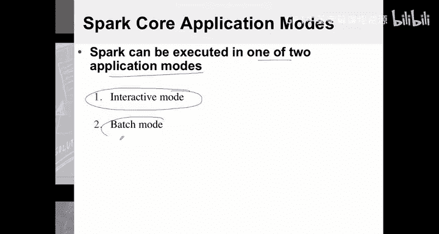

*   执行器负责在内存中存储RDD数据。
*   执行器内部运行多个**任务**。任务是实际执行计算的工作单元，以线程的形式运行在执行器进程中。
*   与Hadoop MapReduce（每个任务运行在独立的JVM中）不同，Spark的任务是执行器进程内的线程，这减少了任务启动的开销。

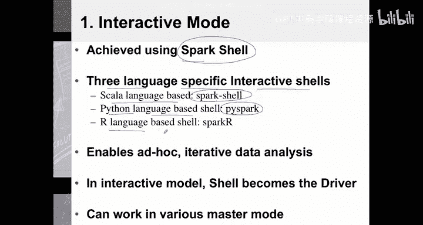

**核心关系**：一个执行器包含多个核心（线程），每个核心运行一个任务，每个任务处理一个RDD分区。

---

## Spark核心应用模式

了解了核心组件后，我们来看看Spark应用可以以哪两种模式运行。

Spark支持两种主要的应用执行模式：**交互式模式**和**批处理模式**。

以下是两种模式的详细介绍：

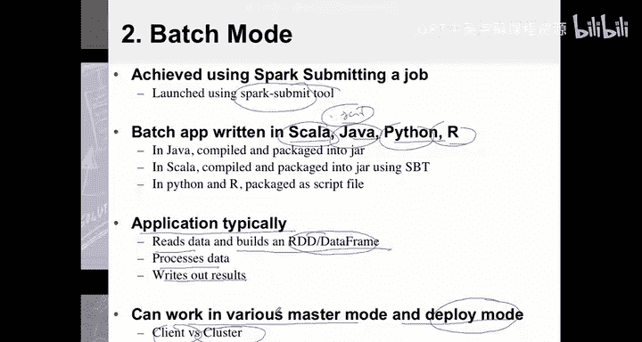

*   **交互式模式**
    *   通过Spark Shell实现，用于**即席查询**和**迭代式数据分析**。
    *   启动后，Shell本身作为驱动程序，并内置了`SparkContext`对象，用户可以直接输入命令与Spark交互。
    *   支持Scala（`spark-shell`）、Python（`pyspark`）和R（`sparkR`）语言。

*   **批处理模式**
    *   通过`spark-submit`工具提交打包好的应用程序（JAR包或Python脚本）。
    *   应用程序通常遵循“读取数据 -> 构建RDD -> 转换处理 -> 输出结果”的流程。
    *   这是生产环境中运行Spark作业的标准方式。

---

## Spark主节点模式

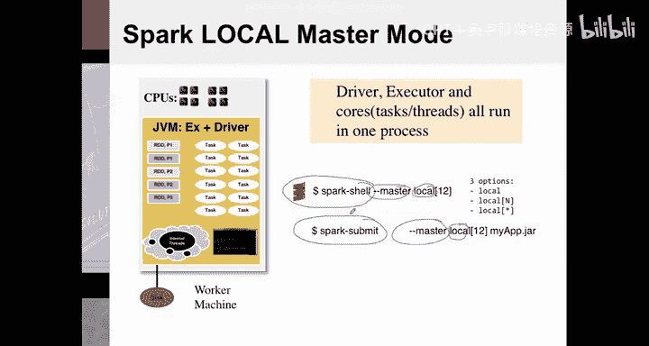

无论以何种应用模式运行，我们都需要指定集群的**主节点模式**，它决定了Spark如何管理集群资源。

Spark支持多种主节点模式，主要分为**本地模式**和**分布式集群模式**。

以下是各种主节点模式的说明：

*   **本地模式**
    *   通过 `--master local[*]` 指定。
    *   所有组件（驱动程序、执行器）都在**单个机器**的**单个JVM进程**内运行。
    *   适用于**开发、测试和原型验证**，而非分布式处理。

*   **独立模式**
    *   通过 `--master spark://HOST:PORT` 指定。
    *   使用Spark内置的**独立集群管理器**。
    *   架构包含一个Spark主节点（类似YARN的ResourceManager）和多个工作节点（Worker）。
    *   驱动程序向主节点申请资源，并在工作节点上启动执行器。

*   **YARN模式**
    *   通过 `--master yarn` 指定。
    *   利用Hadoop YARN作为集群资源管理器。这是企业环境中常见的选择。
    *   根据`--deploy-mode`参数的不同，分为两种子模式：
        *   **客户端模式**：驱动程序运行在提交作业的客户端机器上。客户端必须保持在线直至作业完成。
        *   **集群模式**：驱动程序运行在YARN的Application Master容器中。客户端提交作业后即可断开连接。

*   **Mesos模式**
    *   通过 `--master mesos://HOST:PORT` 指定。
    *   使用Apache Mesos作为集群资源管理器。

---

## Spark处理模型

最后，我们来了解Spark的编程处理模型，这与我们熟悉的MapReduce模型有相似之处，但更加强大。

Spark的操作分为两大类：**转换**和**行动**。

*   **转换操作**：用于从现有RDD创建新的RDD。例如 `map()`、`filter()`、`groupByKey()`。转换是**惰性求值**的，它们只记录转换关系，并不立即执行计算。
*   **行动操作**：触发实际的计算，并向驱动程序返回结果或向存储系统写入数据。例如 `count()`、`collect()`、`saveAsTextFile()`、`reduce()`。

**核心区别**：只有当一个行动操作被调用时，Spark才会开始计算所有累积的转换操作，这个特性使得Spark可以进行高效的优化。

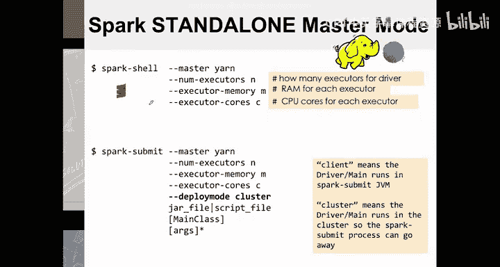

---

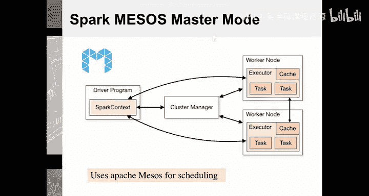

## 总结

本节课中我们一起学习了Spark的核心架构。

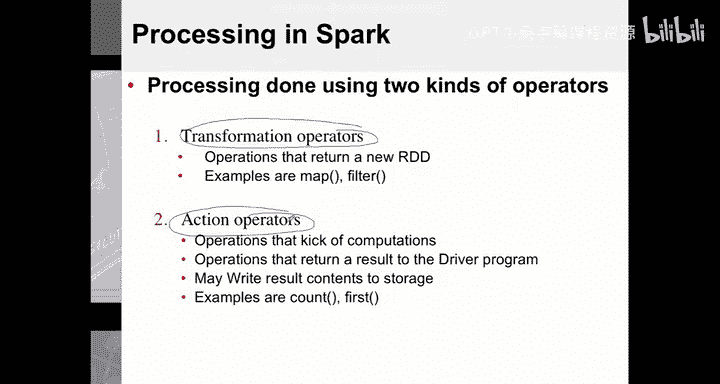

我们首先介绍了**RDD**这一核心数据抽象，它是在内存中跨机器分布的弹性数据集。接着，我们了解了**驱动程序**作为应用的控制中心，以及**执行器**作为运行任务的工作进程。

然后，我们探讨了Spark的两种**应用模式**：用于探索的交互式模式和用于生产的批处理模式。在**主节点模式**部分，我们区分了用于本地测试的本地模式，以及用于分布式计算的独立模式、YARN模式和Mesos模式，并特别说明了YARN模式下客户端与集群部署的区别。

最后，我们学习了Spark的**处理模型**，理解了惰性求值的**转换操作**和触发实际计算的**行动操作**之间的关键差异。

这些概念构成了Spark强大功能的基础，随着后续的实践操作，你对它们的理解会更加清晰和深入。