# 课程29：Spark环境配置与运行 🚀

在本节课中，我们将学习如何下载、安装和运行Apache Spark。我们将重点学习两种运行模式：一是将Spark与Hadoop YARN架构结合运行（即Spark on YARN），二是在本地运行Spark。我们将通过详细的步骤，确保初学者能够成功搭建并运行Spark环境。

---

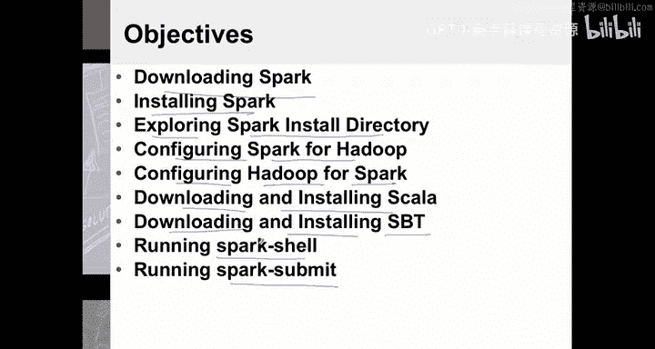

## 概述

本节教程的目标是配置一个完整的Spark开发与运行环境。我们将依次完成以下任务：
1.  下载并安装Spark。
2.  探索Spark的安装目录结构。
3.  配置Spark以集成Hadoop环境。
4.  下载并安装Scala语言和SBT构建工具。
5.  学习如何运行Spark Shell进行交互式操作。
6.  学习如何使用Spark Submit提交批处理应用。

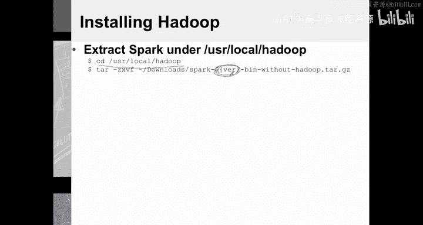

---

## 下载与安装Spark

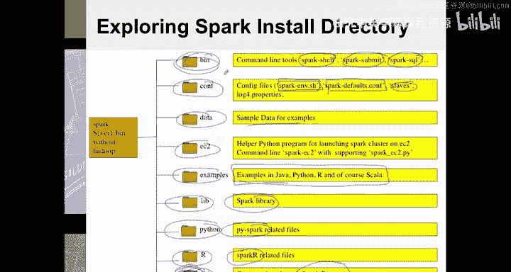

Spark是Apache的开源项目。我们可以从其官方网站下载。

以下是下载和安装Spark的步骤：

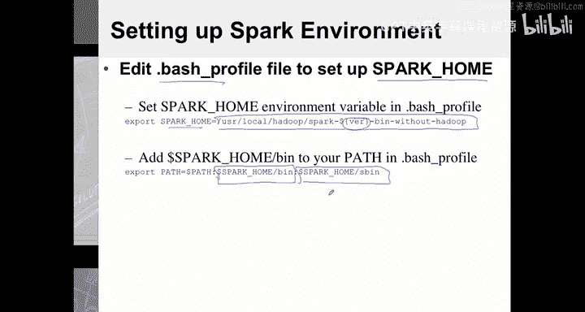

1.  **访问下载页面**：打开浏览器，访问 `spark.apache.org`，点击“Download”链接，或直接访问下载存档页面。
2.  **选择版本**：本教程使用Spark 2.4.4版本。请确保下载与你的Hadoop版本兼容的Spark。
3.  **选择包类型**：由于我们已经安装了Hadoop，因此需要选择“Pre-built for Apache Hadoop 2.7 and later”或类似的“Without Hadoop”选项。我们将下载 `spark-2.4.4-bin-without-hadoop.tgz`。
4.  **解压安装**：将下载的压缩包解压到Hadoop生态系统的统一目录下，例如 `/usr/local/hadoop/`。

```bash
cd /usr/local/hadoop
tar -zxvf ~/Downloads/spark-2.4.4-bin-without-hadoop.tgz
```

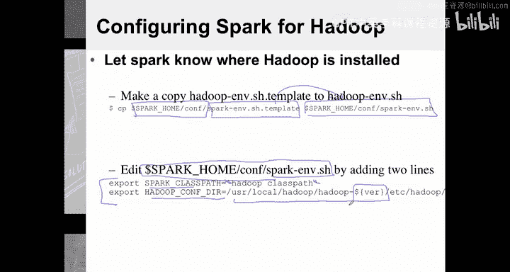

解压后，你将在 `/usr/local/hadoop/` 目录下看到一个名为 `spark-2.4.4-bin-without-hadoop` 的文件夹。

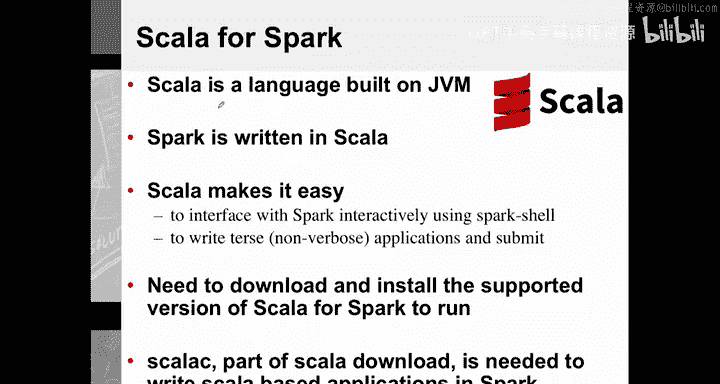

---

## 探索Spark目录结构

上一节我们完成了Spark的安装，本节我们来查看其目录结构，了解各个文件夹的作用。

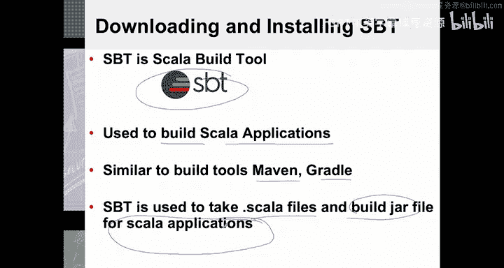

进入Spark安装目录，你会看到以下主要文件夹：

*   **`bin/`**：包含最重要的命令行工具。
    *   `spark-shell`：用于以交互模式启动Spark。
    *   `spark-submit`：用于提交批处理应用程序。
    *   `spark-sql`：用于以SQL模式执行Spark。
*   **`conf/`**：存放配置文件。
    *   `spark-env.sh.template`：环境变量配置模板。
    *   `spark-defaults.conf`：默认配置。
    *   `slaves`：在独立集群模式下，用于指定工作节点。
*   **`examples/`**：包含多种语言的示例代码（Java, Python, R, Scala），是学习的好资源。
*   **`lib/`**：Spark的核心库文件。
*   **`sbin/`**：包含用于启动Spark守护进程的脚本。**注意**：由于我们将Spark运行在YARN上，而非独立模式，因此通常不需要使用此目录下的脚本。

了解这些目录有助于后续的配置和问题排查。

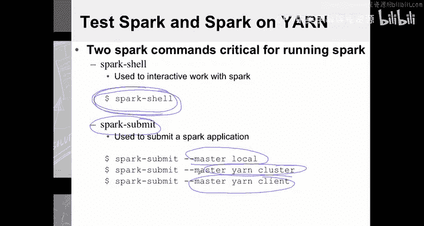

---


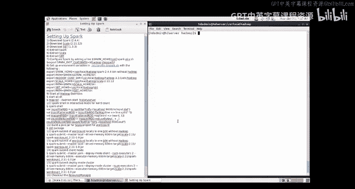

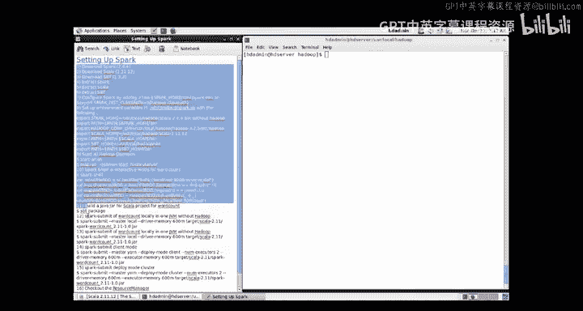

## 配置Spark环境变量

为了让系统识别Spark命令，我们需要设置环境变量。

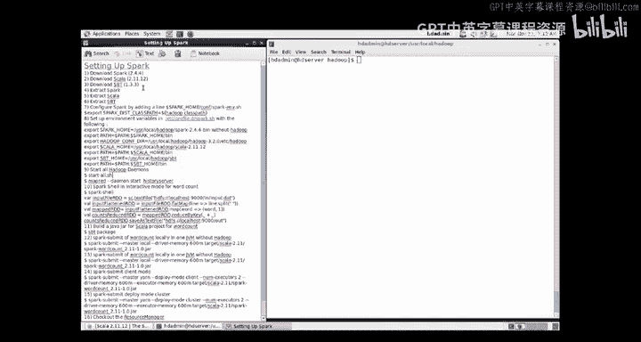

编辑用户主目录下的 `.bash_profile` 或 `.bashrc` 文件，添加以下内容：

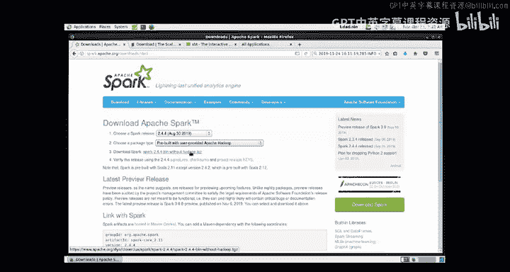

```bash
export SPARK_HOME=/usr/local/hadoop/spark-2.4.4-bin-without-hadoop
export PATH=$PATH:$SPARK_HOME/bin
```

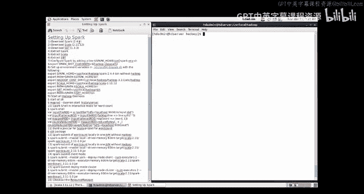

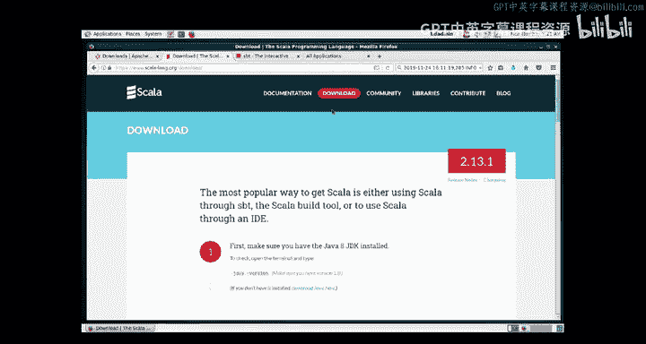

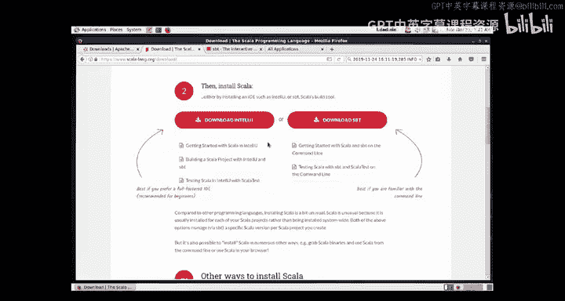

*   `SPARK_HOME`：指向Spark的安装目录。
*   `PATH`：将Spark的 `bin` 目录加入系统路径，这样你就可以在终端直接运行 `spark-shell` 和 `spark-submit` 命令。

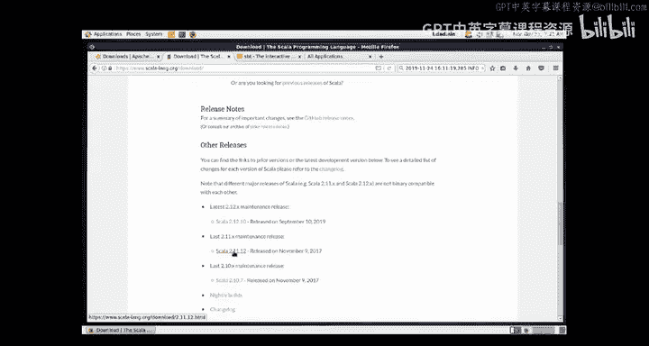

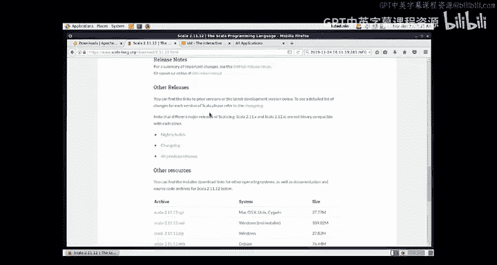

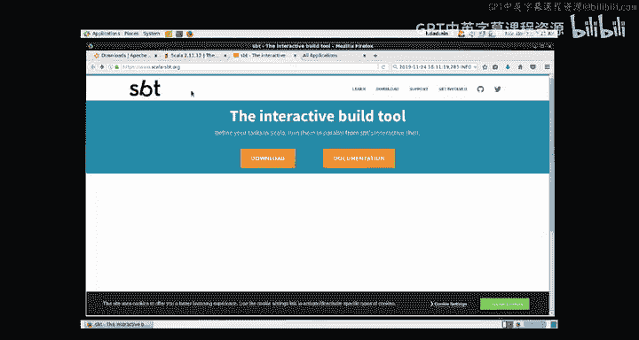

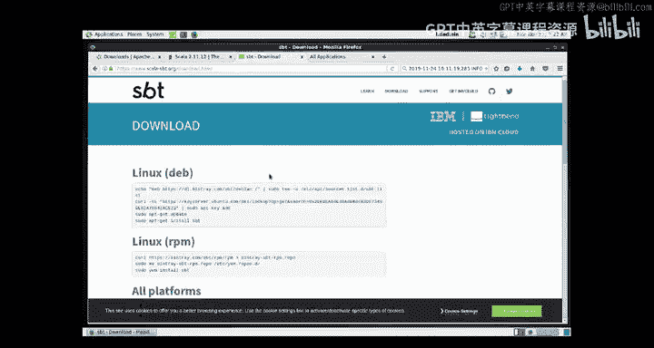

保存文件后，执行 `source ~/.bash_profile` 使配置生效。

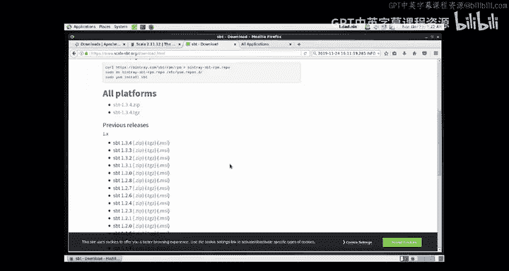

---

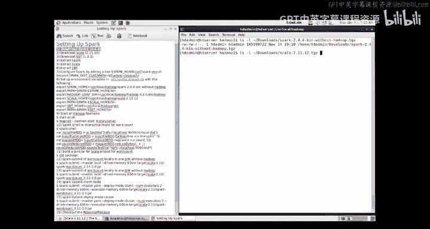

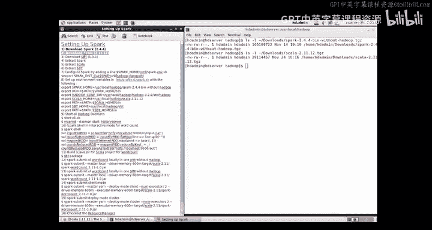

## 配置Spark以集成Hadoop

现在，我们需要告诉Spark Hadoop的位置，以便它们协同工作。

以下是配置步骤：

1.  **进入配置目录**：
    ```bash
    cd $SPARK_HOME/conf
    ```

2.  **创建环境配置文件**：复制模板文件并创建实际的配置文件。
    ```bash
    cp spark-env.sh.template spark-env.sh
    ```

3.  **编辑配置文件**：使用文本编辑器（如vi）打开 `spark-env.sh` 文件，在文件末尾添加以下两行：
    ```bash
    export SPARK_DIST_CLASSPATH=$(hadoop classpath)
    export HADOOP_CONF_DIR=/usr/local/hadoop/hadoop-3.2.0/etc/hadoop
    ```
    *   第一行：通过执行 `hadoop classpath` 命令，自动获取Hadoop的所有类库路径，并设置为Spark的类路径。这是一种简便的集成方式。
    *   第二行：明确指定Hadoop配置文件的目录，确保Spark能读取到Hadoop的核心配置（如 `core-site.xml`, `hdfs-site.xml`, `yarn-site.xml`）。

完成这些配置后，Spark就知道了如何连接到现有的Hadoop集群。

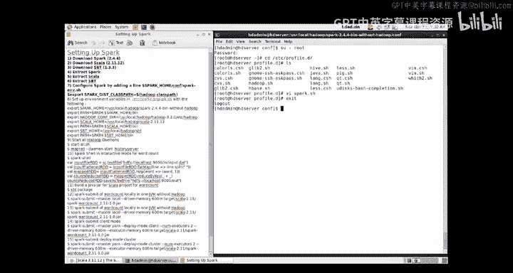

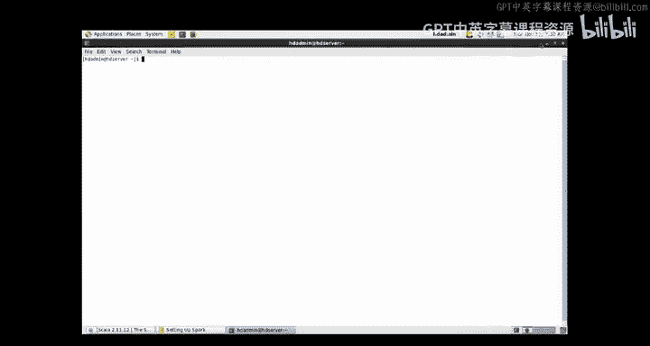

---

## 下载与安装Scala

Spark本身运行在JVM上，但为了使用Scala语言编写和编译Spark应用，我们需要单独安装Scala。

以下是安装步骤：

1.  **访问官网下载**：访问 `scala-lang.org`，下载与Spark 2.4.4兼容的Scala版本（本教程使用2.11.12）。
2.  **解压安装**：将下载的Scala压缩包解压到 `/usr/local/hadoop/` 目录。
    ```bash
    cd /usr/local/hadoop
    tar -zxvf ~/Downloads/scala-2.11.12.tgz
    ```
3.  **配置环境变量**：编辑 `.bash_profile` 文件，添加Scala环境变量。
    ```bash
    export SCALA_HOME=/usr/local/hadoop/scala-2.11.12
    export PATH=$PATH:$SCALA_HOME/bin
    ```
    保存并 `source` 配置文件。现在，你可以在命令行使用 `scalac`（Scala编译器）命令了。

---

## 下载与安装SBT（Scala构建工具）

为了将Scala源代码打包成可执行的JAR文件，我们需要一个构建工具。SBT是Scala项目常用的构建工具，类似于Java的Maven或Gradle。

以下是安装步骤：

1.  **访问官网下载**：访问 `scala-sbt.org`，下载SBT（本教程使用1.3.3版本）。
2.  **解压安装**：将下载的SBT压缩包解压到 `/usr/local/hadoop/` 目录。
    ```bash
    cd /usr/local/hadoop
    tar -zxvf ~/Downloads/sbt-1.3.3.tgz
    ```
3.  **配置环境变量**：编辑 `.bash_profile` 文件，添加SBT环境变量。
    ```bash
    export SBT_HOME=/usr/local/hadoop/sbt
    export PATH=$PATH:$SBT_HOME/bin
    ```
    保存并 `source` 配置文件。现在，你可以在命令行使用 `sbt` 命令来打包项目了（例如，`sbt package`）。

---

## 运行Spark Shell（交互模式）

环境配置完成后，我们可以开始运行Spark了。首先，尝试交互模式。

确保Hadoop的所有守护进程（NameNode, DataNode, ResourceManager等）已经启动。然后，在终端直接输入：

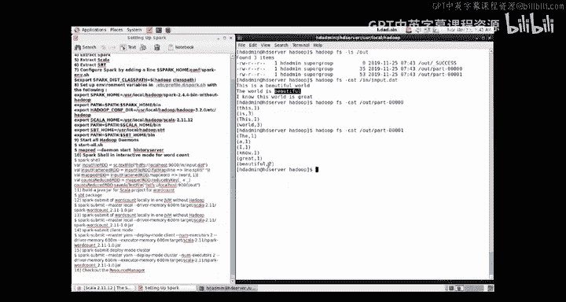

```bash
spark-shell
```

这将启动一个基于Scala的交互式命令行界面。在这个界面中，你可以逐行输入Scala代码来操作Spark，进行数据探索和分析，类似于Hive或Pig的交互模式。

**示例：交互式单词计数**
在Spark Shell中，你可以执行类似以下的代码片段来对HDFS上的文件进行单词计数：
```scala
// 从HDFS读取文件
val inputFileRDD = sc.textFile(“hdfs://localhost:9000/input/input.dat“)
// 将每行文本拆分成单词
val wordsRDD = inputFileRDD.flatMap(line => line.split(“ “))
// 将每个单词映射为 (单词, 1) 的键值对
val pairsRDD = wordsRDD.map(word => (word, 1))
// 按单词聚合，累加计数
val wordCountsRDD = pairsRDD.reduceByKey(_ + _)
// 执行行动操作，将结果保存回HDFS
wordCountsRDD.saveAsTextFile(“hdfs://localhost:9000/output“)
```
这段代码演示了Spark的核心转换和行动操作。注意，直到 `saveAsTextFile` 这个“行动”被调用时，计算才会真正执行。

---

## 运行Spark Submit（批处理模式）

除了交互模式，我们更常使用 `spark-submit` 来提交打包好的应用程序JAR包。

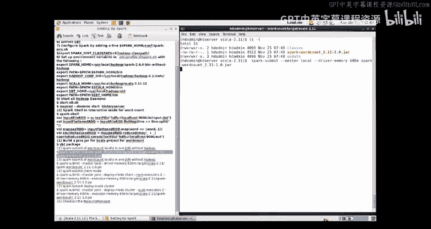

以下是使用 `spark-submit` 的几种常见模式：

1.  **本地模式**：在单个JVM进程中运行，用于测试。
    ```bash
    spark-submit --master local --driver-memory 600m /path/to/your-app.jar
    ```

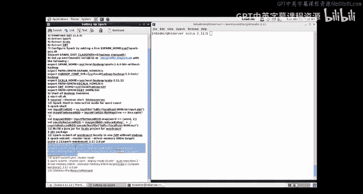

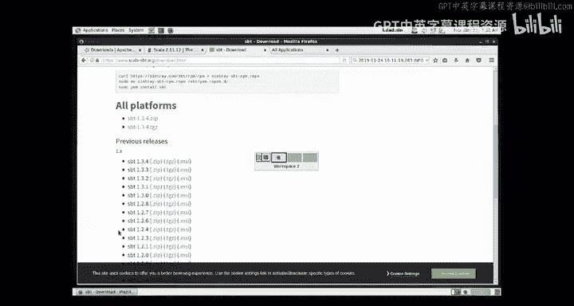

2.  **YARN客户端模式**：Driver程序运行在提交任务的客户端机器上，但任务执行在YARN集群中。
    ```bash
    spark-submit --master yarn --deploy-mode client --num-executors 2 --driver-memory 600m --executor-memory 600m /path/to/your-app.jar
    ```

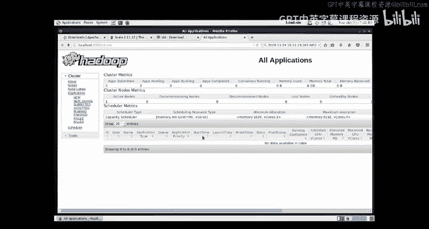

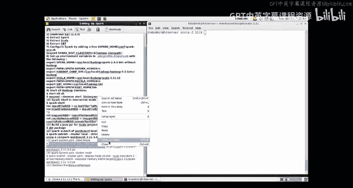

3.  **YARN集群模式**：Driver程序也运行在YARN集群的某个容器中，客户端在提交任务后可以断开。
    ```bash
    spark-submit --master yarn --deploy-mode cluster --num-executors 2 --driver-memory 600m --executor-memory 600m /path/to/your-app.jar
    ```

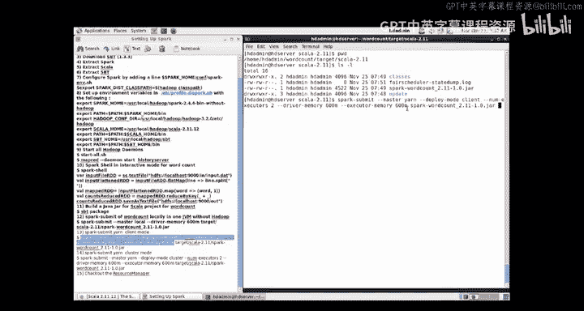

**关键参数说明**：
*   `--master`：指定运行模式（`local`, `yarn`）。
*   `--deploy-mode`：指定部署模式（`client`, `cluster`）。
*   `--num-executors`：指定执行器数量。
*   `--driver-memory`, `--executor-memory`：设置驱动器和执行器的内存。

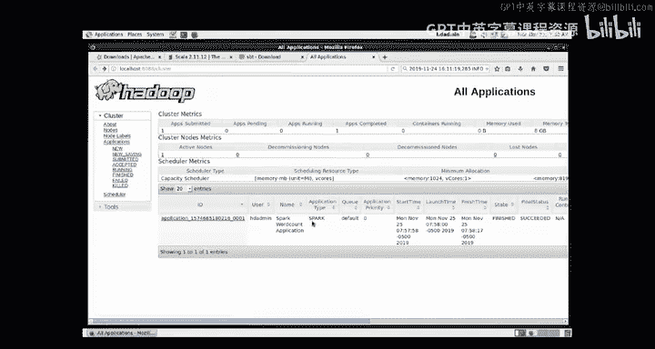

通过切换这些参数，你可以灵活地在不同环境下运行Spark应用。

---

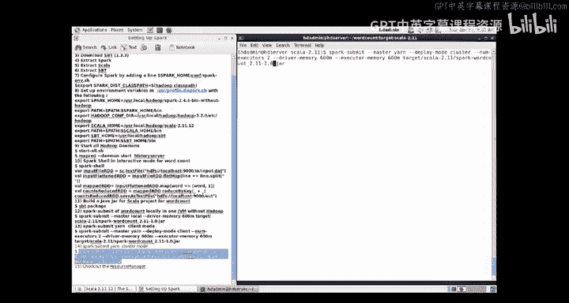

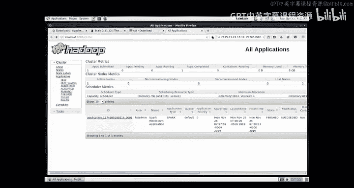

## 总结

在本节课中，我们一起学习了Spark环境的完整配置与运行流程。

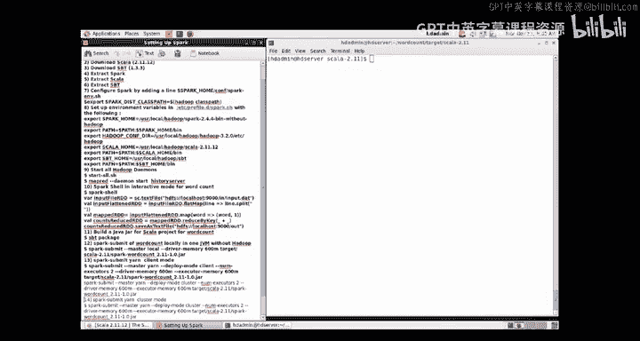

我们首先从官网下载并安装了指定版本的Spark，并了解了其目录结构。接着，我们通过配置环境变量和 `spark-env.sh` 文件，成功将Spark集成到已有的Hadoop YARN环境中。为了支持Scala开发，我们还下载并安装了Scala语言和SBT构建工具。

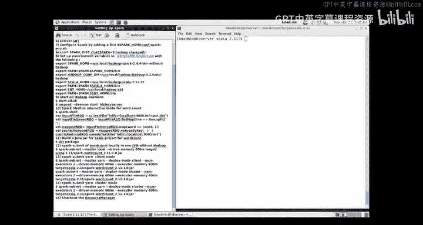

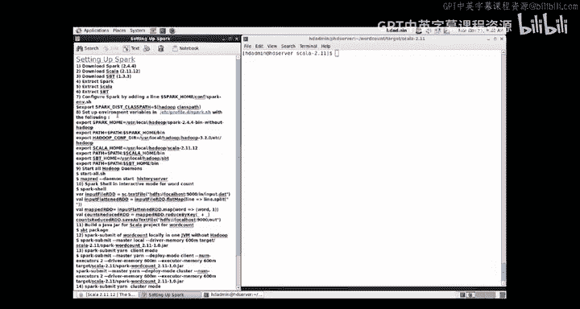

最后，我们实践了Spark的两种主要运行方式：使用 `spark-shell` 进行交互式数据操作，以及使用 `spark-submit` 以本地、YARN客户端、YARN集群等多种模式提交打包好的应用程序。

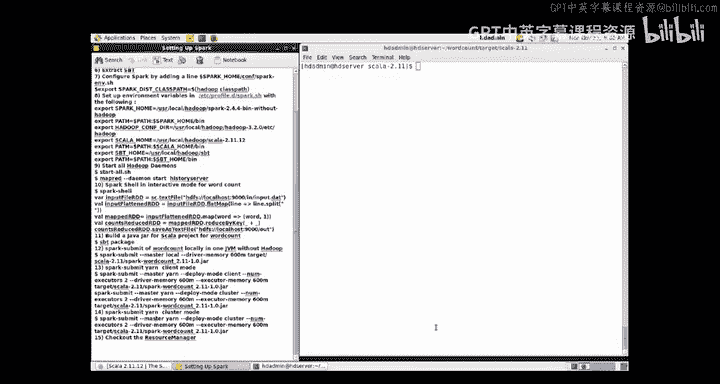

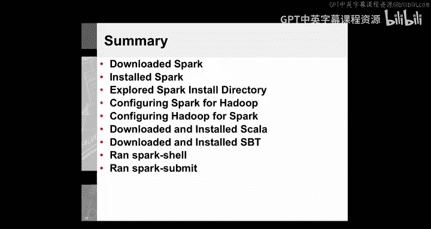


现在，你已经拥有了一个可以运行Spark on YARN的环境，可以开始进行大数据处理任务的开发与测试了。