# 课程32：Spark附加组件详解 🚀

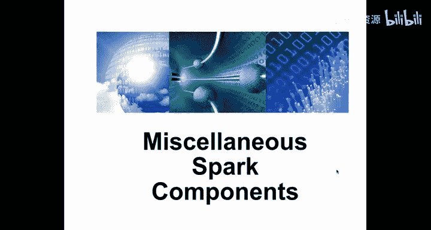

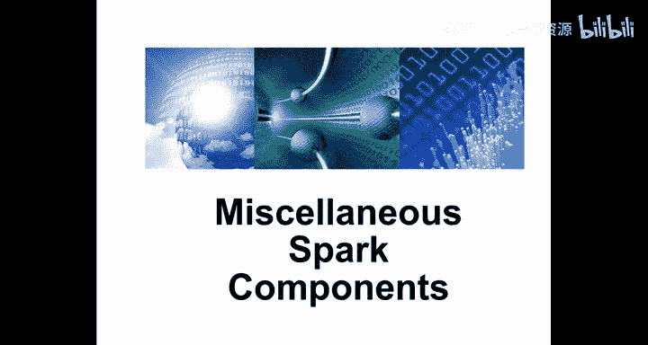

在本节课中，我们将学习Spark生态系统中的几个重要附加组件。这些组件主要用于数据科学活动，包括Spark SQL、Spark Streaming、GraphX和Spark MLlib。我们将从高层次了解它们的功能和用途，为后续深入学习数据科学课程打下基础。

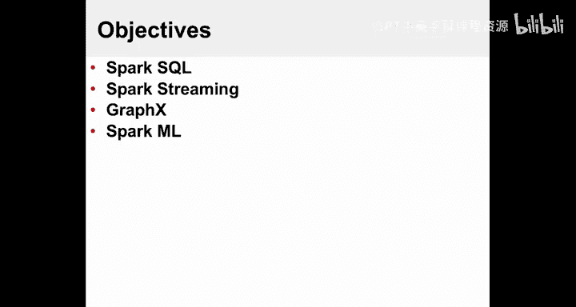

上一节我们介绍了Spark的核心概念，本节中我们来看看Spark为更高级的数据处理和分析任务提供的扩展功能。

---

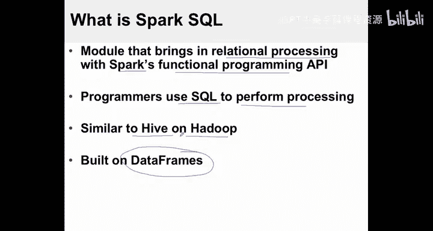

## Spark SQL 📊

Spark SQL是一个模块，它在RDD的函数式编程API之上引入了关系型处理功能。其核心思想是让程序员能够使用类似SQL的接口进行数据处理。

这与Hive在Hadoop之上提供的功能非常相似。Spark SQL使用名为**DataFrame**的API。DataFrame是一个用于Spark SQL处理的新API，它最初构建在RDD之上，但现在已转向主要使用DataFrame。

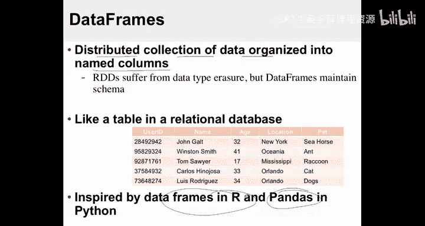

DataFrame与RDD的主要区别在于，RDD存在**数据类型擦除**问题，它不理解数据类型和字段名称，你只能通过类似`x[1]`或`_1`的索引来引用字段。而DataFrame可以使用命名的字段或列名，这正是你能在基于DataFrame构建的Spark SQL中使用类似SQL语法的原因。

Spark SQL的基础建立在DataFrame之上。DataFrame本质上是一个**分布式数据集合**，数据被组织成具有名称的列。因为它没有类型擦除，所以能记住数据类型。你可以加载包含字段名和列名的JSON对象或Avro文件，然后在其上使用类似SQL的接口。这几乎就像关系数据库中的一张表，只不过这一切都是在内存中使用DataFrame完成的。

这项技术的灵感来源于Python中的**Pandas**和R语言中的**data.frame**。

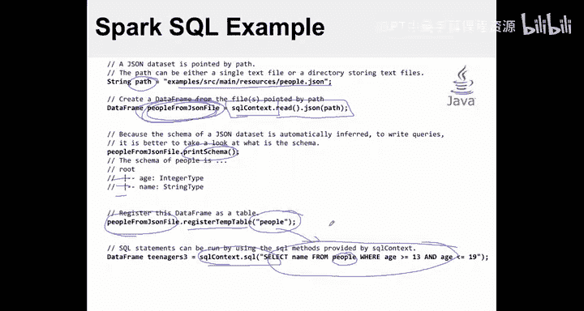

以下是Spark SQL的一个Java示例：

```java
// 创建SQLContext
SQLContext sqlContext = new SQLContext(sc);
// 从JSON文件读取数据并创建DataFrame
DataFrame df = sqlContext.read().json("path/to/people.json");
// 打印模式（schema）
df.printSchema();
// 将DataFrame注册为临时表
df.registerTempTable("people");
// 执行SQL查询
DataFrame results = sqlContext.sql("SELECT name FROM people WHERE age > 20");
```

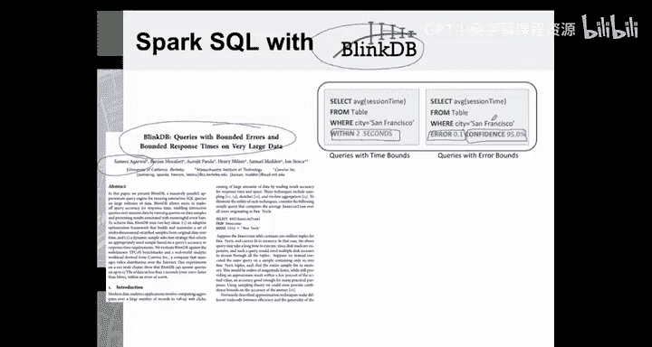

---

## Spark Streaming 🌊

Spark Streaming用于处理实时流入的数据。在大数据应用中，数据通常被批量加载到HDFS或其他存储中，然后由批处理引擎处理。但有时实时处理数据也很有价值。

在Hadoop生态中，有Apache Storm用于流处理。在Spark中，则有Spark Streaming。它扩展了核心API以支持流处理，目标是能够在Spark平台上构建一个完全分布式、容错的实时处理引擎。

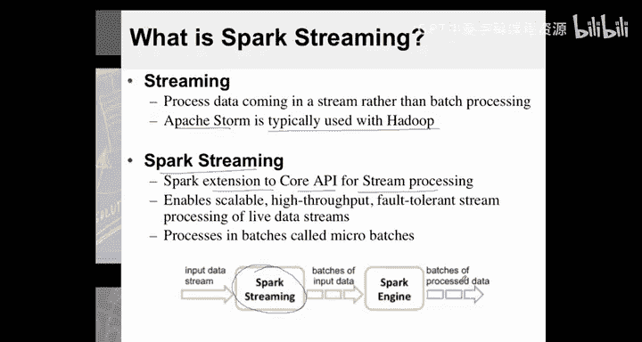

但需要记住的关键点是，Spark Streaming本质上仍是**微批处理**。其思想是：输入数据流持续进入，Spark Streaming将其按特定时间窗口（例如2秒）切分成小批次。每个批次的数据会被收集起来，进行计算，并将结果输出。因此，你是在持续地对多个微批次进行计算。

Spark Streaming的数据可以从多种来源摄取，例如Kafka、Flume、HDFS、S3、Kinesis或Twitter feeds。处理后的结果可以写回HDFS、数据库、仪表盘或其他消息队列。

处理逻辑可以使用我们之前学过的所有转换和行动操作来表达。批处理窗口可以小至**500毫秒**。你需要确保有足够的硬件资源在窗口时间内完成处理，否则会出现延迟。

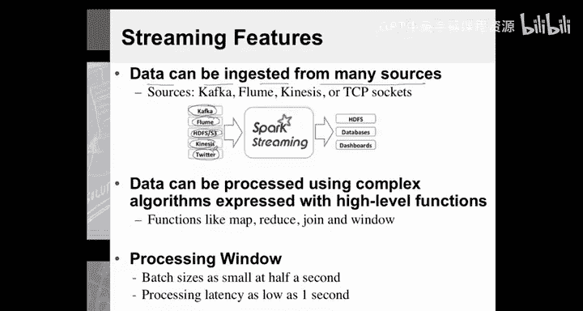

以下是Spark Streaming的两个用例：
1.  **实时页面热度分析**：用户点击网站链接产生的页面浏览量被送入Kafka队列，Spark Streaming读取这些数据，实时统计热门页面，帮助分析师了解当前网站上受欢迎的内容。
2.  **实时异常检测**：例如，将智能电表数据与实时天气数据流结合。通过连接这两个实时数据集，可以分析出用电量读数高的原因是否与冬季风暴有关，从而实现实时的数据科学分析。

需要明确的是，Spark Streaming是**微批处理**，并非像Apache Storm那样的纯实时流处理。Storm可以实现更低的延迟（低于500毫秒）。

以下是一个Python的Spark Streaming示例，它从网络套接字读取数据流：

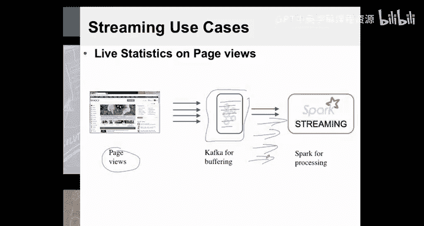

```python
from pyspark import SparkContext
from pyspark.streaming import StreamingContext

# 创建Spark上下文
sc = SparkContext("yarn", "StreamingExample")
# 创建StreamingContext，批处理间隔为1秒
ssc = StreamingContext(sc, 1)

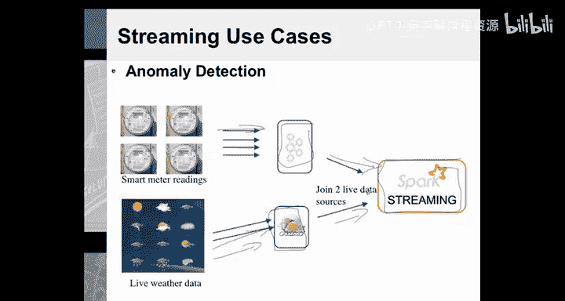

# 创建指向特定主机和端口的DStream
lines = ssc.socketTextStream("localhost", 9999)
# 对每行数据进行处理（例如单词计数）
counts = lines.flatMap(lambda line: line.split(" ")) \
              .map(lambda word: (word, 1)) \
              .reduceByKey(lambda a, b: a+b)
counts.pprint()

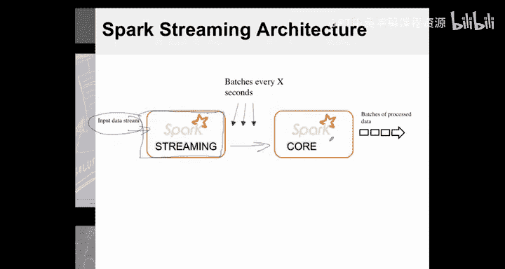

# 启动流计算
ssc.start()
ssc.awaitTermination()
```

---

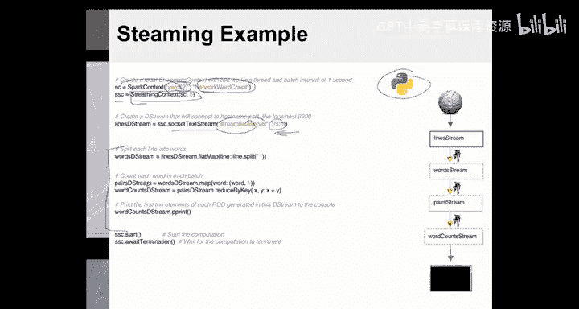

## GraphX 🕸️

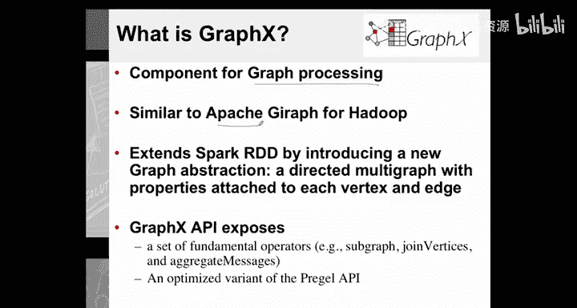

GraphX是构建在Spark之上的图处理引擎，类似于Hadoop生态中的Apache Giraph。它通过引入一个新的**图抽象API**扩展了Spark RDD。

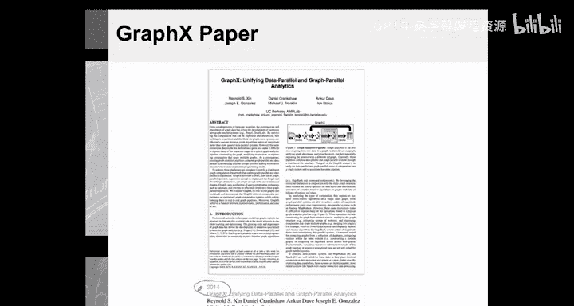

其核心思想是将数据表示为**顶点**和**边**。每个顶点代表一个数据实体（例如一个人），每条边代表实体之间的关系（例如合作、指导）。一旦数据以这种形式表示，就可以在其上执行各种图计算算法。

图处理有许多应用场景：
*   **社交网络**：分析用户之间的关系、共同访问的文档等。
*   **网页图与PageRank算法**：通过分析网页间的链接关系，计算网页的重要性排名。
*   **用户-物品图与推荐系统**：通过分析用户对物品的评分关系，构建推荐引擎。

图数据结构是许多机器学习算法的基础。GraphX提供了丰富的API，一旦构建好图数据结构，就可以调用多种算法，如PageRank、三角形计数、连通组件等。

---

## Spark MLlib 🤖

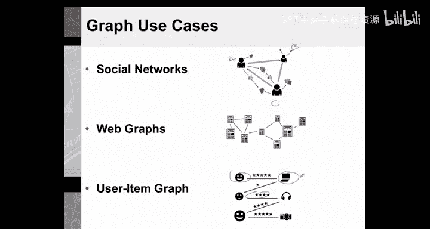

MLlib是Spark生态系统中的机器学习库，类似于Hadoop中的Apache Mahout。它使得大规模机器学习应用变得容易。

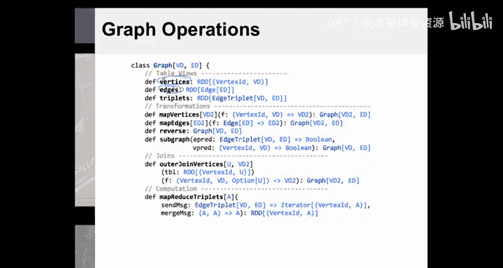

MLlib内置了许多经典算法。它最初基于RDD，在Spark 2.0版本中，正在向基于DataFrame的API迁移。

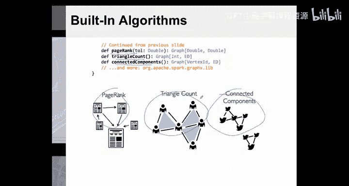

MLlib提供的算法和功能包括：
*   **分类算法**（如逻辑回归）
*   **回归分析**
*   **决策树**
*   **推荐算法**（协同过滤）
*   **聚类算法**（如K-means）
*   **特征转换与ML管道**（构建处理流水线）
*   **基础统计功能**

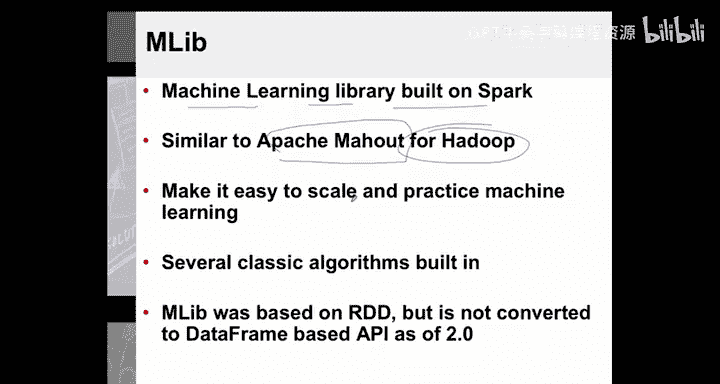

---

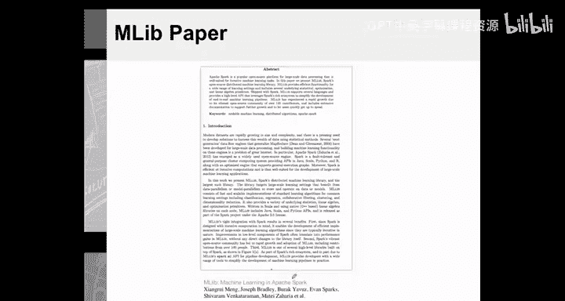

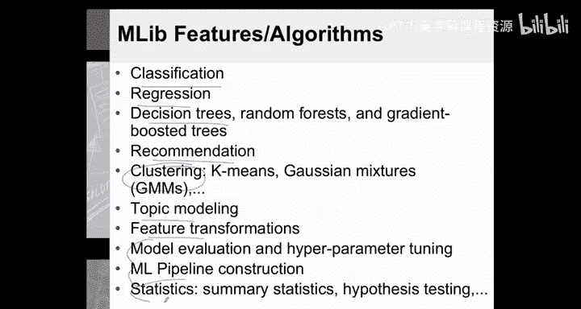

## 总结

本节课中我们一起学习了Spark的四个重要附加组件：Spark SQL、Spark Streaming、GraphX和Spark MLlib。

*   **Spark SQL** 提供了类似SQL的关系型查询接口，基于DataFrame API，便于进行结构化数据分析。
*   **Spark Streaming** 支持对实时数据流进行微批处理，适用于需要近实时响应的场景。
*   **GraphX** 专门用于图结构数据的处理和分析，适用于社交网络、推荐系统等领域。
*   **Spark MLlib** 提供了丰富的可扩展机器学习算法库。

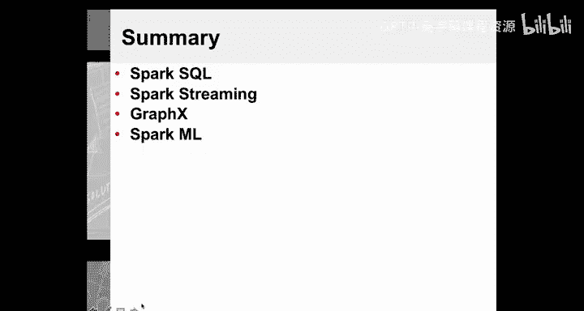

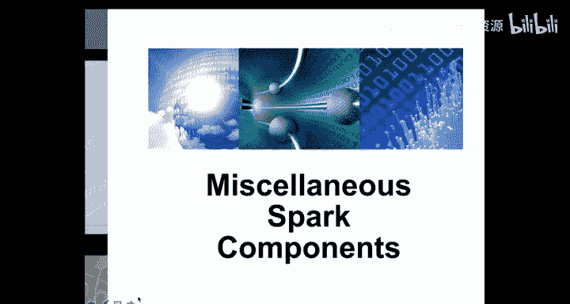

通常，数据工程师更关注数据处理技术本身（如本课程重点），而数据科学家则更倾向于使用Spark SQL、MLlib、GraphX等组件进行数据探索和实验。Spark出色的交互式处理能力使其成为数据科学家进行数据实验的理想平台，在得出洞察后，再由数据工程师将其工程化为生产应用。希望本节能帮助你理解这些工具在Spark生态系统中的角色。