# 课程 P98：Spark 模块总结 🎯

在本节课中，我们将对 Spark 框架的核心内容进行总结。我们将回顾 Spark 的概述、架构、运行模式、环境搭建以及核心编程概念，帮助你巩固对 Spark 的理解。

---

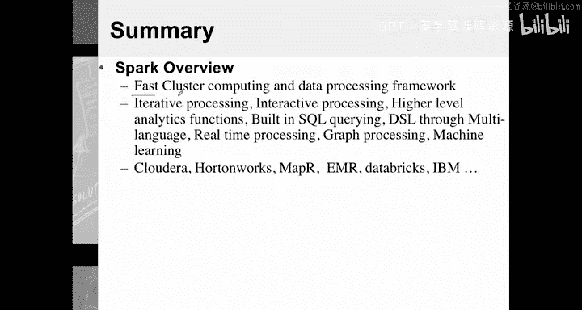

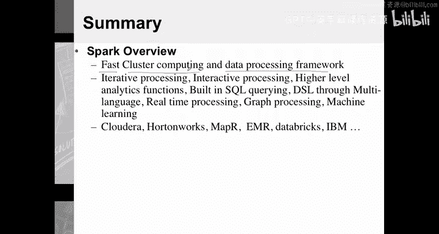

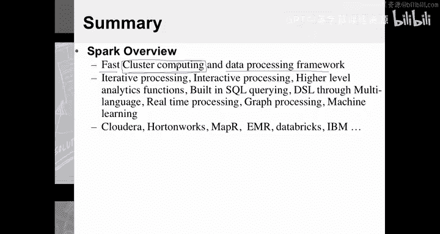

## Spark 概述回顾

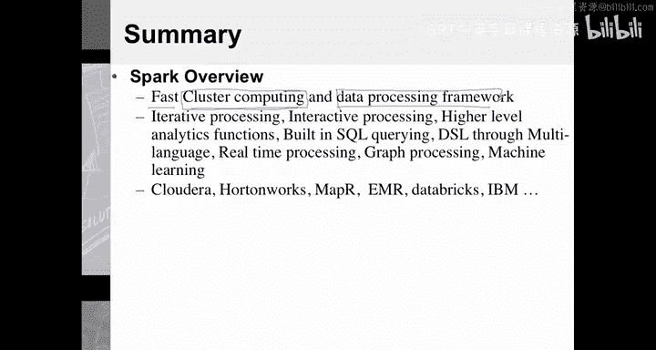

上一节我们介绍了 Spark 的基本概念，本节中我们来回顾其核心特性。

Spark 是一个**快速集群计算框架**，它内置了数据处理引擎。集群计算体现在它拥有自己的调度器，并能与其他调度器协同工作。数据处理则由 Spark 引擎本身完成。

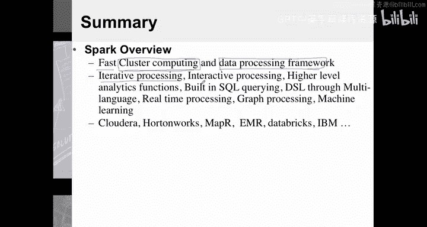

我们了解到，Spark 支持**迭代处理**和**交互式处理**。因为它将所有数据保存在内存中，你可以持续地对这些存储在**弹性分布式数据集**中的数据应用函数。

以下是 Spark 提供的高级功能：

*   **高级分析函数**：除了 `map` 函数，还提供了其他可在数据上执行的功能。
*   **内置 SQL 查询**：功能与 Hive 类似。
*   **多语言 DSL 接口**：支持 Scala、Java、Python 和 R。
*   **实时处理**：通过 Spark Streaming 实现。
*   **图计算与机器学习**：提供了相应的库。

市场上有多种 Spark 发行版。经典的大数据 Hadoop 发行版通常将 Spark 作为其引擎之一。此外，还有专注于 Spark 的 Databricks 公司，它与其他公司合作，为它们的大数据平台提供 Spark 引擎。

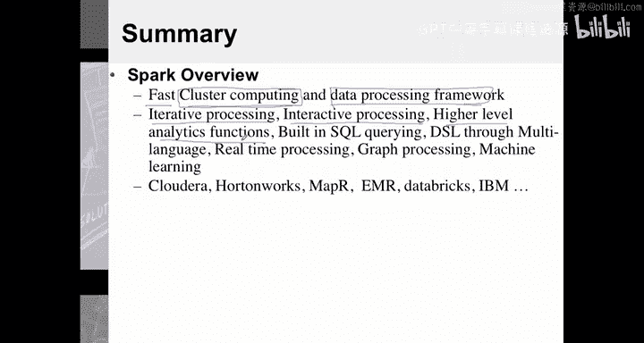

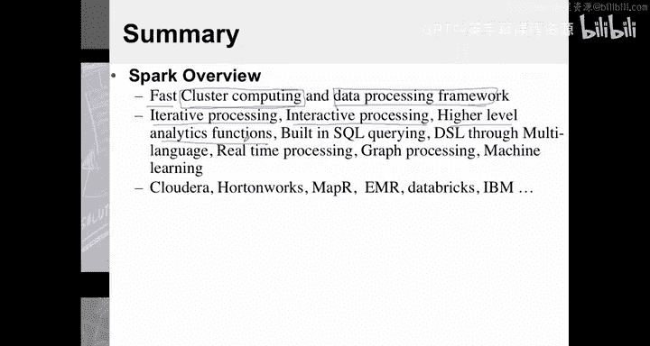

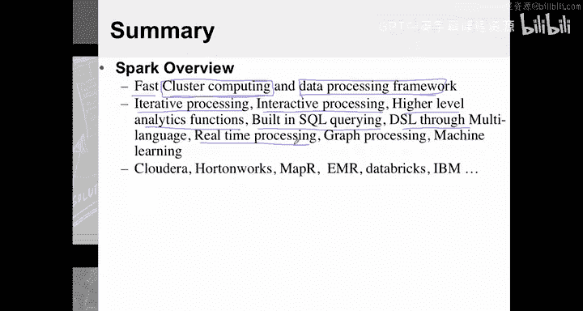

---

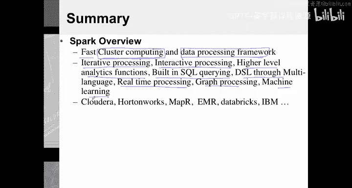

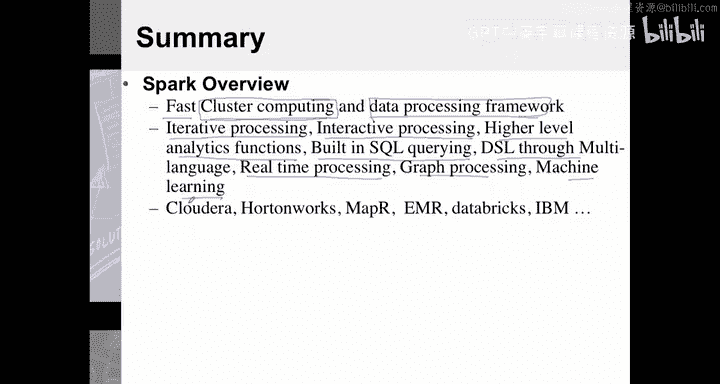

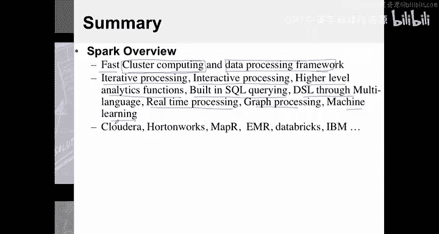

## Spark 架构核心

在 Spark 架构部分，我们学习了几个关键组件。

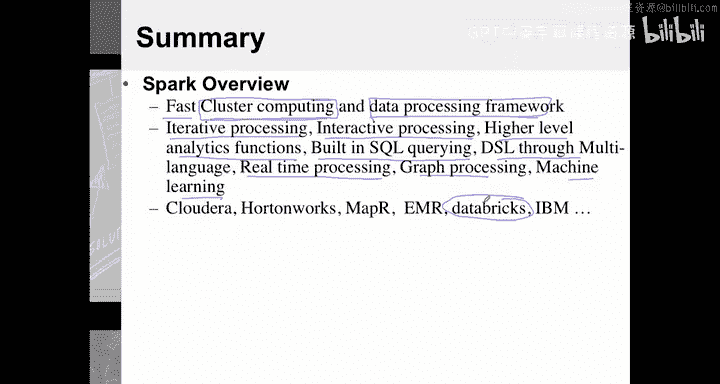

**RDD** 是主要组件，即**弹性分布式数据集**。其核心思想是从某种数据源加载数据，并将数据以分布式集合的形式保存在多台机器上。

**Driver** 控制程序的流程。

**Executor** 是任务和核心以线程形式运行的地方。通常，一个应用有多个 Executor，每个 Executor 有多个线程或任务，负责处理 RDD 的一部分。

---

## Spark 应用运行模式

在 Spark 应用模式方面，Spark 可以在多种模式下运行。

Spark 可以运行在**交互模式**下，允许你通过命令行界面与 Spark 交互。你可以使用基于 Scala 的 Spark Shell、基于 Python 的 PySpark 或基于 R 的 SparkR。

也支持**批处理编程**，你可以使用 `spark-submit` 来提交作业。

此外，Spark 可以在不同种类的**Master模式**下运行。主要分为两类：
*   **本地模式**：Driver 和 Executor 都在同一台机器上运行。
*   **分布式 Master 模式**：分为 Standalone、Mesos 和 YARN。
    *   Standalone 是 Spark 自带的集群计算调度引擎。
    *   YARN 和 Mesos 是 Spark 可以集成的外部调度引擎。

通常，我们以交互模式或批处理模式运行 Spark，并可以选择在本地或分布式环境下运行。

还存在一种称为**部署模式**的概念，可以是 **client** 或 **cluster**，这决定了 Driver 的运行位置。如果是 client 模式，Driver 在提交客户端运行；如果是 cluster 模式，Driver 则在集群环境中运行。

---

## Spark 环境搭建与运行

在设置和运行 Spark 部分，我们学习了如何在环境中下载和安装 Spark。

我们下载了一个能与现有 Hadoop 部署协同工作的 Spark 版本。因为我们已安装了自己的 Hadoop，所以我们下载了不包含 Hadoop 的 Spark 版本，并将其与现有 Hadoop 集成。

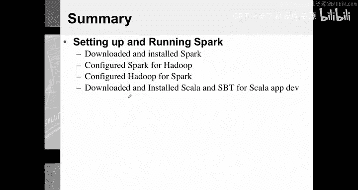

在此过程中，我们配置了 Spark 使其知道 Hadoop 的位置，同时也配置了 Hadoop 使其知道 Spark 的位置。

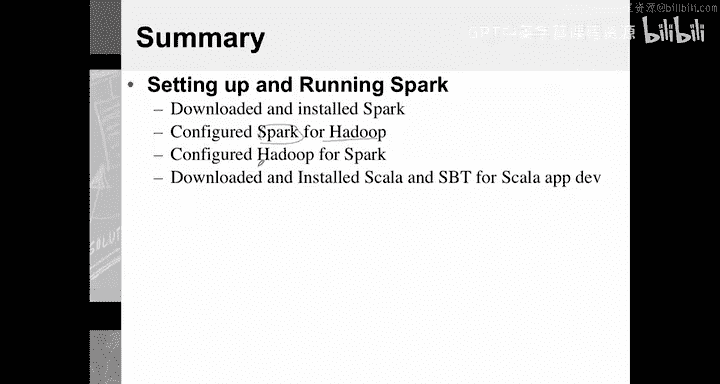

我们还下载并安装了 Scala 和 SBT，以便构建基于 Scala 的应用程序。在实践演示部分，我们展示了几个如何操作的例子。

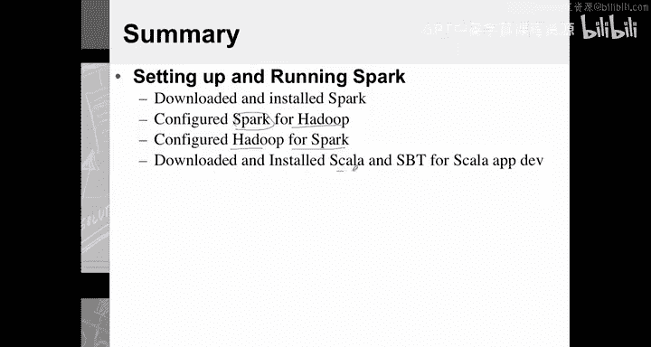

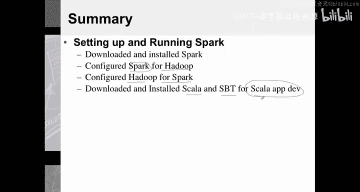

---

## Spark 核心编程

在 Spark 核心编程部分，我们学习了几个关键对象和操作流程。

**Spark配置** 对象代表 Spark 的配置。**Spark上下文** 代表 Spark 环境。你使用 Spark 配置来创建 Spark 上下文，一旦有了 Spark 上下文，你就可以创建 RDD。

当运行 Spark Shell 时，Spark 配置和 Spark 上下文已经创建好，你只需使用它们。如果是编写应用程序，则需要创建这些配置和上下文对象，然后在其上创建 RDD。

通常，你从存储在 HDFS、常规文件系统或分布式数据库中的数据创建 RDD，然后对其应用 RDD 操作。你可以应用**转换操作**或**行动操作**。

你可以应用多个转换操作，但这些操作在行动发生之前并不会真正执行。转换操作（如 `filter` 和 `map` 函数）声明数据需要被转换，但由于**惰性求值**的特性，数据并不会立即被转换，直到一个行动操作发生。行动一旦发生，转换操作会根据一个称为**有向无环图**的执行计划被执行。

在应用开发流程上，通常是：加载数据 -> 应用转换 -> 应用行动 -> 保存结果。如果需要，你可以在同一数据集上应用多个行动并保存多个结果，这完全取决于你的应用程序目标。

你可以使用 Java、Python 或 Scala 编写应用程序。我们演示了如何使用 Scala 编写，并使用 SBT 和 Scala 编译器来构建你的应用程序。

---

## 其他 Spark 组件

我们主要关注了 Spark 架构以及如何使其与 Hadoop 协同运行，但 Spark 之上还构建了许多其他组件，被数据科学家广泛使用。

例如 **Spark SQL**、**Spark Streaming**、**GraphX** 和 **Spark MLlib**。这些都是构建在 Spark 之上的附加组件，通常随 Spark 发行版一同提供。我们对其中一些组件进行了简要概述。当你进入数据科学的一些高级课程时，可能会使用这些技术来创建更复杂的数据科学应用。

---

## 总结

本节课中，我们一起回顾了 Spark 框架的核心内容。我们总结了 Spark 作为一个快速、内存计算框架的概述，其基于 RDD 的核心架构，多样的运行模式（交互式与批处理、本地与分布式），环境搭建与集成的步骤，以及核心的编程模型（转换与行动）。最后，我们还简要了解了构建在 Spark 之上的高级组件。掌握这些基础知识，是进一步深入学习和使用 Spark 进行大数据处理的关键。