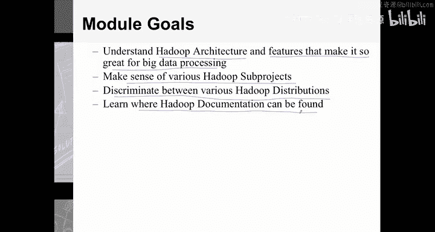

# 课程9：Apache Hadoop架构与生态系统导论 🏗️

在本节课中，我们将学习Apache Hadoop的架构及其生态系统。我们将了解Hadoop的核心组件、使其适用于大数据处理的关键原则，以及围绕它构建的各种子项目和商业发行版。

## 概述

本模块旨在帮助您从宏观角度理解Hadoop的架构，并认识使其成为强大大数据处理工具的关键特性。我们将梳理Hadoop生态系统中的各种子项目，并区分不同的商业发行版。

## Hadoop的背景与历史 📜

上一节我们介绍了本课程的目标，现在让我们首先了解Hadoop的起源。

Hadoop的诞生源于对海量网页数据进行存储和处理的挑战。它最初是Apache Nutch搜索引擎项目的一部分，后来借鉴了Google发表的关于**Google文件系统（GFS）**和**MapReduce**的论文思想，独立发展成为一个顶级Apache项目。

## Hadoop架构核心组件 ⚙️

了解了Hadoop的历史后，本节中我们来看看其架构的核心组成部分。

Hadoop架构主要由两个核心组件构成：
1.  **Hadoop分布式文件系统（HDFS）**：这是一个高度容错的分布式文件系统，设计用于在低成本硬件上运行。它将大数据集分割成块，并跨集群中的多个节点进行存储。
2.  **Hadoop MapReduce**：这是一个用于并行处理大量数据的编程模型。其核心思想是将计算任务分为两个阶段：**Map（映射）**和**Reduce（归约）**。

## 使Hadoop强大的关键原则 🔑

上一节我们介绍了Hadoop的核心组件，本节中我们来探讨其背后的设计原则。

Hadoop的成功建立在几个关键原则之上，这些原则使其特别适合处理大数据：
*   **横向扩展（而非纵向升级）**：通过向集群添加更多普通商用服务器来增加容量和计算能力，而不是依赖更强大、更昂贵的单一机器。
*   **将计算移至数据**：与传统方式不同，Hadoop将计算任务发送到存储数据的节点执行，这极大地减少了数据在网络中的传输，提高了效率。
*   **故障是常态，而非异常**：Hadoop假设硬件故障会经常发生。其架构设计能够自动检测和处理节点故障，确保作业能够继续完成。

## Hadoop技术栈与生态系统 🌐

理解了核心原则后，我们现在可以俯瞰整个Hadoop技术生态系统。

Hadoop生态系统包含了许多子项目，它们扩展了Hadoop的核心功能，提供了更丰富的数据处理方式。以下是其中一些关键项目：
*   **Apache Hive**：一个数据仓库工具，它提供了一种类似SQL的查询语言（称为HiveQL），允许用户查询存储在HDFS中的数据。
*   **Apache Pig**：一个高级平台，用于创建在Hadoop上运行的程序。它使用一种名为Pig Latin的脚本语言，简化了MapReduce作业的编写。
*   **Apache HBase**：一个分布式、可扩展的NoSQL数据库，构建在HDFS之上，支持对大数据进行实时读写随机访问。

## 市场上的Hadoop发行版 🏪

上一节我们介绍了开源生态项目，本节中我们来看看基于Hadoop的商业发行版。

除了原始的Apache Hadoop，多家公司提供了集成的、包含额外工具和商业支持的发行版。主要发行版包括：
*   **Cloudera Distribution for Hadoop (CDH)**：由Cloudera公司提供，集成了许多生态系统工具并包含管理界面。
*   **MapR Distribution**：由MapR公司提供，以其高性能和替代HDFS的MapR-FS文件系统而闻名。
*   **Hortonworks Data Platform (HDP)**：由Hortonworks公司提供（现已与Cloudera合并），强调100%开源。

## 如何获取Hadoop文档与信息 📚

最后，为了帮助您持续学习和保持知识更新，本节将指明获取官方文档和信息的途径。

保持对Hadoop最新发展的了解至关重要。您可以通过以下主要渠道获取文档和信息：
*   **Apache Hadoop官方网站**：获取最权威的官方文档和项目更新。
*   **各发行版供应商的网站**（如Cloudera, Hortonworks/Cloudera, MapR）：获取针对特定发行版的文档、白皮书和教程。
*   **社区与论坛**：如Stack Overflow、邮件列表，是解决具体问题和交流经验的好地方。

## 总结

本节课中，我们一起学习了Apache Hadoop的架构与生态系统。我们从其历史背景出发，深入了解了HDFS和MapReduce这两个核心组件，以及横向扩展、移动计算而非数据、容错设计等关键原则。我们还梳理了Hive、Pig、HBase等重要的生态系统项目，并比较了Cloudera、MapR、Hortonworks等主流商业发行版。最后，我们指明了持续学习和获取最新信息的官方渠道。掌握这些知识，为您进一步深入学习和使用Hadoop处理大数据奠定了坚实的基础。