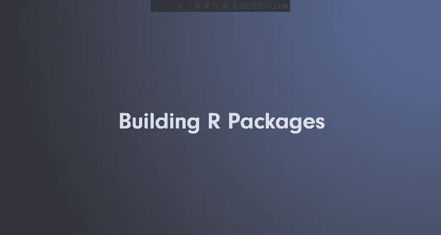

# 📦 课程 3：欢迎来到构建 R 包

在本节课中，我们将要学习如何将您编写的 R 函数组织、打包并分享给他人使用。这是从编写代码到创建可复用、可维护工具的关键一步。

---

上一节我们介绍了如何将代码封装成函数。本节中，我们来看看如何将这些函数进一步组织成一个完整的 R 包。

将代码打包成 R 包，是促使他人真正使用您代码的有效方式。仅仅发送脚本或包含多个函数的文件是不够的，因为它们缺乏组织、文档和使用说明。R 包提供了一种机制，用于组织代码、编写文档、解释使用方法，使其对用户更加友好。这更多地是从用户角度出发，提供他们学习使用您代码所需的便利设施。

我同意。编写文档和整合函数的过程，也有助于理清您所创建的这一组函数的内在逻辑。它帮助您思考哪些是用户真正需要的函数，哪些只是起辅助作用的内部函数。

编写 R 包是编写函数本身的自然延伸。最初我们从一些代码开始，然后将其抽象为带有输入和输出的函数。现在，R 包是下一个自然层级，您将讨论一组用于完成特定任务的、可供用户调用的函数。

一旦您编写好一个包，通常希望分享它。在本课程中，我们将讨论如何使用 GitHub 来分享您的包，以及如何获取他人的包。

我们还将讨论质量控制，这对于让许多人使用您的包并保持其质量至关重要。我们将讨论测试和持续集成，以维护您的包。

由于本课程建立在编写代码和将代码封装成函数的基础上，因此对于已经学习过本专项前两门课程的人来说，会感觉最得心应手。

我们非常高兴大家对构建 R 包感兴趣，并有机会教授大家这项技能。这是一项非常重要的技能，我们非常期待看到您能构建出什么。

---

本节课中，我们一起学习了构建 R 包的重要性：它是分享代码、提供文档和确保质量的标准化方式。从函数到包，是代码可复用性和专业性的重要提升。