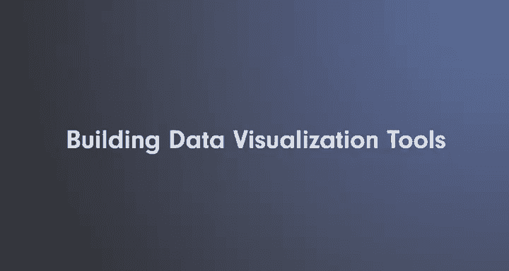

# 课程一：欢迎来到构建数据可视化工具 🎨

在本课程中，我们将学习数据分析中一个至关重要的环节：构建高质量的数据可视化图形。我们将首先介绍如何使用R语言中现有的强大工具（如GGplot）来创建图形，随后深入探讨如何构建自定义的图形扩展。

---

数据分析的一个重要组成部分是构建高质量的图形。在本课程的第一部分，我们将向您展示如何使用包括GGplot在内的现有工具在R中创建图形。课程的第二部分将深入挖掘，并向您展示如何构建自定义的图形扩展。

---

如果您已经完成了本系列专项课程的前两门课程，或者您已经拥有丰富的R语言编程经验，那么学习本课程将会感到最为轻松。

非常感谢您注册本课程。我们非常期待看到您能构建出怎样的成果。😊

---

## 课程总结

本节课中，我们一起学习了本课程的核心目标与结构。我们明确了数据分析中可视化的重要性，并概述了从使用现有工具（如GGplot）到开发自定义图形扩展的学习路径。同时，我们也了解了学习本课程所需的先验知识。接下来，我们将正式开启数据可视化工具构建之旅。