# 课程11：数据过滤、选择、重编码、重命名与管道操作 📊➡️🔧

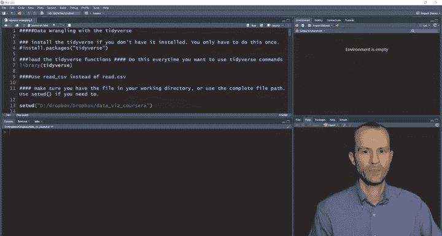

在本节课中，我们将学习如何使用 `dplyr` 包中的核心函数对数据进行操作，包括筛选行、选择列、重编码变量、重命名列，以及如何利用管道操作符 `%>%` 将这些步骤流畅地串联起来。

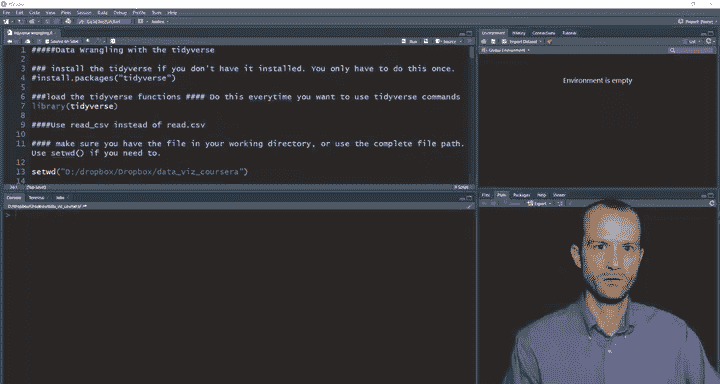

---

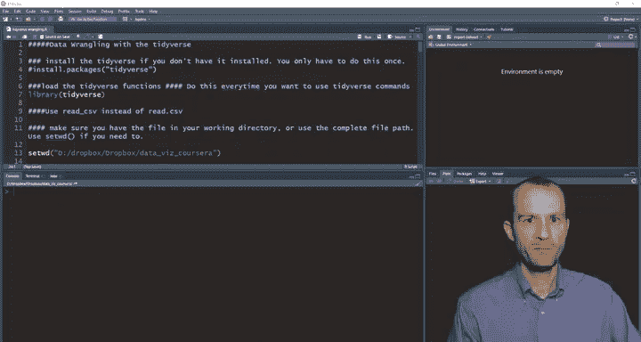

## 数据过滤

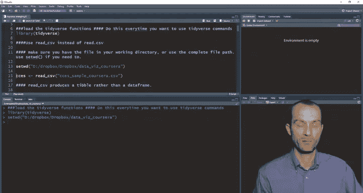

上一节我们介绍了数据导入与初步查看。本节中，我们来看看如何从数据集中提取满足特定条件的子集，这被称为“过滤”。

过滤操作使用 `filter()` 函数，它根据指定的逻辑条件筛选出数据框（tibble）中符合条件的行。

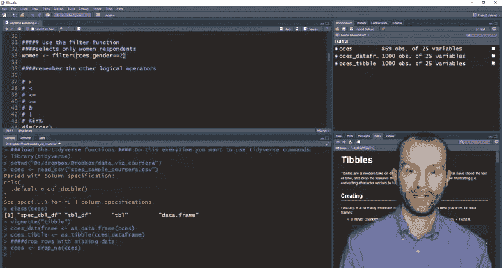

**公式**：`filter(data, condition)`

以下是一个过滤操作的示例。假设我们想从调查数据中提取所有女性受访者的数据。在数据中，性别变量 `gender` 的编码为：1 代表男性，2 代表女性。

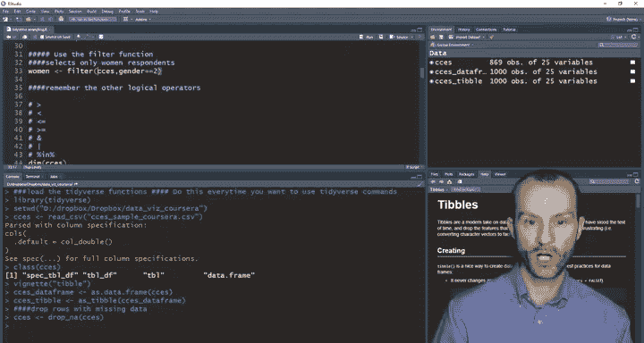

```r
# 从 CCES 数据集中过滤出所有女性受访者
women <- filter(CCES, gender == 2)
```

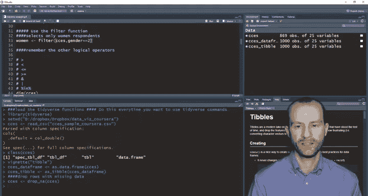

我们可以使用 `dim()` 函数检查新数据集的大小，确认它只包含女性受访者。

```r
dim(women)
```

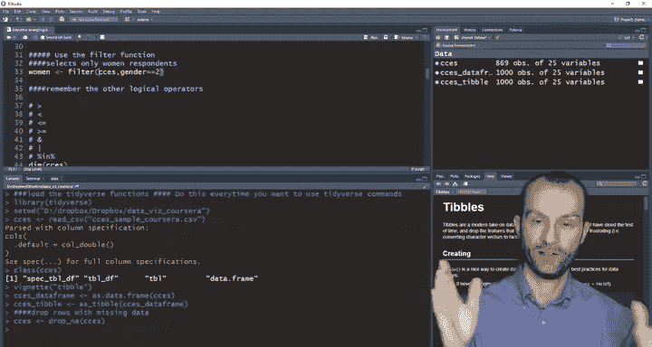

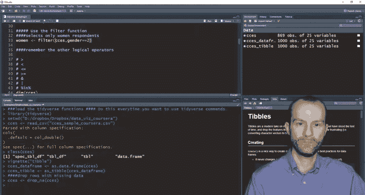

---

## 添加多个过滤条件


我们可以通过逻辑运算符组合多个条件。例如，如果我们想进一步筛选出“坚定的共和党女性”，就需要同时满足两个条件：性别为女，且政党认同为共和党。

以下是逻辑运算符的列表：
*   `==`：等于
*   `!=`：不等于
*   `<`, `>`：小于，大于
*   `<=`, `>=`：小于等于，大于等于
*   `&`：与（同时满足）
*   `|`：或（满足其一）

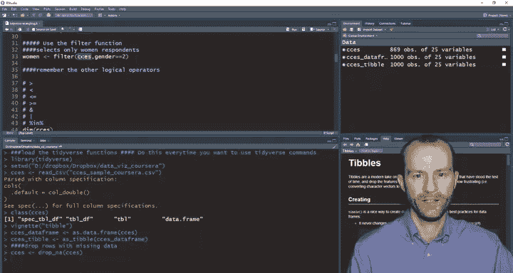

```r
# 过滤出性别为女性且政党认同为共和党（PID7 > 4）的受访者
republican_women <- filter(CCES, gender == 2 & PID7 > 4)
dim(republican_women)
```

---

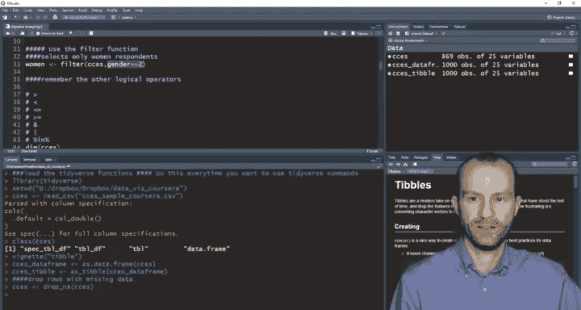

## 选择特定列

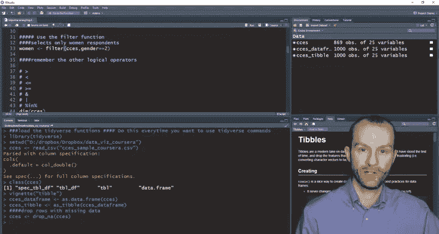

过滤行之后，我们可能只对数据集中的某几列感兴趣。这时可以使用 `select()` 函数来选择特定的列。

**公式**：`select(data, column1, column2, ...)`

例如，从 `republican_women` 数据集中，我们只选择教育程度（`educ`）和就业状态（`employ`）这两列。

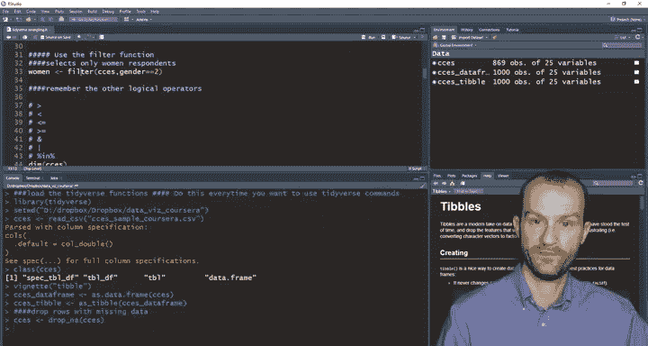

```r
# 从 republican_women 数据集中选择 educ 和 employ 列
selected_data <- select(republican_women, educ, employ)
head(selected_data)
```

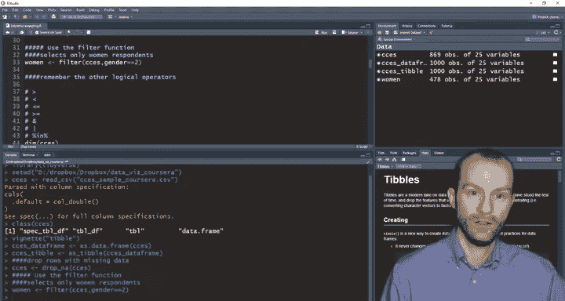

运行后，新的 `selected_data` 对象将只包含我们指定的两列数据。

---

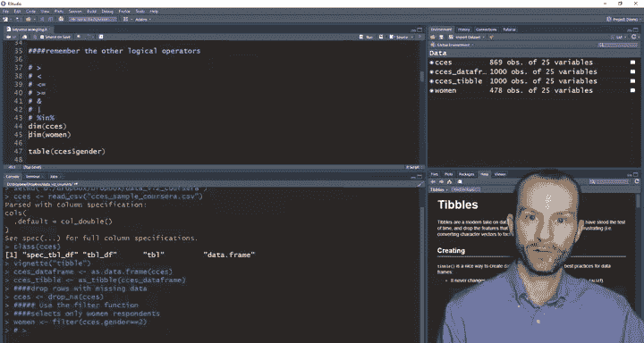


## 重编码变量值

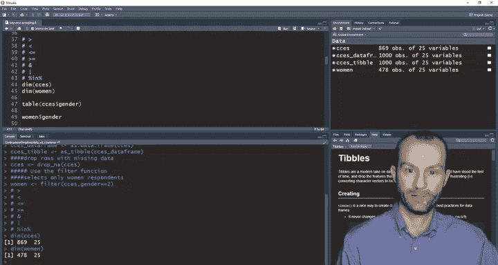

有时，我们需要更改变量中值的表示方式，使其更易读或符合分析需求。这可以通过 `recode()` 函数或 `mutate()` 与 `case_when()` 的组合来实现。

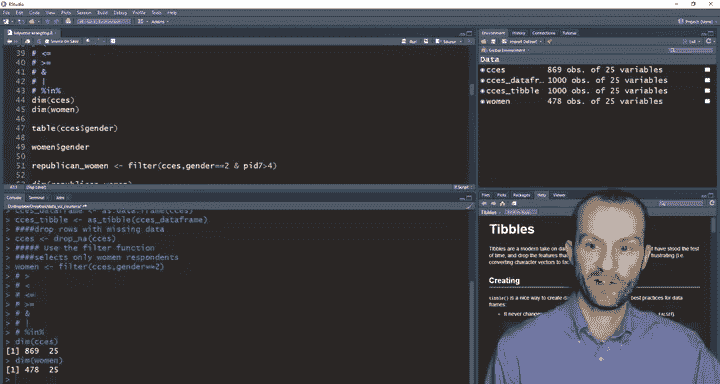

假设我们想将教育程度 `educ` 的数值编码（如1，2，3...）转换为更具描述性的标签（如“高中以下”，“高中”等）。

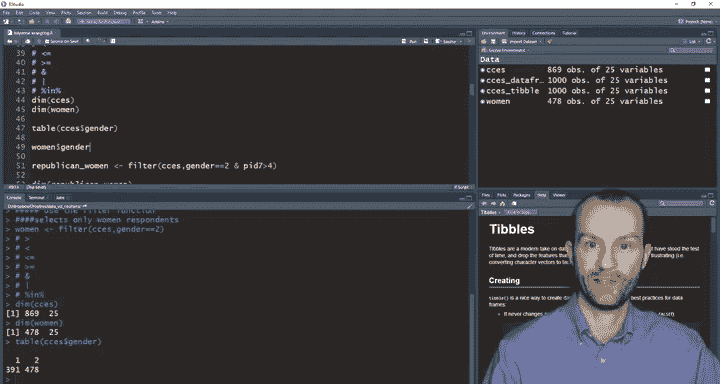

以下是使用 `mutate()` 和 `recode()` 的示例：

```r
# 创建一个新列 educ_label，将数值重编码为文字描述
CCES_recoded <- mutate(CCES,
                       educ_label = recode(educ,
                                           `1` = "Less than HS",
                                           `2` = "High School",
                                           `3` = "Some College",
                                           `4` = "2-Year",
                                           `5` = "4-Year",
                                           `6` = "Post-Grad"))
# 查看新列的前几行
head(select(CCES_recoded, educ, educ_label))
```

---

## 重命名列

如果列名不够直观或需要统一格式，可以使用 `rename()` 函数来重命名列。

**公式**：`rename(data, new_name = old_name)`

例如，将 `educ` 列重命名为 `education`。

```r
# 将 educ 列重命名为 education
CCES_renamed <- rename(CCES, education = educ)
names(CCES_renamed) # 查看新的列名
```

---

## 使用管道操作串联步骤

管道操作符 `%>%` 是 `dplyr` 包中的一个强大工具，它允许你将多个数据操作步骤流畅地连接成一个序列，使代码更简洁、易读。

**核心思想**：将左侧对象的结果“传递”给右侧函数的第一个参数。

**代码结构**：`data %>% function(arguments)`

现在，让我们用管道将之前的所有步骤（过滤、选择、重编码、重命名）合并成一个连贯的操作流程：

```r
# 使用管道操作完成：过滤共和党女性 -> 选择列 -> 重编码教育程度 -> 重命名列
final_data <- CCES %>%
  filter(gender == 2 & PID7 > 4) %>%      # 步骤1：过滤
  select(educ, employ, pid7) %>%          # 步骤2：选择列
  mutate(education = recode(educ,         # 步骤3：重编码并创建新列
                            `1` = "Less than HS",
                            `2` = "High School",
                            `3` = "Some College",
                            `4` = "2-Year",
                            `5` = "4-Year",
                            `6` = "Post-Grad")) %>%
  rename(party_id = pid7) %>%             # 步骤4：重命名列
  select(-educ)                           # 步骤5：删除旧的 educ 列

# 查看最终处理好的数据集
head(final_data)
```

通过管道，我们避免了创建多个中间变量，代码逻辑从上到下清晰地展示了数据处理的每一步。

---

## 总结

本节课中我们一起学习了数据整理的核心操作：
1.  **过滤**：使用 `filter()` 根据条件筛选行。
2.  **选择**：使用 `select()` 挑选需要的列。
3.  **重编码**：使用 `mutate()` 与 `recode()` 或 `case_when()` 更改变量值的含义。
4.  **重命名**：使用 `rename()` 修改列的名称。
5.  **管道操作**：使用 `%>%` 将多个数据操作步骤优雅地串联起来，提升代码的可读性和效率。

掌握这些技能是进行有效数据分析和可视化的基础，它们能帮助你快速地将原始数据塑造成适合分析的形式。