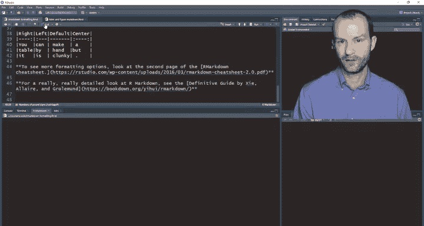
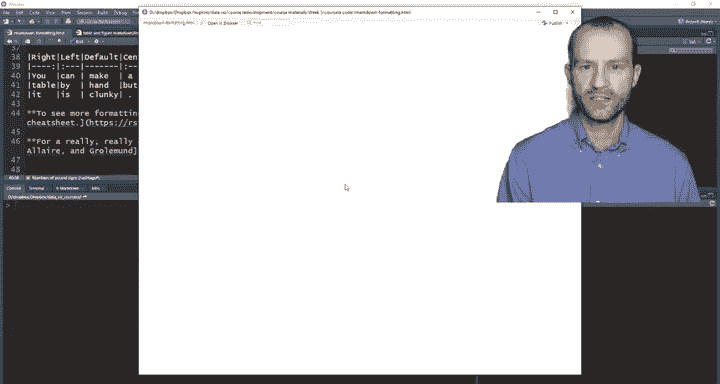
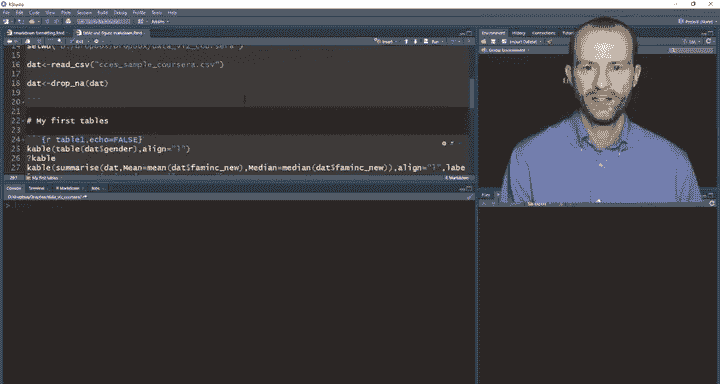
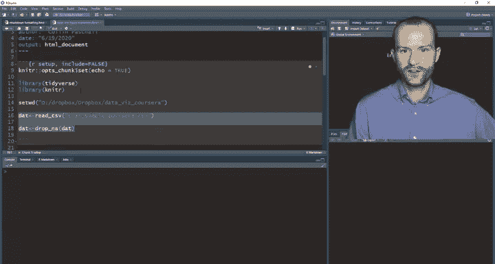
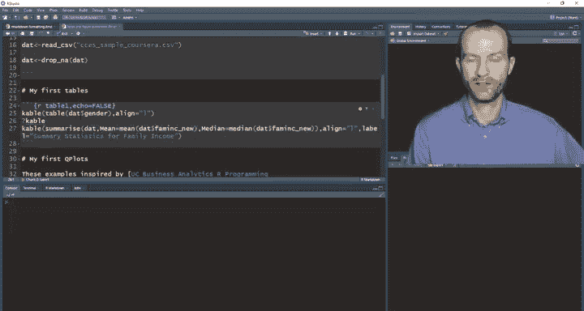

# 课程15：R Markdown语法与表格 📊

在本节课中，我们将深入学习如何格式化R Markdown报告。我们将通过更多示例和详细指导，帮助你掌握R Markdown的多种格式选项。

上一节我们简单介绍了R Markdown的示例，本节我们将进行更详细的逐步讲解，以便你理解在撰写报告时可用的众多选项。

## R Markdown语法基础

在R Markdown中撰写报告时，你需要使用特定的R Markdown语法。这不像Microsoft Word或Google Docs那样是点击式的文字处理器。它更像是编写非常简单的HTML代码（如果你之前接触过的话）。其核心在于，你必须使用文档中的特殊语法，明确地告诉R Studio你希望如何格式化文本。

以下是发布在课程网站上的一个R Markdown文件示例，我们将逐一解析。

在R Markdown文件的设置部分之后，你可以直接编写普通的段落文本，空行之后即表示新段落的开始。

如果你想进一步格式化文本，可以使用以下语法：
*   使用单个星号 `*文本*` 使文本变为*斜体*。
*   使用两个星号 `**文本**` 使文本变为**粗体**。

你还可以包含所谓的“逐字文本”（verbatim text），使其看起来像R代码。此外，你可以创建上标、破折号和块引用。每种格式的语法都在示例中有所展示。

你还可以创建不同级别的标题、项目符号列表或编号列表。

## 手动创建表格

你也可以手动创建表格，但这个过程可能有些笨拙。因此，你可能不会经常这样做。更好的方法是自动化生成表格，我们稍后会展示。

关于如何使用R Markdown以及更多格式提示的详细信息，你可以参考本课程附带的一些材料，包括R Markdown速查表。如果你真的需要深入了解，可以参考所谓的《R Markdown权威指南》，它更像是一本参考书，你应该熟悉它，但可能不需要通读。

## R Markdown的核心优势

对于日常的文字处理，Markdown可能看起来并不是一个非常出色的工具。但正如我们在上一节视频中看到的，Markdown的闪光点在于它能够将R的输出结果集成到文档中，从而实现可重复的数据科学。

让我们再次查看本视频材料中包含的 `.Rmd` 文件。

在这份报告中，我使用了我们一直在处理的样本调查数据，并通过从CSV文件中提取数据来创建表格和图形。

当你这样做时，**极其重要**的一点是：记住将要在Markdown文件中使用的数据文件，与Markdown文件本身放在**同一个文件夹**中，否则这将无法工作。请确保这两个文件在你的计算机上位于同一位置。

## 自动化生成表格

在设置代码块中，我加载了 `tidyverse` 和 `knitr` 包，并指示R指向Markdown文件和CSV文件所在的目录。

我们像之前一样导入数据文件，并删除缺失值。

正如我在另一个文件中所示，你可以在Markdown中手动创建表格，但这很笨拙。更好的方法是直接将R的输出转换为表格。

如果你加载了 `knitr` 包，可以使用 `kable` 函数轻松地将R输出转换为表格。

`kable` 函数并非与所有R对象都能完美配合，但它能很好地处理表格类数据，特别是与 `table` 函数或使用 `tidyverse` 的 `summarize` 生成的输出配合使用。

如果你稍作尝试，也可以让 `kable` 与其他对象一起工作，但这是一个很好的起点。你可能需要对不同对象的类进行一些转换，但通过一些自主实验，你可以让它工作起来。此外，还有一些其他的R包可以用来将R输出转换为表格，你只需要稍作搜索就能找到它们。速查表和在线文档也能提供帮助。

如果你查看 `kable` 的文档，你会发现你还可以做一些事情，比如改变单元格中文本的对齐方式、为表格添加标题或说明、以及添加列标题和行标题。

## 课程总结

本节课我们一起学习了R Markdown的基本语法，包括文本格式化、列表和标题的创建。重点探讨了手动创建表格的局限性，并介绍了如何使用 `knitr` 包的 `kable` 函数自动化地将R输出（特别是汇总表格）转换为美观的Markdown表格。我们还强调了将数据文件与Rmd文件放在同一目录的重要性。

请保持这个文件打开，在下一节视频中，我们将讨论如何向这份报告添加一种新的图形，一种比R基础可视化更美观的图形。