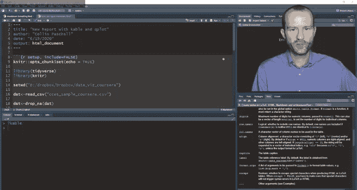
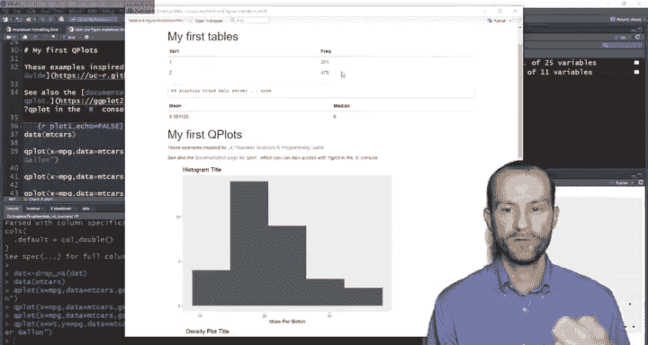

# 课程16：快速绘图与结束语 🎨

在本节课中，我们将学习`qplot`函数的基本用法，并回顾整个课程的核心内容。`qplot`是`ggplot2`包中的一个便捷函数，适合快速创建图表，为深入学习`ggplot2`打下基础。

---

## 快速绘图工具：qplot

上一节我们介绍了数据整理和可视化基础，本节中我们来看看如何使用`qplot`进行快速绘图。

`qplot`是`ggplot2`包中的一个函数，它整合了`ggplot2`的部分功能，但语法更简单，类似于R的基础绘图函数。对于初学者或需要快速绘制图表时，`qplot`是一个非常有用的工具。

以下是使用`qplot`的基本步骤：

1.  **指定美学映射**：你需要定义`x`和`y`美学映射。这决定了哪些数据将对应到图表的X轴或Y轴。
    *   公式：`aes(x = 变量名, y = 变量名)`
2.  **指定数据**：你需要告诉`qplot`使用哪个数据集。
3.  **选择几何对象**：你需要指定想要绘制的图表类型，在`ggplot2`中这被称为“几何对象”。
    *   代码：`geom = "几何对象类型"`


基本的几何对象类型包括：直方图（`histogram`）、密度图（`density`）、箱线图（`boxplot`）、散点图（`point`）和折线图（`line`）。



---

## 实践示例

我们将使用R内置的`mtcars`数据集进行演示。

以下是使用`qplot`命令创建的几个不同图表示例。这些示例指定了X和Y轴的映射关系、几何对象类型，并添加了一些额外的参数对图表进行微调。

```r
# 加载数据
data(mtcars)

# 示例1：绘制马力的直方图
qplot(x = hp, data = mtcars, geom = "histogram")

# 示例2：绘制马力与每加仑英里数的散点图
qplot(x = hp, y = mpg, data = mtcars, geom = "point")

# 示例3：根据气缸数分组的每加仑英里数箱线图
qplot(x = factor(cyl), y = mpg, data = mtcars, geom = "boxplot")
```

你可以在`tidyverse`的文档中找到更多关于`qplot`的示例，也可以通过搜索在线资源获取其他案例。本视频的创作参考了加州大学商业分析R编程指南，这是一个很好的资源。

---

## 课程总结与展望

回顾我们学习的所有内容，我们已经取得了长足的进步。

你可能在课程开始时对R几乎没有使用经验，但通过努力，你现在已经能够导入电子表格数据，使用R命令处理和操作这些数据，并利用这些数据创建表格和图表，最后将它们整合到一份可重复生成的R Markdown报告中。

如果你对开放数据科学感兴趣，这已经是一个很棒的基础。

然而，我们还有更多的事情可以做，更多的知识需要学习。在利用R创建数据可视化方面，我们仅仅触及了表面。

展望未来，你可以期待学习如何使用完整的`ggplot2`来创建更多类型的图表，以多种方式优化它们，并最终制作交互式图表和仪表盘。

你已经走上了正轨。希望很快能在未来的课程中再次见到你。



---


本节课中我们一起学习了`qplot`函数的基本用法，它作为`ggplot2`的快速入门工具，能帮助我们便捷地创建多种基础图表。同时，我们也回顾了整个课程的学习旅程，从数据导入、整理到可视化与报告生成，为你后续深入探索R语言数据科学奠定了坚实的基础。