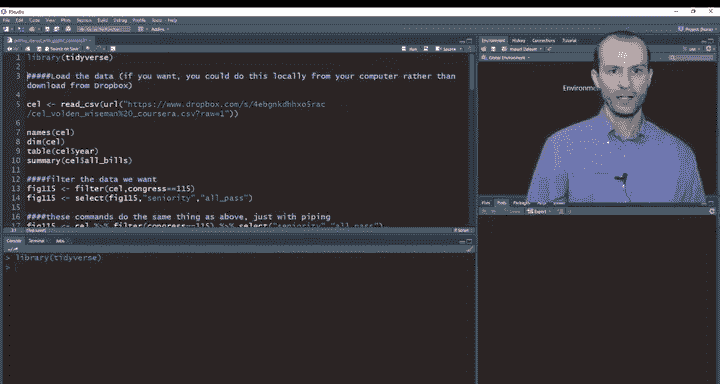

# 课程18：开始使用ggplot（第一部分）📊

在本节课中，我们将学习如何使用R语言中强大的`ggplot2`库来创建数据可视化。我们将从理解`ggplot2`的基本语法结构开始，并动手创建第一个散点图。

---

## 概述

在之前的课程中，我们介绍了将R作为可视化工具的基础知识，包括在Markdown中制作报告、将数据导入R并创建快速示例图，以及回顾了在R中整理数据的一些基本操作。

现在，我们将继续练习所有这些技能，并开始创建各种不同类型的可视化图表。我们将通过大量练习来熟悉`ggplot2`库的众多功能。

`ggplot2`作为`tidyverse`的一部分，是使用R创建数据可视化最重要的工具之一，也将是我们后续学习的重点。让我们从描述`ggplot`图形的基本结构开始。

---

## ggplot的基本结构

`ggplot`中的“GG”代表“图形语法”。接下来，我将描述使用`ggplot2`进行数据可视化的工作原理语法。

一个`ggplot`可视化的“配方”包含五种成分：
1.  **整洁的数据**（长格式）。
2.  **美学映射**：将这些数据映射到可视化的美学特征上，例如X轴和Y轴、图中标记的大小、颜色或类型。
3.  **几何对象**：`ggplot`对构成图形的几何形状的称呼。
4.  **坐标系**。
5.  **标签和引导元素**：“引导元素”是`ggplot`对图例的称呼。

这些概念通过实例来看会比单纯听讲解更容易理解，所以让我们直接通过示例来展示其含义。

---

## 实践数据集介绍

为了练习，我们将使用一个来自政治科学领域的数据集，因为这是我的学术背景。我将使用关于美国国会的数据，该数据由弗吉尼亚大学的艾伦·怀斯曼和范德堡大学的克雷格·沃尔登领导的研究团队收集。

这两位研究人员收集了大量关于国会议员的信息，作为一项关于国会议员制定法律效率的书籍项目的一部分。在此过程中，他们统计了自20世纪70年代以来由国会议员提出的每一项法案，以及所有获得通过的法案（即在美国众议院获得多数票的法案）。

这些数据非常棒，因为它们提供了许多可视化国会生产力的机会。需要说明的是，出于教学目的，我对这个数据集进行了微小的修改。因此，如果你想对沃尔登和怀斯曼的数据进行任何原始数据分析，你应该访问他们的“有效立法中心”网站自行下载，以获取正确和更新的数据表。

在继续之前，你应该花点时间阅读我附在本视频及相关材料中的代码簿，它将解释数据中所有不同变量的含义。这对于解释数据非常有用，并且在你进行一些实践可视化时，可能需要在以后回头查阅。

---

## 开始创建可视化

有了以上铺垫，让我直接开始构建一些可视化图表，以便你开始对`ggplot2`作为可视化工具的工作原理有一些直观感受。

首先，假设我们想要绘制国会议员通过的法案数量与其在议院任职届数（即他们担任国会议员的时间长短）之间的关系。我们可能普遍预期，在国会任职时间更长的议员，在他们每届任期内往往会通过更多的法案，因为他们成为了更有经验的立法者，并在议院中获得了更大的权力。

假设我们想为某一届国会可视化这个关系，我将任意选择数据中最近的一届国会，即第115届国会。

我将引导你完成创建图形的每一个步骤，我们从基础开始。你需要跟随本视频材料中包含的R代码一起操作，接下来我将逐步讲解这些代码。

---

## 准备工作

在进行任何可视化之前，第一步是做好工作准备。


在代码的前几行，我加载了包含`ggplot2`函数的`tidyverse`库，并导入了数据。

```r
# 加载必要的库
library(tidyverse)



# 导入数据
# （示例代码中包含从网络地址直接导入数据的代码行）
# 你也可以下载与本视频关联的CSV文件，保存到本地目录后在R会话中打开。
```

现在，一旦数据加载完毕，下一步就是检查数据，因为你总是需要确保数据导入工作正常。我们可以检查列名、查看有多少观测值，并检查几列数据的汇总统计信息和频率表。

请记住，如果你要制作可视化图表，了解你的数据总是非常重要的，所以请检查并确保它符合你的预期。

---

## 创建第一个散点图

之前提到，我们将查看第115届国会，并关注资历和通过的法案数量。让我们开始编写`filter`和`select`命令来实现这一点，这应该是对你在专项课程前一课程中学到内容的复习。

你可以将`filter`和`select`写成两行单独的代码，也可以使用管道命令将它们全部放在一行中。如果你不理解我们在这里做什么，你可能需要参考`tidyverse.org`上关于`dplyr`包的参考资料，以便在需要时刷新记忆。

现在，调用`ggplot`函数。首先，你需要向函数提供要使用的数据。然后进行美学映射。

我们将从一个简单的散点图开始，因此在美学映射中，我们将X轴设置为`seniority`（资历），Y轴设置为`all_pass`（通过总数）。如果我们运行这行代码，会看到一个带有X轴和Y轴的空白图。

我们的下一步将是使用`geom`命令向图中添加标记。我们将在下一个视频中从这一点继续，所以请保持你的R文件打开，并在下一个视频中与我继续学习。

---

## 总结

本节课中，我们一起学习了`ggplot2`图形语法的基本组成部分，包括数据、美学映射、几何对象、坐标系和引导元素。我们介绍了用于实践的数据集背景，并完成了创建第一个可视化图表前的所有准备工作：加载库、导入和检查数据，以及设定了第一个散点图的美学映射框架。

在下一节，我们将为这个框架添加几何对象，完成我们的第一个`ggplot`图形。