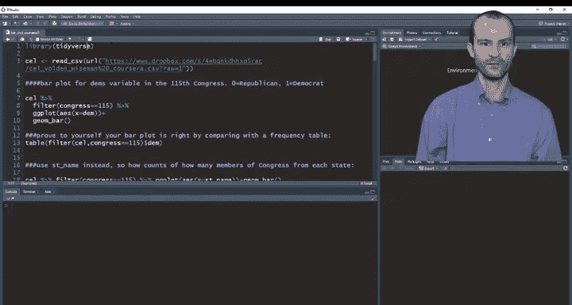

# 课程21：条形图（第一部分）📊


在本节课中，我们将学习如何使用R语言和`ggplot2`包创建条形图。我们将使用美国国会成员的数据，通过条形图展示不同党派或州别的成员数量分布。

---

## 概述

上一节我们介绍了数据可视化的基础概念和工具。本节中，我们将重点学习如何创建条形图。条形图是一种经典的可视化方式，常用于展示分类数据的频数或比例。



我们将使用来自“有效立法中心”和“合作国会选举调查”的数据。课程材料中已包含所需的数据文件和代码本。

---

## 数据准备与加载

首先，我们需要加载必要的R包并导入数据。以下是代码示例：

```r
# 加载tidyverse包（包含ggplot2）
library(tidyverse)

# 导入数据
# 假设数据文件名为'cel_data.csv'
cel_data <- read_csv("cel_data.csv")
```

这段代码加载了`tidyverse`包，它包含了`ggplot2`等用于数据操作和可视化的函数。接着，我们导入了名为`cel_data`的数据集。

---

## 创建基础条形图

现在，让我们创建一个条形图，展示美国第115届国会中共和党与民主党成员的数量。

我们首先对数据进行处理，筛选出第115届国会的数据，然后使用`ggplot2`创建图表。以下是具体步骤：

```r
# 数据处理与绘图
cel_data %>%
  filter(Congress == 115) %>%
  ggplot(aes(x = dim)) +
  geom_bar()
```

在这段代码中：
- `%>%` 是管道操作符，用于将左侧数据传递给右侧函数的第一个参数。
- `filter(Congress == 115)` 筛选出`Congress`列值为115的行。
- `ggplot(aes(x = dim))` 设置美学映射，将`dim`变量映射到x轴。
- `geom_bar()` 添加条形图层。

运行代码后，我们将得到一个包含两个条形的图表：
- 左侧条形对应`dim`值为0（共和党成员）的数量。
- 右侧条形对应`dim`值为1（民主党成员）的数量。

为了验证图表准确性，我们可以使用R的频率表功能：

```r
# 生成频率表
table(cel_data$dim)
```

---

## 调整条形图

虽然基础条形图已经能够展示数据，但x轴的标签（0和1）不够直观。我们可以通过数据重编码来改进。

以下是重编码`dim`列并更新图表的步骤：

```r
# 重编码dim列
cel_data <- cel_data %>%
  mutate(party = ifelse(dim == 1, "Democrat", "Republican"))

# 使用新变量绘图
cel_data %>%
  filter(Congress == 115) %>%
  ggplot(aes(x = party)) +
  geom_bar()
```

现在，x轴标签显示为“Democrat”和“Republican”，图表更加清晰。

---

## 自定义颜色与图例

为了进一步美化图表，我们可以为不同党派添加颜色，并自定义颜色方案。

以下是添加颜色并自定义的代码：

```r
cel_data %>%
  filter(Congress == 115) %>%
  ggplot(aes(x = party, fill = party)) +
  geom_bar() +
  scale_fill_manual(values = c("Democrat" = "blue", "Republican" = "red")) +
  guides(fill = FALSE)
```

在这段代码中：
- `aes(fill = party)` 将`party`变量映射到填充颜色。
- `scale_fill_manual()` 手动设置颜色，民主党为蓝色，共和党为红色。
- `guides(fill = FALSE)` 移除图例，因为颜色含义已通过标签明确。

---

## 总结

本节课中，我们一起学习了如何创建和自定义条形图。我们掌握了以下关键步骤：
1. 数据准备与加载。
2. 使用`ggplot2`创建基础条形图。
3. 通过数据重编码改善轴标签。
4. 自定义颜色方案并移除不必要的图例。

条形图是数据可视化中的重要工具，能够直观展示分类数据的分布。在下一节课中，我们将继续探索条形图的更多高级功能和变体。

请保持R文件打开，回顾本节课的内容，并为下一节做好准备。