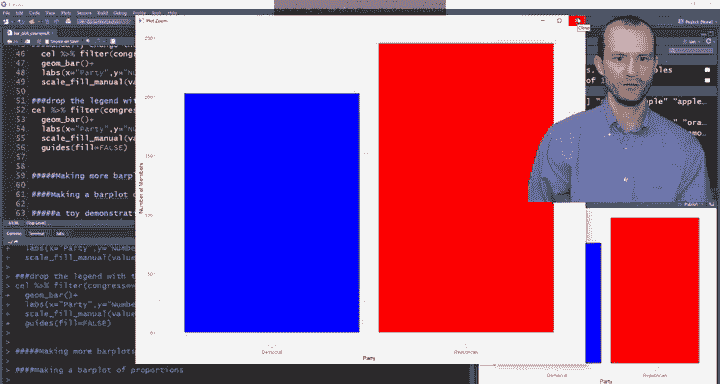
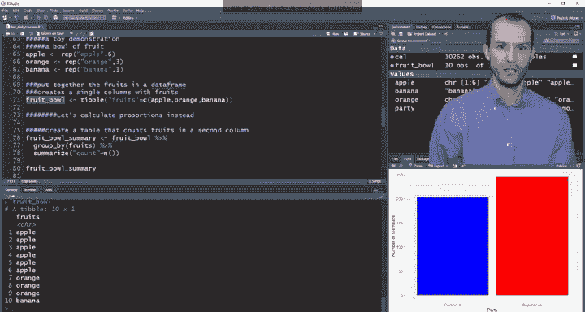

# 课程22：条形图进阶与数据操作 🧮


在本节课中，我们将继续探索条形图的更多修改技巧，并练习在R中操作数据的基本方法。我们将从上一节课结束的代码位置开始，逐步学习如何创建比例条形图，以及如何通过构建示例数据集来加深对绘图函数的理解。

## 从计数条形图到比例条形图

上一节我们介绍了如何使用`geom_bar()`默认统计计数来创建条形图。本节中，我们来看看如何直接指定条形的高度值，例如绘制各类别的比例。

有时我们不希望R自动计算频数，而是希望直接告诉R每个条形应该显示的具体数值。这种情况的一个典型例子是绘制不同响应或类别在总体中的比例。



为了更清晰地说明这一点，我们将暂时离开现有的调查数据集，创建一个简单的示例数据集进行演示。

## 创建示例数据集

构建小型示例或“玩具”数据集是检验你对函数理解程度的好方法，也是快速演示可视化效果的实用技能。在线查阅GGPlot参考资料时，你经常会看到作者通过创建新数据来演示可视化过程。

假设我们想模拟一个虚构果篮中的水果集合。首先，我们使用`replicate`函数创建一组苹果：

```r
apple <- replicate(6, "Apple")
```

上述代码创建了一个包含六个“Apple”字符串的字符向量。我们同样为橘子和香蕉创建向量：

```r
orange <- replicate(3, "Orange")
banana <- replicate(1, "Banana")
```

现在，我们使用`tibble`和`c()`函数将所有水果组合到果篮中：

```r
fruit_bowl <- tibble(fruit = c(apple, orange, banana))
```

这样我们就得到了一个包含10个水果的小型数据集，可以用它来创建比例条形图。

## 计算比例并整理数据



首先，我们需要计算果篮中每种水果的比例。目标是得到一个包含三列的表格：水果种类、每种水果的数量，以及它们的比例。

我们可以通过一些简单的数据整理步骤来完成：

```r
fruit_summary <- fruit_bowl %>%
  group_by(fruit) %>%
  summarise(count = n()) %>%
  mutate(proportion = count / sum(count))
```

这段代码的执行过程是：先按水果种类分组，然后计算每组的观测数量（`count`），最后新增一列计算每种水果数量占总数的比例（`proportion`）。

## 绘制比例条形图

现在我们已经有了一个包含每种水果数量和小数比例的小表格，接下来绘制条形图。这里的做法与之前略有不同：

```r
ggplot(data = fruit_summary) +
  geom_bar(mapping = aes(x = fruit, y = proportion), stat = "identity")
```

在这段代码中，我们同时映射了x和y美学：x轴是水果种类，y轴是计算出的比例值。关键在于`stat = "identity"`参数，它告诉`geom_bar()`函数不要执行其默认操作（即使用`count`统计函数），而是直接根据数据集中每一行的具体数值来绘制条形的高度。

为了完善图表，我们可以添加一些额外的命令来设置颜色、添加标签并移除图例：

```r
ggplot(data = fruit_summary) +
  geom_bar(mapping = aes(x = fruit, y = proportion, fill = fruit), stat = "identity") +
  labs(title = "Proportion of Fruits in the Bowl", x = "Fruit Type", y = "Proportion") +
  theme(legend.position = "none")
```

最终结果是一个包含三个条形的条形图，每个条形的高度对应果篮中每种水果的比例。

## 总结

本节课中我们一起学习了如何超越简单的计数条形图，创建展示比例或其他汇总值的条形图。我们通过构建一个示例水果数据集，演示了数据整理、比例计算以及使用`stat = "identity"`参数直接绘制指定数值的过程。请保持你的R代码文件打开，在接下来的代码行中，我们将进行更多的练习。