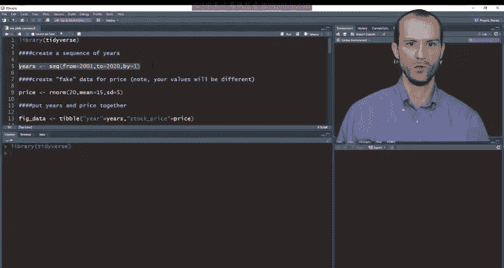
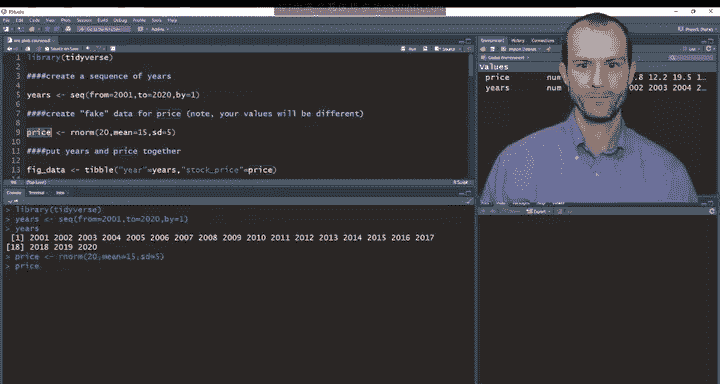
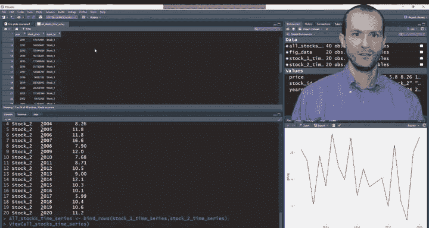

# 课程24：📈 折线图（第一部分）

在本节课中，我们将学习另一种经典的数据可视化类型——折线图。折线图通常用于展示时间趋势，显示某个数值随时间变化的波动情况。

## 概述

要创建折线图，数据中需要包含一列时间或日期信息，以及一列或多列数值，这些数值代表每个时间点上需要绘制的数据点。接下来，我们将通过创建一个示例数据集来演示折线图的绘制过程。



## 创建示例数据集

首先，我们需要创建一个包含年份的向量，范围从2001年到2020年。我们可以使用序列命令 `seq()` 来实现。

```r
years <- seq(2001, 2020, by = 1)
```

接下来，我们需要为每一年创建一个对应的数值。这里我们创建一个名为 `price` 的向量，可以将其想象为一家公司的股票价格随时间的变化。我们将从一个均值为15、标准差为5的正态分布中随机抽取数值来生成这些价格。

```r
price <- rnorm(20, mean = 15, sd = 5)
```



现在，我们将年份和价格组合成一个数据框，并使用 `ggplot2` 包来创建折线图。

```r
library(ggplot2)
library(tibble)

stock_one_time_series <- tibble(years = years, price = price)
```

## 绘制基本折线图

调用 `ggplot()` 函数，指定数据源，并进行美学映射：将 `years` 映射到X轴，将 `price` 映射到Y轴。然后，通过添加 `geom_line()` 函数来绘制折线。

```r
ggplot(data = stock_one_time_series, aes(x = years, y = price)) +
  geom_line()
```

执行上述代码后，我们将得到一个展示价格随时间变化的折线图。

## 添加第二条折线

现在，假设我们想在同一个图中添加第二条折线，以比较两只不同股票的价格走势。我们需要在数据中添加一个标识股票的列。

首先，在第一个数据框中添加一个名为 `stock_id` 的列，标识为“stock1”。

```r
stock_one_time_series$stock_id <- rep("stock1", 20)
```

接着，我们创建第二个股票的数据。过程类似，但使用不同的股票ID（“stock2”）和不同的正态分布参数（例如，均值为20，标准差为3）来生成价格，以使两条线有所区别。



```r
price2 <- rnorm(20, mean = 20, sd = 3)
stock_two_time_series <- tibble(years = years, price = price2, stock_id = rep("stock2", 20))
```

现在，我们将两个数据框合并。

```r
all_stocks_time_series <- rbind(stock_one_time_series, stock_two_time_series)
```

查看合并后的数据对象，确保其结构正确。请注意，由于随机抽样的原因，您电脑上生成的具体数值可能与示例中的不同，这属于正常现象。

## 绘制多条折线图

要绘制包含两条折线的图表，我们再次调用 `ggplot()`。美学映射与之前相同，但这次我们需要通过 `group` 美学将数据按 `stock_id` 分组，这样 `ggplot2` 就会为每只股票分别绘制折线。

```r
ggplot(data = all_stocks_time_series, aes(x = years, y = price, group = stock_id)) +
  geom_line()
```

运行代码后，我们会得到一个包含两条折线的图。为了更好地区分它们，我们可以进一步设置线条的颜色和线型。

```r
ggplot(data = all_stocks_time_series, aes(x = years, y = price, group = stock_id, color = stock_id, linetype = stock_id)) +
  geom_line()
```

最后，如果我们不希望两条线出现在同一个图中，可以使用 `facet_wrap()` 函数将它们分开展示在两个独立的面板中。

```r
ggplot(data = all_stocks_time_series, aes(x = years, y = price)) +
  geom_line() +
  facet_wrap(~ stock_id)
```

## 总结

本节课中，我们一起学习了如何创建基本的折线图来展示时间序列数据。我们掌握了创建示例数据集、绘制单条折线、以及通过分组和美学映射在同一图表中绘制并区分多条折线的方法。我们还了解了如何使用分面功能将不同的线条分离到独立的子图中。在下一个视频中，我们将使用示例数据进行折线图的实践练习。请确保打开相关的R代码文件并跟随操作。