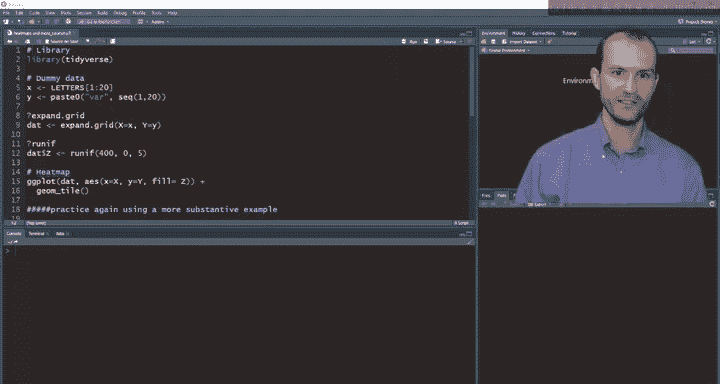
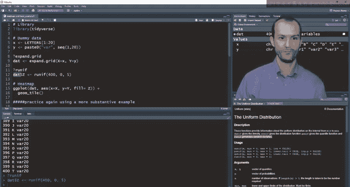

# 课程26：学习新图形（第一部分）🔥


在本节课中，我们将学习如何利用外部资源（如R图形库）来掌握新的数据可视化图形。我们将以热图为例，演示如何查找模板、理解代码并将其应用到自己的数据中。

---

## 概述

在之前的课程中，我们已经学习了ggplot2的核心功能，并能够用它创建多种可视化图形。现在，你应该可以自己进行实验，生成自己的图形了。同时，你也准备好去寻找其他类型可视化的模板，并学习如何将它们适配到自己的数据上。这实际上是一项非常重要的技能，因为ggplot2有许多开源资源，你需要知道如何访问并利用这些资源来提升你的技能。

## 探索R图形库



其中一个非常棒的开源资源是R图形库。这是一个免费网站，提供了许多可以在R中创建的图形模板，有些使用ggplot2，有些则使用其他包。

在接下来的内容中，我将以该库的指导为基础，带你逐步创建一种新类型的图形。目的是为你示范如何学习一种新的可视化方法。

在这个具体的例子中，我们将学习如何制作热图。

## 什么是热图？

假设有人要求我们，或者我们看到了一个有趣的例子想要模仿，我们需要用一些数据来开发一个热图。

热图是一种便捷的汇总方法，用于展示不同观测单元（如人、地点、公司等）在多个变量上的情况。热图中不同图块的颜色表示不同变量的相对大小。颜色可能随着数值增大而从浅变深，或从深变浅。

## 开始制作热图

首先，我们需要访问R图形库网站。到达网站后，向下滚动找到热图类型的可视化页面。

打开热图页面后，你会看到该库提供了几种制作热图的不同函数。你会发现，使用R有多种方法可以实现同一种可视化效果。R图形库会为你提供这些不同的选择。

当你熟悉R并掌握了ggplot2后，你会发现其实可以相当轻松地掌握新的包，因为它们的编程过程在本质上都是相似的。

我们最熟悉的是ggplot2，因此我们将继续遵循其指导，制作该网站上提供的最基本的热图模板。

你应该花点时间自己阅读一下说明，然后再回来看视频。正如说明所示，你可以在ggplot2中使用`geom_tile`函数来创建热图。

这就像`geom_boxplot`、`geom_line`、`geom_point`、`geom_jitter`一样，只是另一种几何对象。

## 使用geom_tile

要使用`geom_tile`，你需要一组观测值，并且每个观测值至少有三个变量。这些观测值可以是人、地点、公司、植物等任何事物，只需要是至少具有三个属性的某种对象。

R图形库展示了一个非常简单的热图示例，R代码就在旁边。你可以直接复制该代码并粘贴到R中，然后自己进行探索。


但出于教学目的，我们将一起完成这个过程。

在本视频附带的R代码中，我所做的就是从R图形库复制了这段R代码并粘贴进去。请跟着我们一起操作。

## 解析示例代码

以下是这个虚拟示例的代码解析：

第一行将字母表中的前20个字母赋值给向量`x`。这些字母代表了可能具有特征的事物，它们只是数据集中的不同案例或观测值。

```r
x <- LETTERS[1:20]
```

下一行将字符串“var”与数字1到20的序列拼接起来。这是你将绘制的特征集合，因此你有20个案例，每个案例有20个不同的属性或变量。

```r
y <- paste0("var", seq(1,20))
```

下一个函数`expand.grid`是我们之前没有遇到过的。因此，你可能需要在R中调用帮助文件来理解这个函数的作用。请记住，当你在外查找参考资料时，尤其是在开源世界中，你可能会遇到不熟悉的函数，所以你需要花点时间确保理解它们的功能。

简而言之，`expand.grid`的作用是创建一个数据框，其中包含你输入到函数中的所有数据向量的每一种组合。这意味着它获取`x`和`y`这两个向量的每一种组合，将它们堆叠在一起，并组成一个表格。

```r
data <- expand.grid(X=x, Y=y)
```

如果你查看代码生成的对象，你就会明白这是如何工作的。当你像这样创建模拟数据时，这是一个很方便的函数，因为现在我们有了一个长格式的数据表，每一行对应一个变量-观测值对。请记住，当我们在ggplot2中创建图形时，我们希望数据是长格式而非宽格式。

下一行有一个`runif`命令，这又是我们没见过的，所以我们可能需要查看帮助文件来了解它的工作原理。你会发现，`runif`是允许你从均匀分布中抽取随机数的函数之一。在这里，它将提供从0到5范围内的随机数。

```r
data$Z <- runif(400, min=0, max=5)
```

这行`runif`命令创建了一个包含400个数字的列表。然后我们可以将这些数据添加到这个玩具数据的新列中，我们将其称为`Z`。

## 创建ggplot图形



这个`ggplot`命令现在对你来说应该很熟悉了。第一个参数是数据，X轴和Y轴映射到我们创建的玩具数据集中的`X`和`Y`列。每个图块的填充颜色将映射到`Z`值。

```r
ggplot(data, aes(X=X, Y=Y, fill=Z)) +
  geom_tile()
```

当我们运行这段代码时，我们看到我们得到了这个热图。底部是观测单元，即那些字母。在Y轴上，每一行代表一个特征，即那20个不同的变量。图块的颜色范围最高到5，这正是我们通过美学映射所设定的。

## 总结

在本节课中，我们一起学习了如何利用R图形库等外部资源来学习创建新的可视化图形。我们以热图为例，详细讲解了从查找模板、理解示例代码（包括新函数`expand.grid`和`runif`）到最终使用`geom_tile`函数生成图形的全过程。这个过程的核心是学会阅读、理解和适配开源代码模板。

在下一个视频中，我们将制作另一个热图来检验你的理解，所以请保持你的R文件打开，我们稍后见。