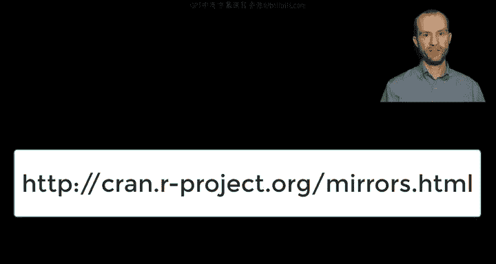
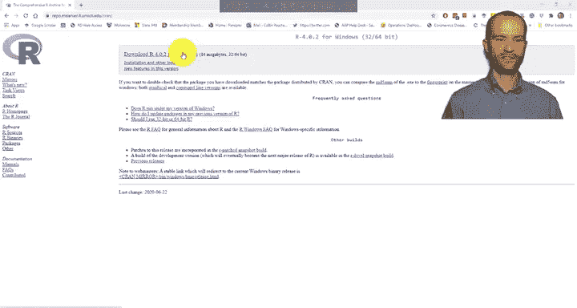
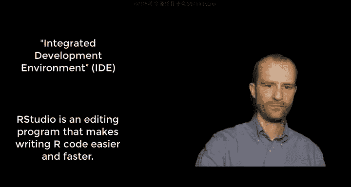
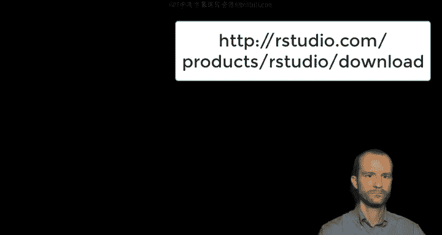
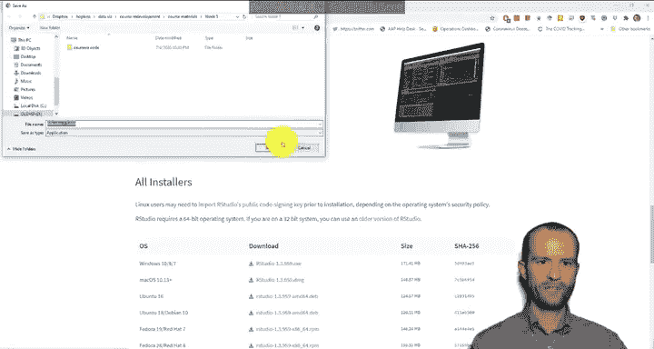
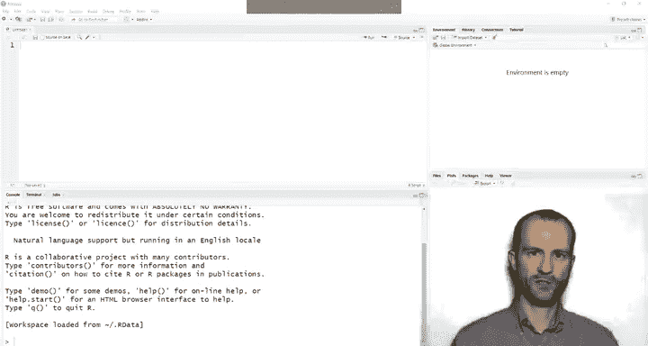
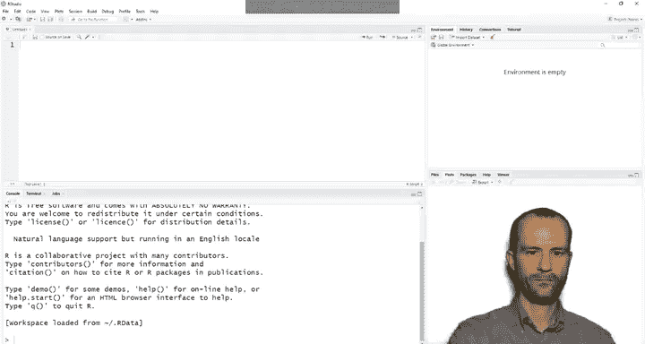

# 课程1：R语言与软件安装介绍 🛠️

在本节课中，我们将要学习R语言的基本概念，并完成R和RStudio的安装与初步设置。R是一种功能强大的统计编程语言，是数据科学家的常用工具之一。

## R语言简介

R是一种极其强大的统计编程语言。与Python一样，它是数据科学家常用的工具之一。

与Tableau这类点击式软件甚至电子表格软件不同，使用R创建数据可视化需要你编写R代码。这既包括创建可视化图表，也包括组织底层数据。

这种数据管理或整理工作极其重要，因为如果你的数据没有以R能够理解和处理的方式组织好，R就无法生成你想要的可视化图表。如果你能将数据转换为R能够理解的格式，那么创建可视化本身通常并不困难，并且在大多数情况下，R几乎可以即时完成。困难的部分在于将数据整理到R能够理解和处理的格式。

## 安装R语言

要开始这一切，首先请确保你的Mac或PC上安装了R和RStudio。

如果你还没有安装R，请访问以下网站。

该网站是综合R存档网络（CRAN）的一部分。CRAN是R及其扩展包在全球服务器上的存储库。

在这个页面上，你可以找到一个离你较近的镜像服务器。我使用的是密歇根大学的镜像。

一旦你找到了合适的镜像，请根据你使用的操作系统点击相应的下载链接。

点击“install R for the first time”，然后根据你的操作系统点击“Download R”。

你需要下载基础文件。在你观看本视频时，R可能已经有了更新的版本，但这没关系，只需下载最新的版本即可。

R的安装文件将下载到你的电脑上。下载完成后，打开它并按照安装说明进行操作。

## 安装RStudio

在你的电脑上安装好R之后，你还需要安装RStudio。

RStudio被称为集成开发环境（IDE）。它是一个独立于R本身的应用程序，可以看作是运行在R之上的一个界面。本质上，RStudio是一个辅助编辑程序，它让你能够以一种非常直观的方式处理文件或编写R代码，并允许你在编码时实时查看R的输出。它还有许多其他有用的功能，我们将在课程中逐步探索。

要安装RStudio，请访问 rstudio.com/products/rstudio/download。

选择RStudio Desktop的免费版本。在下一页，点击下载并将文件保存到你的电脑上。然后打开该文件并按照安装说明进行操作。

## 启动与界面概览

至此，我们已经准备好开始使用R了。请在你的电脑上打开RStudio。

你的屏幕应该看起来类似这样。屏幕的主要部分是控制台，在这里你可以输入命令让计算机执行。

在右上方，有一个选中了“Environment”标签的区域。最终，你将在这里看到当前在R中打开或已创建的各种数据和数据对象的列表。

在右下方，你会看到一个选中了“Plots”标签的窗口。在这里，你将能够看到生成的图表。

当你打开RStudio时，可能还会看到第四个窗格，这是编辑窗格，你可以在其中输入和保存R命令。如果你没有看到这个窗格，可以通过点击新建文件图标并选择“R Script”来打开一个空白的脚本文件。

总的来说，RStudio是一个相当复杂的软件，因此我不会现在就去详细介绍菜单中每一项功能。这类知识在使用过程中学习会比从一开始就进行完整盘点更容易掌握。

熟悉RStudio的一个好方法是仔细查看RStudio速查表，我已将其包含在本周的学习材料中。如果你感兴趣，这份速查表将为你提供关于RStudio各个部分的更详细说明。

## 自定义RStudio外观

我认为在开始时了解如何修改RStudio的一些外观设置是有用的。

如果你进入“Tools”菜单并选择“Global Options”，你可以更改代码编辑的外观选项。

在“Code”部分的“Editing”下，我总是喜欢确保选中“Soft-wrap R source files”。

在“Appearance”部分，我也喜欢增大字体大小。你可以修改颜色和其他字体选项，使其看起来更舒适。

## 总结

本节课中，我们一起学习了R语言作为数据可视化工具的基本特点，了解了数据整理的重要性。我们完成了R语言和RStudio集成开发环境的下载与安装步骤，并初步熟悉了RStudio的界面布局和基本的外观自定义设置。现在，你的开发环境已经准备就绪，可以开始后续的R编程学习了。