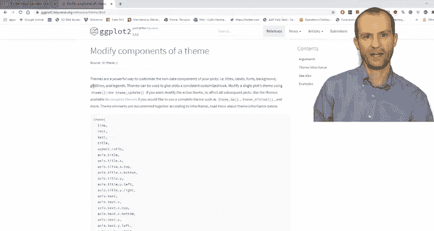
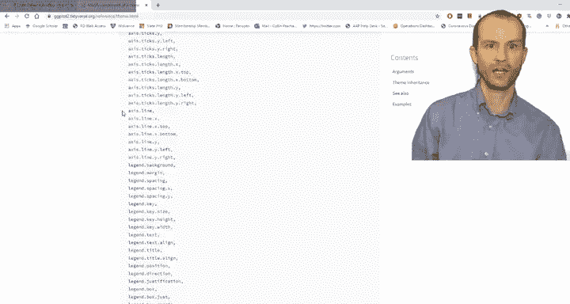
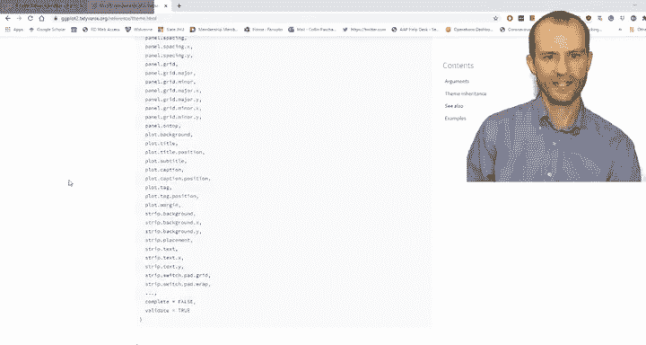
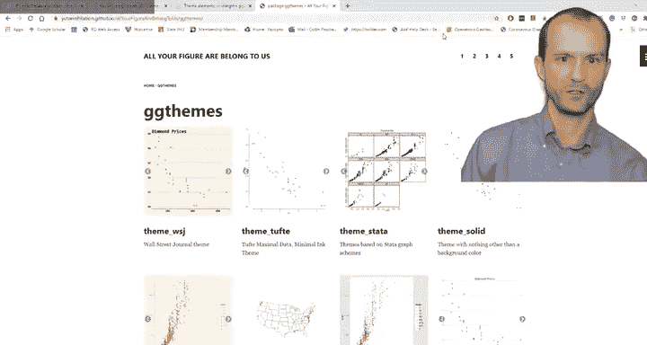
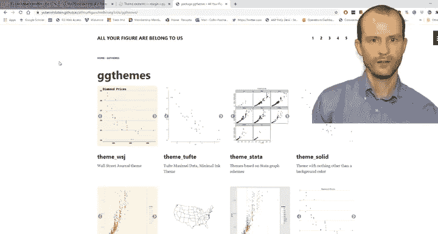
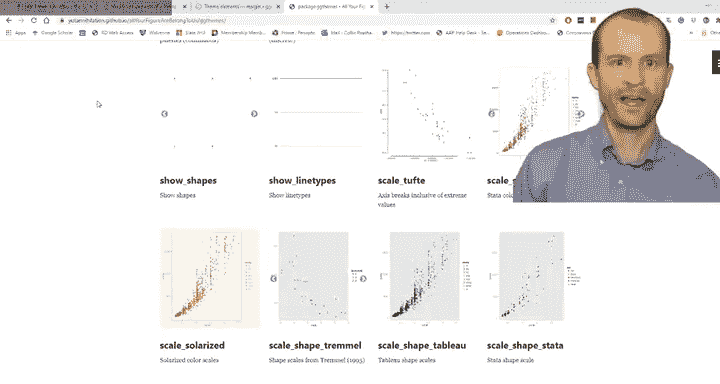
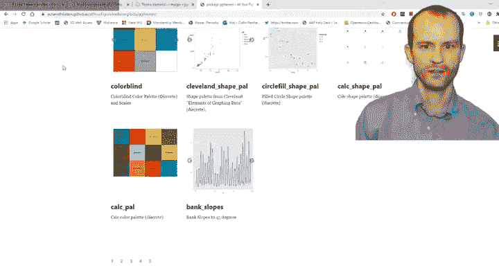
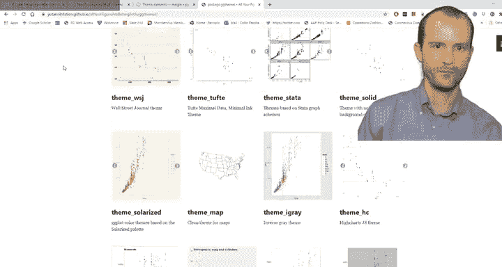

# 课程31：颜色、图例和主题（第二部分）🎨

在本节课中，我们将继续学习如何优化图形的视觉元素。我们将从上一视频结束的地方开始，在代码文件中继续操作。本节课的重点是学习如何使用 `theme` 函数来修改图形的非数据元素。

## 概述

上一节我们介绍了如何根据数据本身来改变点的颜色或大小。本节中，我们来看看如何使用 `theme` 函数来修改那些与底层数据无关、始终保持一致的图形元素。例如，图形中字体的样式、图例的位置以及其他静态的、不依赖于数据的方面。

`theme` 函数相当复杂，包含许多参数。因此，你需要查阅 tidyverse 中关于 `theme` 的文档，了解所有不同的参数、选项以及你可以通过此函数控制的内容。这里我将演示其中的一部分。如果你想控制我们未涉及的其他绘图方面，你需要回头查看其他选项。

## 使用 `theme` 函数

`theme` 函数通过加号（`+`）添加到 `ggplot` 的命令字符串中，就像我们之前看到的那样。它是一个功能非常强大的函数。



让我们从上次结束时的图形开始，分几个步骤来修改它。



### 移动图例位置



假设我们想将此图形的图例移动到下方。我们可以通过修改 `theme` 函数中的 `legend.position` 参数，并将其设置为 `"bottom"` 来实现。

```r
+ theme(legend.position = "bottom")
```

### 修改坐标轴文本格式

接下来，我们修改 X 轴文本的格式。这同样需要通过修改 `theme` 函数中的一个参数来实现。

我们使用 `axis.text.x` 参数。这有点复杂，因为在这个参数内部，你实际上需要放入另一个函数：`element_text`。这是一个完全独立的函数，有单独的文档页面。你需要去 `ggplot2` 的参考页面查看，以了解所有不同的选项。但基本上，它是一个用于控制文本格式或字体的函数。

我们将这个函数放入 `theme` 的这个参数中。通过使用 `element_text` 函数内的选项，我们可以设置文本的角度、水平间距、颜色等。

```r
+ theme(axis.text.x = element_text(angle = 45, hjust = 1, color = "blue"))
```

再次运行代码后，我们可以看到这些更改已添加到我们的图形中。

### 修改坐标轴标题颜色

假设我们想改变坐标轴标题的颜色。我们可以使用 `theme` 函数中的 `axis.title` 参数来实现。同样，我们在该参数内使用 `element_text` 函数，并将颜色设置为红色。

```r
+ theme(axis.title = element_text(color = "red"))
```

完成所有这些操作后，我们可以再次使用 `labs` 函数为图形添加标签。我们在这里做的是将 `theme` 函数的一些修改与 `labs` 函数的修改结合起来。

正如你所见，通过使用 `theme` 函数，并结合 `labs` 函数或 `guides` 函数，你可以对图形的元素进行非常精细的控制。但我也承认，这相当复杂，在你真正开始自己深入研究之前，可能有点难以跟上。

## 使用 `ggthemes` 包简化操作





幸运的是，有一个更简单的方法，那就是 `ggthemes` 包。我们在 R 代码的开头已经安装并加载了 `ggthemes`。这个包内置了大量预制的主题，你可以将它们应用到自己的可视化中。

以下是可用的主题列表，你可以通过谷歌搜索“ggthemes”并访问一个名为“All Your Figure Are Belong To Us”的网站来查看，课程材料中也提供了链接。





这个网站的名字很有趣，但它基本上就是一个所有不同 `ggthemes` 主题的画廊。你可以看到这里有很多不同的选项，这个包的作者已经对 `ggplot2` 的主题进行了调整，将它们变成了这些你可以直接使用的预制模板。



你可以在这里浏览，并选择一个你喜欢的主题。例如，在代码中，我选择了 `theme_wsj` 选项，它将模仿美国《华尔街日报》中图形的外观。你可以看到，当我运行带有这个额外主题参数的代码时，它会对图形进行一系列更改，使其更具吸引力。

不过，请记住，即使你使用了 `ggthemes`，你仍然可以使用 `theme` 函数自行修改主题的元素，这将让你直接控制图形的特性。例如，如果我喜欢 `theme_wsj`，我可以使用它，但之后我可以添加自己的 `theme` 函数来旋转坐标轴文本的角度。

```r
+ theme_wsj() + theme(axis.text.x = element_text(angle = 45))
```

## 总结

本节课中，我们一起学习了如何使用 `ggplot2` 的 `theme` 函数来精细控制图形的非数据元素，如字体、图例位置和坐标轴样式。我们还介绍了 `ggthemes` 包，它提供了大量预制主题，可以快速美化图形，同时仍允许我们通过 `theme` 函数进行自定义调整。掌握这些工具，你将能创建出更具专业性和吸引力的数据可视化作品。