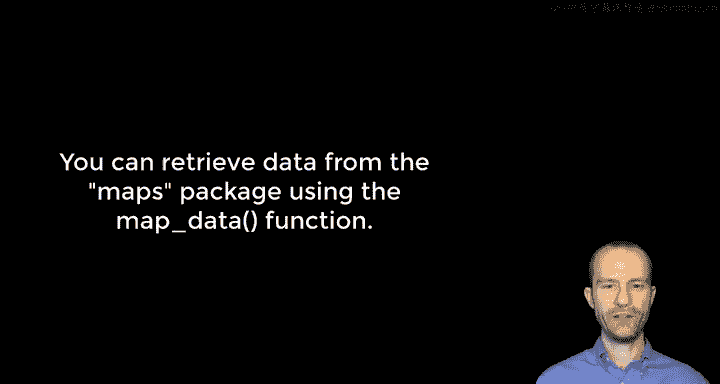
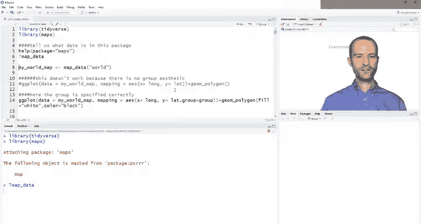

# 课程名称：R语言数据可视化与仪表盘 - P37：地图绘制入门 🗺️

在本节课中，我们将学习如何在R中绘制地图。我们将从绘制基础地图开始，了解绘制地图所需的基本数据和步骤。

---

## 绘制地图的基本逻辑

任何在R中绘制的地理空间可视化都需要两个步骤。首先，需要使用某种数据来指导R绘制构成地图的多边形形状。然后，在地图上添加信息，用于绘制颜色和标记。从这个意义上说，其基本逻辑与我们目前使用`ggplot2`绘图是一致的。

关键在于拥有能够将地理数据与你想要在地图上展示的实质性信息联系起来的数据集。

---

## 使用 `maps` 包绘制地图

为了简化入门，R中的`maps`包包含了一系列使用经纬度数据绘制的美国和世界地图。虽然你可能想绘制其他地理实体，但通过世界地图和美国各州地图，你可以完成许多绘图任务并掌握基本方法。

让我们直接开始绘制地图，这样会更容易理解。

### 获取地图数据





首先，我们需要获取R绘制地图所需的数据。在`maps`包中，有一个名为`map_data`的命令，可用于检索软件包中包含的预置地图。

查看`map_data`的帮助文件，我们看到第一个输入参数是`map`，它要求我们指定要从包中绘制的哪个地图。选项包括美国各县、法国、意大利、新西兰、美国各州以及两个不同版本的世界地图。遗憾的是，该数据库中没有其他国家的行政区划数据，因此如果你未来想绘制其他类型的地理单元，需要自行寻找数据。

### 加载世界地图数据

让我们查看包中内置的世界地图数据。我们使用命令`map_data`，并输入参数`"world"`，然后将结果保存到对象`my_world_map`中。

```r
my_world_map <- map_data("world")
```

运行这行代码生成的对象是一个数据框。查看数据框，重要的列包括用于绘制地图的经纬度坐标集、与每个地理点对应的国家/地区名称列，以及为每个国家/地区指定组号的`group`列。数据中可能包含一些国家的子区域信息，但目前我们暂不关注。`order`列只是一个顺序向量，当前用途也可以忽略。

---

## 使用 `ggplot2` 绘制地图

现在我们已经掌握了地图数据，接下来使用`ggplot2`来绘制地图。

在`ggplot`命令中，我们将数据设置为`my_world_map`。对于图形属性，我们希望经度在X轴上（因为在地图上水平移动时经度会变化），纬度在Y轴上（因为在地图上垂直移动时纬度会变化）。我们还需要将`group`设置为数据框中的`group`列，以确保正确绘制边界。

设置好这些图形属性后，我们添加`geom_polygon`图层来告诉`ggplot2`为我们绘制地图。毕竟，地图本质上就是一系列多边形。这与我们过去绘制的点、线、条形图等`ggplot2`几何对象是类似的。

```r
ggplot(data = my_world_map, aes(x = long, y = lat, group = group)) +
  geom_polygon()
```

运行此代码，我们会得到一张地图，其中国家/地区被填充为黑色，边界线为白色。现在，我们就有了一张世界地图，它可以作为可视化的基础，未来我们可以通过添加颜色和点来绘制不同类型的图形。

---

## 绘制特定区域的地图

假设我们只想查看世界地图的某一部分，例如单个国家。

你可以通过在地图数据上设置过滤器来实现，该过滤器仅选择特定的国家或国家组，并创建一个仅包含这些选定国家经纬度的数据框。我们使用过去常用的`tidyverse`命令`filter`来完成此操作。

例如，如果我们想创建仅德国的地图，我们可以使用仅过滤德国的条件来创建世界地图数据的子集。或者，也可以过滤多个国家来绘制几个国家。最好在此处使用相邻的国家，否则可能会遇到投影和缩放方面的奇怪问题。

让我们以德国和法国为例进行过滤。

```r
germany_france_map <- my_world_map %>%
  filter(region %in% c("Germany", "France"))

ggplot(data = germany_france_map, aes(x = long, y = lat, group = group)) +
  geom_polygon()
```

正如预期的那样，现在我们得到了法国和德国的图形，因为这是我们从世界地图数据中选择的唯一数据。

另一种方法，如果你不想挑选单个国家，可以通过经纬度来过滤地图数据，本质上就是放大你在地图上绘制的框。

---

## 总结

本节课中，我们一起学习了在R中绘制地图的基础知识。我们了解到绘制地图需要两个核心部分：用于定义形状的地理数据，以及用于可视化的附加信息。我们使用`maps`包中的`map_data`函数获取了预置的世界地图数据，并使用`ggplot2`的`geom_polygon`图层将其绘制出来。最后，我们还学习了如何使用`filter`函数来绘制特定的国家或区域。绘制这些地图为你的可视化创建了骨架，在接下来的课程中，我们将学习如何添加颜色和形状等附加信息来丰富地图内容。