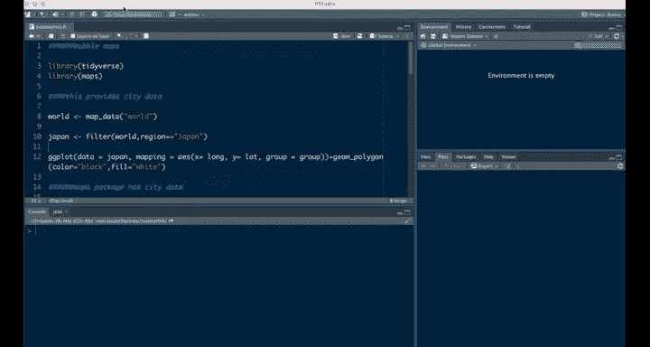
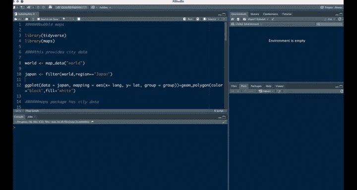
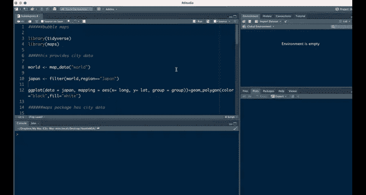
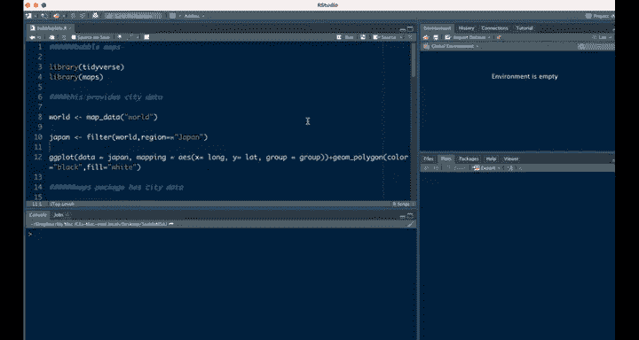
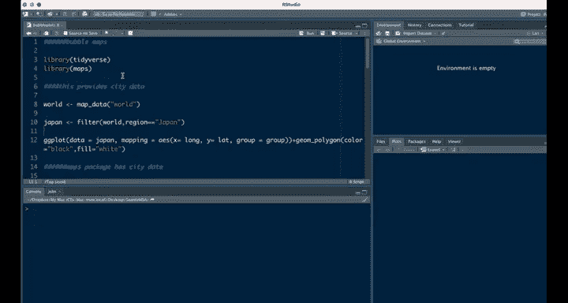
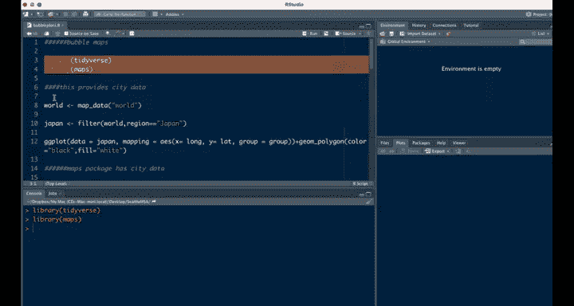

# 课程39：气泡地图 🌍


在本节课中，我们将学习如何创建气泡地图。气泡地图是一种特殊的地图类型，其中点的尺寸或颜色会根据数据中的某些数值而变化。通过这种方式，我们可以在地图上直观地展示不同地点的数据差异。



---



上一节我们介绍了基础地图的绘制，本节中我们来看看如何在地图上添加带有尺寸和颜色变化的气泡点。

## 创建日本基础地图



首先，我们需要加载必要的R包，并创建一个日本的空白地图。


```r
# 加载所需包
library(ggplot2)
library(maps)



# 创建日本空白地图
japan_map <- map_data("world", region = "Japan")
ggplot() +
  geom_polygon(data = japan_map, aes(x = long, y = lat, group = group), fill = "white", color = "black")
```



## 获取并映射城市数据

`maps` 包内置了许多城市的数据。我们可以通过以下代码访问日本的城市列表。



```r
# 获取日本城市数据
japan_cities <- world.cities[world.cities$country.etc == "Japan", ]
```

查看这个对象，我们会发现它包含了日本许多城市的名称、人口以及对应的经纬度坐标。

现在，我们将所有城市点添加到日本地图上。

```r
# 将所有城市点添加到地图
ggplot() +
  geom_polygon(data = japan_map, aes(x = long, y = lat, group = group), fill = "white", color = "black") +
  geom_point(data = japan_cities, aes(x = long, y = lat), color = "red")
```

在这段代码中，我们在 `geom_point` 函数中单独指定了数据源和经纬度映射。虽然基础地图的 `aes` 中使用了 `group` 参数，但在这里我们不需要，因此将其设为 `NULL`。目前，我们将所有点的颜色统一设置为红色。

绘制后，地图上会显示所有我们有数据的日本城市点。由于点过多，地图可能显得拥挤。

## 筛选并展示特定城市

为了获得更清晰的视图，我们可以筛选出人口超过50万的城市。

```r
# 筛选人口超过50万的城市
major_cities <- japan_cities[japan_cities$pop > 500000, ]

# 绘制筛选后的城市
ggplot() +
  geom_polygon(data = japan_map, aes(x = long, y = lat, group = group), fill = "white", color = "black") +
  geom_point(data = major_cities, aes(x = long, y = lat), color = "red")
```

## 根据数据特征调整气泡

为了使地图传达更多信息，我们可以让点的尺寸和颜色反映数据的不同特征。

以下是调整点尺寸以反映人口大小的步骤。

```r
# 点尺寸映射到人口
ggplot() +
  geom_polygon(data = japan_map, aes(x = long, y = lat, group = group), fill = "white", color = "black") +
  geom_point(data = major_cities, aes(x = long, y = lat, size = pop), color = "red")
```

现在，点的尺寸会根据城市人口而变化。变化可能不剧烈，但确实存在。

## 同时映射尺寸和颜色

如果我们想同时根据人口调整尺寸，并根据另一个分类变量调整颜色呢？以下是具体操作方法。

首先，我们为数据创建一个示例分类变量。

```r
# 创建一个示例分类变量（例如城市类型）
set.seed(123) # 确保结果可重现
major_cities$category <- sample(LETTERS[1:3], nrow(major_cities), replace = TRUE)
```

接着，在 `aes` 函数内同时映射尺寸和颜色。

```r
# 尺寸映射到人口，颜色映射到分类变量
ggplot() +
  geom_polygon(data = japan_map, aes(x = long, y = lat, group = group), fill = "white", color = "black") +
  geom_point(data = major_cities, aes(x = long, y = lat, size = pop, color = category))
```

请注意，颜色设置在 `aes` 函数内部，因为我们希望颜色与数据特征（分类变量）相关联。这与之前将颜色统一设置为红色的做法不同。

## 最终修饰与完成

最后，我们可以对图形进行一些简单的美化，例如添加标题、调整图例位置等，以完成最终的气泡地图。

```r
# 最终修饰后的气泡地图
ggplot() +
  geom_polygon(data = japan_map, aes(x = long, y = lat, group = group), fill = "white", color = "black") +
  geom_point(data = major_cities, aes(x = long, y = lat, size = pop, color = category), alpha = 0.7) +
  labs(title = "日本主要城市气泡地图",
       subtitle = "点尺寸代表人口，颜色代表分类",
       size = "人口",
       color = "类别") +
  theme_minimal()
```

---

本节课中我们一起学习了如何创建气泡地图。我们掌握了从绘制基础地图、添加数据点，到根据数值和分类变量调整点尺寸与颜色的完整流程。气泡地图是展示地理空间数据分布与差异的强大工具。