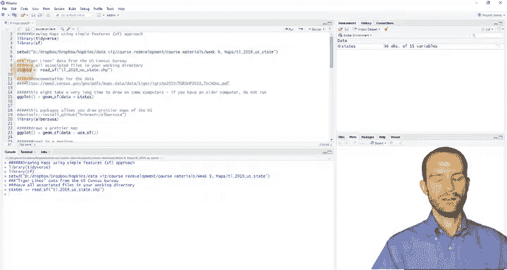

# 课程名称：R语言数据可视化与仪表盘 - P40：6_简单特征地图 🗺️

## 概述

在本节课中，我们将学习如何在R语言中使用“简单特征”（Simple Features）格式的地理空间数据来绘制地图。我们将涵盖如何读取Shape文件和GeoJSON文件，如何绘制基础地图，以及如何在地图上叠加自定义数据和点标记。

---

## 从内置地图数据到简单特征格式

上一节我们介绍了如何使用R内置的`maps`包数据绘制地图。本节中，我们来看看如何使用更灵活的地理数据格式。

到目前为止，我们所绘制的地图都依赖于R中`maps`包内置的数据。如果你只是绘制简单地图，并且数据可以通过经纬度坐标绘制，这可能就足够了。

然而，R有能力使用其他类型的地理数据。一个较新且日益流行的用于存储和分发地理空间信息的系统是“简单特征”格式。你可以将简单特征格式编码的数据读入R，这真正开启了你可以绘制的地图类型以及可以使用的数据来源。

具体来说，使用R中的简单特征工具，你可以下载并使用两种非常常见的地理数据格式：**Shape文件**和**GeoJSON文件**。

Shape文件和GeoJSON文件的来源非常多，但美国人口普查局是一个组织良好、非常棒的数据源，我们可以从中获取一些很好的例子。

---


## 读取和绘制Shape文件

以下是读取和绘制Shape文件的基本步骤。

首先，你需要获取Shape文件。例如，我通过谷歌搜索“US Census shapefile”找到了这里使用的数据。读取Shape文件时，它们附带一组相关文件。你需要将`.shp`文件（即Shape文件）及其所有相关文件放在计算机的同一文件夹中。在处理它们时，你需要在R中将该文件夹设置为工作目录。

接下来，下载并加载`sf`库到你的R会话中。

要读取一个`.shp`文件或Shape文件，我们使用`read_sf()`命令，并将结果赋值给R中的一个对象。

```r
# 示例代码：读取Shape文件
library(sf)
states <- read_sf("path/to/your/shapefile.shp")
```

花点时间检查这个对象。你会发现它本质上是一个56行、15列的表，包含许多以特定方式编码的列。这些列的文档（即数据的代码簿）可在美国人口普查网站上找到。但仅通过检查，你可以看到有一个“州缩写”列，因此每个美国州和一些领地都对应一行。

我们现在可以开始制作地图了。调用`ggplot()`，将数据设置为我们读取的`states`对象。然后，我们添加一个专门用于映射简单特征数据的特殊几何对象：`geom_sf()`。



```r
# 示例代码：绘制基础地图
library(ggplot2)
ggplot(data = states) +
  geom_sf()
```

你的计算机可能需要一点时间来渲染这张地图，因为它相当大，但最终会完成。这张地图对用户并不完全友好，因为它绘制了许多外围领地，并且在美国本土各州中绘制阿拉斯加和夏威夷始终是个问题。

---

## 处理特殊投影：包含阿拉斯加和夏威夷

由于这是一个非常常见的问题，一位聪明的开发者编写了一个特殊的包，其中包含一个在美国简单特征框架下包含阿拉斯加和夏威夷的投影。

我们需要为此安装一个特殊的包：`albersusa`库。一旦我们将该库加载到R中，就可以使用它来绘制美国地图。

```r
# 示例代码：使用特殊投影绘制美国地图
# 安装并加载包
# install.packages("albersusa")
library(albersusa)
library(ggplot2)

# 使用包内提供的简单特征数据
ggplot(data = usa_sf()) +
  geom_sf()
```

---

## 使用GeoJSON文件

还有一个需要快速介绍的内容，现在向你展示如何使用GeoJSON信息绘制地图是值得的。

GeoJSON只是空间数据的另一种常见格式。你可以在本课的材料中找到一个示例GeoJSON文件。这个GeoJSON文件是华盛顿州西雅图周边县的地图。

要使用此文件，将你的`read_sf()`命令指向`.geojson`文件并将其加载到R对象中。然后，我们可以用与处理Shape文件完全相同的方式来映射它。

```r
# 示例代码：读取和绘制GeoJSON文件
seattle_counties <- read_sf("path/to/your/seattle_counties.geojson")
ggplot(data = seattle_counties) +
  geom_sf()
```

---

## 向地图添加数据

既然我们知道了如何使用Shape文件、GeoJSON文件和`sf`包绘制地图，我们就可以开始向这些地图添加信息了。

有两种方法可以做到这一点。首先，你可以向从Shape或GeoJSON文件创建的对象添加数据。或者，这些文件有时也嵌入了信息，你可以在绘制地图时直接利用这些信息。

为了从头开始，我们将使用向我们用Shape文件创建的对象添加自有数据的方法。当我们实际进行操作时，这一点会变得更加清晰。

首先，再次使用美国人口普查数据的Shape文件调用美国地图。这次，让我们过滤数据，只保留堪萨斯州、内布拉斯加州、爱荷华州和密苏里州。

你可以使用这里的邮政编码列（即`STUSPS`）或FIPS代码（`FIPS`）来设置此过滤器。你可以在网上找到关于FIPS代码的信息，很容易用谷歌搜索到，这些只是美国政府用于按数字分类州的特殊代码。

让我们使用FIPS代码执行一个`filter`命令，并绘制这四个州的地图。

```r
# 示例代码：过滤特定州并绘制
library(dplyr)
library(ggplot2)

# 假设states对象已包含FIPS代码列‘FIPS’
four_states <- states %>%
  filter(FIPS %in% c("20", "31", "29", "19")) # 示例FIPS代码

ggplot(data = four_states) +
  geom_sf()
```

我们将首先将这个空白地图转换为一个用不同颜色填充各州的**等值区域图**。

为了演示目的，我们将创建一个简单的虚拟数据集，包含州代码和字母表中的四个字母。

```r
# 示例代码：创建虚拟数据并合并
demo_data <- data.frame(
  FIPS = c("20", "31", "29", "19"),
  value = c("A", "B", "C", "D")
)

# 使用左连接命令将数据合并到地图数据
map_with_data <- left_join(four_states, demo_data, by = "FIPS")
```

如果我们愿意，也可以在这里用定量信息的向量做完全相同的事情。

一旦数据集合并完成，我们可以再次使用`ggplot()`绘制这些数据，将填充（`fill`）设置为我们创建的新变量，你会看到创建了等值区域图。这与我们之前使用`geom_polygon`时所做的非常相似。

```r
# 示例代码：绘制带填充颜色的等值区域图
ggplot(data = map_with_data) +
  geom_sf(aes(fill = value))
```

---

## 在地图上绘制点

至此，你可能已经猜到如何使用简单特征数据在地图上绘制点了。

如果我们有一个包含经纬度坐标的数据框，我们可以使用`geom_point()`函数直接在它上面绘制点。再次说明，仅以此为例，请记住`maps`包中包含许多世界城市的经纬度坐标。

让我们调用它，并执行一个过滤命令，提取出我们已绘制的四个州中的几个城市。

```r
# 示例代码：从maps包获取城市数据并过滤
library(maps)
data(world.cities)

# 假设我们有四个州的名称列表
target_states <- c("Kansas", "Nebraska", "Iowa", "Missouri")
cities_in_states <- world.cities %>%
  filter(country.etc == "USA",
         name %in% c("Topeka", "Lincoln", "Des Moines", "Jefferson City")) # 示例城市

# 注意：需要确保城市数据有‘lat’和‘long’列
```

现在我们可以将这些点直接添加到绘图中。

```r
# 示例代码：在地图上添加点
ggplot() +
  geom_sf(data = four_states) + # 先绘制州界
  geom_point(data = cities_in_states, aes(x = long, y = lat), color = "red", size = 3)
```

---

## 为点添加标签

我们也可以或多或少地按照为简单散点图添加标签的方式，为这些点添加标签。

使用`ggrepel`包中的`geom_text_repel()`命令，我们可以从地理数据的名称列中提取信息来添加这些标签。

```r
# 示例代码：为点添加防重叠标签
# install.packages("ggrepel")
library(ggrepel)

ggplot() +
  geom_sf(data = four_states) +
  geom_point(data = cities_in_states, aes(x = long, y = lat), color = "red", size = 3) +
  geom_text_repel(data = cities_in_states, aes(x = long, y = lat, label = name))
```

---

## 总结

本节课中，我们一起学习了在R中使用“简单特征”格式进行地理数据可视化的核心技能。我们掌握了如何读取**Shape文件**和**GeoJSON文件**这两种常见格式，使用`geom_sf()`绘制基础地图，并通过过滤、合并数据来创建**等值区域图**。我们还学会了如何在地图上叠加**点数据**（`geom_point`）并为这些点添加清晰的**标签**（`geom_text_repel`）。这些技能为你利用丰富的外部地理数据源创建信息丰富、定制化的地图奠定了基础。