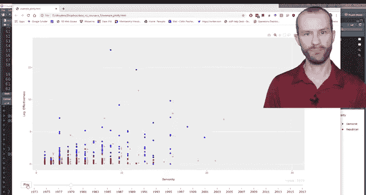
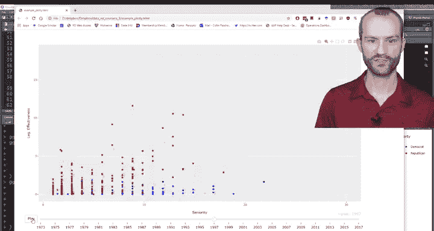
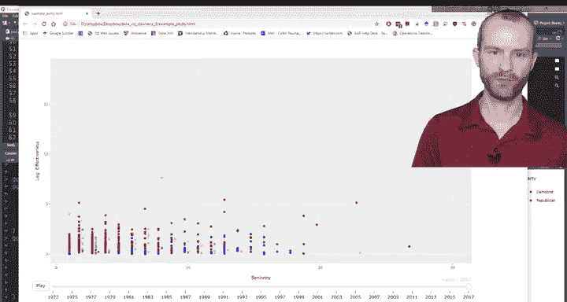

# 课程11：使用ggplotly创建交互式图表（第二部分）🎬

在本节课中，我们将学习如何使用Plotly库为你的ggplot2图表添加动画效果，并了解如何保存和分享这些交互式可视化作品。

上一节我们介绍了`ggplotly`函数的基础用法，本节中我们来看看如何用它来创建动态图表。

---

## 使用Plotly制作动画图表

与`gganimate`库类似，Plotly也能为图表添加动画效果。其工作原理是：根据数据中某个变量的不同取值创建动画的“帧”，然后为每一个不同的值重新绘制图表。

实现这一功能非常简单。以下是一个示例，我们将从一个静态散点图开始。

### 创建基础静态图表

首先，我们使用`geom_point()`和之前例子中用过的“国会效力”数据集来绘制一个静态散点图。这段代码对你来说应该很熟悉了。

```r
# 示例代码：绘制静态散点图
ggplot(data = effectiveness_data, aes(x = seniority, y = leg_effectiveness, color = party)) +
  geom_point()
```

这个图表在Y轴上绘制立法效力得分，在X轴上绘制资历，并根据党派为点着色。立法效力得分旨在衡量国会议员制定法律的效率，分数越高代表效率越高。通常，资历更深的议员应该更高效，得分也更高。

运行这段代码，我们会得到一个包含数据集中所有年份和届次的所有议员的散点图。

### 为图表添加动画

如果我想让这个图表动起来，以展示不同年份间的变化，可以将整个`ggplot`命令包裹在`ggplotly()`函数中。

```r
# 示例代码：添加年份动画
ggplotly(
  ggplot(data = effectiveness_data, aes(x = seniority, y = leg_effectiveness, color = party, frame = year)) +
    geom_point()
)
```

关键是在美学映射`aes()`中添加一个`frame = year`的选项。这将指示Plotly根据数据集中不同的年份值，一遍又一遍地重绘图表。

完成这一步后，`ggplotly`会生成图表，并在下方出现一个播放按钮。点击它，图表就会逐年动画显示。

### 优化动画流畅度：对象恒常性

你可能会注意到，上面的动画切换比较“跳跃”。为了让动画更平滑，可以引入“对象恒常性”的概念。这会使数据点从上一帧的位置移动过来，而不是每次都被完全重新绘制。

实现方法是为每个数据点提供一个跨时间恒定的唯一标识符（ID）。

```r
# 示例代码：添加ID以实现平滑动画
ggplotly(
  ggplot(data = effectiveness_data, aes(x = seniority, y = leg_effectiveness, color = party, frame = year, ids = name)) +
    geom_point()
)
```

这里，我添加了每位议员的名字作为`ids`参数。因为在数据集中，跟踪同一议员跨年份的数据时，其姓名是恒定不变的。

添加此参数并重新运行动画后，你会发现动画变得平滑了，并且能够实际追踪某些议员在多年间的变化轨迹。

---

## 保存与分享Plotly图表

创建了交互式图表后，你可能需要保存或分享它。

### 保存为静态图片或HTML文件

在RStudio的Viewer窗口中，你可以将Plotly图表导出。

*   **保存为静态图片**：你可以将图表导出为PNG等格式的图片文件，但这会丢失所有交互功能。
*   **保存为HTML文件**：更好的方法是将其保存为`.html`文件。在网页浏览器中打开这个文件，可以完整保留图表的所有交互元素（如悬停提示、缩放、动画）。之后，你可以将这个HTML文件嵌入网页或其他类型的文档中。

### 发布到网络





如果你想在网络上发布Plotly图表，可以直接在RStudio的Viewer窗口中操作。

1.  点击图表上方的“Publish”按钮。
2.  选择发布到**Plotly Chart Studio**（一个在线托管服务）。
3.  你需要创建一个（免费）账户。完成之后，图表的HTML文件将被上传到你的Plotly个人主页。
4.  你可以获得一个可分享的链接，通过任何你喜欢的方式与他人共享这个交互式可视化作品。

关于如何将可视化作品发布到网络并分享的更多细节，你需要学习本专业系列课程中的下一门课。



---

## 总结

本节课中我们一起学习了：
1.  如何使用`ggplotly()`和`frame`参数，基于数据中的变量（如年份）为ggplot2图表创建动画。
2.  如何通过添加`ids`参数来实现“对象恒常性”，从而让动画过渡更加平滑。
3.  如何将Plotly图表保存为静态图片或交互式HTML文件。
4.  如何通过Plotly Chart Studio将图表发布到网上，并获得可分享的链接。

通过这些技巧，你可以让数据故事更加生动，并轻松地与他人分享你的交互式发现。