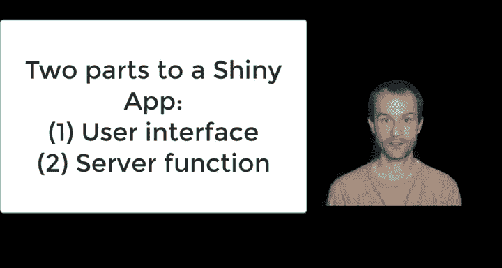
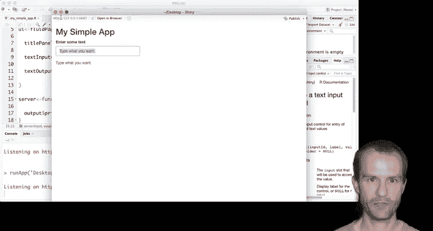

# 课程名称：构建自己的Shiny应用程序 🛠️


## 概述

在本节课中，我们将从零开始构建一个简单的Shiny应用程序。我们将学习Shiny应用的两个核心组成部分：用户界面和服务器函数，并通过一个具体示例理解它们如何协同工作。

---



## Shiny应用的基本结构

上一节我们了解了Shiny应用的整体概念。本节中，我们来看看其核心结构。


一个Shiny应用由两部分组成：**用户界面**和**服务器函数**。

*   **用户界面** 控制应用的所有可视元素，即用户实际看到的部分。
*   **服务器函数** 控制图表、表格及其他类型输出的信息处理逻辑。

在最基础的层面上，你通过定义这两样东西来创建一个Shiny应用：一个**用户界面对象**和一个**服务器函数**，最后通过`shinyApp()`函数将它们绑定在一起。

其核心关系可以用以下代码表示：

```r
# 定义用户界面
ui <- fluidPage()

# 定义服务器逻辑
server <- function(input, output) {}

# 将两者结合，创建应用
shinyApp(ui = ui, server = server)
```

---

## 从零开始构建一个简单应用

为了巩固你对上述概念的理解，我们将亲手创建一个非常简单的Shiny应用。本视频中不会提供任何现成代码，目的是让你能自己一步步跟随操作。

### 第一步：搭建基础框架

首先，打开一个新的R脚本文件并加载Shiny库。

以下是创建基础框架的步骤：

1.  创建一个名为`ui`的对象，并将其赋值为`fluidPage()`函数。
2.  在另一行，创建一个名为`server`的对象，它是一个包含`input`和`output`参数的函数。
3.  在最后一行，写入`shinyApp(ui = ui, server = server)`。

完成以上步骤后，你就写出了一个Shiny应用的所有基本组件：用户界面、服务器，并将它们结合在了一起。

现在，将这个文件保存到你电脑的某个文件夹中。此时，RStudio窗口会发生变化，运行按钮会变为“Run App”，因为RStudio识别出这是一个Shiny应用。

你可以点击运行这个应用，但它目前什么也不会做，因为我们的用户界面是空白的，服务器函数内部也没有任何内容。

### 第二步：为应用添加功能

接下来，我们将让这个应用做一些事情：首先给它一个标题，然后添加一个输入文本框，最后让应用输出用户在其中输入的任何文本。

我们将从用户界面端开始，在`fluidPage()`函数内部构建界面。用户界面的每个元素都将作为参数传递给这个函数，这些函数之间用逗号分隔。

以下是构建用户界面的具体步骤：

1.  在`fluidPage()`函数内，添加`titlePanel()`函数来为应用设置标题。添加后运行应用，你将看到应用不再空白，而是有了一个标题面板。
2.  现在，我们需要添加一个允许用户提供输入的元素。在本例中，我们将使用`textInput()`函数来创建一个文本框。这个函数有两个关键参数：
    *   `inputId`：这个值将被存储在Shiny应用中，并稍后在服务器函数中使用。
    *   `label`：文本框在屏幕上显示的标签。

添加文本框后再次运行应用，你会看到主面板上出现了一个文本输入框。但目前我们还没有对这个输入做任何处理。

### 第三步：连接服务器与界面

我们希望Shiny应用能打印出用户在这个输入框中键入的任何内容。这需要做两件事：首先告诉服务器函数我们想对输入进行处理，然后将服务器函数生成的输出包含到用户界面中。

以下是连接服务器与界面的步骤：

1.  在`server`函数内部，我们创建一个名为`print_text`的输出槽。
2.  我们使用`renderText()`函数来指示应用在Shiny中渲染文本，并将其赋值给名为`print_text`的输出槽。
3.  此时再次运行应用，仍然不会有变化，因为我们还没有在用户界面中指定服务器输出的显示位置。
4.  为此，我们需要向`fluidPage()`函数添加另一个参数：`textOutput()`。这个函数会告诉用户界面去打印我们在服务器函数中生成的文本输出。我们需要将`textOutput()`的`outputId`参数指向我们在服务器函数中创建的输出（即`print_text`）。

这个过程涉及一些来回操作，可能略显复杂。但当你运行最终代码时，就会看到程序现在的工作方式：我们创建了用户界面的三个不同元素（标题、文本输入框、文本输出位置），并告诉服务器在后台获取文本框的输入，然后将其打印到用户界面中。

你可能需要多花些时间思考这个过程，甚至可能需要多看几遍视频，以理解这些不同部分之间的相互作用。



---

## 总结

本节课中，我们一起学习了Shiny应用的基本结构，并通过动手实践，从零构建了一个简单的交互式应用。你了解了**用户界面**和**服务器函数**如何通过`input`和`output`对象进行通信。更复杂的应用程序只是这种“来回”交互模式的扩展：你设计用户界面的元素，用户界面的输入进入服务器，服务器产生输出，你再指定这些输出显示在用户界面的特定位置。


请不要感到沮丧，坚持下去，你会逐渐理解应用程序中所有这些互补部分是如何协同工作的。