# 课程名称：R语言数据可视化和仪表盘｜Data Visualization & Dashboarding with R - P51：将Shiny集成到R Markdown报告中 📊➡️📄


在本节课中，我们将学习如何将Shiny应用程序集成到R Markdown文件中。这是一种分享交互式数据分析结果的便捷方式，它结合了R Markdown的报告生成能力和Shiny的交互性。

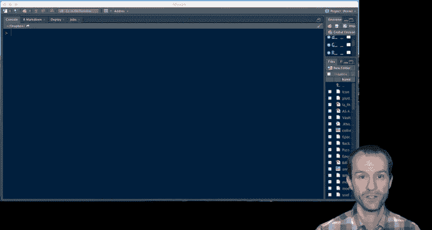

---

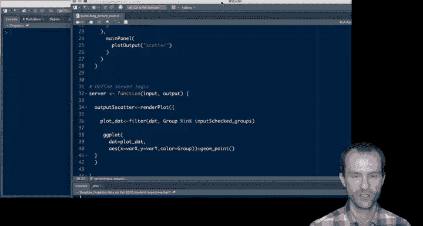

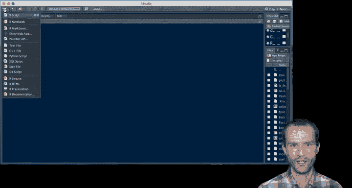

## 概述

上一节我们介绍了如何创建和发布独立的Shiny应用。本节中，我们来看看如何将Shiny的交互式组件嵌入到R Markdown报告中，从而创建一份包含动态图表和控件的可共享文档。

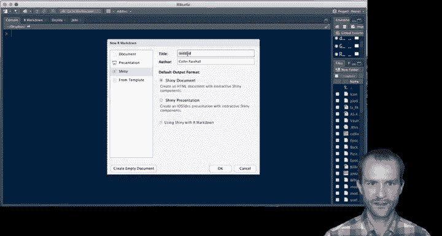

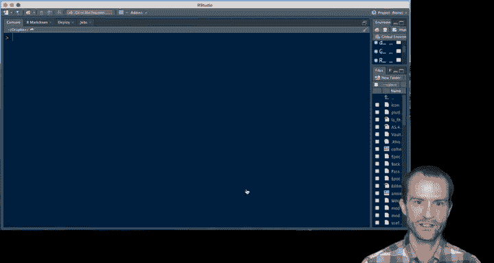

## 创建Shiny R Markdown文件

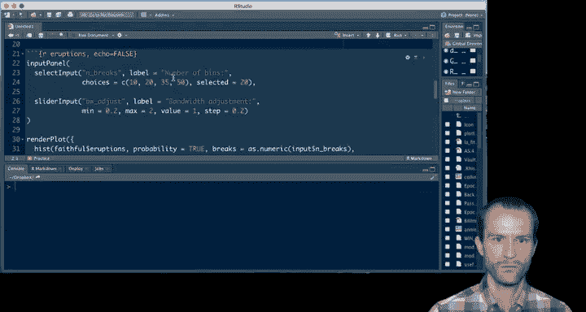

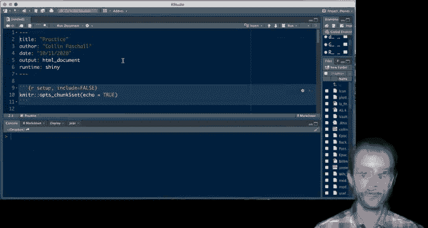

首先，我们需要创建一个支持Shiny的R Markdown文件。

以下是具体步骤：

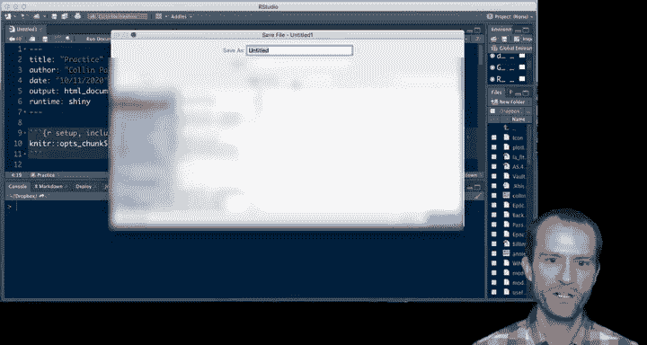

1.  在RStudio中，点击 `File` -> `New File` -> `R Markdown...`。
2.  在弹出的窗口中，选择 `Shiny` 作为文档类型。
3.  你可以为这个文档取一个你喜欢的名字。

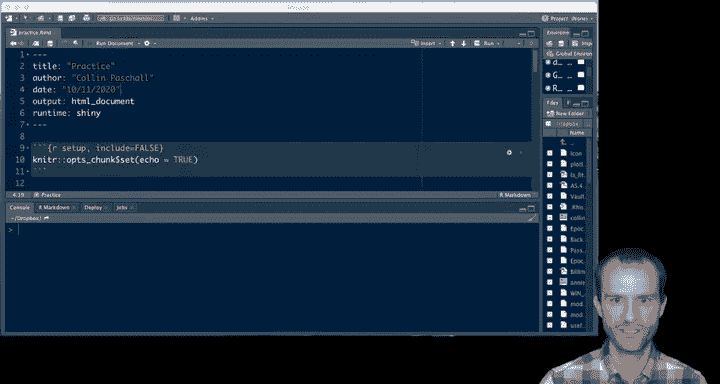

这个模板文档已经包含了创建Shiny内容所需的占位符代码。我们先保存这个文件到电脑的某个位置。

## 准备文件与环境

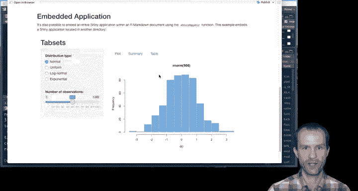

在保存R Markdown文件时，有一个关键点需要注意。

请确保将 `.Rmd` 文件与本节课（以及上节课）使用的 `.csv` 数据文件保存在电脑的**同一个文件夹**中。这样做可以避免路径问题，尤其是在后续在线发布时。

现在，我们可以先运行一下这个模板文档，你会看到它已经包含了一些Shiny的输入控件和输出图表。

## 自定义R Markdown内容

模板只是一个起点，我们的目标是将其定制成自己的应用。接下来，我们将参考上一视频中创建的Shiny应用代码，对模板进行修改。

首先，我们需要在文档开头的代码块（setup chunk）中加载必要的包并导入数据。

```r
library(tidyverse)
my_data <- read_csv("your_data_file.csv") # 请确保文件名正确
```

**注意**：在R Markdown文件中，通常不需要使用 `setwd()` 显式设置工作目录。只要确保 `.Rmd` 文件和 `.csv` 文件在同一目录下即可。如果设置了工作目录，在通过Shiny Apps.io在线发布时可能会产生问题。

## 修改输入与输出

接下来，我们将替换模板中的占位符内容。模板中使用 `inputPanel()` 函数来创建一个放置Shiny输入控件的区域。

以下是需要进行的修改：

1.  删除模板中默认的 `selectInput` 和 `sliderInput`。
2.  将我们之前Shiny应用中的 `checkboxGroupInput` 复制到这里。
3.  同样，找到模板中的 `renderPlot` 函数，将其替换为我们之前应用的绘图代码。

**请注意**：在R Markdown中，`renderPlot` 函数是直接使用的，不需要像在独立Shiny应用 `server` 函数中那样将其赋值给一个输出对象（如 `output$plot`）。

## 运行与发布

完成所有修改后，点击 `Run Document` 按钮。

此时，模板已经成功转换成了包含我们自定义Shiny交互内容的R Markdown报告，其功能与上一节的独立应用完全相同。

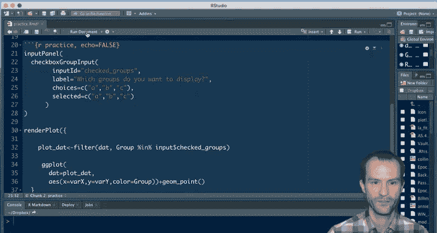

要分享这份报告，我们可以再次点击 `Publish` 按钮。由于之前已经将RStudio与ShinyApps.io账户关联，系统会自动将此R Markdown文件上传到你的ShinyApps账户，生成一个可在线访问和分享的链接。

---

## 总结

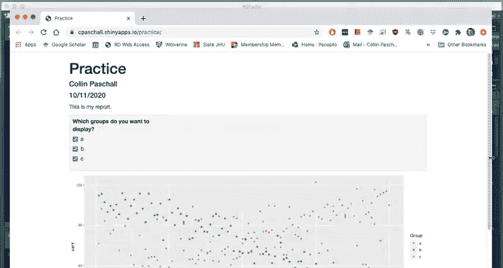

本节课中我们一起学习了如何将Shiny应用集成到R Markdown报告中。关键步骤包括：创建Shiny R Markdown模板、确保数据文件与报告文件位于同一目录、将原有Shiny应用的UI输入和服务器渲染逻辑移植到R Markdown的相应部分，最后将其发布到线上。这种方法让你能够创建结合了静态文本、代码与动态交互元素的强大数据报告。