# 📘 课程 P52：Shiny 的输入与输出

在本节课中，我们将学习如何在 Shiny 应用中创建和使用不同类型的输入与输出组件。我们将回顾一些之前见过的组件，并介绍一些新的选项。通过掌握这些基础组件，你将能够构建功能丰富且交互性强的 Shiny 应用。

---


## 🏗️ Shiny 用户界面的基本结构


Shiny 的用户界面通过 `fluidPage` 函数创建。在该函数内部，我们定义输入和输出组件，这些组件构成了用户在应用界面上看到的所有内容。

输入组件允许用户向应用提供指令或数据，例如输入文本或选择选项。输出组件则用于展示基于输入数据生成的结果，最常见的是根据用户提供的参数过滤数据并展示。

---

## 🎛️ 常见的输入组件

以下是几种常用的输入组件，它们允许用户以不同方式与应用交互：

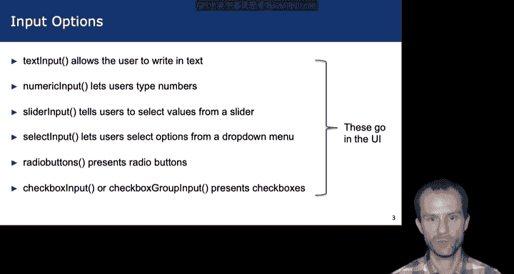

*   **文本输入 (`textInput`)**: 允许用户输入文本。
*   **数值输入 (`numericInput`)**: 允许用户输入数字。
*   **滑块输入 (`sliderInput`)**: 允许用户通过滑块选择一个或一个范围内的值。
*   **下拉选择 (`selectInput`)**: 允许用户从下拉菜单中选择选项。
*   **单选按钮 (`radioButtons`)**: 允许用户从一组选项中选择一个。
*   **复选框 (`checkboxInput`) 和复选框组 (`checkboxGroupInput`)**: 允许用户勾选一个或多个选项。


这些是最基础的输入类型。如需了解更多选项，可以查阅 Shiny 的官方参考文档。

---

## 📊 常见的输出组件

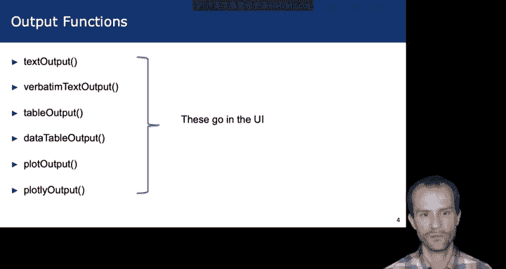

输出组件用于在界面上展示内容，它们总是与服务器端的渲染函数配对使用。以下是一些常见的输出函数：


*   **文本输出 (`textOutput`)**: 用于输出普通文本。
*   **原始文本输出 (`verbatimTextOutput`)**: 用于输出 R 控制台的原始结果。
*   **表格输出 (`tableOutput`)**: 以 HTML 表格形式展示数据框。
*   **数据表格输出 (`dataTableOutput`)**: 展示功能更丰富的交互式表格（需加载 `DT` 包）。
*   **图形输出 (`plotOutput`)**: 展示静态图形。
*   **交互式图形输出 (`plotlyOutput`)**: 展示 Plotly 交互式图形（需加载 `plotly` 包）。

---

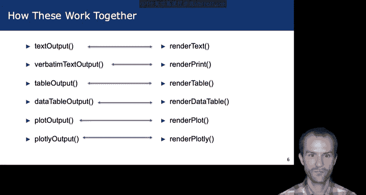

## 🔗 输出与渲染函数的配对


每个输出函数都对应一个服务器端的渲染函数，用于生成实际内容。它们必须成对使用：

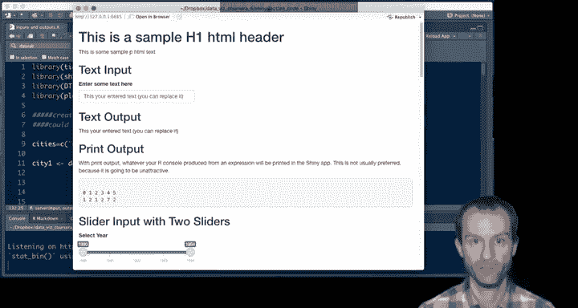

*   `textOutput` 对应 `renderText`
*   `verbatimTextOutput` 对应 `renderPrint`
*   `tableOutput` 对应 `renderTable`
*   `dataTableOutput` 对应 `renderDataTable`
*   `plotOutput` 对应 `renderPlot`
*   `plotlyOutput` 对应 `renderPlotly`

---

## 🧪 通过示例代码理解

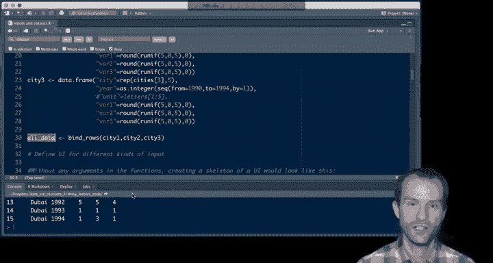

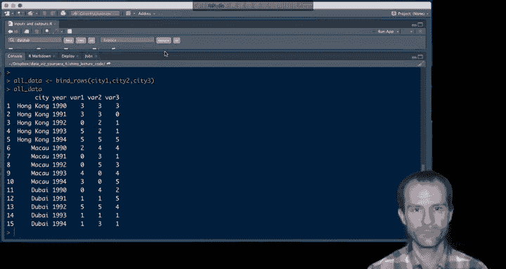

上一节我们介绍了输入输出的基本概念和配对关系，本节我们将通过一个具体的示例文件来深入理解这些组件如何协同工作。

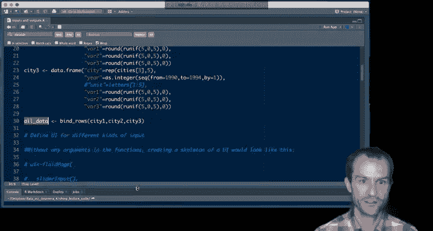

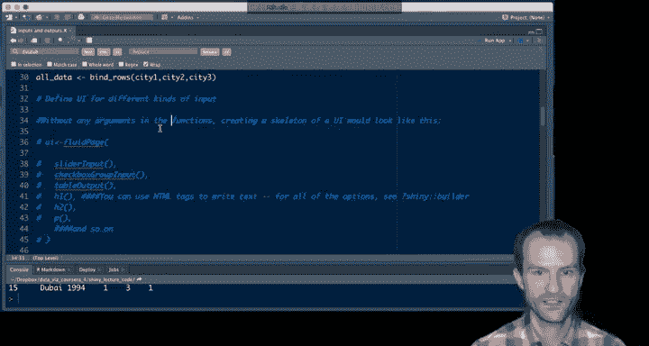

首先，打开示例文件并运行应用，观察最终效果。同时，浏览代码以熟悉其结构。

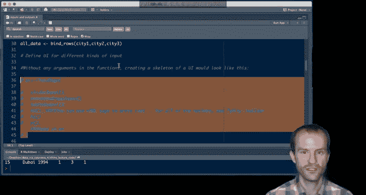

### 1. 加载库与创建数据

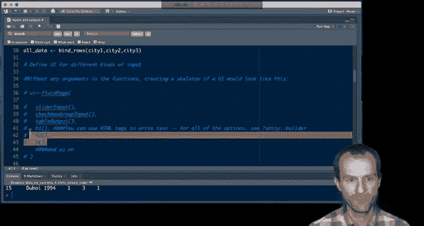

代码开头加载了必要的 R 包，包括 `shiny`、`tidyverse`、`DT` 和 `plotly`。`DT` 用于数据表格，`plotly` 用于交互式图形。

```r
library(shiny)
library(tidyverse)
library(DT)
library(plotly)
```

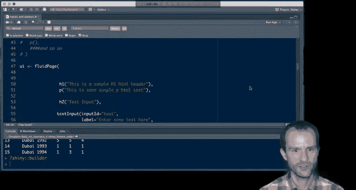


接着，创建了一些模拟数据，包含三个城市在1990年至1994年间的若干指标。

### 2. 构建用户界面 (UI)

应用从定义 `ui` 对象开始，使用 `fluidPage` 函数。我们向该函数传递一系列参数来构建界面组件。

*   **静态文本**: 使用 `h1()`, `p()` 等函数添加标题和段落文本，它们类似于 HTML 标签。
*   **文本输入框**: 使用 `textInput` 函数，需设置 `inputId`、`label` 和初始值 `value`。
*   **文本输出**: 使用 `textOutput("text_output")` 来预留显示动态文本的位置。
*   **其他输入组件**: 后续代码中包含了 `sliderInput`（滑块）和 `checkboxGroupInput`（复选框组），用户通过它们来过滤数据。
*   **多种输出组件**: 代码中还包含了 `tableOutput`、`dataTableOutput`、`plotOutput` 和 `plotlyOutput`，用于展示不同格式的结果。

### 3. 构建服务器逻辑 (Server)

在 `server` 函数中，我们定义每个输出对应的渲染逻辑。

*   **渲染文本**: `renderText` 函数接收 `input$text_input` 的值，并将其赋值给 `output$text_output`。
*   **渲染原始输出**: `renderPrint` 函数生成原始 R 输出，对应 `verbatimTextOutput`。
*   **过滤与渲染**: 对于表格和图形，`renderTable`、`renderDataTable`、`renderPlot` 和 `renderPlotly` 函数内部都使用了 `dplyr` 的 `filter` 命令。它们根据 `input$city1`（复选框组选中的城市）和 `input$year1`（滑块选中的年份范围）来过滤模拟数据，然后生成相应的输出。

### 4. 理解连接关系

整个应用的工作原理是：UI 中的输入组件收集用户选择，这些值在服务器端通过 `input$` 对象访问。服务器端的渲染函数使用这些输入值进行计算或过滤，并将结果赋值给 `output$` 对象。最后，UI 中对应的输出组件显示这些结果。

为了彻底理解，建议你尝试注释掉部分 UI 和 server 代码，然后逐步取消注释，观察应用的变化。这是一个很好的学习方法，虽然学习曲线较陡，但一旦掌握，组合这些组件就会变得非常容易。

---

## 🎯 总结

本节课我们一起学习了 Shiny 应用中输入与输出组件的核心知识。我们了解了常见的输入类型（如文本、滑块、复选框）和输出类型（如文本、表格、图形），并重点掌握了它们必须成对使用的原则。通过剖析一个综合示例，我们看到了这些组件如何在 UI 和 Server 中相互配合，共同构建出交互式应用。


在接下来的课程中，我们将学习如何以更高级、更美观的方式布局 Shiny 应用中的这些组件。