# 📊 课程 P54：使用 Flexdashboard 制作仪表板


在本节课中，我们将学习如何使用 R 包 `flexdashboard` 来创建和分享数据可视化仪表板。`flexdashboard` 是一种特殊的 R Markdown 报告格式，它允许你将不同的图表和表格排列成仪表板风格的文档。这对于展示和分享你的分析成果非常有用。

---

## 🛠️ 准备工作

上一节我们介绍了仪表板的概念，本节中我们来看看如何开始创建。首先，你需要安装 `flexdashboard` 包。

在 RStudio 的控制台中运行以下代码：


```r
install.packages("flexdashboard")
```

安装完成后，在 RStudio 中点击 `File` -> `New File` -> `R Markdown...`。在弹出的窗口中，选择 `From Template`，然后点击 `Flex Dashboard`。


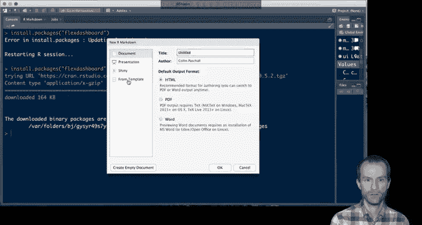

当你以这种方式创建新项目时，`.Rmd` 文件会打开，其中已经包含了一个仪表板模板。为了演示，你可以将这个 `.Rmd` 文件保存到电脑的某个位置。

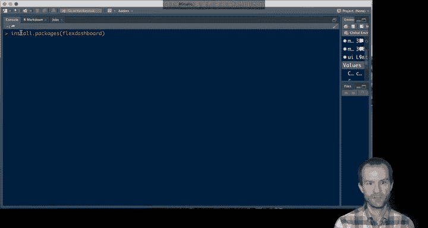

---

## 📁 文件与数据管理


与任何其他 R Markdown 文件一样，如果你需要导入数据，请确保将 `.Rmd` 文件与你将要导入的 CSV 文件放在同一个文件夹中。

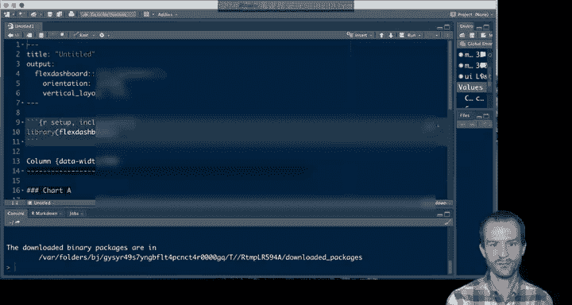

在本演示中，我们不会导入任何外部数据，但请记住这一点以备将来使用。保存文件后，点击 `Knit` 按钮。你会看到它生成了一个包含三个内容占位符的空白仪表板。


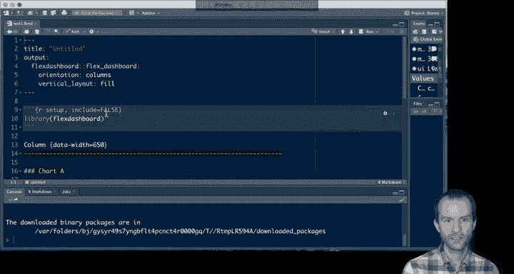

这是一个 HTML 文件，你可以在文件资源管理器或 Finder 中找到它，并在网页浏览器中打开。

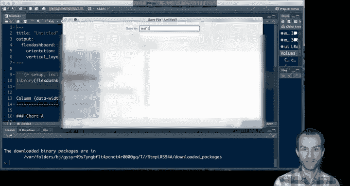

---

## 📈 创建可视化图表

为了继续演示，让我们在模板文档中加载 `tidyverse` 包和一些数据来创建几个简单的可视化图表。


我们将使用 R 内置的 `mtcars` 数据集，这是一个包含各种汽车型号信息的表格。

在 “Chart A” 的代码块中，创建一个以重量为 X 轴、每加仑英里数为 Y 轴的散点图。

```r
ggplot(mtcars, aes(x = wt, y = mpg)) + geom_point()
```

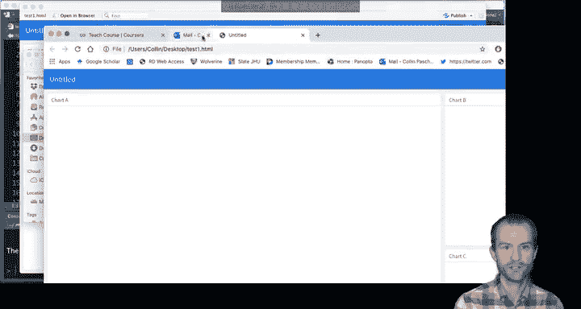

在 “Chart B” 的代码块中，创建一个按气缸数（4、6、8缸）统计车型数量的条形图。

```r
ggplot(mtcars, aes(x = factor(cyl))) + geom_bar()
```

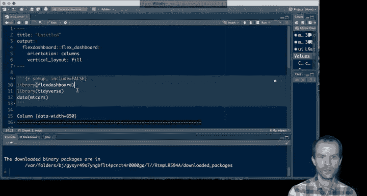

在 “Chart C” 的代码块中，创建一个关于马力的箱线图。

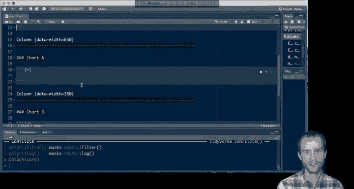

```r
ggplot(mtcars, aes(y = hp)) + geom_boxplot()
```

我们暂时不关心如何美化或格式化这些图表，因为本演示的重点是如何将内容放入仪表板的不同组件中。

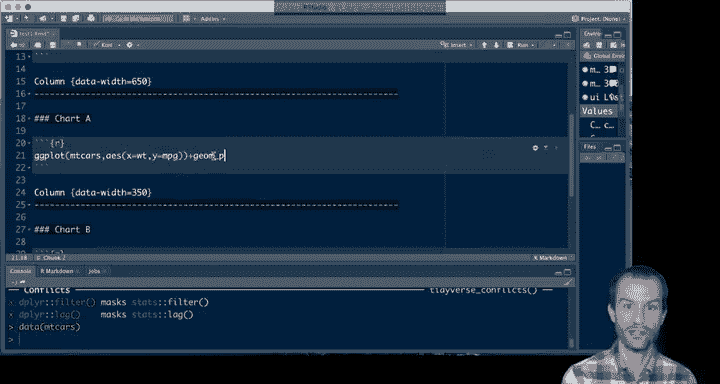

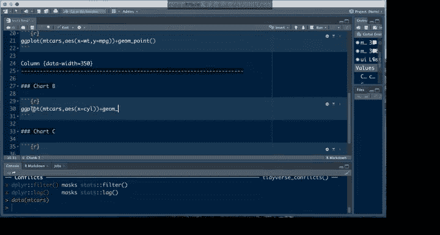


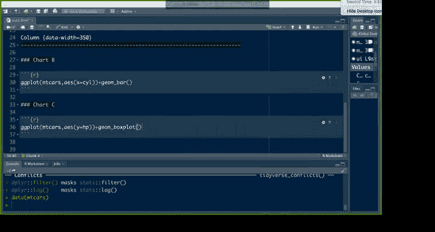


你还可以继续更改仪表板的标题。对于制作基本的静态可视化图表来说，这非常简单。现在，点击 `Knit` 来查看最终效果。

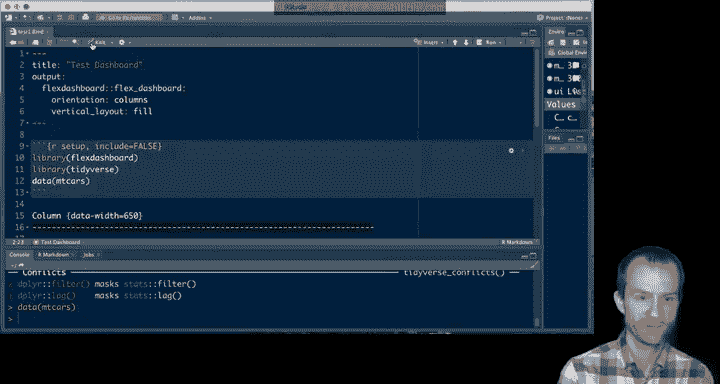


然后，你可以将输出结果与代码进行对比。

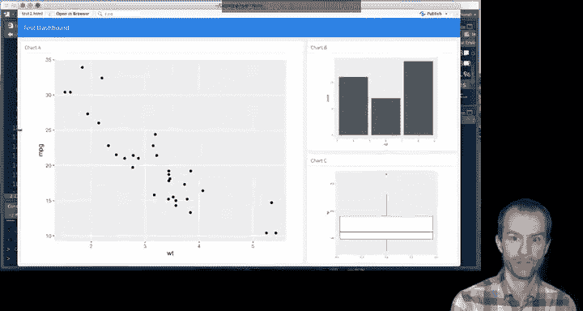

---

## 🧱 布局：列与行

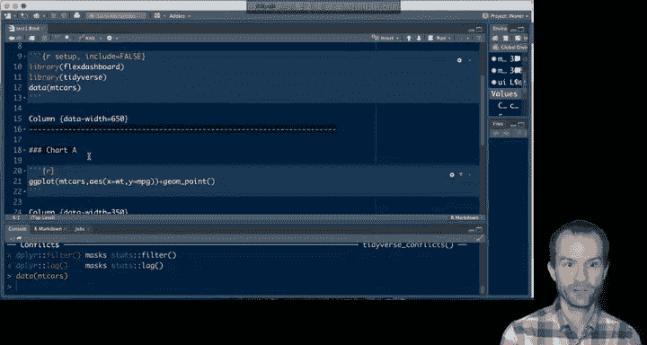

仪表板的布局通过 YAML 头部和 Markdown 语法控制。在模板中，布局默认是按列组织的。

列是通过写入 `column` 并在此标记中设置该列的宽度来指定的。在下一行之后，你应至少包含一个破折号标记。

```markdown
Column {data-width=350}
-------------------------------------
### Chart A
```

宽度是相对的，你可以设置任意总和，仪表板会根据相对大小分配不同的组件。你可以在列内通过使用三级标题（三个井号 `###` 后跟图表标题）来指定不同的框。在此列中，每个图表将垂直显示。

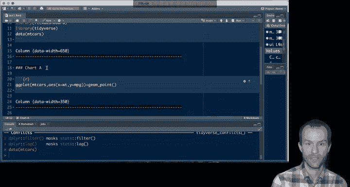


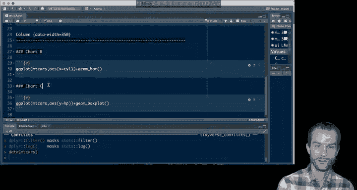

如果你想切换到行方向，这也很容易做到。只需转到 YAML 头部，将方向改为 `rows`。

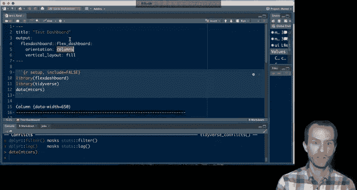

```yaml
orientation: rows
```

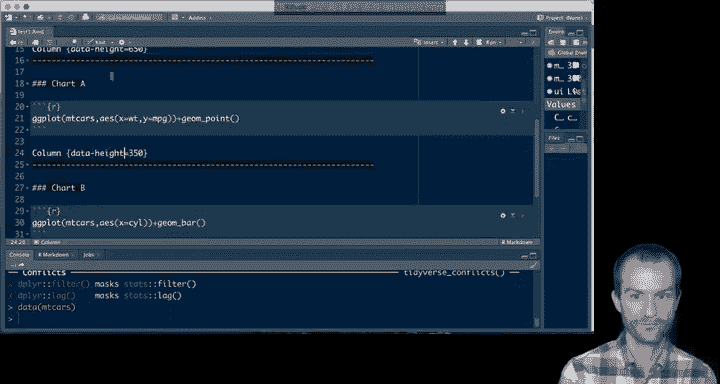

然后将每个组件中的 `data-width` 标签改为 `data-height`。

```markdown
Row {data-height=350}
-------------------------------------
### Chart A
```

你需要尝试调整高度和宽度值，以最适合你的图形。找到合适的值很大程度上是一个反复试验的过程，因此你需要积累一些经验。

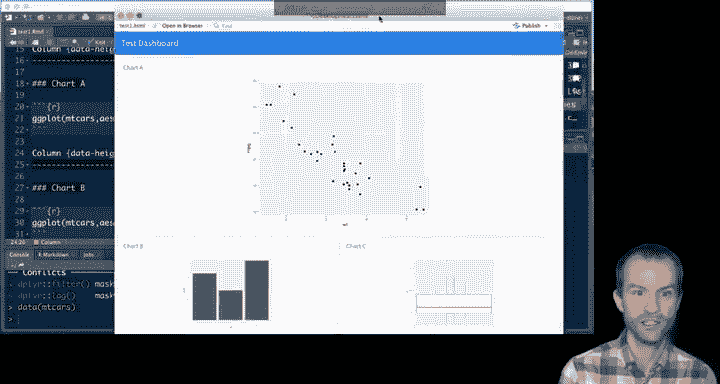

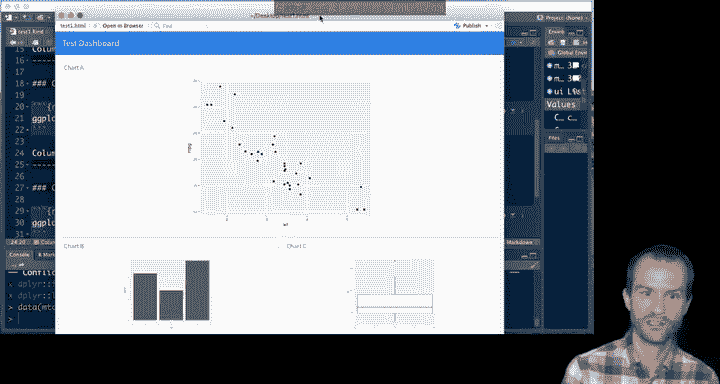


---

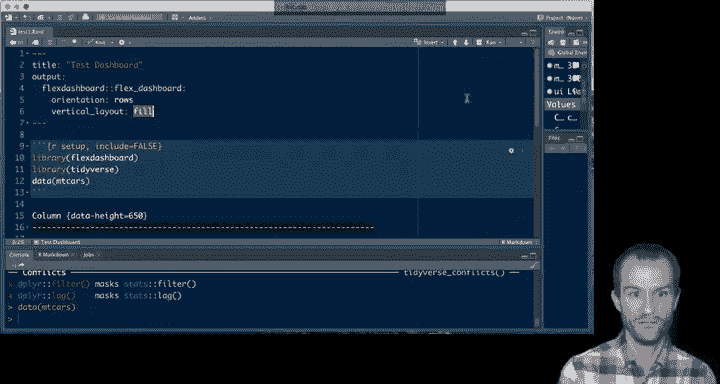

## 🔄 填充与滚动布局

最后一个需要讨论的选择是决定仪表板的布局是采用 `fill`（填充）格式还是 `scroll`（滚动）格式。

使用 `fill` 布局时，HTML 文件会尝试将所有图表适配到用户浏览器窗口的当前大小。如果用户调整窗口大小，不同组件的大小也会相应改变以尝试适应。

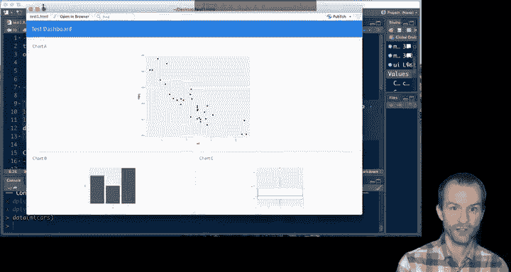

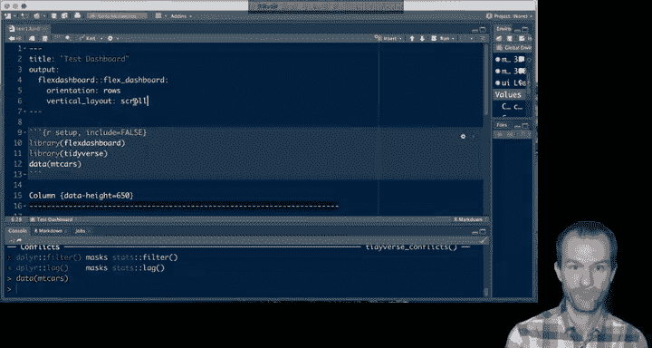

使用 `scroll` 布局时，用户会看到滚动条，图表不会自动进行太多大小调整。你可以在 YAML 头部指定：

```yaml
vertical_layout: scroll
```

这只是对 `flexdashboard` 最简单的介绍，但仅凭我们介绍的这几个基本选项，你已经可以做很多事情了。

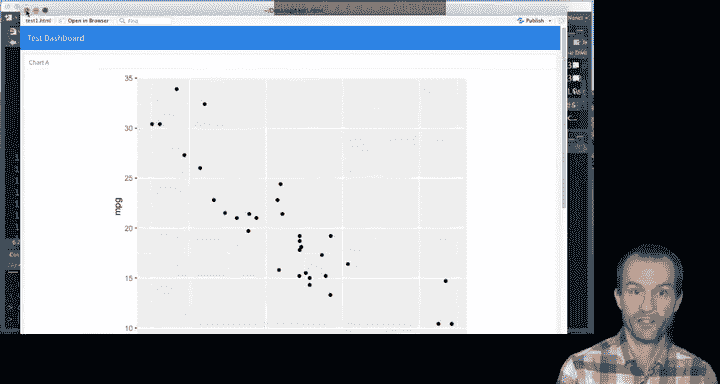

我们将在接下来的视频中探讨更多布局选项和调整技巧。所以，请花几分钟时间，尝试调整这里的各个组件，在行和列之间切换，调整列和行的高度和宽度。

当你准备好后，请继续观看下一个视频，我们将讨论如何制作更复杂的仪表板。

---

## 📝 总结

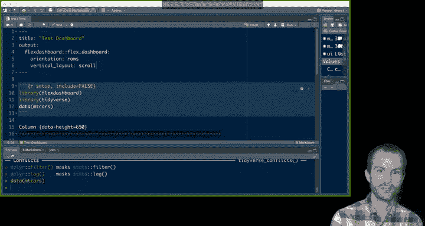

本节课中我们一起学习了如何使用 `flexdashboard` 包创建基本的 R 仪表板。我们涵盖了从安装包、创建模板、添加可视化图表，到调整列/行布局以及选择填充或滚动模式的全过程。这是将你的 R 可视化成果整合并展示给他人的强大而直接的方法。