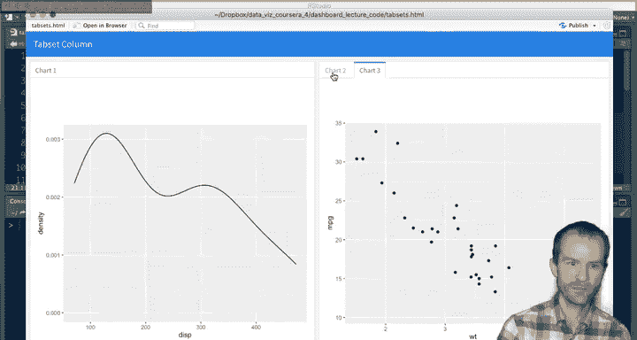
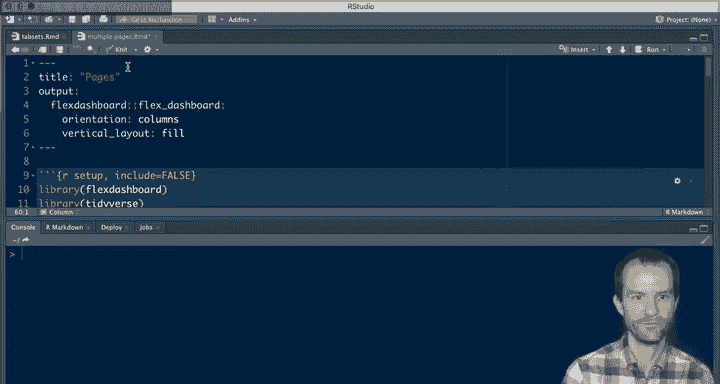
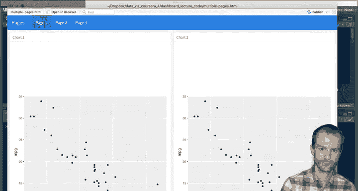
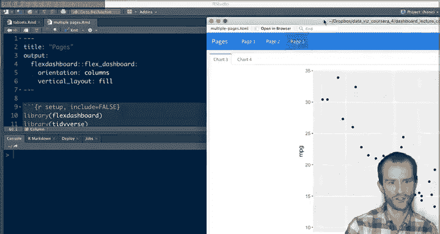
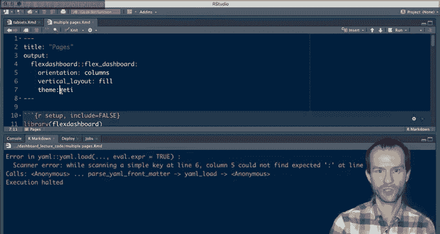
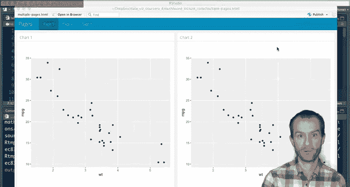
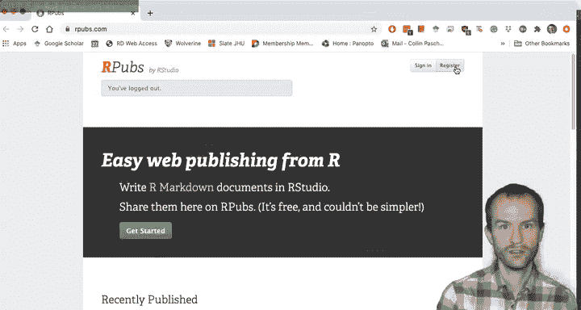
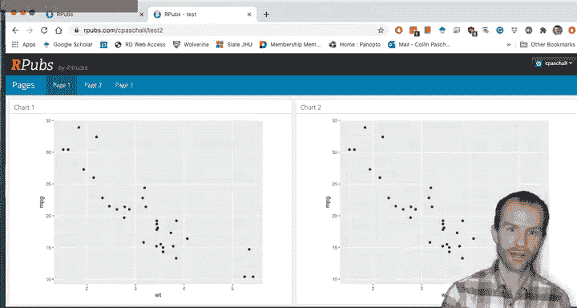

# 课程 P55：仪表板中的选项卡和页面 📑➡️📄

在本节课中，我们将学习如何为复杂的 Flexdashboard 仪表板设置选项卡和页面，以组织和管理多个可视化内容。我们还将了解如何应用不同的视觉主题以及如何发布完成的仪表板。

---

正如我们在 Shiny 应用程序中所见，设置复杂仪表板还有一些更高级的选项。

例如，与 Shiny 类似，你可以在 Flexdashboard 中设置选项卡集。这允许用户在一行或一列中切换不同的可视化图表。

以下是如何设置选项卡集的步骤：

1.  创建一个行或列。
2.  为该行或列添加 `.tabset` 属性。

这样，在该行或列中，用户可以通过点击选项卡来切换查看不同的图表。

你还可以创建多页文档。要创建一个新页面，你需要指定页面名称，并在下一行用至少一个等号跟随。

这在与本视频关联的示例文件中有所演示。

在创建新页面时，你还可以指定该页面的数据布局方向是行还是列。因此，文档的不同页面可以有不同的布局方向。

当然，如果你愿意，也可以在页面内包含一个选项卡集。

Flexdashboard 还内置了许多视觉主题选项，为你提供了改变仪表板外观的选择。

你可以在官方文档中找到这些主题的列表。要应用主题，只需在仪表板顶部的 YAML 头部设置中插入 `theme: [主题名称]`。

与 Shiny 布局一样，设置 Flexdashboard 的方式几乎是无限的，但核心都是这些不同组件的组合。

一旦你对基本工作原理有了直观理解，就应该能够根据自身需求来格式化仪表板。这只需要一些尝试、耐心来习惯如何布局。

---

现在是一个好时机，向你展示如何发布 Flexdashboard。

对于不包含任何 Shiny 交互组件的仪表板，你可以通过分享编织文档后生成的 `.html` 文件来与他人共享。你的同事可以在网页浏览器中打开这个 `.html` 文件进行查看。

你还可以通过免费的 `rpubs.com` 服务来分享不包含 Shiny 元素的 Flexdashboard。这类似于 Shiny 的 `shinyapps.io`，但专为 R Markdown 文档设计。

你需要前往 `rpubs.com` 注册一个账户。注册后，你可以在 RStudio 中点击“发布”按钮，选择“R Pubs”并登录你的账户。仪表板将上传，之后你可以将生成的链接分享给任何人。

请注意，R Pubs 是公开的，因此不要上传任何你不想公开的私人信息。

对于包含 Shiny 交互组件的 Flexdashboard（我们将在下一个视频中学习），你可以使用 `shinyapps.io` 来发布。我们将在下一个视频开始让仪表板更具交互性时详细讨论这一点。

---

本节课中，我们一起学习了如何在 Flexdashboard 中创建选项卡和页面来组织内容，探索了可用的视觉主题，并掌握了发布静态与交互式仪表板的不同方法。