# 课程10：仪表板中的Shiny和Plotly 📊

在本节课中，我们将学习如何在Flexdashboard中集成Shiny交互式内容和Plotly交互式图形，从而创建动态、可交互的数据仪表板。


---

除了静态的R图形，你也可以向你的Flexdashboard仪表板中添加Shiny交互式内容。

这实际上非常简单，就像将Shiny集成到普通的R Markdown报告中一样容易。

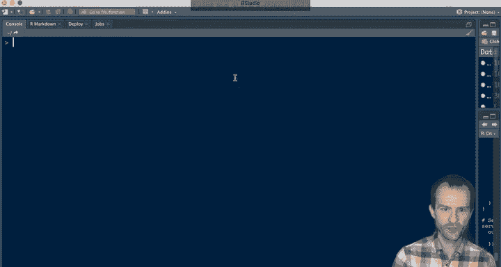

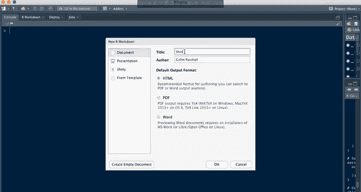

我们将通过创建一个新的仪表板来演示这个过程。

## 创建新仪表板

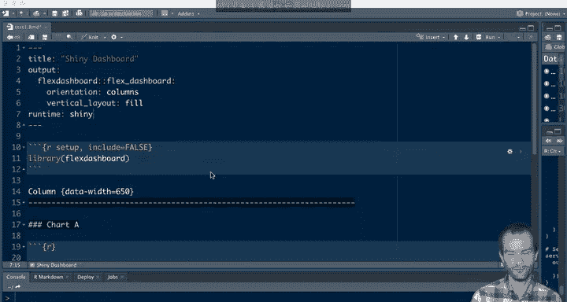

首先，在你的RStudio中创建一个新的Flexdashboard文档，并将其保存在你电脑的某个位置。

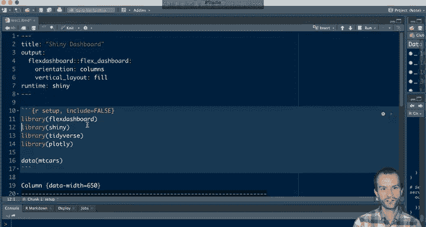

## 配置仪表板

第一步，在Flexdashboard文档的YAML前言或设置区域，添加一行代码：`runtime: shiny`。

接着，在R代码块中，加载`tidyverse`、`shiny`库以及`mtcars`数据集。

```r
library(tidyverse)
library(shiny)
data(mtcars)
```

## 设计布局结构

现在，我们来修改布局。将第一列重命名为“input”。

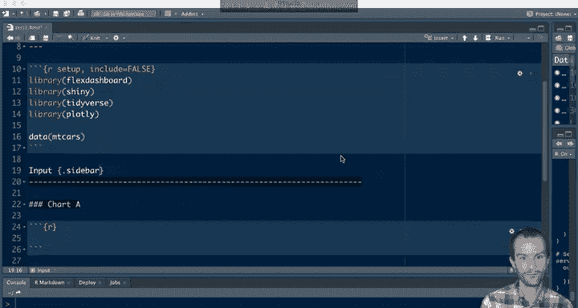

请记住，你可以随意命名行和列，关键是在名称后面加上一行破折号来创建该列。

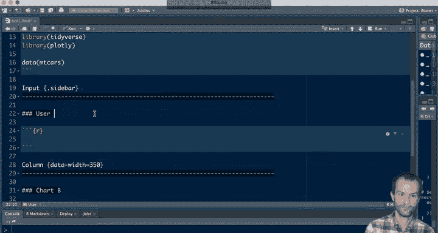

在“input”列名之后，添加属性`.sidebar`。

这将在文档中创建一个侧边栏，Shiny的交互控件（如我们之前使用Shiny时见过的滑块、选择框或单选按钮）将放置在这里。

## 添加交互控件

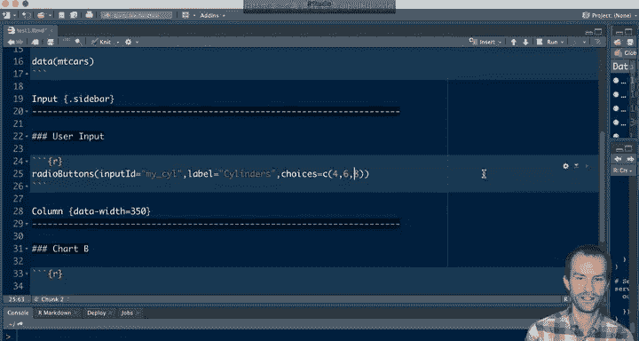

接下来，将这个面板的标题改为“用户输入”。

在这个例子中，我将使用`mtcars`数据集，并创建一组单选按钮，让用户选择查看4缸、6缸或8缸汽车的数据。

这里我使用`radioButtons`函数，并设置输入ID、标签和选项，就像在独立的Shiny应用中一样。

```r
radioButtons("cyl", "选择气缸数：",
             choices = c(4, 6, 8),
             selected = 4)
```

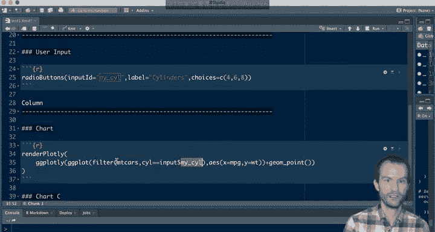

## 创建交互式图形

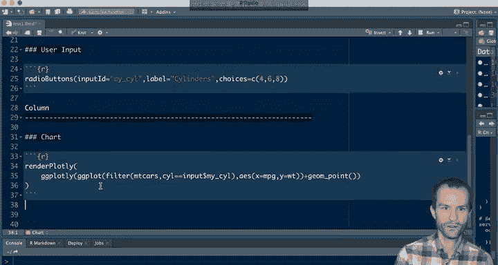

我们将要创建的图形是一个Plotly风格的交互式散点图，展示每加仑英里数（mpg）与车重（wt）的关系，数据会根据用户选择的气缸数进行筛选。

因此，我将在这里使用`renderPlotly`函数，并指示仪表板根据单选按钮的输入来渲染一个ggplotly对象。

```r
renderPlotly({
  data <- mtcars %>% filter(cyl == input$cyl)
  p <- ggplot(data, aes(x = wt, y = mpg)) +
    geom_point() +
    labs(title = paste(input$cyl, "缸汽车数据"))
  ggplotly(p)
})
```

## 运行与发布

现在，你可以移除用于演示的占位图表代码。完成后，点击“Run Document”来运行文档。

正如你所见，我们现在获得了一个集成了Shiny应用和Plotly交互式图形的仪表板。

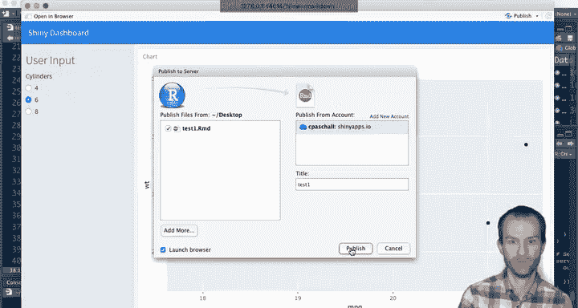

因为我们在仪表板中包含了Shiny内容，所以不能将其发布到RStudio Connect的普通“Pubs”。相反，我们需要点击“Publish”按钮，将其发布到`shinyapps.io`平台，就像我们之前发布完整的Shiny应用一样。

---

## 总结

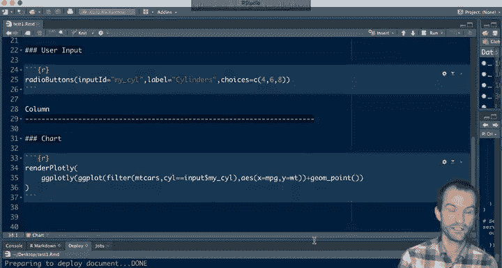

本节课中，我们一起学习了如何将Shiny的交互能力与Plotly的动态可视化结合到Flexdashboard中。通过添加`runtime: shiny`、设计带侧边栏的布局、嵌入Shiny控件（如`radioButtons`）以及使用`renderPlotly`创建响应式图形，我们成功构建了一个交互式数据仪表板。最后，我们了解到包含Shiny内容的仪表板需要发布到`shinyapps.io`这类支持Shiny的服务器。

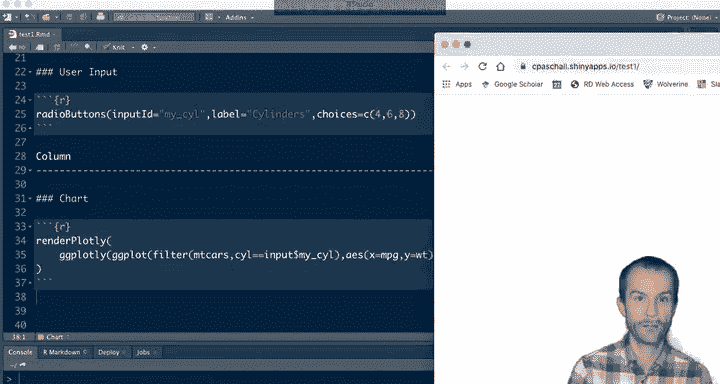

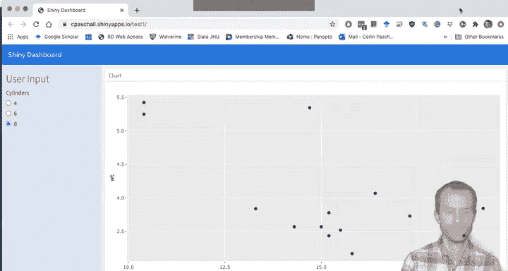

由此可见，Flexdashboard并不难用，但它为你提供了另一种分享可视化成果的方式，尤其是以仪表板这种在许多商业场景中非常流行、深受决策者青睐的格式。