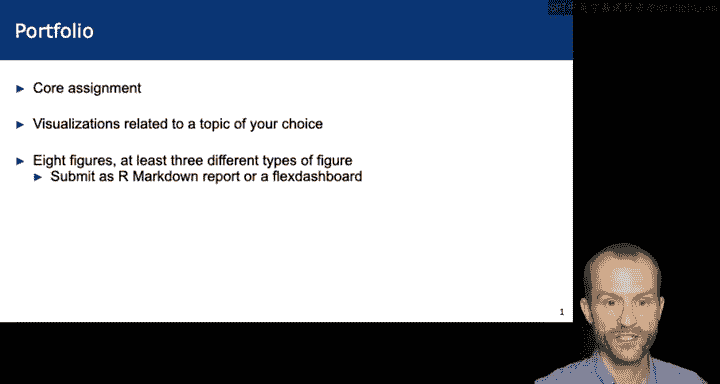
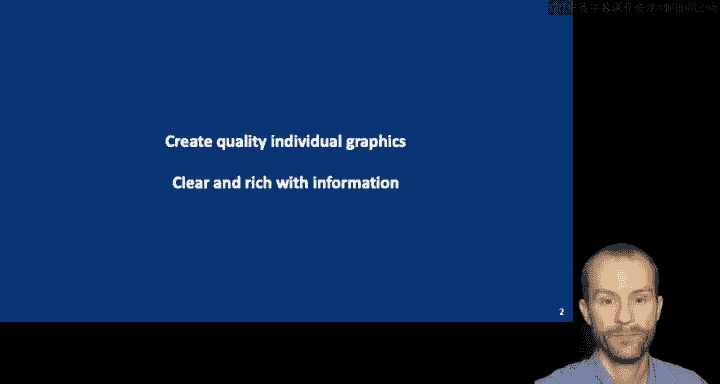
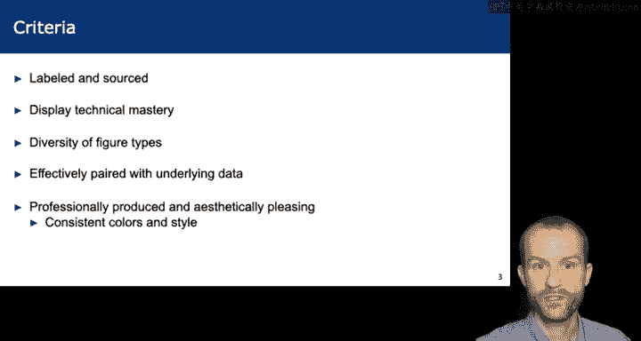
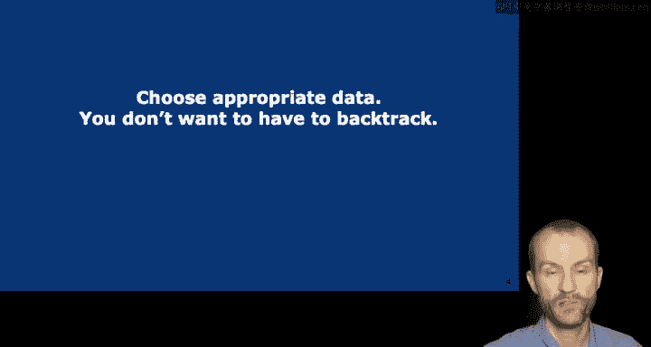
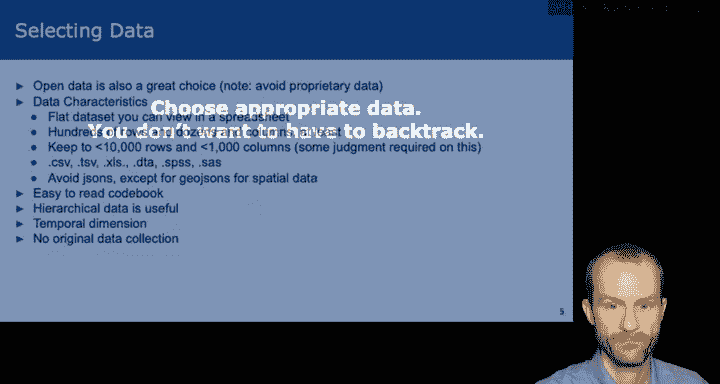
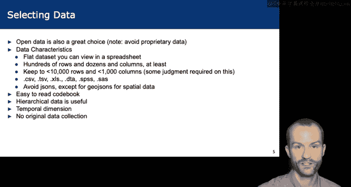
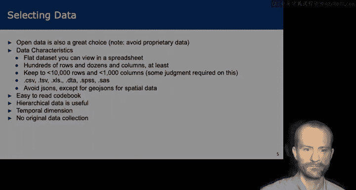

# 📊 课程 P58：项目概述与数据查找技巧

在本节课中，我们将学习课程最终项目的整体概述，并掌握查找合适数据源的实用技巧。最终项目是本课程的核心任务，也是整个专项课程的总结。

## 🎯 项目概述

上一节我们介绍了课程的整体安排，本节中我们来看看最终项目的具体要求。

最终项目要求你创建一个与自选主题相关的数据可视化作品集，展示你目前掌握的R语言数据可视化技能。

最终项目需要包含八个数据驱动的图形。你可以选择以R Markdown报告的形式提交，也可以使用Flexdashboard创建一个仪表盘。

在构思项目时，请记住，主要重点在于图形的质量。图形最重要的特征在于其传达丰富信息的清晰度。

以下是你在整合项目时需要思考的几个方面：

*   **确保图形来源清晰、标签准确。**
*   **确保图形展示了对本课程所学技能的技术掌握。**
*   **确保作品集中包含多样化的图形类型，至少三种。**
*   **确保所选图形类型能有效呈现其代表的数据。**
*   **确保图形美观且制作专业。** 这一点与上述所有要点相辅相成。

请记住，这些是项目的一般要求，而其中最重要的一步就是选择合适的数据。

## 🔍 查找合适的数据

如果没有触手可及、能够处理和准备用于可视化的数据，就很难制作出一套优秀的可视化作品。因此，你需要尽早决定使用什么数据，以避免中途被迫更改方向。

有许多不同的潜在数据源可供使用。如果你对某个特定领域感兴趣，互联网上很可能有相关数据可供下载并用于本项目。

如果数据是你通过工作或教育背景熟悉的领域，那很好。事实上，我鼓励你选择对自身职业发展有用的主题。

我唯一的建议是，你需要确保数据是开源的，因为你希望能够复现自己的分析和可视化。使用来自工作或企业的私有专有数据可能不是一个好选择，因此我建议避免这种情况。

在考虑项目可能使用的数据类型时，有几点需要牢记。

以下是选择数据时需要考虑的关键因素：

*   **确保数据是矩形的**，它应该看起来像电子表格，有行和列。为了有足够的数据进行可视化，你可能需要数百行和至少10到12列的数据。
*   **避免使用非常大的数据集**，例如超过10万行或1000列，因为这会给数据管理带来很大负担，而你的时间有限。
*   **建议寻找类似电子表格的文件**，例如Excel文件、逗号分隔值（CSV）文件、制表符分隔值（TSV）文件，或一些易于读取的统计文件（如`.dta`或SPSS文件）。关于数据导入的更多细节将在下一个视频中介绍。
*   **通常建议避免使用JSON文件**，因为它们处理起来稍微复杂一些。例外情况是，如果你有某种空间数据（例如制作地图时使用的GeoJSON文件）。
*   **寻找带有数据字典（Codebook）的数据**，类似于我们在专项课程前几门课中使用的那样。确保数据字典描述了变量的含义及其编码方式，这样你就不必花费时间去猜测某些内容的含义。
*   **寻找文档完善且不太混乱的数据**，这将增加你在本课程中取得成功的几率。
*   **如果可能，最好数据具有层次结构或地理成分**，例如各州的选民、监狱中的囚犯、各城市的客户、各学校的学生等。这将为你在可视化数据类型上提供更大的灵活性。
*   **拥有时间成分的数据也很有用**，即跨单位、跨时间的观测数据，这样你就可以制作折线图。

## 💡 决策与建议

你的数据是否适合最终项目是一个重要的决定，但很难给出放之四海而皆准的建议。在考虑不同数据源时，你需要运用自己的最佳判断。

然而，我的建议通常是**保守一点**。在管理大量数据方面，不要给自己安排太多任务。

如果你必须在“非常有趣但难以使用的数据”和“不那么有趣但文档完善、格式良好的数据”之间做出选择，我肯定会选择文档更好、格式更佳的数据，这会让你的工作更轻松。

我相信，凭借我们在专项课程中已涵盖的内容，以及在本课程接下来一周将补充的一些细节，你将拥有所有必要的技能，利用一些有趣的数据创建出一套出色的可视化作品。

再次祝你顺利，并享受这个过程。

---

本节课中，我们一起学习了最终项目的核心要求与评估标准，并详细探讨了如何为项目寻找和筛选合适的数据源。关键在于选择**矩形、规模适中、文档清晰、格式友好**的数据，并优先考虑**具有层次、地理或时间维度**的数据集，这将为你的可视化创作提供更大的发挥空间。