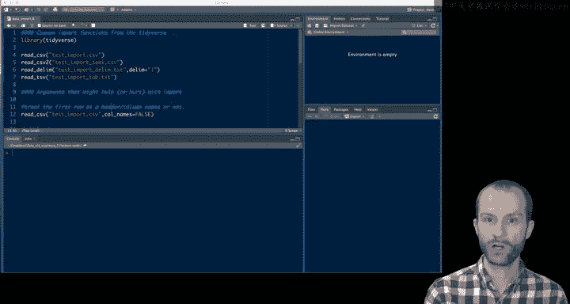
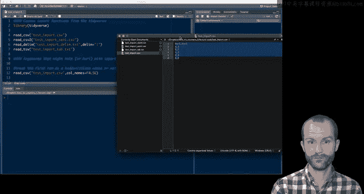
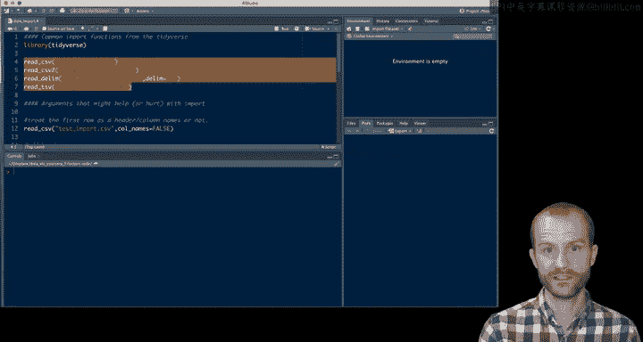
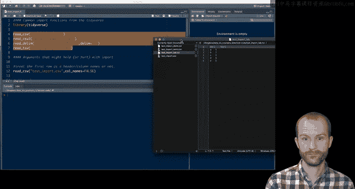
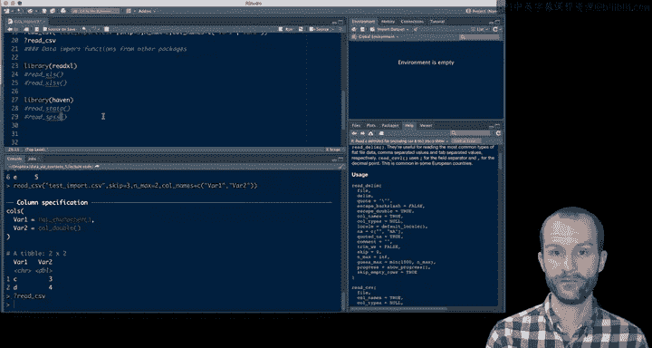

# 课程P59：R语言数据导入教程 📊

在本节课中，我们将学习如何在R语言中导入不同格式的数据文件。数据导入是数据分析的第一步，掌握多种数据格式的导入方法能让你更灵活地处理各种公开数据。

---

## 数据格式多样性

当你寻找公开数据时，会发现矩形数据（即行和列组成的数据）以多种不同文件格式存在。幸运的是，R语言非常擅长从多种文件类型中导入数据。

本视频附带的“数据导入速查表”很好地总结了许多相关函数。接下来，我将展示其中几个最重要的函数。

---

## 常见分隔符文件

你已经熟悉了逗号分隔值（CSV）文件和 `read_csv()` 函数。

但其他常见的数据类型使用与逗号不同的分隔符。分隔符指的是原始数据中用于分隔不同列的字符。

与本视频相关的文件中包含了几个示例。

这些文件包括：
*   分号分隔的文件
*   使用竖线（在许多键盘上位于回车键附近）作为分隔符的文件
*   制表符分隔的文件

你可以使用我们将要介绍的R函数来读取任何这些文件类型，这些函数对应不同的分隔符。

---

## 导入函数的参数控制

除了用于读取这些不同格式文件的函数，你还可以指示这些函数按照特定的指令读取数据。

以下是你可以控制的一些选项：
*   你可以选择将文件的第一行作为列名读入，或者不这样做。
*   你可以在读入文件时，分配自己的列名，这些名称将作为第一行。
*   在某些情况下，你可能希望跳过一些行开始读取，或者指定从这些原始数据文件中读取的最大行数。如果你正在处理非常大的文件，并且只想读取一定数量的行，这将非常有帮助。
*   如果你在读取非常混乱的数据时遇到问题，你可能需要查看这些不同函数的不同参数，看看是否有某个选项可以帮助你从一开始就更有效地清理数据。

---

## 其他专用数据包

除了我们刚刚讨论过的来自 `readr`（tidyverse的一部分）的函数之外，还有几个其他软件包对于处理其他类型的文件非常方便。

这些包括：
*   **`readxl` 包**：包含用于读取Microsoft Excel的 `.xls` 或 `.xlsx` 文件的函数。
*   **`haven` 包**：包含用于读取SAS（`.sas7bdat`）或SPSS（`.sav`）文件的函数。这两种文件是专业统计软件使用的格式。

这些函数的使用方式与其他类型的导入函数相似。

---

## 探索更多可能性

如果你发现某种其他类型的文件，不确定是否能够将其读入R，值得去谷歌搜索一下，看看是否有方法可以将该数据类型导入R。

市面上有很多不同的函数和文件类型，你可能会发现一些我们在本视频中没有涵盖的内容。

---

## 课程总结

本节课中，我们一起学习了R语言数据导入的核心知识。我们了解到R可以处理多种分隔符文件（如CSV、分号、竖线、制表符分隔），并通过函数参数控制读取过程（如指定列名、跳过行数）。此外，我们还介绍了用于Excel文件的 `readxl` 包和用于SAS/SPSS文件的 `haven` 包。最后，我们认识到对于未知格式，主动搜索解决方案是扩展数据处理能力的关键。掌握这些方法将为后续的数据清洗、可视化和分析打下坚实的基础。