# 课程P5：R中的函数 🧮

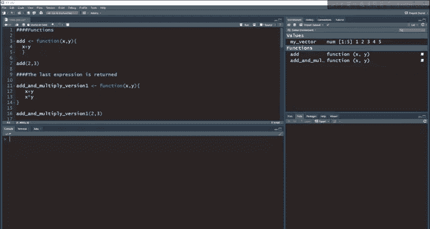

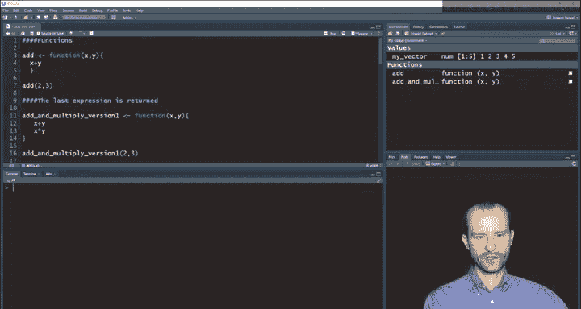

在本节课中，我们将要学习R语言中函数的基本概念、如何创建自定义函数，以及如何使用R内置的一些常用函数来处理数据。

## 概述

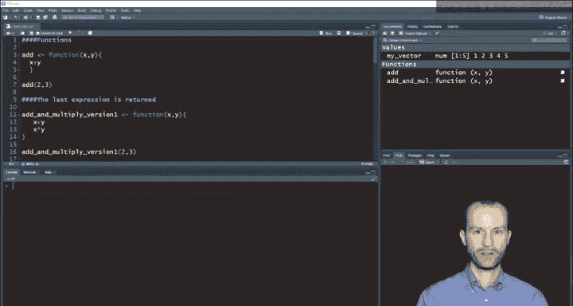

上一节我们介绍了R中的基本数学和逻辑运算符。本节中，我们来看看R语言的核心工作方式——函数。函数是一组命令的集合，它告诉R如何处理一组输入数据。

## 什么是函数？

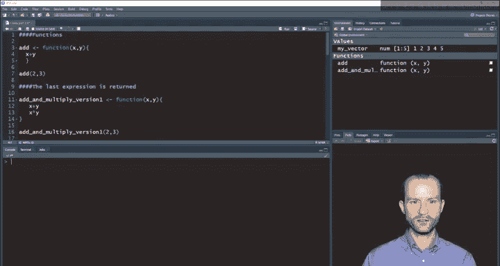

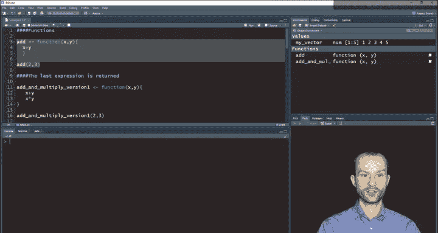

R通过使用函数来工作。函数是一组命令，它告诉R如何处理一组输入。


在R中，你可以通过编写 `function` 关键字来定义一个函数，然后在括号内指定用户需要输入的参数，参数之间用逗号分隔。

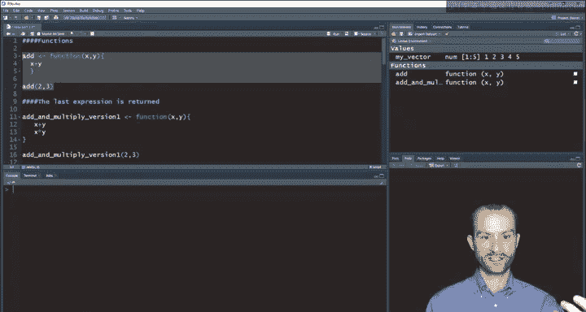

```r
function(参数1, 参数2, ...)
```

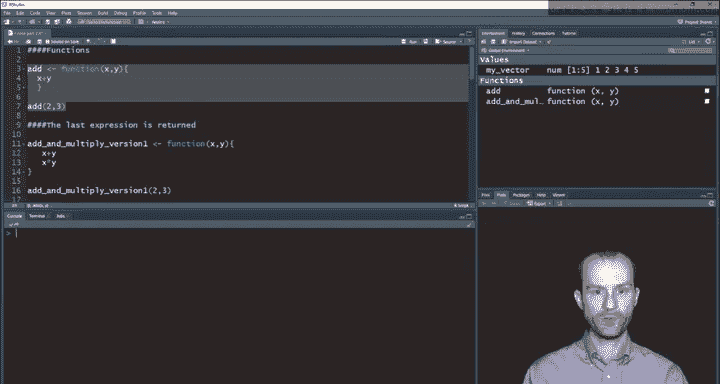

接着，在大括号 `{}` 内，你提供希望函数对输入数据执行的一系列命令。


```r
{
  # 要执行的命令
}
```


## 创建自定义函数

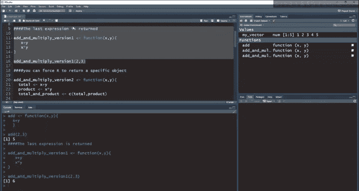

以下是一个示例，我们将创建一个名为 `add` 的函数。

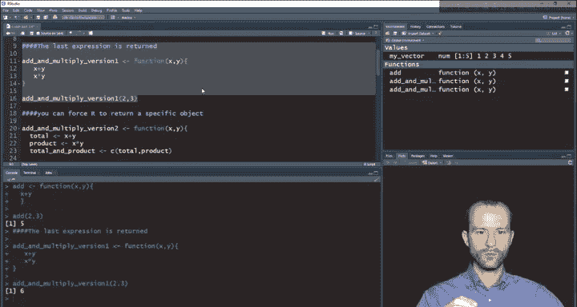

```r
add <- function(x, y) {
  x + y
}
```


在这个例子中，我们告诉R将两个输入值相加。

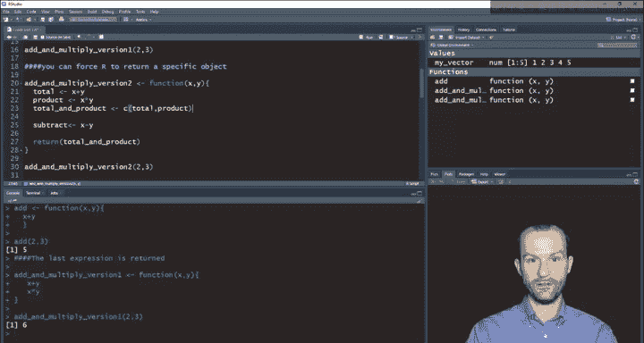

默认情况下，运行函数后，R会将函数中最后一个被计算的表达式作为输出返回，正如这个例子所示。


或者，你可以通过使用 `return()` 函数来明确指定函数应该返回什么。你可以将函数内部保存的某个对象包裹在 `return()` 函数中。

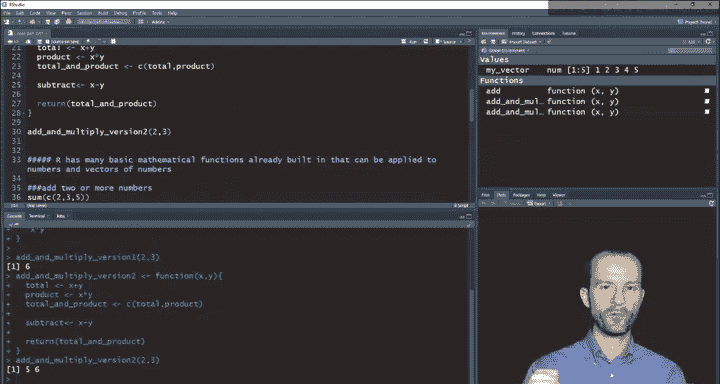

```r
add <- function(x, y) {
  result <- x + y
  return(result)
}
```

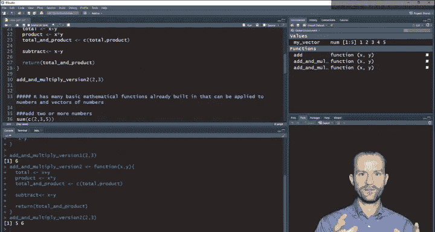

并且，这个返回对象实际上可以是一个向量。

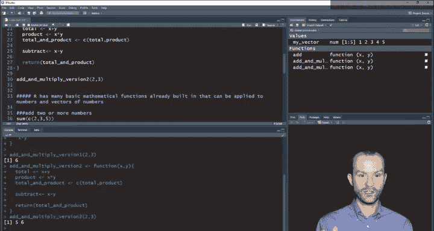

在本课程中，你可能不会自己编写太多函数，但了解这些底层工作原理是有帮助的。

从这个非常简单的起点出发，理论上你可以构建出任何你想要的R函数。

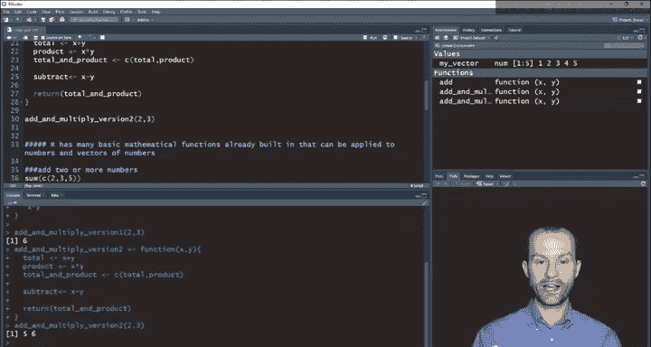

## 使用内置函数

然而，实际上，世界各地的R软件开发者已经编写了成千上万个函数，你可以下载并将它们应用到自己的数据中。


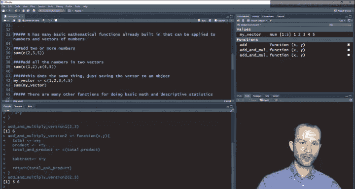


例如，你完全没有必要自己编写一个将向量中数字相加的函数，因为R已经有一个内置函数可以完成这个任务，它叫做 `sum()` 函数。

```r
sum(1, 2, 3, 4, 5) # 返回 15
```

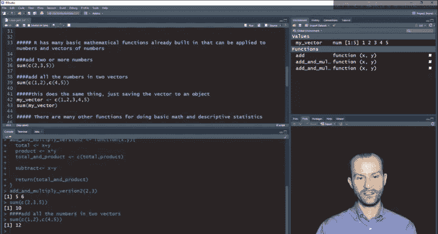

如果你将一系列数字或一个数字向量放入 `sum()` 函数，它将返回所有输入的总和。

这基本上就是R的全部工作方式：你将函数应用于基于数字和逻辑操作构建的数字和字符数据。


随着学习的深入，你会发现R内置了许多不同的函数，可以提供简单的描述性统计和其他有用信息。此外，你还可以下载更多功能丰富的函数，我们将在后续课程中介绍。

## 其他常用向量处理函数


以下是一些其他常见且有用的函数，它们可以返回关于向量的信息：`sort()`、`rev()`、`table()`、`unique()` 和 `length()`。

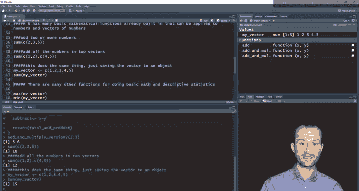

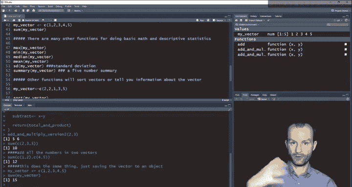

你应该运行这些函数，感受一下它们各自的功能。

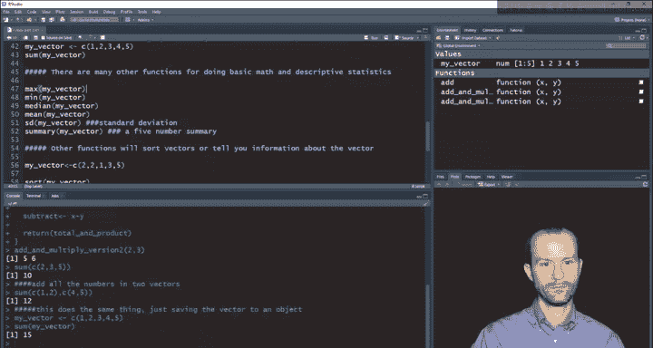

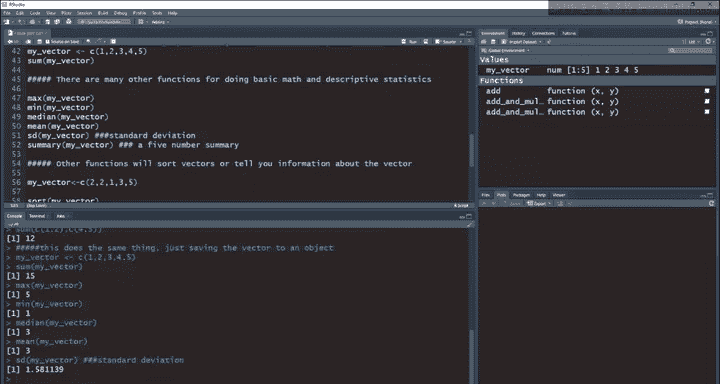

```r
# 示例
my_vector <- c(3, 1, 4, 1, 5)
sort(my_vector)   # 排序
rev(my_vector)    # 反转顺序
table(my_vector)  # 计算频数
unique(my_vector) # 获取唯一值
length(my_vector) # 获取长度
```

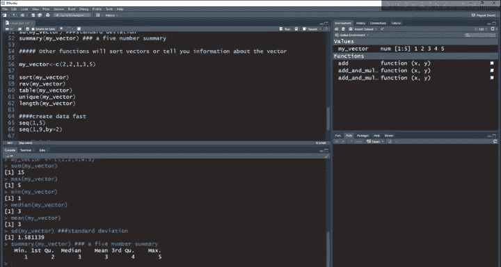

## 用于创建数据的函数

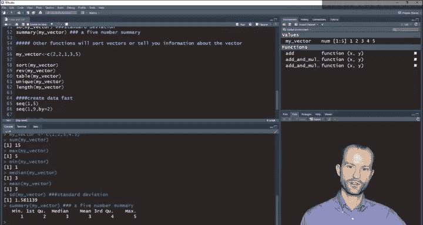

你也可以使用函数来帮助你快速创建数据。在这方面，一些方便的函数是 `seq()` 和 `rep()`。

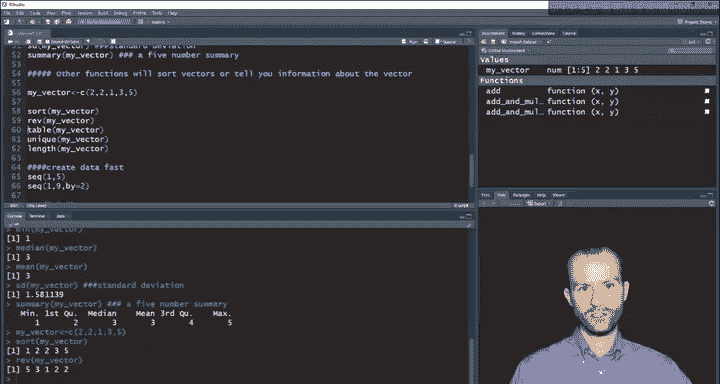

`seq()` 函数用于创建数字序列，`rep()` 函数用于重复向量的元素。

```r
seq(from = 1, to = 10, by = 2) # 生成序列 1, 3, 5, 7, 9
rep(c("A", "B"), times = 3)    # 重复 "A", "B" 三次
```

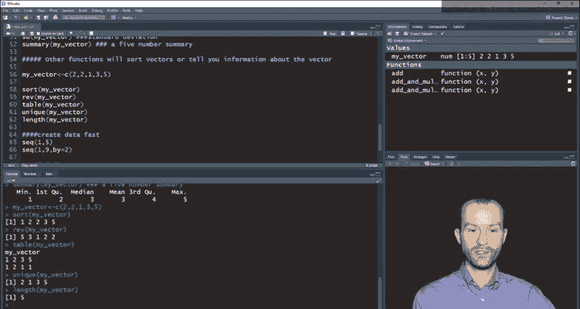

也请尝试使用这些函数，以了解它们是如何工作的。

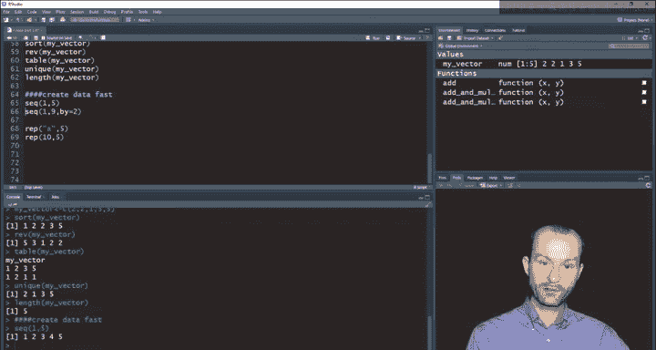

## 总结

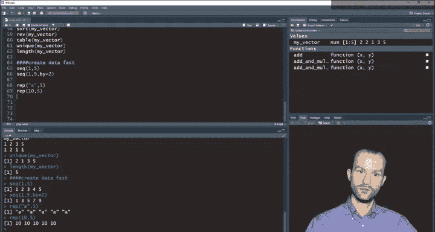

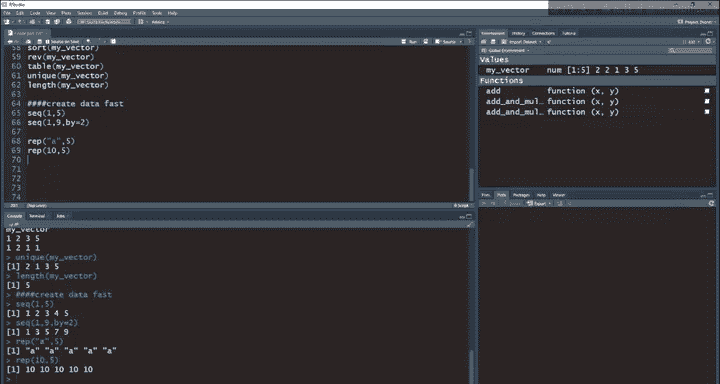

本节课中，我们一起学习了R语言中函数的核心概念。我们了解了函数是如何定义和工作的，如何创建简单的自定义函数，以及如何利用R强大的内置函数（如 `sum()`、`sort()`、`seq()` 等）来高效地处理和创建数据。理解函数是掌握R编程的关键一步，它为后续更复杂的数据分析和可视化操作奠定了基础。