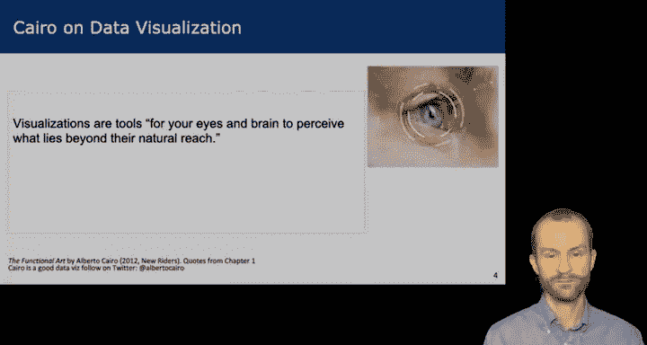
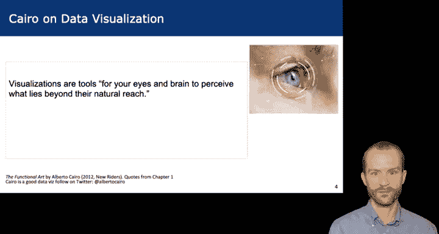
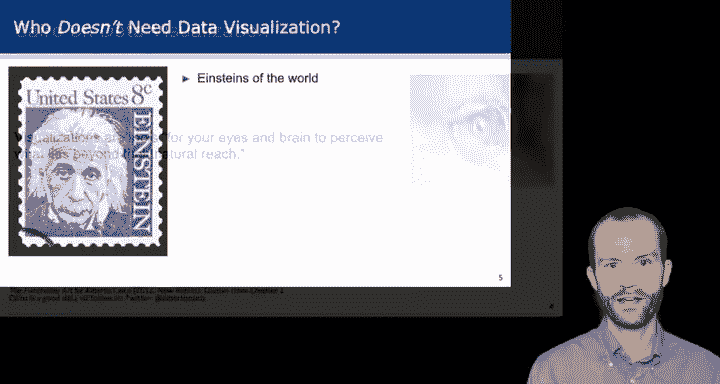
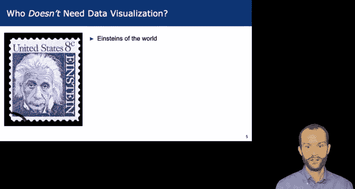
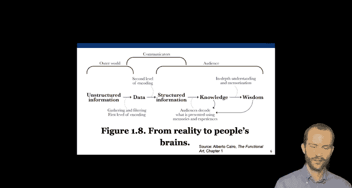
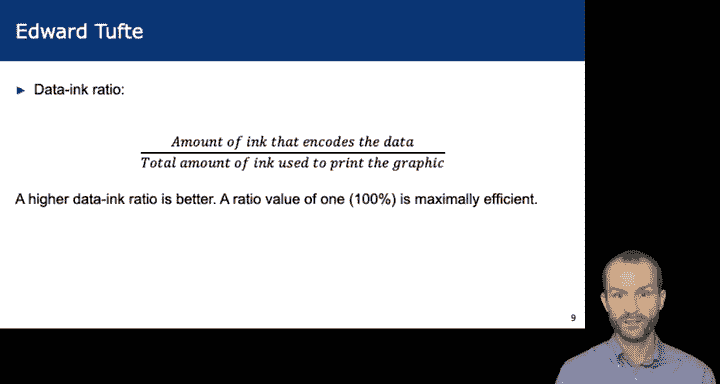
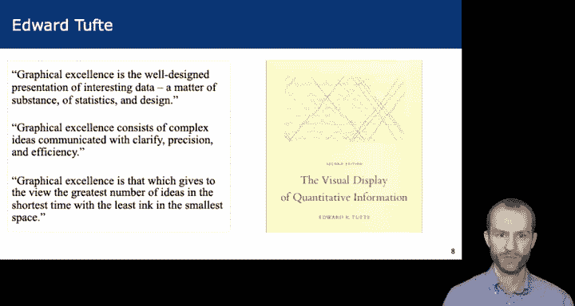
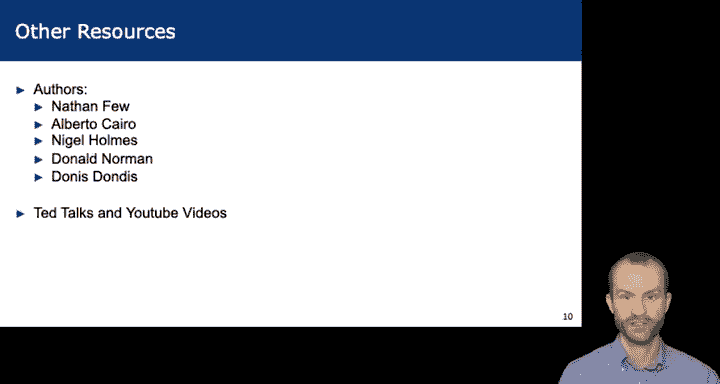

# 课程P60：数据可视化要点 📊

在本节课中，我们将探讨数据可视化的核心价值与基本原则。我们将了解为何可视化是数据分析的关键工具，并学习爱德华·塔夫特提出的图形卓越原则，特别是“数据墨水比”这一核心概念。

---

## 为何需要数据可视化？ 🤔

上一节我们介绍了本系列课程的重点是学习使用R语言创建可视化的软件技能。

本节中我们来看看数据可视化理论或最佳实践的重要性。

本课程至今尚未深入探讨可视化理论或最佳实践。

因此，我想借此机会花几分钟时间讨论该领域的一些基本概念，并为您介绍一些有价值的资源，如果您有兴趣了解更多相关知识。

现在我们已掌握了所有这些可视化数据的工具。

现在是时候回过头思考一些基本问题了。

我们花了大量时间学习使用R语言来可视化数据。

但为什么可视化如此重要？为什么它是数据分析师的重要工具？

鉴于可视化在当今媒体中如此普遍，您可能对此已有直觉，但将其正式化是值得的。

本质上，我们可视化数据的原因，正如阿尔贝托·凯罗所言，图形和可视化是让您的眼睛和大脑感知超出其自然能力范围之外事物的工具。

换种说法，因为我们如今被数据淹没，如果没有帮助我们处理信息的感官辅助，我们很难理解所有这些数据并发现其中的模式。

可能有一些人在数学技能和空间推理方面天赋异禀，他们不需要可视化就能理解数据。

但对于我们其他人来说，可视化非常有帮助。

借助当今软件可以轻松生成的图形，您可以处理一堆非结构化数据，并以一种让受众更容易理解的方式利用它。

## 图形卓越的原则 ✨

如果您想更正式地思考这个问题，您应该查看阿尔贝托·凯罗《功能艺术》一书中的这个图表。

您可能需要暂停视频，思考几分钟。

如果可视化有助于组织非结构化数据，那么这在实践中究竟意味着什么？什么构成了好的可视化？如果您想更深入地思考这个问题，有很多可用资源，事实上，关于什么构成好图表存在不同的思想流派。

在某种程度上，我从中得出的结论是，其中一部分取决于观察者的眼光。

因此，从作者的角度来看，重要的是批判性地思考如何可视化数据、包含哪些信息、排除哪些信息，以及试图通过可视化讲述何种统计真相。

尽管如此，如果我必须为您指出一些准则，我会从爱德华·塔夫特的工作开始，他是过去一代人中数据可视化领域最重要的人物之一。

塔夫特在职业生涯中期转换方向，致力于倡导更好的统计信息展示方式。

他的著作《量化信息的视觉展示》是关于这一主题的真正杰作，我强烈建议您找时间阅读一下。

塔夫特提出了图形卓越的三项原则，供您参考。

以下是这些原则：

第一，图形卓越是关于有趣数据的精心设计的呈现，是实质内容、统计和设计的问题。

第二，图形卓越在于以清晰、精确和高效的方式传达复杂思想。

第三，图形卓越是能在最短时间内、用最少的墨水、在最小的空间内，给予观看者最多想法的图表。

这第三点被称为效率原则，尤其重要，它可以更简洁地表述为**数据墨水比**。

**数据墨水比 = 图表中用于编码数据的墨水量 / 打印整个图形所用的总墨水量**

一般来说，比率越高，图形越好。理想情况下，打印图形所用的100%墨水都应用于编码数据。

这在现实生活中可能不切实际，但当您思考如何设计可视化时，这是可以追求的理想目标。

审视塔夫特的原则，您应该明白为什么我说一个好的统计图形是批判性思维的实践。

## 设计中的平衡与批判性思维 ⚖️

什么构成“精心设计”、“清晰”等术语是有争议的。

事实上，一些平面设计专业人士对塔夫特的极简方法有异议，他们指出当今许多受众习惯于看到有趣或有创意的视觉效果，人类有追求新奇事物的倾向，他们可能会对非常基础的图形感到厌倦。

在我看来，更好的方法是从极简开始，然后根据需要增加复杂性。

在每一步都考虑您的视觉修饰是否有助于讲述您作为分析师从对数据的深入研究中所获得的统计故事。

没有什么可以替代对数据的深入了解，因此在做出任何可视化决策之前，请确保您知道数据在告诉您什么。

正如我所提到的，关于这个话题还有很多可以说的。

如果您想了解更多，我可以推荐几位在该领域有有趣著作和工作的作者：当然是爱德华·塔夫特，还有内森·福、阿尔贝托·凯罗、奈杰尔·霍姆斯、唐纳德·诺曼和丹尼斯·顿斯。

在YouTube上搜索爱德华·塔夫特也能产生许多有趣的结果，包括录制的演讲和演示。

您可以在闲暇时探索这些内容，但最重要的是，请记住重点是在可视化数据时，将您自己的批判性眼光带入您的工作中。

---

## 总结 📝

本节课中我们一起学习了数据可视化的核心价值，它作为理解海量数据和揭示模式的感官辅助工具的重要性。我们重点探讨了爱德华·塔夫特提出的图形卓越三原则，特别是**数据墨水比**这一核心量化概念，它强调图表应最大化用于编码数据的视觉元素。最后，我们认识到优秀的数据可视化是批判性思维的体现，需要在极简与有效传达之间找到平衡，并始终建立在对数据本身深刻理解的基础之上。