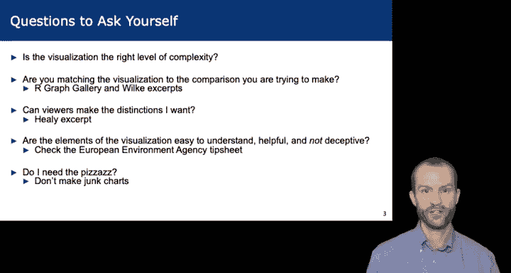

# 📊 课程名称：R语言数据可视化和仪表盘｜Data Visualization & Dashboarding with R - P62：5_更多最佳实践和阅读概述

在本节课中，我们将要学习数据可视化的更多最佳实践，并对本周的推荐阅读材料进行概述。我们将探讨如何设计有效、清晰且不易误导的图表，并理解在创建可视化时应向自己提出的关键问题。

---

你会看到，在本视频之后，我为本周提供了大量的阅读材料。

我认为我整理了一套关于可视化最佳实践的优质资源集。

现在复习这些材料，并在未来的可视化工作中随时参考，将使你受益匪浅。

然而，我意识到这些信息量很大。

因此，我在这里只强调几个要点。

首先，我无法指定这本书。

但除了塔夫特的《定量信息的视觉展示》之外。

我还鼓励你获取一本阿尔贝托·开罗的《功能失调的艺术》。

开罗提出了几个关于数据可视化设计的绝佳观点，我想着重强调。

任何图形的首要和主要目标，是成为你的眼睛和大脑感知其自然能力之外事物的工具。

其次，在信息图形中，你展示的内容与你隐藏的内容同等重要。

第三，可视化应被视为一种技术，它们是达成目标的手段。

并且，图形的复杂程度应适应你的普通读者的特性。

我认为这些基本原则可以转化为你在进行可视化时需要问自己的一系列问题。

---

上一节我们介绍了可视化设计的基本原则，本节中我们来看看具体需要向自己提出的问题。

以下是你在创建可视化时应考虑的核心问题列表：

*   **问题一：可视化内容的复杂程度是否适合你的受众？** 你认为会看到这个图表的普通人，能够理解它吗？是否有足够的背景信息让他们明白发生了什么？
*   **问题二：我使用的可视化类型适合这项任务吗？** 可视化可以展示多种不同类型的关系。它们可以展示分布、相关性、排名、构成、随时间的变化以及其他特征。在本周的阅读材料中，R图表库和克劳斯·威尔克书中的教材摘录在这些方面非常有用，它们向你展示了各种可能的可视化图表，以及每种图表擅长展示的关系类型。
*   **问题三：我创建的可视化是否包含了能让观众做出我希望他们做出的区分的视觉元素？** 思考一下位置、长度、角度、面积和颜色，这些是你可以修改的可视化特征，以便让你的受众能够进行区分并理解你想要传达的信息。人类在这些维度上进行区分的能力各不相同，因此你需要仔细思考如何在可视化中使用它们。金·希利的教材摘录在阐明这些观点方面尤其出色，它展示了个人在做出这些区分和解读可视化方面的不同能力。
*   **问题四：我的可视化元素是否合理且不具欺骗性？** 你的坐标轴应该易于理解，并且通常应该在图中使用完整的X轴和Y轴范围。使用透明的区间，注意比例尺。许多人不习惯解读对数比例尺或其他类型的转换比例尺，因此通常最好的做法是从线性比例尺开始，如果你要使用其他比例尺，务必明确说明你的做法，以确保易于解读坐标轴的含义。

---

在讨论了设计原则和关键问题后，接下来我们关注一些具体的实用技巧和常见陷阱。

**战略性地谨慎使用颜色**。颜色确实能为你的图形增色不少，但也可能使图形过于杂乱，并让读者从底层信息上分心。此外，你必须记住，有很多人，尤其是男性，是色盲。因此，你可能不希望仅仅依赖颜色来绘制数据中真正重要的鲜明区别，因为你的受众可能是色盲，或者他们可能需要在黑白印刷页面上看到这些图表，而在黑白情况下颜色更难区分。

**一般来说，避免在图形中使用过多的“炫技”**。例如，在二维表面上使用爆炸式或3D渲染的图形非常难以解读，因此在使用这些效果时要非常谨慎。动画也是如此，动画确实很酷，但有时使用小倍数显示会更好。例如，使用 `facet_wrap` 来展示数据中不同类别之间的区别。

欧洲环境署的指导文件有一个非常好的指导原则和技巧列表，呼应了我在这里所说的内容，请务必仔细阅读。

当你刚开始进行数据可视化时，你会犯错误，也会感到有些困惑。

因此，一个好的做法是：先动手创建你的可视化，尽你所能去尝试，然后去查看一些技巧清单，看看你是否犯了任何常见错误。

如果你真的想看一些糟糕的图表，我包含了一个指向“垃圾图表”网站的链接，该网站展示了一些在制作糟糕可视化方面堪称“典范”的例子。

请避免尝试出现在“垃圾图表”网站上。

---

本节课中我们一起学习了数据可视化的核心设计原则、创建图表时需要自问的关键问题，以及一系列实用的最佳实践和应避免的常见陷阱。记住，可视化是沟通的工具，其有效性取决于是否清晰、准确且适合受众。持续练习并参考优质资源，将帮助你不断提升数据叙事的能力。