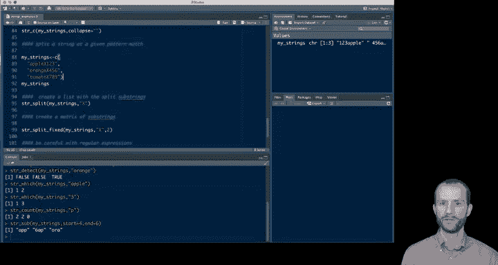

# 课程名称：R语言数据可视化和仪表盘｜Data Visualization & Dashboarding with R
## 课程编号：P64 - 字符串处理入门 🧵


在本节课中，我们将要学习如何处理R语言中的字符串数据。字符串，即文本数据，在数据分析中非常常见，但处理方式与数值数据有所不同。

---

我们过去处理的数据大多是数值型的。然而，有时表格单元格中的数据并非数字，而是单词或字符序列。这类数据处理起来可能有些困难，因此tidyverse专门设计了一个名为`stringr`的包来处理此类数据。

字符串处理中最常见的任务是模式识别，即判断表格中的给定单元格是否包含特定的模式或字符序列（如一个单词）。有时，您可能还需要拆分字符串，并将数据分布到多个列中。

`stringr`的速查表很好地总结了这些函数，tidyverse网站上关于`stringr`的参考资料也非常清晰。接下来，我将通过几个示例向您介绍这个包中的函数。

---

### 创建示例向量

首先，我们创建一个简短的字符向量作为示例。代码如下：

```r
# 创建一个字符向量
example_vector <- c("apple pie", "pineapple", "grape", "pear")
```

请注意这些字符的排列，包括任何空格。

---

### 检测字符串模式

上一节我们创建了示例数据，本节中我们来看看如何检测字符串中是否包含特定模式。

`stringr::str_detect()`函数可以对字符串中模式的存在与否进行逻辑测试。以下代码测试字符向量中每个元素是否包含“apple”这个模式：

```r
library(stringr)
# 检测是否包含“apple”
str_detect(example_vector, "apple")
```

函数会返回一个逻辑向量，找到模式则返回`TRUE`，否则返回`FALSE`。

---

### 定位匹配项

如果您不想得到真假值向量，而是想直接输出包含给定模式的字符向量元素，可以使用`stringr::str_which()`函数。

以下是使用该函数查找包含“p”的元素的索引：

```r
# 查找包含“p”的元素的索引
str_which(example_vector, "p")
```

输出结果是向量中匹配模式的元素的索引值。

---

### 统计模式出现次数

`stringr::str_count()`函数会统计给定字符模式在字符向量每个元素中出现的次数。

以下代码统计字母“p”在每个元素中出现的次数：

```r
# 统计“p”出现的次数
str_count(example_vector, "p")
```

我们可以看到，在向量的第一个和第二个元素中，“p”出现了两次。

---

### 提取子字符串

`stringr::str_sub()`函数可以从字符向量的每个元素中提取子字符串。您可以在函数内指定要提取的字符范围。

以下代码提取每个字符串中第4到第6个字符：

```r
# 提取第4到第6个字符
str_sub(example_vector, start = 4, end = 6)
```

运行该函数将提取向量每个元素字符串中的第4、5、6个字符。

---

我可以继续演示`stringr`包中的每一个函数，代码文件中也有更多示例。但您现在应该已经理解了基本要点。



`stringr`函数允许在字符串中进行模式匹配和替换。您还会发现，这些函数可以拆分或组合字符串，这对于创建新的数据列非常方便。这一切都相当直观，对于管理此类数据可能非常重要。

请运行本代码中的所有函数，并确保理解它们的工作原理。这样，您就知道这些函数的存在，以便在需要时可以在工作中使用它们。

---

### 关于正则表达式

有一点您应该了解，但这里不会详细展开，那就是**正则表达式**。

在`stringr`速查表的第二页，您会看到许多关于正则表达式的信息。简而言之，这是一套极其强大的工具，用于进行更复杂的模式匹配，它比精确匹配或替换相似字符串提供了更大的灵活性。

然而，正则表达式可能相当复杂，这更适合在比本课程更高级的编程课程中讲解。目前，您只需知道，如果您在处理非结构化或非常不规则的字符数据时遇到非常复杂的模式匹配问题，您或许可以使用正则表达式来解决它。

当时机成熟时，您可以从Roger Peng的著作《R Programming for Data Science》的第17章开始学习，该章节对正则表达式及其用法进行了更深入的介绍。本周的阅读材料中包含了该章节的链接。

---

### 总结

本节课中我们一起学习了R语言中处理字符串的基础知识。我们介绍了如何使用`stringr`包来检测、定位、计数和提取字符串中的模式。虽然我们未深入探讨强大的正则表达式，但您现在已经掌握了处理常见文本数据的基本工具。请务必练习这些函数，以便在数据分析项目中熟练运用。