# 课程10：连接和透视 📊

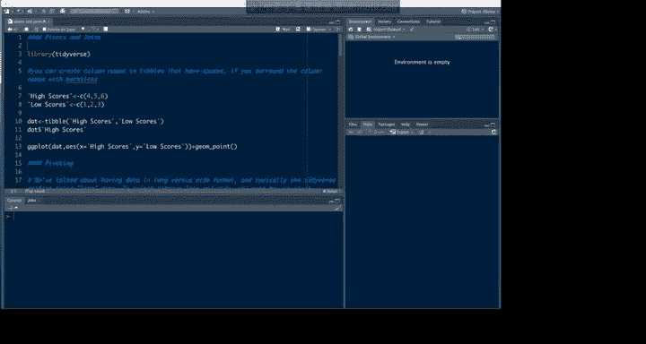

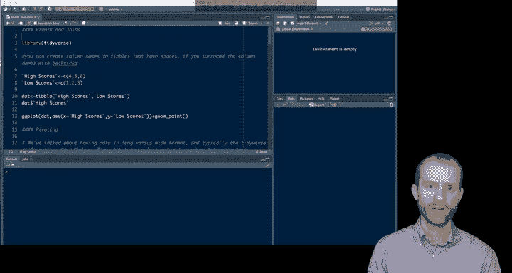

在本节课中，我们将学习两个重要的数据整理技能：如何将数据从“宽格式”转换为“长格式”（即数据透视），以及如何将来自不同来源的数据表合并（即连接）。掌握这些技能对于整合和准备项目数据至关重要。

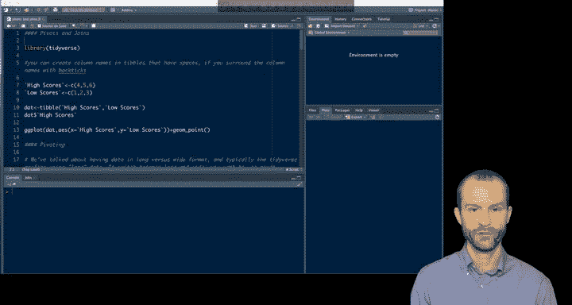

---

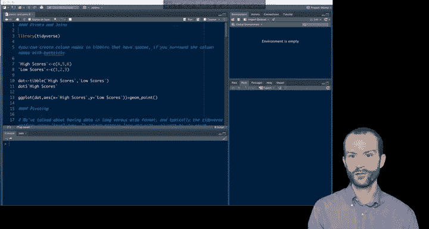

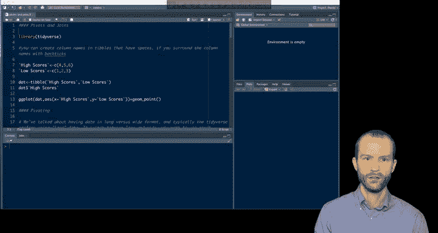

上一节我们介绍了处理字符串、日期和分类数据的基本工具。本节中，我们来看看如何重塑和合并数据表。

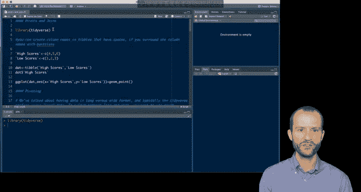

首先，有一个小知识点需要提及。在R中，你可以为Tibble或数据框创建包含空格的列标题。

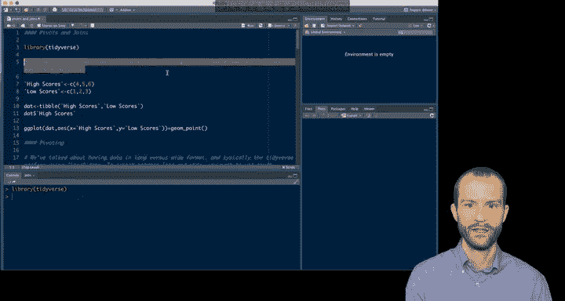

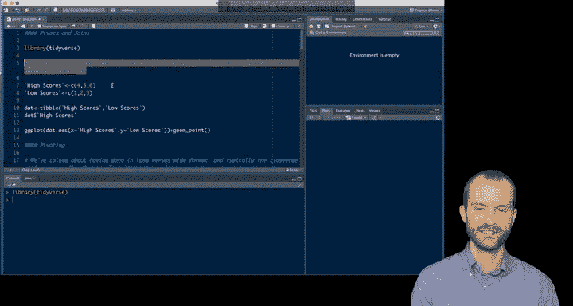

```r
# 使用反引号创建包含空格的列名
`Column Name With Spaces` <- c(1, 2, 3)
```

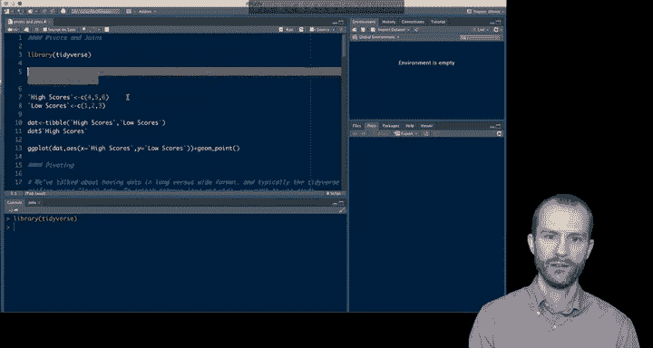

通常不建议在数据处理阶段这样做，除非是在为图表制作图例或坐标轴标题时，需要确保格式美观。

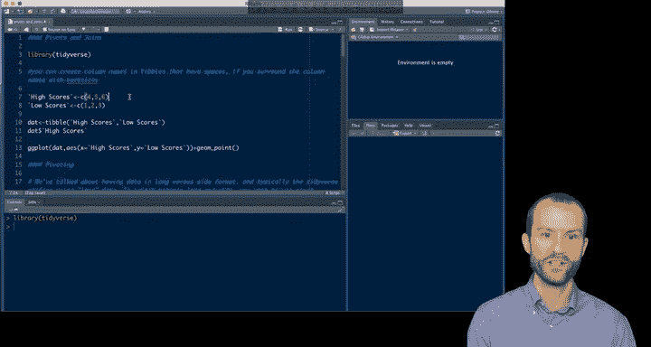

如果你导入的数据本身列名就包含空格，那么在调用这些列时，也需要用反引号将列名括起来。

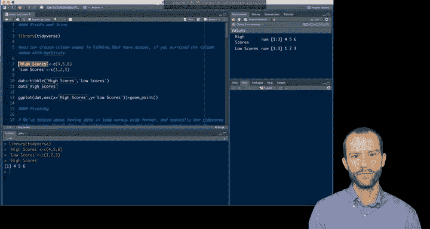

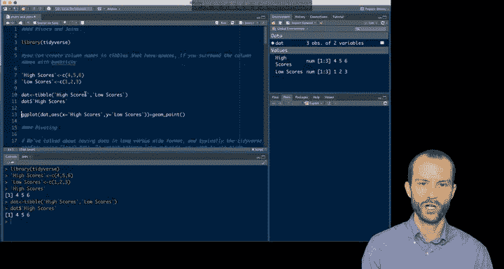

---

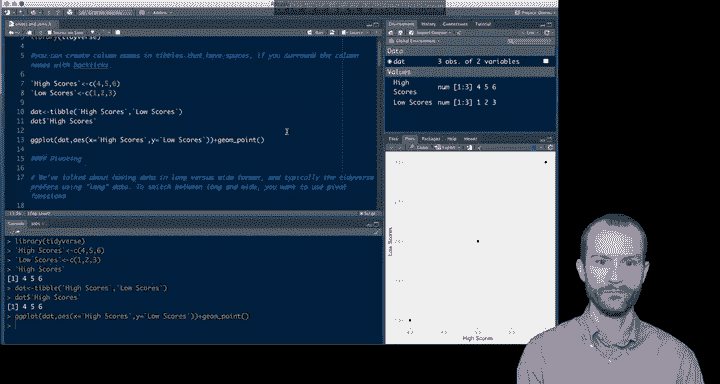

理解了列名的处理方式后，现在我们来回顾将数据从宽格式转换为长格式的概念。


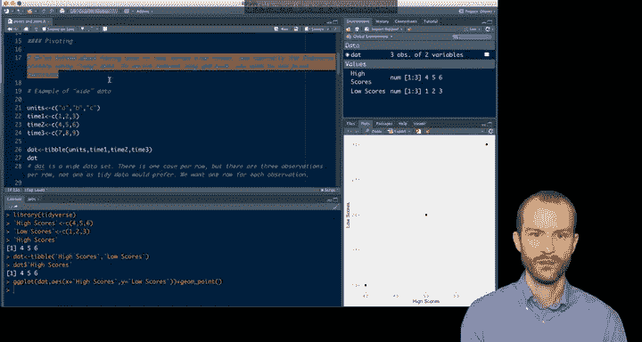

在Tidyverse中，我们更倾向于使用长格式数据，即每一行代表一个单一的观测值。

但你经常会发现现实世界中的数据是宽格式的，即每一行可能是一个案例，但该案例有多个观测值分布在不同的列中。


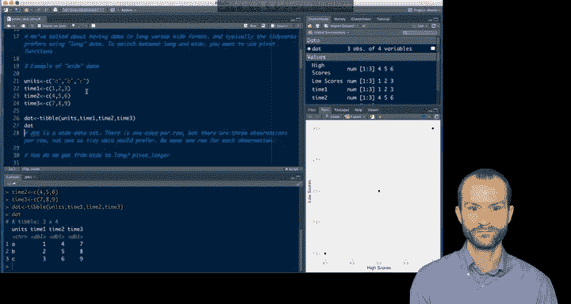

例如，下面这个简单的表格就是宽格式。每个单元或案例在time1、time2和time3有三个观测值，因此观测值在表格中是横向排列的。


| case | time1 | time2 | time3 |
|------|-------|-------|-------|
| A    | 10    | 12    | 15    |
| B    | 8     | 9     | 11    |

这不是在Tidyverse中处理数据的好方式，因此我们需要能够将这种数据透视成长格式。我们使用 `pivot_longer` 函数来实现。

以下是使用 `pivot_longer` 的步骤：
1.  首先，将我们想要透视的数据传递给函数。
2.  然后，选择我们想要进行透视的列。
3.  接着，为包含原列名的新列指定一个名称。
4.  最后，为存放被透视数值的新列指定一个名称。

如果这听起来不太直观，没关系，先运行函数，观察输出结果，你就能逐渐理解其原理。

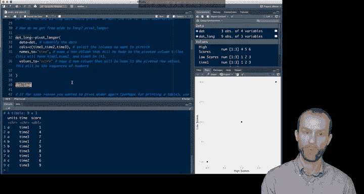

```r
library(tidyr)
wide_data <- tibble(case = c("A", "B"), time1 = c(10, 8), time2 = c(12, 9), time3 = c(15, 11))

long_data <- pivot_longer(wide_data,
                          cols = c(time1, time2, time3), # 选择要透视的列
                          names_to = "time_point",       # 新列：存放原列名（time1, time2...）
                          values_to = "measurement")     # 新列：存放对应的数值
```

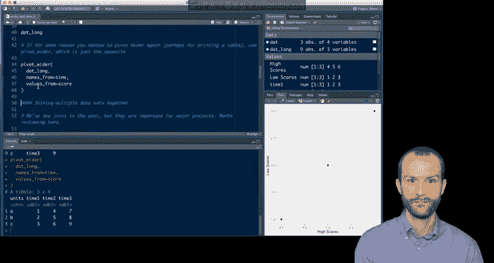

运行函数后，你会看到之前的宽格式数据现在变成了长格式。这相当于进行了部分转置。理解这种差异非常重要，因为它可能与你习惯的数据思维方式不同，并且对于在Tidyverse中工作至关重要。

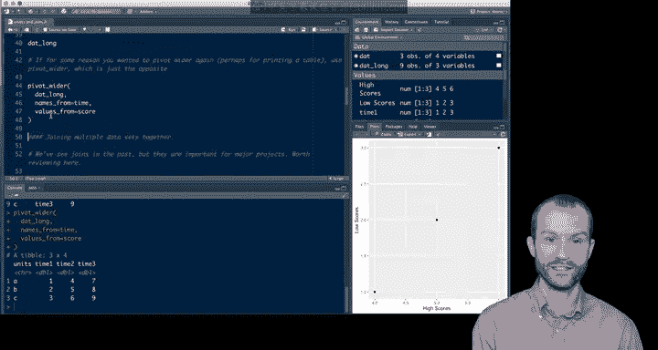

如果出于某些原因（例如格式化表格），你需要将数据从长格式转回宽格式，可以使用 `pivot_longer` 的逆函数 `pivot_wider`。


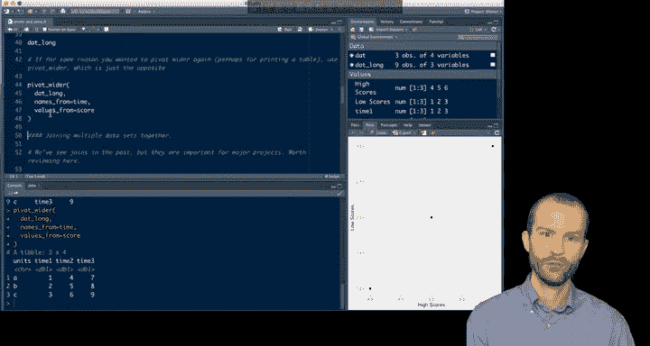

```r
# 将长格式数据转回宽格式
back_to_wide <- pivot_wider(long_data,
                            names_from = "time_point", # 从哪一列获取新列名
                            values_from = "measurement") # 从哪一列获取数值
```

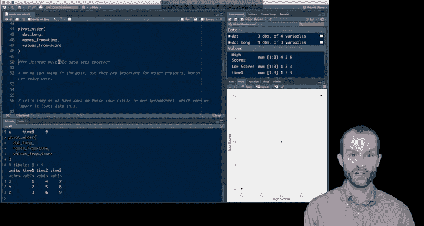

建议你在两种格式之间来回转换几次，观察单元格是如何从宽格式移动到长格式并返回的，从而更好地理解这个函数的工作原理。刚开始使用时可能不太直观，但多加练习就会熟悉。


---

学会了如何重塑单个表格的形状后，接下来我们看看如何合并来自不同表格的数据。

你的项目数据很可能来自多个电子表格、CSV文件或其他类型的文件，你需要将它们合并成一个完整的大表。

假设你有一些关于世界多个城市的数据，但它们分散在不同的表格中。

*   表格A包含纽约、伦敦、堪培拉和内罗毕的变量X数据。
*   表格B包含纽约、伦敦、堪培拉和雅加达的变量Y数据。

将纽约、伦敦和堪培拉这两个变量的数据合并到一个表格中会非常方便。我们可以通过“连接”操作来实现。

连接的工作原理是在不同的表中查找“键值”，并基于这个键值将表拼接起来。键值本质上是不同表中共有的列。例如，这里的共有列是“城市”。我们可以基于该键值列使用连接来合并数据。

主要有四种类型的连接：左连接、右连接、内连接和全连接。

以下是四种连接的说明：
*   **左连接**：保留连接函数中第一个表的所有行，并尽可能匹配第二个表中的数据。结果合并表中将包含第一个表的所有行，但如果第二个表中没有某个键值的数据，则该处显示为缺失值（NA）。
*   **右连接**：与左连接相反，保留第二个表的所有行，并匹配第一个表的数据。第一个表中没有的键值对应的数据会显示为缺失值。
*   **内连接**：只保留键值在两个表的共有列中都存在的行。即结果只包含两个表共有的键值对应的数据。
*   **全连接**：保留两个表中的所有行，缺失的数据用NA填充。

连接数据可能相当棘手，也存在一定风险，因为有很大的出错空间，可能导致数据丢失或错误合并。键值列中的微小不一致都可能造成错误和不匹配。有时你可能需要进行更复杂的模式匹配或其他技巧才能使连接正常工作。

**务必、务必、务必**通过手动检查数据来验证你的连接操作是否正确。

关于连接的更多信息，强烈建议你阅读《R for Data Science》的第13章，该章节已包含在本视频的后续阅读材料中。如果你能理解那部分内容，你将能够合并各种有趣的数据并创建出色的可视化图表。

---

本节课中，我们一起学习了数据整理的两个高级技能：使用 `pivot_longer` 和 `pivot_wider` 进行数据透视，以及使用左连接、右连接、内连接和全连接来合并多个数据表。掌握这些技能能帮助你整合不同来源和格式的数据，为后续的数据分析和可视化打下坚实的基础。