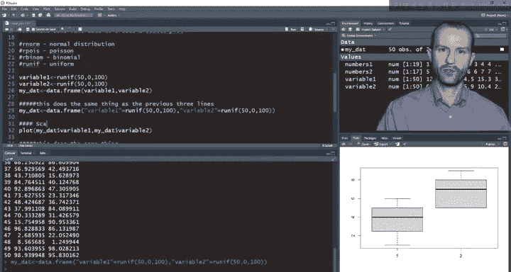

# 📊 课程 P8：基础 R 可视化

在本节课中，我们将学习如何使用 R 语言的标准安装（即基础 R）中的函数来创建基本图形。我们将从单变量图开始，逐步过渡到多变量图，并了解如何对这些图形进行简单定制。

---

## 基础 R 可视化简介

在 R 语言的标准安装中，有许多函数可用于制作基本图形。网络上有大量优秀的在线资源和速查表可供参考，本视频的相关材料中也包含了一些这样的资源。

绘制数据时，可以制作单变量图，用于展示单个变量或单个向量值的分布。也可以制作多变量图，用于展示两个或多个变量值之间的相互关系。


---

## 单变量图

上一节我们介绍了基础 R 可视化的概念，本节中我们来看看两种常见的单变量图：直方图和箱线图。

### 直方图

直方图是一种非常简单的单变量图，本质上是不同向量值频率的条形图。

以下是创建直方图的步骤：

1.  创建一个包含重复值的数字向量。
2.  使用 `hist` 函数生成直方图。

**示例代码：**
```r
# 创建一个向量
my_vector <- c(1, 2, 2, 3, 3, 3, 4, 4, 5)
# 绘制直方图
hist(my_vector)
```

### 箱线图

可视化数值分布的另一种方法是箱线图。我们可以使用 `boxplot` 函数来创建。

将数字向量传递给 `boxplot` 函数，它会显示该向量的最小值、最大值、中位数以及第一和第三四分位数。

若要显示多个箱线图（即针对多个向量），只需将两个或更多向量输入 `boxplot` 函数即可。

**示例代码：**
```r
# 为单个向量创建箱线图
boxplot(my_vector)
# 为多个向量创建箱线图
vector1 <- c(1, 2, 3, 4, 5)
vector2 <- c(2, 3, 4, 5, 6)
boxplot(vector1, vector2)
```

---

## 多变量图：散点图

现在，让我们进入双变量统计的世界，学习如何创建散点图。我们将创建一些模拟数据来演示这个过程。

这为我们提供了一个机会，可以使用基础 R 速查表中尚未提及的几个函数，例如 `rnorm`、`rpois`、`rbinom` 和 `runif`。你可以通过给定一组参数，指示 R 从这些不同的统计分布中抽取随机样本。

如果这听起来有些复杂，不必过于担心，你可以将其视为生成随机数的一种方式。例如，使用 `runif` 函数，我们可以指示 R 在 0 到 100 之间随机抽取 50 个值。

我们将执行两次此操作，然后将这些向量组合成一个数据框。你可以使用多行代码完成此操作，也可以将所有命令合并到一行中。随着你越来越熟练地使用 R，可能会开始将更多命令放在一行中，因为这是一种更高效的编码方式。



**示例代码：**
```r
# 生成随机数据并创建数据框
set.seed(123) # 确保结果可重现
x_values <- runif(50, min = 0, max = 100)
y_values <- runif(50, min = 0, max = 100)
my_data <- data.frame(x = x_values, y = y_values)
# 或者合并为一行
my_data <- data.frame(x = runif(50, 0, 100), y = runif(50, 0, 100))
```

一旦数据位于数据框中，就可以使用散点图来绘制这些值彼此之间的关系。第一个变量位于 x 轴，第二个变量位于 y 轴。


**示例代码：**
```r
# 绘制散点图
plot(my_data$x, my_data$y)
# 也可以明确指定轴
plot(x = my_data$x, y = my_data$y)
```

关于函数的一点说明是，有时你可以明确使用 `x = values` 或 `y = values` 这样的参数，但随着经验增加，你可以省略这些，函数参数的默认位置会确定它们的用途。这是一个随着实践会越来越熟悉的过程。

在这个散点图中，每个点代表一个 XY 坐标对，即数据框中的一行。

---

## 图形的定制与导出

基础 R 绘图具有一定的定制能力，可以通过向函数添加额外的参数来实现，这些参数在 `plot` 函数或 `hist` 函数等帮助文件中有详细说明。

以下是定制图形的示例，例如添加标题或更改轴标签：

**示例代码：**
```r
plot(my_data$x, my_data$y,
     main = "我的散点图",   # 主标题
     xlab = "X 轴变量",      # X轴标签
     ylab = "Y 轴变量",      # Y轴标签
     col = "blue",           # 点的颜色
     pch = 16)               # 点的形状
```

在 R 中创建图像后（无论是使用基础 R 还是后续更高级的图形），都可以通过 RStudio 的 “Plots” 面板中的 “Export” 按钮将其导出。

你可以将图形保存为图像或 PDF 文件，也可以将图像复制到剪贴板，然后粘贴到正在处理的其他文件中。

---

## 基础 R 图形的能力与局限

使用基础 R 图形，可以快速制作简单的直方图、密度图、散点图、条形图、折线图以及其他一些可以尝试的图形。

但在实践过程中，你会发现这些图形并非出版级质量，并且修改它们的能力相当有限。因此，为了制作出版质量的图形，我们将不得不依赖其他 R 函数，这些内容将在后续课程中学习。

这里的重点只是初步展示 R 如何能够非常快速地生成图形。

---

## 总结

本节课中，我们一起学习了基础 R 可视化的核心内容。我们了解了如何使用 `hist` 和 `boxplot` 函数创建单变量图，以及如何使用 `plot` 函数创建多变量散点图。我们还探讨了如何通过添加参数对图形进行基本定制，并学会了如何从 RStudio 中导出图形。虽然基础 R 图形功能强大且快捷，适合初步探索数据，但其在美观度和定制灵活性上存在局限，为满足更高要求，我们将在后续课程中学习更强大的图形包。