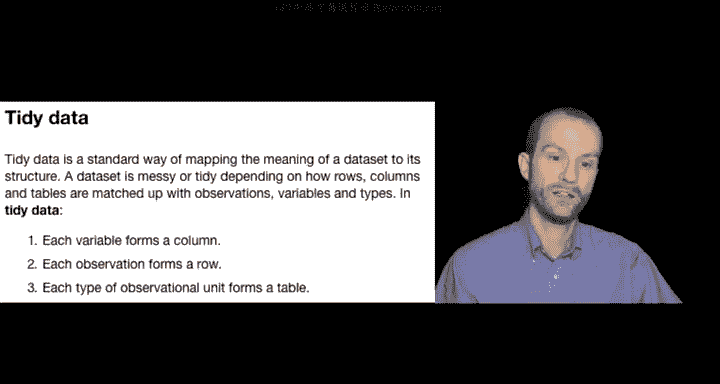
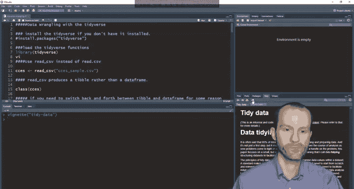
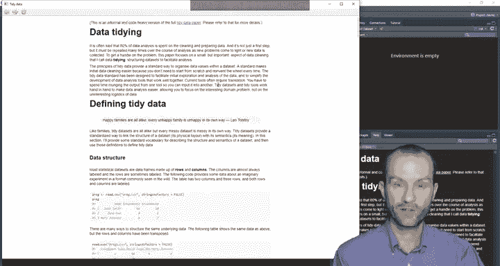
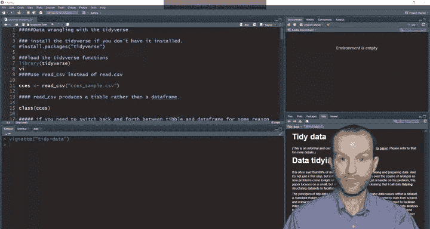
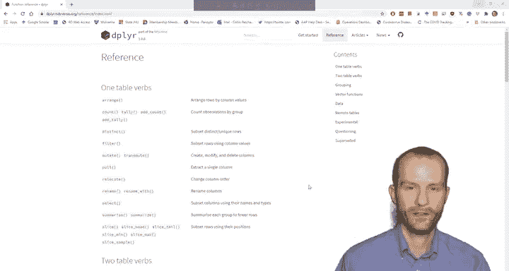
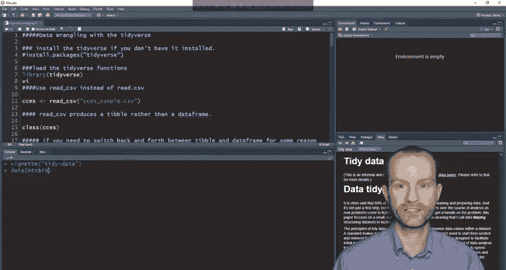

# 课程9：Tidyverse介绍 🧹

在本节课中，我们将学习如何使用Tidyverse这一强大的R语言工具集来操作和整理数据。Tidyverse提供了一系列功能强大的包，能够帮助我们更高效地进行数据清洗、转换和可视化。

---

## 概述

到目前为止，我们已经介绍了如何将数据加载到R中，如何检查数据，并使用R的基础可视化函数制作了第一个图表。

现在，我们将花更多时间讨论如何操作数据。接下来几个视频中将要介绍的各种数据整理函数，其应用在当下可能并不十分明显，但当你开始制作可视化图表和处理更复杂的数据集时，会反复用到这些知识。

---

## 数据整理的多重路径

理解这一点非常重要：当你在R中整理数据，并为了满足需求而重新排序或重塑数据时，几乎总是有不止一种方法可以实现相同的结果。

R的基础安装包内置了许多不同的工具，开发者们还添加了更多函数。因此，如果你看到我做的某件事，然后去网上搜索，可能会发现实现同一目标的不同方法，这完全没问题。我只是向你展示处理某些数据整理问题的一种方式。

---

## 聚焦Tidyverse

与上述观点相关的是，函数实在太多，我无法为你提供一个全面的、涵盖所有方法的清单。因此，在本课程中，我们将重点介绍属于所谓 **Tidyverse** 的命令。

Tidyverse是一组R包，包含许多用于管理数据以及（稍后你会看到）从数据制作可视化图表的命令。它是由一位名叫Hadley Wickham的软件开发者兼教师创建的，他普及了Tidyverse中的许多工具及其在R中组织数据的方法。

---

## Tidy Data原则

Wickham对数据有非常具体的思考方式，Tidyverse正是基于这些原则。Wickham希望用户在进行数据科学工作时使用他所谓的 **整洁数据**，他将整洁数据的原则描述如下：

> 当每一列是一个变量，每一行是一个观测值，每个单元格是一个单一值时，数据就是整洁的。

这基本上只是对一个美观的矩形数据集应有的样子的另一种重述。

因此，如果你在开始处理数据或用其制作可视化图表之前，确保你的数据是整洁的，你将花费更少的时间与R“斗争”，从而有更多时间专注于分析本身。

---

## 学习资源

Wickham在Tidyverse包的文档中很好地总结了整洁数据方法。你可以在R控制台中输入 `vignette("tidy-data")` 来查看。安装Tidyverse后，你会看到一个关于其含义的简短描述。

我将只介绍一些最重要的函数，让你对它们在实际中如何工作有一个具体的认识。最终，培养对不同函数的熟悉度并进行练习，必然需要你自己努力。我试图为你指明资源并引导方向，以便你在未来的道路上能够进行更多的自主学习。

以下是几个极佳的学习资源：

*   **Tidyverse官方网站**：Wickham和他的同事在 `tidyverse.org` 创建了一个非常棒的网站。点击网站上的“Packages”，它会引导你查看Tidyverse不同组件的概述。点击具体包名，会跳转到该包的在线文档页面，这些页面包含包的简短介绍。在导航栏中，你还会找到其他材料，包括包中许多命令的参考页面。你应该习惯查看这些文档，因为在学习Tidyverse的过程中，你很可能会频繁地回来查阅。

*   **速查表**：还有一系列非常棒的速查表，我已将其链接放在课程资料中。它们能非常简洁地概述Tidyverse中不同函数的工作原理。

*   **免费教材**：最后，Wickham有一本名为《R for Data Science》的免费教材，它对Tidyverse命令和一些数据可视化函数提供了结构清晰的介绍。该教材的网站信息我也已包含在资料中。

---

## 如何开始练习

再次强调，逐一学习Tidyverse的每个命令会令人疲惫且难以集中注意力，学习每一个函数对你来说也并非真正重要。你需要学习的是在你的数据任务中需要用到的函数。

作为最低要求，我建议你浏览**数据转换速查表**和**数据导入速查表**，并使用示例数据测试所有这些函数。

如果你在寻找示例数据，一个很好的起点是 **`mtcars`** 数据集。`mtcars` 是R内置的一个示例数据集，你只需在控制台中输入 `data(mtcars)` 即可将其加载到你的R环境中。

它包含了许多汽车型号的一些技术规格，如果你想进行练习，这是一个很好的数据来源。你可能还会在网上找到很多使用 `mtcars` 数据的例子，因此值得让自己习惯使用它。

---

## 总结

本节课中，我们一起学习了Tidyverse的基本概念和重要性。我们了解到Tidyverse基于“整洁数据”的原则，并提供了多种强大的工具来操作和整理数据。我们还介绍了几个关键的学习资源，包括官方文档、速查表和免费教材，并建议使用 `mtcars` 数据集进行实践练习。掌握这些基础将为你后续的数据分析和可视化工作打下坚实的基础。