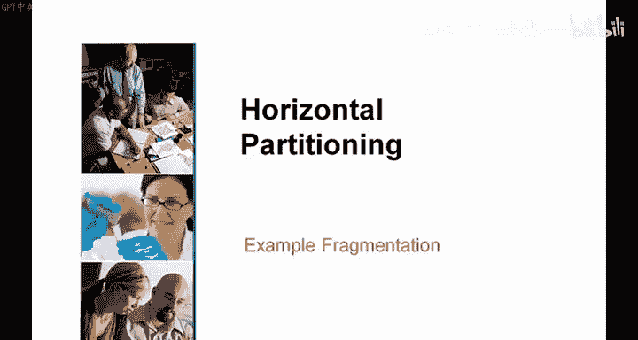
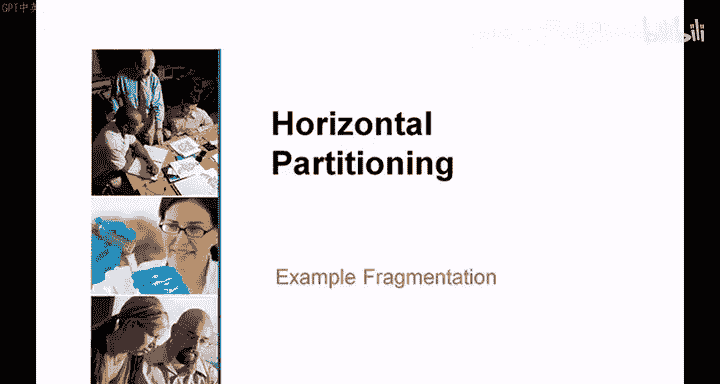
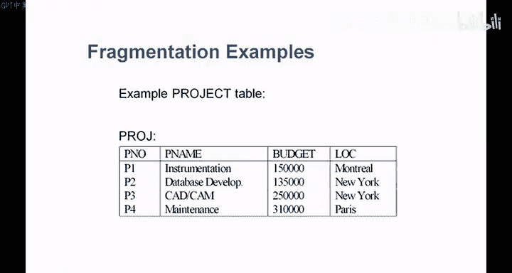
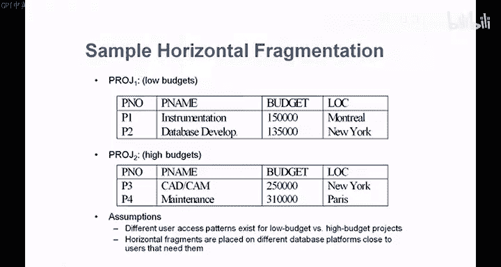
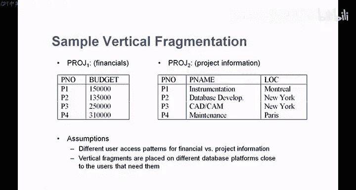

# 课程名称：大规模数据库系统 - 第3单元第2课：水平分区 🗂️



## 概述



在本节课中，我们将要学习数据库系统中的**分片**概念。分片是一种将大型数据库表拆分成更小、更易管理的部分的技术，这对于构建大规模、高性能的分布式系统至关重要。我们将重点探讨两种主要的分片方式：**水平分片**和**垂直分片**。

---

## 水平分片介绍

上一节我们介绍了分片的基本概念，本节中我们来看看第一种分片方式：水平分片。



给定一个简单的项目表，它包含四个列：项目编号、项目名称、预算和地点。这个表只有四个条目：项目1、2、3和4。水平分片是指将这张表按行拆分成不同的集合，这些行集合会被不同的应用程序以不同的方式访问。

例如，我们可以将项目1定义为低预算项目，项目2定义为高预算项目。这样，我们就将包含所有列的同一张数据库表，拆分成了两个不同的行集合。对低预算数据感兴趣的用户会访问一个行集合，而对高预算数据感兴趣的用户会访问另一个行集合。

这是一种逻辑上的分片。其假设是，不同的用户对不同类型的数据有不同的需求。例如，可能芝加哥的用户需要访问低预算项目，而西雅图的用户需要访问高预算项目。或者，可能访问低预算数据的人更多，而访问高预算数据的人较少。

当人们对不同类型的数据有不同需求时，在分布式数据库系统中进行水平分片通常是合理的。我们可以将一个分片放在一个位置，另一个分片放在另一个位置，使需要低预算信息的用户能就近访问他们的数据，需要高预算信息的用户也能就近访问他们的数据。

以下是水平分片的一个简单示例：

```sql
-- 原始表
CREATE TABLE projects (
    p_number INT,
    p_name VARCHAR(255),
    budget DECIMAL,
    location VARCHAR(255)
);

-- 水平分片：低预算项目
CREATE TABLE projects_low_budget AS
SELECT * FROM projects WHERE budget < 100000;

-- 水平分片：高预算项目
CREATE TABLE projects_high_budget AS
SELECT * FROM projects WHERE budget >= 100000;
```

在水平分片中，我们总是可以通过**并集**操作来重建原始表：

**公式：原始表 = 分片1 ∪ 分片2 ∪ ... ∪ 分片N**

---

## 垂直分片介绍

了解了水平分片后，我们来看看另一种分片方式：垂直分片。

垂直分片是指将同一张表按列拆分开。我们假设有些用户或应用程序只对财务信息感兴趣，而另一些只对项目信息感兴趣。这些用户或应用程序可能位于不同的地理位置，或者他们对数据的访问模式不同。例如，财务信息可能比项目信息被访问得更频繁。



由于对这些垂直分片的访问模式存在差异，将表拆分成垂直分片是有意义的。需要注意的是，在进行垂直分片时，总需要有一个特殊的列用于重建原始表。在这个例子中，**项目编号**列就是这样一个列。因为最终我们需要重建原始表，而这是通过在项目编号列上进行**连接**操作来实现的。

以下是垂直分片的一个简单示例：

```sql
-- 垂直分片1：项目财务信息
CREATE TABLE projects_financial AS
SELECT p_number, budget FROM projects;

-- 垂直分片2：项目基本信息
CREATE TABLE projects_info AS
SELECT p_number, p_name, location FROM projects;
```

在垂直分片中，我们需要通过**连接**操作来重建原始表：

**公式：原始表 = 分片1 ⨝ 分片2 ⨝ ... ⨝ 分片N** （在公共键上连接，如 `p_number`）

与水平分片使用并集不同，垂直分片需要使用连接，并且依赖于一个公共标识符列来确保数据能正确关联。

---

## 总结

本节课中我们一起学习了数据库分片的两种核心策略。

*   **水平分片**：按行拆分数据。适用于不同用户群体访问数据不同子集的情况。重建方式为**并集**。
*   **垂直分片**：按列拆分数据。适用于不同应用关注表中不同属性集的情况。重建方式为在公共键上的**连接**。



理解这两种分片方法及其适用场景，是设计高效、可扩展的分布式数据库系统的基础。在后续课程中，我们将深入探讨如何具体实施和优化这些分片策略。