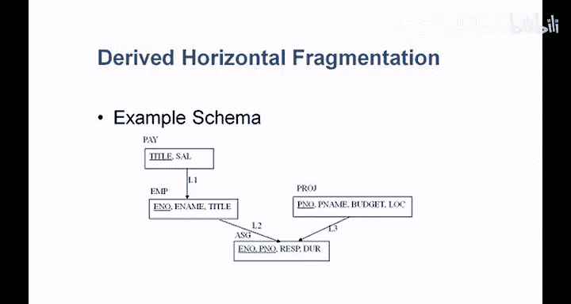
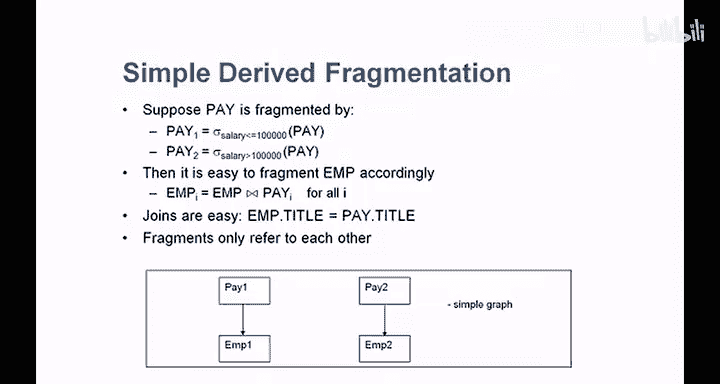
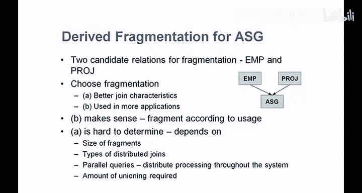
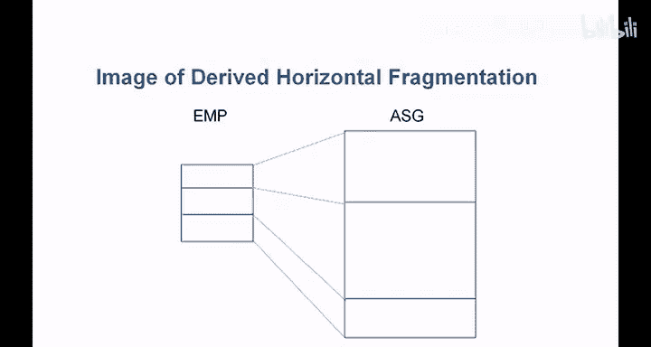
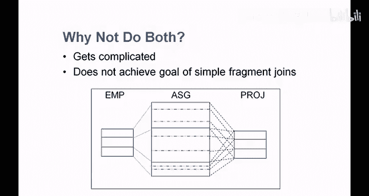
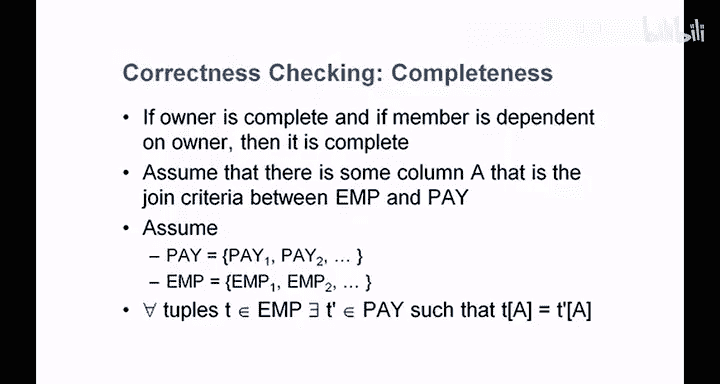
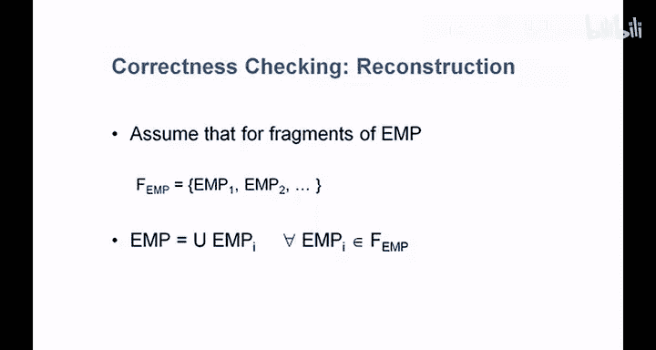

# 课程名称：大规模数据库系统 - 第13课：派生水平分片 📊

## 概述

在本节课中，我们将要学习**派生水平分片**的概念。这是一种在分布式数据库系统中，基于一个表的分片方式，自动推导并创建与其相关联的另一个表的分片策略。这种方法旨在优化查询性能，特别是减少跨数据库的联接操作。

---

## 1. 课程背景与示例模式

上一节我们介绍了水平分片的基本概念，本节中我们来看看一种特殊的水平分片策略——派生分片。

我们使用一个贯穿课程的“三元”模式作为示例。该模式包含以下关系：
*   **Pay** 表：包含 `title`（职位）和 `salary`（薪水）列。
*   **Employee** 表：包含 `employee number`（员工号）、`employee name`（员工姓名）和 `title`（职位）列。
*   **Assignment** 表：记录员工与项目的分配关系。
*   **Project** 表：项目信息。

它们之间的关系是：
*   `Pay` 和 `Employee` 之间存在**一对多**关系（一个薪酬等级对应多名员工）。
*   `Employee` 和 `Assignment` 之间存在**一对多**关系（一名员工可参与多个项目分配）。
*   `Project` 和 `Assignment` 之间也存在**一对多**关系（一个项目可有多个分配记录）。
*   `Assignment` 表的主键由 `employee` 和 `project` 组合构成，确保每个员工对特定项目的分配是唯一的。

---

## 2. 派生分片的基本原理

假设我们已经根据薪水对 `Pay` 表进行了水平分片，创建了两个片段：

*   **Fragment Pay1**: `σ salary ≤ 100,000 (Pay)`
*   **Fragment Pay2**: `σ salary > 100,000 (Pay)`

现在，我们将这两个分片分布到分布式数据库的不同节点上。

由于 `Employee` 表通过 `title` 列与 `Pay` 表关联（一对多关系），我们可以根据 `Pay` 表的分片来“派生”出 `Employee` 表的分片。具体方法是：将原始的 `Employee` 表分别与每个 `Pay` 片段进行联接（`JOIN`），联接结果就构成了 `Employee` 表对应的派生片段。

**核心操作公式**：
`Employee_i = Employee ⋈ Pay_i` （其中 `i` 为 1 或 2，代表 `Pay` 表的片段）

这样做的优势在于：当查询需要联接 `Pay` 和 `Employee` 表时（例如，查询某个薪水段的所有员工），数据库只需在**同一个节点**上对共存的 `Pay_i` 和 `Employee_i` 片段进行本地联接，无需进行代价高昂的跨节点（跨数据库）联接操作，从而极大地提升了查询效率。

因此，派生分片的策略是：让派生表（如 `Employee`）的分片方式与主表（如 `Pay`）保持一致，并将对应的片段放置在同一数据库节点上。

---

## 3. 处理多对多关系的派生分片

现在我们来处理一个更复杂的情况。请注意，`Assignment` 表同时位于两个一对多关系的“多”方：它既依赖于 `Employee`，也依赖于 `Project`。

假设 `Employee` 表和 `Project` 表都已经被分片。那么，`Assignment` 表应该根据哪一个来派生分片呢？这里有两个主要的考量因素：

以下是选择依据：

1.  **更好的联接特性**：评估哪种分片方式能带来更高效的联接。但这取决于许多动态因素，如片段大小、分布式联接算法、并行查询能力、所需的合并操作量等，难以预先精确计算。
2.  **更频繁的应用使用**：分析数据库应用程序的访问模式。如果大多数应用更频繁地联接 `Employee` 和 `Assignment` 表，而较少联接 `Project` 和 `Assignment` 表，那么根据 `Employee` 的分片来派生 `Assignment` 的分片就是更合理的选择，因为这能优化最常用的查询路径。

通常，**选择依据2（更频繁的应用使用）** 是更实际和可操作的策略。

---

## 4. 派生分片示例与分布

让我们看一个具体例子。假设 `Employee` 表被分成了三个水平片段（E1, E2, E3）。

如果我们决定根据 `Employee` 的分片来派生 `Assignment` 表的分片，那么：
*   `Employee` 的第一个片段（E1）会通过联接派生出 `Assignment` 的第一个片段（A1）。
*   `Employee` 的第二个片段（E2）派生出 `Assignment` 的第二个片段（A2）。
*   `Employee` 的第三个片段（E3）派生出 `Assignment` 的第三个片段（A3）。

在分布式部署时，`Employee` 的每个片段及其派生出的 `Assignment` 片段，将被放置到同一个数据库节点上。

---

## 5. 为何不进行双向派生？

你可能会问，为什么不同时根据 `Employee` 和 `Project` 两者来对 `Assignment` 进行派生分片呢？

这会导致问题迅速复杂化。假设 `Employee` 有3个片段，`Project` 也有3个片段。如果试图同时满足两者的派生关系，理论上 `Assignment` 表需要被分成 **3 × 3 = 9** 个片段。

这9个片段在分布式环境中很难有效放置。无论怎样分布，当进行 `Employee-Assignment` 或 `Project-Assignment` 联接时，都几乎不可避免地需要跨节点操作，这完全违背了我们通过派生分片来减少跨节点联接、提升性能的初衷。因此，双向派生通常不是个好主意。

---

## 6. 派生分片的正确性检验

最后，我们需要确保派生分片满足分布式数据库分片的三个正确性条件：

1.  **完备性**：如果被派生的“主”表（如 `Pay`）的分片是完备的（即所有数据都在某个片段中），并且成员表（如 `Employee`）依赖于主表，那么派生出的分片也是完备的。形式化地说，对于 `Employee` 中的每一个元组（行），在 `Pay` 表中都存在一个具有相同联接属性值的对应元组。
2.  **可重构性**：将所有派生片段（如 `Employee1`, `Employee2`, ...）进行**并集**操作，必须能够重构出完整的原始 `Employee` 表。即：`Employee = Employee1 ∪ Employee2 ∪ ...`
3.  **不相交性**：对于主表进行的**初级分片**，很容易通过分片谓词（如 `salary ≤ 100,000` 和 `salary > 100,000`）证明其片段互不重叠。对于**派生分片**，如果派生过程是基于简单的联接（如我们上面的例子），不相交性通常也能得到保证。但如果分片策略非常复杂或非派生，则需要仔细检查每个元组，确保它只出现在唯一的一个片段中，这通常比较困难。

---

## 总结

本节课中我们一起学习了**派生水平分片**。我们了解到，这是一种通过一个表（主表）的分片策略，自动确定与之关联的另一个表（成员表）分片方式的技术。其核心目标是**将需要频繁联接的数据保持在同一个数据库节点上**，从而最大限度地减少分布式查询中昂贵的跨节点联接操作。在选择派生依据时，应优先考虑**应用程序最常使用的联接路径**。同时，我们需要确保派生分片满足完备性、可重构性和不相交性的要求。