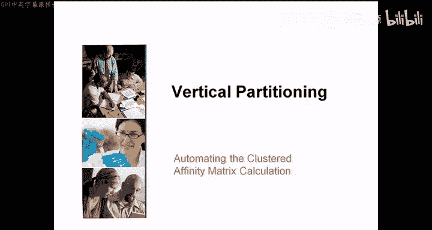
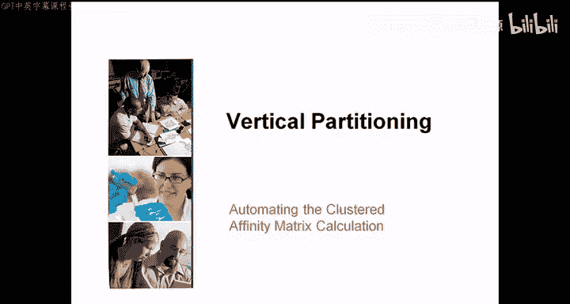
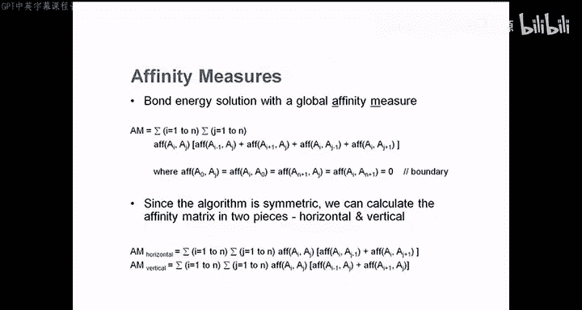
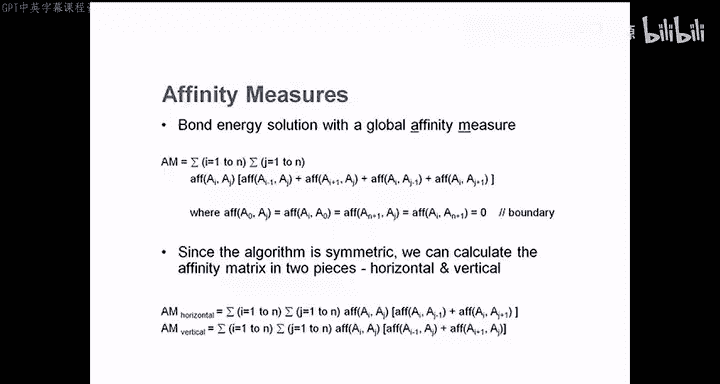
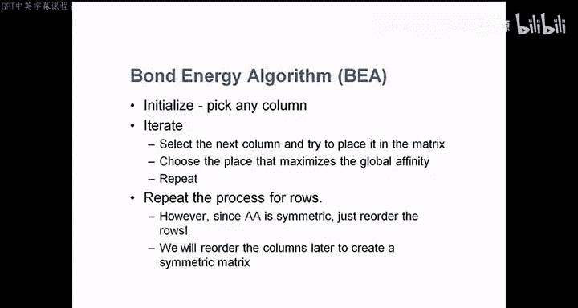
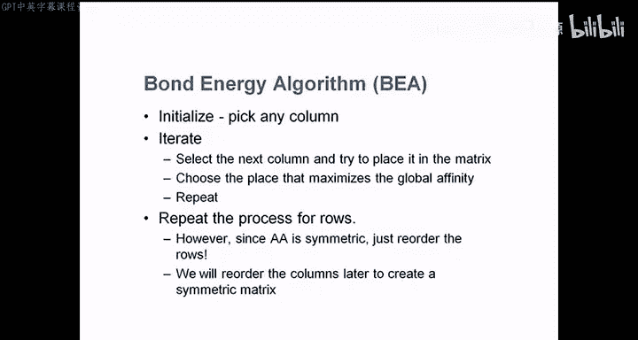
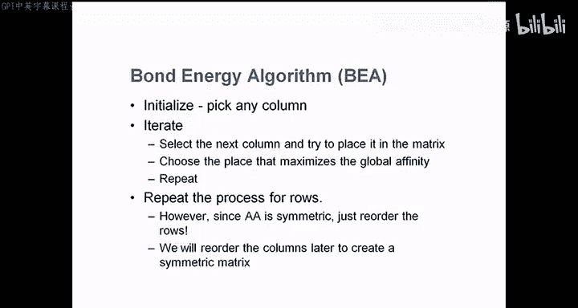
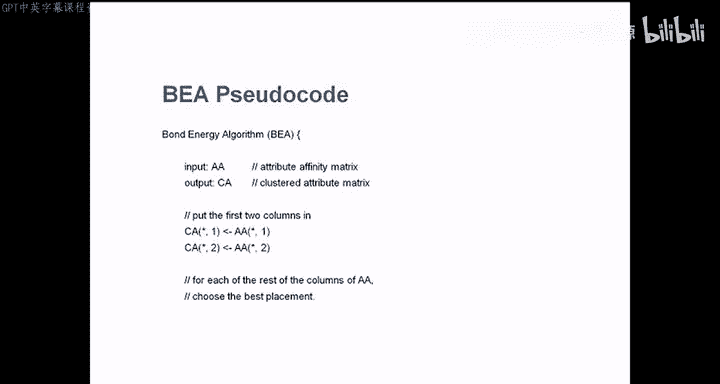
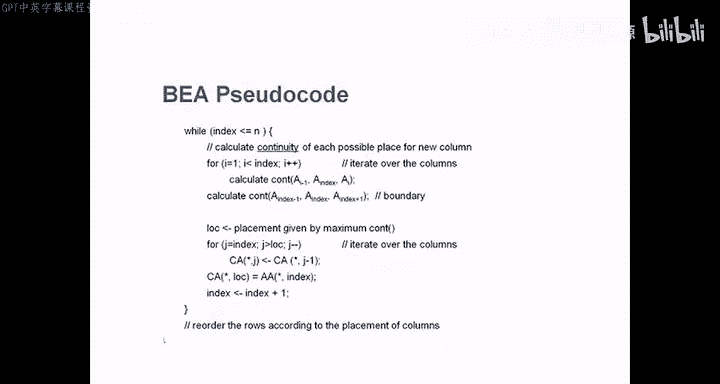

# 课程15：自动化聚类亲缘矩阵计算 🧮






在本节课中，我们将学习如何自动化地计算聚类亲缘矩阵。我们将深入理解全局亲缘度量的概念，并掌握邦德能量算法的具体步骤，该算法能帮助我们找到使矩阵整体亲缘度量最大化的列排列方式。

---

## 全局亲缘度量

上一节我们介绍了亲缘矩阵的基本概念，本节中我们来看看如何量化整个矩阵的“亲缘度”。

计算整个矩阵的邦德能量，实际上是在计算一个全局的亲缘度量，我们简称为 **AM**。

其计算公式如下：

```
AM = Σ_i Σ_j [ aff(i, j) * (aff(i-1, j) + aff(i+1, j) + aff(i, j-1) + aff(i, j+1)) ]
```

我们需要对矩阵中的每一个单元格（位置 `(i, j)`）进行计算。具体做法是：取该单元格的亲缘值 `aff(i, j)`，乘以它**北、南、东、西**四个邻居亲缘值的总和。



在计算时，需要注意边界条件：矩阵顶部、底部、左侧和右侧边界之外的亲缘值均视为 **0**。这意味着，如果一个单元格没有某个方向的邻居，则该邻居的亲缘值贡献为0。

---

## 计算的简化

由于矩阵具有对称性，我们不需要同时计算四个方向。我们可以选择只计算**南北方向**或**东西方向**的邻居，因为将矩阵沿对角线翻转后，这两种计算方式得到的全局亲缘度量值是相同的。

因此，公式可以简化为：



```
AM = Σ_i Σ_j [ aff(i, j) * (aff(i-1, j) + aff(i+1, j)) ]
```

或者等价地：

```
AM = Σ_i Σ_j [ aff(i, j) * (aff(i, j-1) + aff(i, j+1)) ]
```



选择其中一种方式计算即可。





---

## 邦德能量算法



理解了如何评估矩阵后，我们来看看如何通过算法自动找到最优的列排列。邦德能量算法的目标是找到能使全局亲缘度量 **AM** 最大化的列顺序。

以下是算法的核心步骤：

1.  **初始化**：从属性亲缘矩阵中，任意选择两列作为起始，放入聚类亲缘矩阵的前两列位置。
2.  **迭代放置剩余列**：对于尚未放置的每一列，尝试所有可能的插入位置。
3.  **评估每个位置**：对于每一个可能的插入位置（例如，放在最前、插入某两列之间、放在最后），计算此时整个矩阵的邦德能量（即全局亲缘度量 **AM**）。
4.  **选择最佳位置**：比较所有尝试位置计算出的邦德能量值，选择使能量值最大的那个位置，将该列插入。
5.  **重复迭代**：对剩余的每一列重复步骤2-4，直到所有列都被放置到矩阵中。
6.  **重排行**：最后，根据确定的列顺序，相应地重新排列矩阵的行，最终得到聚类亲缘矩阵。

---

## 总结



本节课中我们一起学习了自动化构建聚类亲缘矩阵的方法。我们首先定义了**全局亲缘度量（AM）** 的公式，它通过评估每个单元格与其邻居的关系来量化矩阵的整体结构。接着，我们详细介绍了**邦德能量算法**，该算法通过迭代地为每一列寻找最佳插入位置，最终得到一个邦德能量最大化的列排列，从而自动化地生成聚类亲缘矩阵。掌握这个算法是进行高效垂直分区的关键步骤。