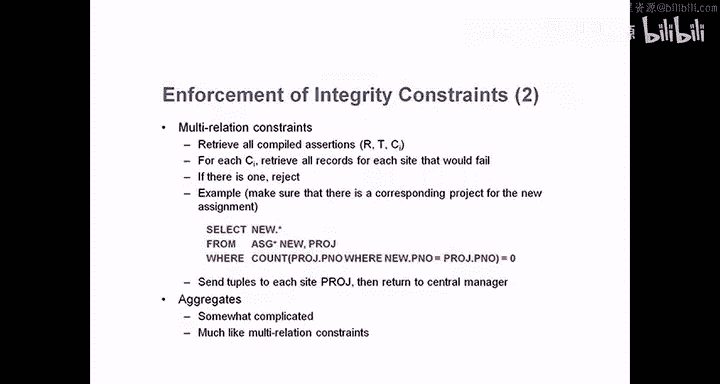

# 课程19：大规模数据库系统 - 实施分布式语义完整性 🔗

在本节课中，我们将要学习如何在分布式数据库系统中实施语义完整性约束。我们将探讨不同类型的约束，了解它们如何与数据分片交互，并学习在分布式环境下检查和强制执行这些约束的方法。

---

## 概述

语义完整性约束是确保数据库数据正确性和一致性的关键规则。在分布式系统中，由于数据被分割并存储在不同位置，实施这些约束变得更加复杂。本节将介绍三种主要的完整性约束类型，并解释如何在分布式环境中处理它们。

---

## 三种完整性约束类型

根据约束的范围和复杂性，我们可以将其分为三类。

### 1. 个体断言

上一节我们介绍了完整性约束的基本概念，本节中我们来看看第一种类型：个体断言。这种断言与一个表或与该表关联的分片一同被识别，并随分片被发送到每个站点。

以下是其实施要点：
*   检查是针对**谓词**和**数据**进行的。
*   这意味着需要检查这些分片是如何创建的，以及数据是否与这些断言一致。
*   此处假设我们已有一个现有数据库，现在正针对这些数据库（特别是此表）定义约束断言。
*   如果**谓词**在一个站点为假，则全局拒绝该谓词。
*   如果**数据**在一个站点不匹配，也全局拒绝该谓词。
*   即使尝试定义断言，我们也必须拒绝此断言，并声明该约束不再存在。

**具体示例**：
假设我们有一个员工表，按以下方式定义了三个分片：
*   **P1**：员工号在 0 到 300 之间的员工。
*   **P2**：员工号在 300 到 600 之间的员工。
*   **P3**：员工号大于 600 的员工。

如果尝试定义一个约束，规定 `员工号 < 400`（即永远不会出现员工号大于等于400的员工），并且已有现有数据，我们将检查每个分片。
*   对于分片1，此约束与数据及分片定义一致，定义此断言没有问题。
*   对于分片2，虽然与分片定义（员工号在300到600之间）一致，但如果该分片中已存在员工号大于等于400的数据，我们将拒绝此谓词和断言。
*   对于分片3，其定义就是为了包含员工号大于600的员工，这与约束直接矛盾，因此我们将全局拒绝此断言。

### 2. 面向集合的断言

个体断言主要关注单表内的约束，而面向集合的断言则稍微复杂一些。它们是多关系的，涉及至少一个连接谓词，并且这些断言与单个关系存储在一起。

以下是其实施要点：
*   这些断言存储在所有存储该关系分片的站点。
*   它们无法仅通过谓词测试，只能对数据进行测试。
*   实际上，在许多情况下，必须执行连接操作以测试其是否为真。

**具体示例**：
给定一个断言：只能插入新的`Assignment`（任务分配）行，如果存在对应的`Project`（项目）行。
在这种情况下，我们将根据半连接分片策略进行检查。我们稍后将更详细地讨论半连接算法，但此时假设我们已按以下方式定义`Assignment`：
根据`Project`的分片来定义`Assignment`的分片。如果`Project`表被水平分片成多个片段，那么我们将以相应方式对`Assignment`表进行分片，使得每个`Assignment`分片与其对应的`Project`分片位于同一站点。
因此，当想要向数据库添加此插入时，我们只需检查一个站点，确保任何新的`Assignment`行在对应的`Project`分片中有相应的项目。此检查期间不需要通信，因为我们假设`Assignment`的分片范围与`Project`的分片范围相同。这是一种**派生分片**。

**另一个示例**：
如果`Project`基于两个谓词进行水平分片：
*   第一个分片：项目号小于300的项目。
*   第二个分片：项目号大于等于300的项目。
那么，每个新的`Assignment`元组将与第一个或第二个`Project`分片进行比较。因此，每个新元组最多只会产生一次通信开销。

如果`Project`是基于与连接条件无关的`项目名称`进行水平分片的，而`Assignment`表并非按此方式分片，那么每个新的`Assignment`都需要与每个`Project`分片的每一行进行比较，因为我们最终不知道那些项目存在于何处。这实际上是一项相当复杂的检查。

### 3. 多关系约束与聚合

面向集合的断言涉及多个关系，而多关系约束则更进一步，它涉及多个关系并且通常包含一些聚合操作。

以下是其实施要点：
*   每个约束将检索每个站点上所有可能失败的记录。
*   如果有一个失败，我们将拒绝它。

**具体示例**：
假设我们定义了这个复杂约束，由 `SELECT ... FROM new_assignments, projects ...` 组成。我们想确保新项目有对应的项目存在。`COUNT` 是一个聚合操作，我们需要确保遵守此约束。
不幸的是，所有可能最终进入数据库的新元组都必须发送到每个包含`Project`分片的站点，并返回到中央管理器。如果有一个站点拒绝，或者它们全部拒绝，则约束被拒绝，插入被拒绝。否则，它将被接受。

聚合操作更为复杂。在某种意义上，这里的 `COUNT` 操作是一种聚合，非常复杂。因此，检查完整性约束的复杂性可以从简单到复杂不等，这取决于聚合约束的复杂性，以及一次测试中涉及的不同分片之间关系的复杂性。

---

## 如何强制执行完整性约束

了解了不同类型的约束后，我们来看看如何在实际操作中强制执行它们。

*   **通过个体断言**：这些断言与关系一起存储在站点。当我们进行更新时，会引发对站点上所有断言的差异更新（`R+` 和 `R-`）。站点将接受更新，如果它被任何一个断言拒绝，则将被拒绝。
*   **面向集合的断言**：这些稍微复杂一些。它们是同一表上的单关系约束，但是面向集合的，使用元组变量。例如，任何两个新员工必须遵守这样的约束：如果他们的员工号相同，那么他们的员工姓名最好也相同；或者，如果有一个员工号对应于表中已有的某个员工号，那么其姓名必须与表中该员工号对应的姓名一致。
系统将创建差异关系 `R+` 和 `R-` 并将其发送到每个站点，每个站点验证其是否为真。一旦有站点拒绝，全部或部分将被拒绝。
*   **多关系约束**：如前所述，这涉及多个关系的复杂约束，通常还包括一些聚合。每个约束会检索每个站点上所有会失败的记录。如果有一个失败，我们将拒绝它。

---

## 总结

本节课中我们一起学习了在分布式数据库系统中实施语义完整性约束的核心方法。我们探讨了三种主要约束类型：**个体断言**、**面向集合的断言**以及**多关系与聚合约束**，并分析了它们如何与数据分片交互以及在分布式环境下进行检查和强制执行的策略。关键在于理解，在数据分散存储的情况下，维护全局一致性需要协调各个站点，并根据约束的复杂性和数据分布模式，采用从本地检查到全局协调的不同技术手段。